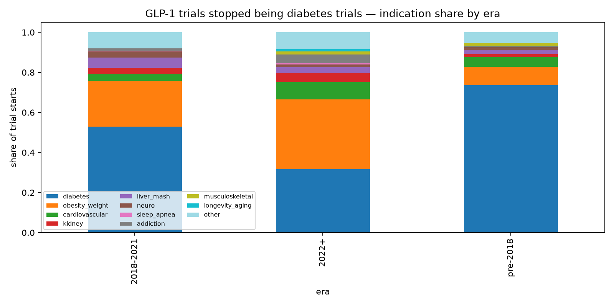
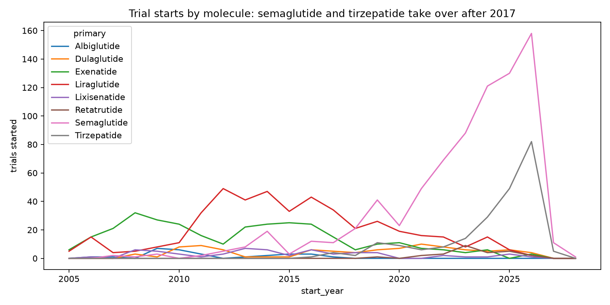
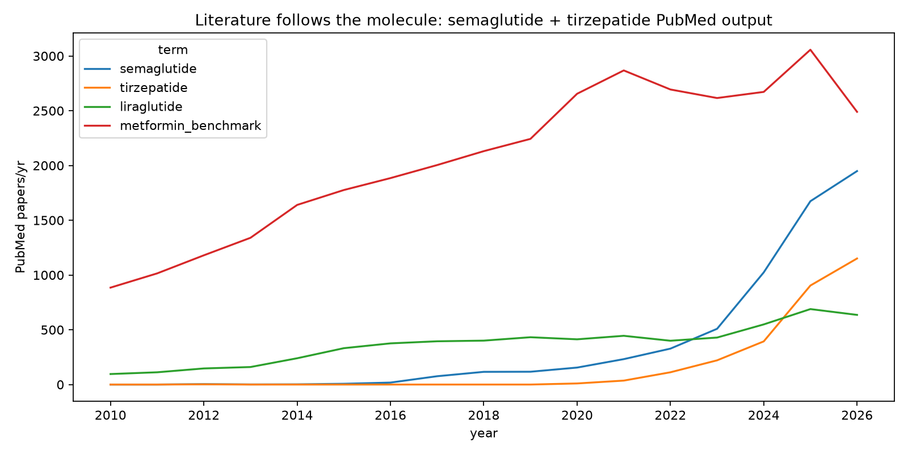
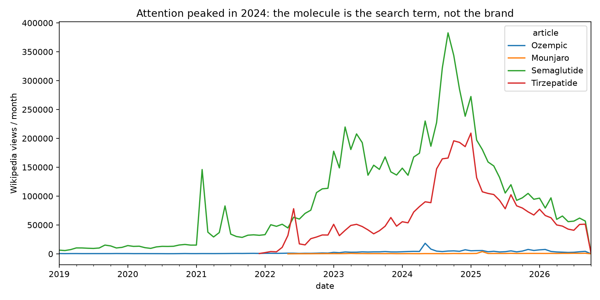
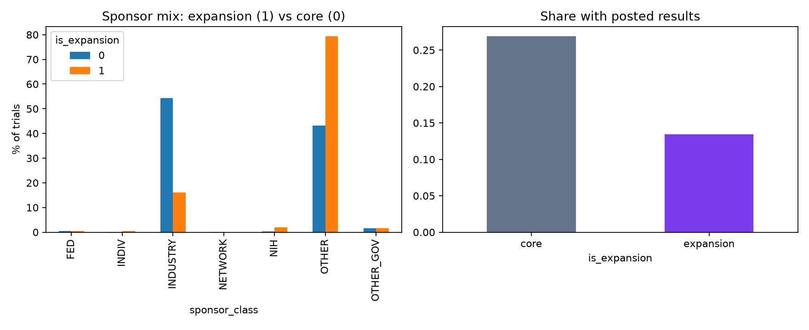
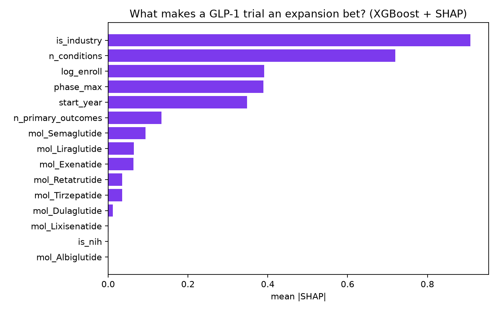
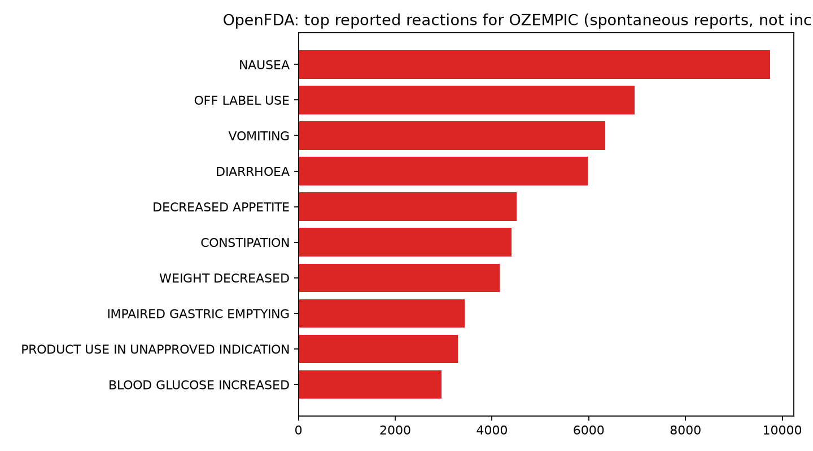

# Ozempic Ate Biohacking: One Drug Class Is Quietly Re-running the Entire Longevity Playbook

**Date:** 2026-10-11 · **Topic:** biohacking · Part of the [Daily builds](https://github.com/mzhou-ds/passion-projects) series — *Musing with Mike*

I know this drug the boring way: a refill, a pharmacy counter, a prior authorization that expired in June. Semaglutide is personal logistics before it is a headline. But step back from the counter and something stranger is happening. The biohacking stack I have audited twice in this series — the NMN, the rapamycin, the sauna protocols, the molecules with podcasts and no results — is being displaced by a single drug class that started as a diabetes treatment. GLP-1 receptor agonists are not one entry in the longevity conversation anymore. They are absorbing it, indication by indication, trial by trial.

So I measured the absorption. Every registered trial I could find for eight GLP-1 molecules — semaglutide, tirzepatide, liraglutide, dulaglutide, exenatide, lixisenatide, albiglutide, and the next-in-line retatrutide — 2,013 unique trials from ClinicalTrials.gov, each classified by what it is actually trying to treat. Then PubMed output by year, Wikipedia attention by month, and FDA spontaneous adverse-event reports by brand, to watch science, culture, and real-world use move at three different speeds.

## What I built

- `src/01_fetch_trials.py` — ClinicalTrials.gov API v2, eight molecules, paginated and de-duplicated by NCT number → `data/trials.csv` (2,013 trials)
- `src/02_fetch_pubmed.py` — yearly PubMed counts (title/abstract) per molecule plus metformin and creatine benchmarks via NCBI E-utilities → `data/pubmed_yearly.csv`
- `src/03_fetch_pageviews.py` — monthly Wikipedia pageviews, Jan 2019–Oct 2026, for the molecule and brand articles → `data/pageviews_monthly.csv`
- `src/04_fetch_openfda.py` — OpenFDA/FAERS report totals and top reactions for eight brands (Ozempic, Wegovy, Mounjaro, Zepbound, Rybelsus, Trulicity, Victoza, Saxenda) → `data/openfda.json`
- `src/05_analysis.py` — rule-based indication classification (diabetes, obesity/weight as the "core"; cardiovascular, kidney, liver/MASH, neuro, addiction, sleep apnea, musculoskeletal, longevity/aging as "expansion") → `data/trials_categorised.csv`, `data/summary.json`
- `src/06_model.py` — TF-IDF + KMeans (k=6) over trial conditions, and an XGBoost classifier with SHAP predicting whether a trial is an expansion bet, against a logistic baseline → `data/model.json`, `charts/shap_expansion.png`
- `src/07_charts.py` — the charts below → `charts/`

## Findings

**1. One in four GLP-1 trials is no longer about diabetes or weight at all.**
Expansion indications were 11.9% of trial starts before 2018, 16.5% in 2018–2021, and 25.2% of the 890 dated starts since 2022. The core didn't shrink — diabetes and obesity trials kept growing — but the frontier grew faster. This is the DoorDash pattern in a lab coat: win one dense market, then use the same logistics — here, the same molecule, manufacturing, and prescriber base — to enter every adjacent market at a fraction of the original cost.

**2. The breakout frontier is addiction, and longevity only exists as a category after 2022.**
Addiction trials (alcohol, nicotine, cannabis, opioid use disorders) went from 9 total before 2022 to 39 since 2022. Kidney went 13 starts pre-2018 to 39 since 2022; cardiovascular is the largest expansion bucket overall at 128 trials. And longevity/aging — trials whose registered condition is literally aging, frailty, or sarcopenia — went 0, 0, 11 across the three eras. A category of GLP-1 science that did not exist five years ago now includes microdosed-GLP-1 longevity studies and biological-age-clock endpoints. The biohacking wishlist is being run, but it's being run as registered trials by other people.

**3. The frontier is academia-led, not pharma-led — and that inverts the usual story.**
Industry sponsors 54.2% of non-expansion GLP-1 trials but only 16.1% of expansion trials. The expansion frontier is ~79% "other" sponsors, mostly universities and academic medical centres. Novo Nordisk and Eli Lilly run the enormous core-outcome trials; the Alzheimer's, addiction, and aging bets are investigator-initiated. An XGBoost model can tell an expansion trial from a core trial at registration with AUC 0.82 (a logistic baseline hits 0.83 — the signal is simple and structural, not subtle). SHAP's ranking: sponsor class is the single strongest tell, then number of listed conditions, enrollment, phase, and start year. Translation: if a university registers a small, recent, multi-condition GLP-1 trial, it is almost certainly a frontier bet.

**4. Culture peaked in 2024. The science is still compounding.**
Wikipedia attention for "Semaglutide" peaked in September 2024 at 382,789 views in a month and has fallen ~85% to ~57k by September 2026. Tirzepatide peaked in January 2025 at 209,131. Over the same window, PubMed output for semaglutide went from 76 papers in 2017 to 1,674 in 2025 — and semaglutide plus tirzepatide together (2,578 papers in 2025) are closing on metformin's 3,057, a molecule researchers have published on for decades. Trial starts rose from 73 in 2017 to 199 in 2025. The group chat moved on; the evidence base doubled twice. Also worth knowing: people search the molecule, not the brand. The Semaglutide article averages ~152k views a month since 2024 against Ozempic's ~5k — a 30× gap. "Ozempic" is television language. The internet's language is the generic name.

**5. The frontier's results are lagging its registrations.**
Among mature trials (started 2020 or earlier), expansion trials have posted results 24.8% of the time against 41.8% for core trials; mature neuro trials sit at 11.8%. This is the [evidence black hole from Build 2026-10-02](../../2026-10-02/evidence-black-hole/) wearing a new costume: the most exciting indications are exactly the ones where the readout discipline is weakest, because the sponsors are academics with no regulator forcing the upload. Price the Alzheimer's and addiction headlines accordingly.

**6. In the real world, "off-label" is already a top-three event.**
In FDA spontaneous reports for Ozempic (66,161 reports), "off label use" is the #2 reported term at 6,949, plus another 3,294 filed as "product use in unapproved indication." For Mounjaro, off-label use accounts for 7,711 of 91,059 reports. Nausea tops every brand's list, as expected. Spontaneous reports are not incidence rates — they count concern, not harm rates, and include duplicates — but as a demand signal they say plainly what the trial registry says politely: use has already expanded past the label, and the trials are the catch-up, not the leading edge.

**Bottom line:** biohacking spent a decade selling interventions with attention and no trials. GLP-1s are the mirror image: trials multiplying faster than attention, a frontier being explored mostly by universities, and a results-posting gap that means the boldest claims are the last to be verified. The smart position isn't hype or dismissal. It's watching which expansion categories start posting Phase 3 results — kidney and cardiovascular first, addiction as the dark horse — and discounting every frontier headline until its NCT number produces a readout.

## Charts









## Reproduce

```bash
pip install -r requirements.txt
python3 src/01_fetch_trials.py    # ClinicalTrials.gov API v2, ~1 min
python3 src/02_fetch_pubmed.py    # NCBI E-utilities, throttled, ~2 min
python3 src/03_fetch_pageviews.py # Wikimedia REST API
python3 src/04_fetch_openfda.py   # OpenFDA (no key; rate-limited)
python3 src/05_analysis.py
python3 src/06_model.py
python3 src/07_charts.py
```

## Caveats

- Indication categories are assigned by transparent keyword rules over registered conditions, with expansion categories taking priority over core ones (a diabetes trial in an Alzheimer's population counts as neuro). "Non-alcoholic" is stripped before the addiction rule fires, so NASH trials are not misread as alcohol trials. Rules are in `src/05_analysis.py` — argue with them there.
- Trial retrieval is intervention-name based (`query.intr`); combination products and brand-only registrations can be missed, so 2,013 is a floor, not a census.
- 637 registrations list start dates as year-month only; they are normalised to the first of the month. Trials with start dates in late 2026 and 2027 are registered future starts, included in year counts.
- The TF-IDF clustering is the weakest piece and is reported as such: condition language is so anchored to obesity and type 2 diabetes that only the kidney cluster (35 trials, 100% expansion) separates cleanly. That anchoring is itself reported in the model file rather than dressed up.
- FAERS/OpenFDA counts are spontaneous reports: duplicated, unverified, and driven by publicity as much as by events. They are used here only as a demand/off-label signal, never as risk rates. Brand totals for same-molecule products (Mounjaro/Zepbound) may share reports.
- PubMed 2026 counts include ahead-of-print and future-dated records as returned by the API on 2026-10-11; treat the 2026 bar as "already at least this large," not a final year total.
