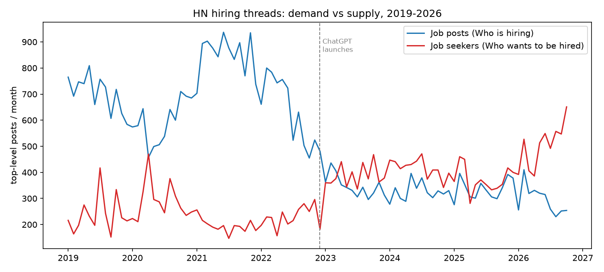
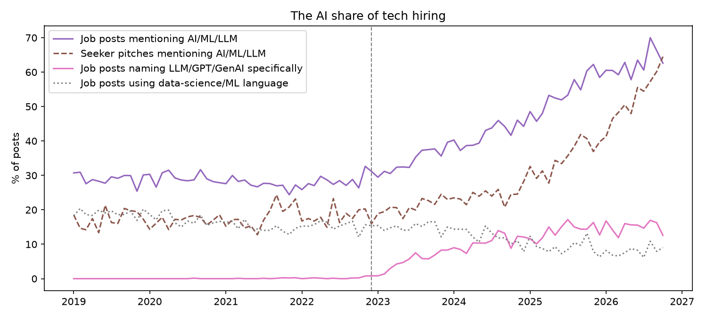
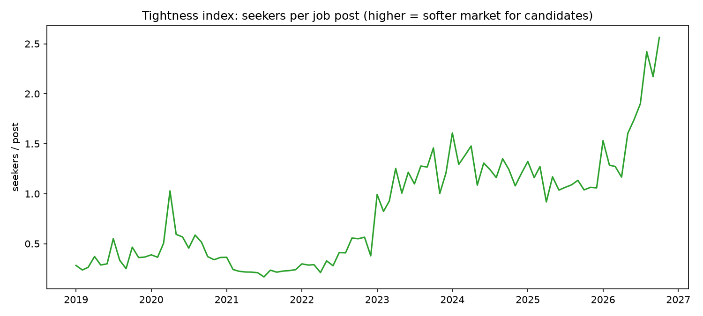
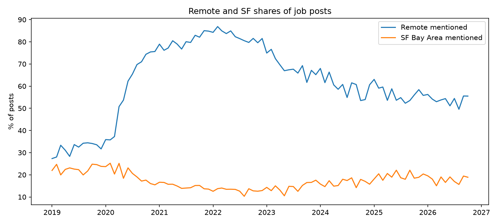
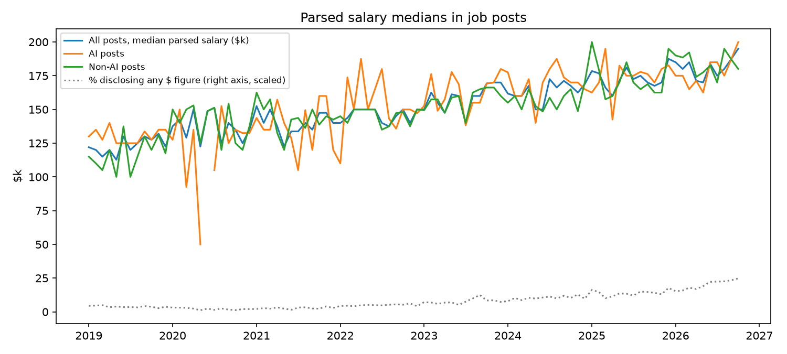
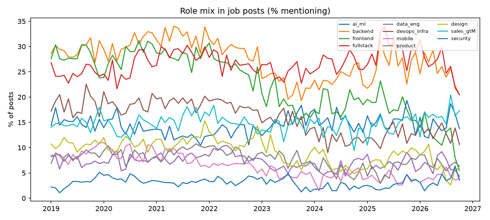
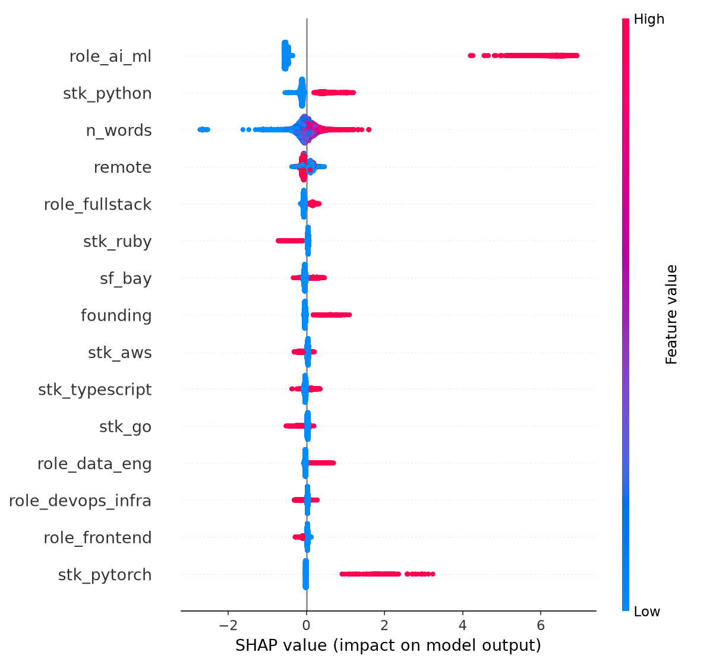

# AI Ate the Job Post: The Market for Tech Labor Flipped, Then Changed Its Name

**Date:** 2026-10-12 · **Topic:** tech-industry · Part of the [Daily builds](https://github.com/mzhou-ds/passion-projects) series — *Musing with Mike*

Every month since before I worked at Lyft, two threads have gone up on Hacker News on the first weekday of the month. In one, companies post jobs. In the other, people post themselves. "Ask HN: Who is hiring?" and "Ask HN: Who wants to be hired?" are the closest thing tech has to a continuous, public, unedited labor-market tape — no LinkedIn polish, no recruiter copy, just posters writing "Company | Role | Location" and hoping.

I pulled both threads for 94 straight months, January 2019 through October 2026: 48,426 job posts and 30,581 seeker pitches, top-level comments only. Then I classified every post — AI language, role, stack, remote, location, seniority, parsed salary figures — and built the two series against each other. What the tape shows is not the story either the AI bulls or the AI doomers are telling. The market didn't just shrink and it didn't just pivot. It flipped from the tightest candidate market in memory to a crowded one, and *while it was flipping*, the product being hired for changed its name.

## What I built

- `src/01_fetch.py` — Algolia HN API: finds the monthly `whoishiring` threads and pulls every top-level comment from both thread types → `data/posts_hiring.csv` (48,426), `data/posts_seekers.csv` (30,581)
- `src/02_analysis.py` — transparent keyword classification (AI language, 11 role families, 13 stack signals, remote/SF/founding/senior flags, regex-parsed salary ranges) → `data/posts_*_classified.csv`, `data/timeseries.csv`, `data/summary.json`
- `src/03_model.py` — TF-IDF + KMeans (k=6) posting archetypes on 15,079 posts from 2023 on, and an XGBoost classifier with SHAP predicting whether a post is an AI post from structural features alone, against a logistic baseline → `data/model.json`, `charts/shap_ai_post.png`
- `src/04_charts.py` — the charts below → `charts/`

## Findings

**1. The tightness flip is the biggest number in the tape.**
In June 2021, the peak month, 937 companies posted jobs and 196 people posted pitches: 0.21 seekers per job post, roughly five open posts chasing every public candidate. By the last three months of this series that ratio is 2.39 seekers per post, and October 2026 printed 2.56. That is an eleven-fold swing in who holds the leverage, measured in the same venue with the same format. Job posts per month fell from 851 on average in 2021 to about 295 in 2026 — but seeker pitches *tripled* off their lows. The pain isn't only that there are fewer posts. It's that the other side of the marketplace refilled. Anyone who has run a two-sided market knows which side you'd rather be standing on, and it switched.

**2. "AI" didn't grow — it replaced. The old vocabulary is dying in the same posts.**
A broad AI/ML mention share sat flat at 27–29% of job posts for four straight years, 2019 through 2022. Then it went 34%, 42%, 54%, and 62% across 2023–2026, hitting 66% over the last three months. But look at the composition, because that's the actual story. The bare word "AI" went from 7.8% of posts in 2019 to 54.3% in 2026. Over the same span, "data science" collapsed from 10.9% to 3.5%, "machine learning" from 11.0% to 4.2%, and "deep learning" halved. Meanwhile the specifically LLM-era vocabulary — LLM, GPT, generative AI — went from literally 0.0% of posts through 2022 to 15.0% in 2026. This is a rebranding with a real technology change inside it: the 2019 ML team that did recommendations and fraud models got absorbed into a 2026 post that just says "AI," and the job is now as likely to be about agents and evals as models. Same budget line, new name, different work.

**3. The poster changed: from scale-ups hiring classes of engineers to founders hiring one.**
Posts mentioning "founding" went from 1.6% of all job posts in 2019 to 11.5% in 2026 — a seven-fold rise. Senior-plus language (senior, staff, principal, lead) climbed from 42% to 54%. Put those together with the volume collapse and a picture forms: the median HN job post is no longer a growth-stage company hiring a cohort; it's an early-stage, usually AI, company hiring one expensive senior generalist. The KMeans clustering says the same thing in its own language — of the six posting archetypes since 2023, exactly one is 100% AI (2,229 posts: "ai, engineer, founding, building, product"), with the highest-but-one salary median at $185k and the *lowest* remote share at 51%. The archetypal new tech job is a founding AI engineer, in person, paid like it.

**4. Remote peaked, partially reverted, and the center of gravity drifted back to San Francisco.**
Remote mentions went 32% (2019) → 83% (2022) → 54% (2026). SF Bay Area mentions bottomed at 13% in 2022 and recovered to about 18–20% by 2025–26. The partial reversion lines up with the archetype above: founding-stage AI companies are the ones insisting on a room. Remote didn't die; it stopped being the default and became a feature of the older archetypes — the generic full-stack post still runs ~74% remote.

**5. You can now read salaries in the tape, and the visible market pays more.**
Only 3.9% of posts disclosed any dollar figure in 2019. By 2026 it's 19.7% — pay-transparency laws plus norms did that. Among posts that disclose, the median parsed midpoint rose from $125k to about $182k. Treat that carefully: disclosure is selected, and who's disclosing changed (the AI archetype discloses at the same rate as everyone else and posts a median around $175k, vs $170k for non-AI posts since 2024 — the AI wage premium in *posted* numbers is real but single-digit, not the 2× of the anecdotes). An XGBoost model can spot an AI post from structural features alone — stack, role words, founding, seniority, length — at AUC 0.83 against a 0.80 logistic baseline. The signal is mostly the vocabulary of the new stack (LLM tooling, PyTorch, TypeScript) plus the founding flag: AI posts are structurally different postings, not regular postings with a buzzword stapled on.

**6. The stack rotated quietly underneath the headline.**
TypeScript mentions more than doubled, 10% → 24%. Rust nearly tripled, 3.2% → 8.7%. Java fell from 10.7% to 3.5%, Ruby/Rails from 11.6% to 5.2%, React eased from 31% to 24%, and Python — the language everyone assumed AI would crown — stayed dead flat at about 25–26% the whole eight years. The AI era's stack story isn't Python eating everything. It's TypeScript moving up-stack into the AI product layer while the enterprise languages of the 2010s fade out of the startup tape entirely.

**Bottom line:** read as a marketplace, the HN tape says the tech labor market did two things at once that are easy to confuse. It loosened — eleven-fold, by the seekers-per-post ratio — and it renamed itself, with "AI" absorbing the data-science and ML vocabulary almost completely inside four years. The operator's takeaways are unglamorous: if you're hiring, your leverage is historically high but the candidates have repriced around senior, founding-shaped roles; if you're looking, you're not competing for the 2021 job at all — that posting archetype is gone, and the one replacing it wants one senior person, in San Francisco, building the AI product, at $175–185k posted. Plan for the market that's on the tape, not the one in memory.

## Charts









## Reproduce

```bash
pip install -r requirements.txt
python3 src/01_fetch.py   # Algolia HN API, no key, ~7 min for 188 threads
python3 src/02_analysis.py
python3 src/03_model.py
python3 src/04_charts.py
```

## Caveats

- HN's hiring threads skew to startups and smaller companies, English-speaking and US-heavy. This is the startup tape, not BLS data — but it's the same venue and format for 94 months, which is what makes the *changes* legible.
- Classification is keyword-based and reported as such. The broad AI measure deliberately includes the pre-LLM vocabulary (data science, machine learning) so the 2019–2022 baseline is honest; the LLM-specific and bare-"AI" series are reported separately so the vocabulary swap can't hide inside the headline.
- Salary parsing reads dollar figures in post text; some are ranges for non-US or contract roles, and disclosure is self-selected. Medians are medians of *disclosing* posts only, and the disclosure rate itself rose 5× over the series.
- "Seeker" counts are people who chose to publicly pitch in a given month, not unemployment. The ratio is a tightness proxy for this venue, not a labor statistic.
- The clustering is the weakest piece, as usual: most posts link out to job boards, so four of six archetypes are "generic post with a link" variants that differ mainly in remote share and salary. Only the pure-AI founding archetype separates cleanly — which is itself the finding.
