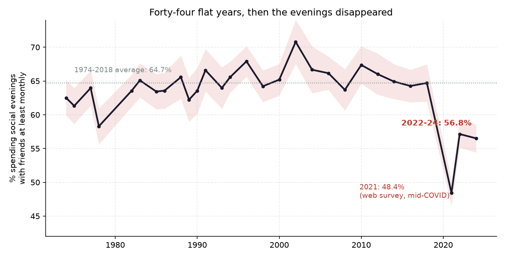
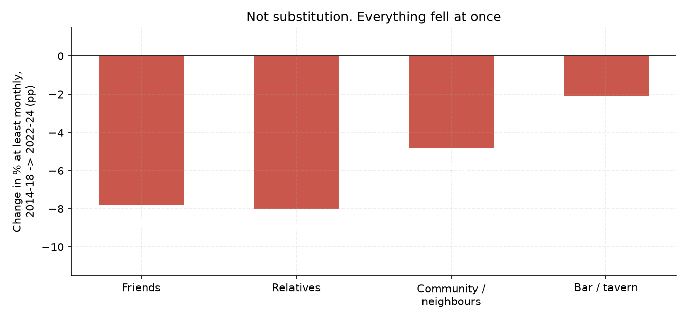
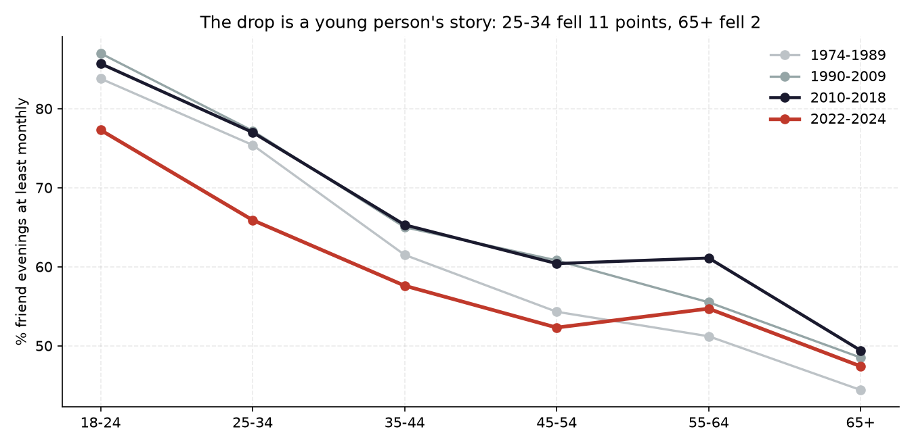
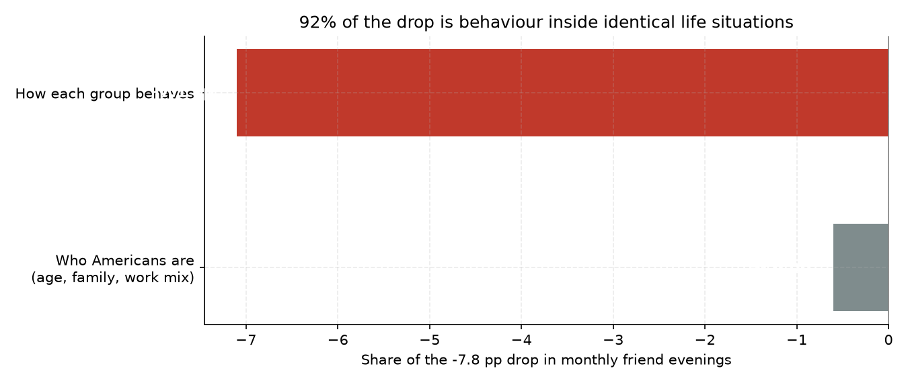
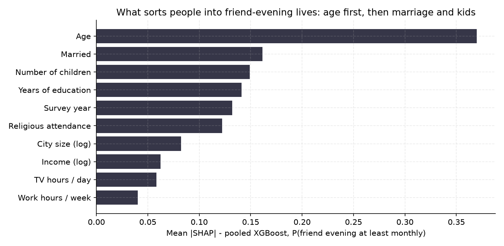
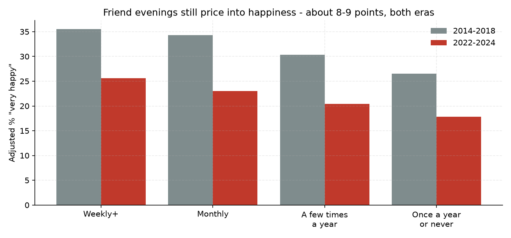
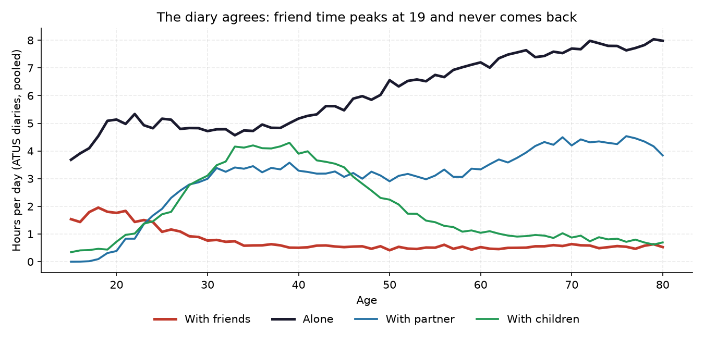
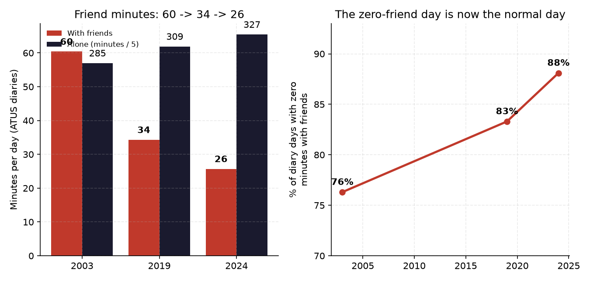

# The evenings disappeared

**Friendship did not slowly fade for fifty years. It held steady for forty-four, then fell off a cliff in about four.**
*Musing with Mike · 2026-10-14 · Topic: relationships*

Every few years someone writes the loneliness essay. The story goes that Americans have been drifting apart since the bowling leagues emptied out, a slow fifty-year slide into isolation. I believed that story too, until I ran the longest-running social survey in the country year by year.

The slide is not in the data. What is in the data is a flat line, four decades long, and then a break. Social life in America did not decay. It held, and held, and then something snapped around the pandemic years, and the part that snapped has not come back.

**Interactive version:** open `site/index.html`, pick a life profile (age, relationship, kids, work, sex), and see how often people in that exact situation spent evenings with friends in the 2014-2018 world versus the 2022-2024 world.

## What I built

| # | Question | Data | Script |
|---|----------|------|--------|
| 1 | Did social evenings really decline slowly since the 1970s? | GSS cumulative file 1972-2024, 45,294 adults with valid social-evening answers, survey-weighted | `src/02_analysis.py` §1 |
| 2 | Who lost their evenings, and which kinds of evenings went? | Same file: evenings with friends, relatives, community/neighbours, and at bars, by age, marital status, era | `src/02_analysis.py` §2-3 |
| 3 | Is the drop just demographics (older, more single, fewer married)? | Oaxaca-Blinder style decomposition over 132 life-situation cells | `src/02_analysis.py` §4 |
| 4 | Would a model trained on the old world see the new one coming? | XGBoost + SHAP trained on 1974-2018, scored untouched on 2022-2024; pooled SHAP for what sorts people socially | `src/03_model.py` A-B |
| 5 | Do friend evenings still buy happiness, and did marriage fall off the same cliff? | GSS happiness and marital-happiness items, g-computation adjusted contrasts by era | `src/02_analysis.py` §5, `src/03_model.py` C |
| 6 | Does a completely different instrument agree, and on what clock? | ATUS respondent microdata 2003 / 2019 / 2024 (BLS companion-minutes series, 37,824 diaries) plus the pooled ATUS age extract (Our World in Data) | `src/05_atus.py`, `src/04_charts.py` chart 6 |

Reproduce: `python3 src/01_fetch.py && python3 src/02_analysis.py && python3 src/03_model.py && python3 src/04_charts.py`. Step 1 re-downloads the GSS cumulative file (via the `gssr` mirror) and the ATUS extract, and rebuilds the 48-variable GSS extract with the included R script. Without R it keeps the committed extract.

## Findings

**1. The flat line is the finding.** From 1974 to 2018, the share of American adults who spent a social evening with friends at least once a month barely moved: individual surveys bounce between 58% and 71%, and the 44-year average is 64.7%. In 2014-2018 it was 64.6%. Whatever was supposed to be killing friendship for fifty years, it was not showing up in the evenings. Then: 48.4% in the 2021 survey (taken by web, mid-COVID, so treat it as a floor, not a point estimate), 57.1% in 2022, 56.5% in 2024. The pooled 2022-2024 rate is 56.8%, down 7.8 points from 2014-2018, with a standard error under a point. The share who say they *never* spend a social evening with friends rose from 8.5% to 12.7%. Half again as many friendless evenings, in one step.



**2. Nobody substituted. Everything fell at once.** If people had traded friends for family, relatives' evenings would be up. They fell the most in volume terms: evenings with relatives went from about 6.2 a month to 5.2 (down 17%), and the at-least-monthly share fell 8.0 points, slightly more than friends. Community and neighbour evenings fell 4.8 points. Bar evenings fell least in share (down 2.1 points) only because they were already rare. This was not a reshuffle of the social portfolio. The whole book shrank.



**3. It is a young person's drop, and a single person's drop.** By age, comparing 2010-2018 to 2022-2024: ages 25-34 lost 11.1 points of monthly friend evenings (77% down to about 65%). Ages 18-24 lost 8.4. Ages 65 and over lost 2.0. The group the culture pictures as lonely, older adults, kept their evenings. The group that lost them is the group that used to have the most. By marital status, comparing 2014-2018 to 2022-2024: never-married adults lost 13.7 points, separated adults 14.3, divorced adults 9.6, married adults 5.5, widowed adults 1.1. The people whose social lives ran through friends rather than a spouse are exactly the people whose evenings disappeared.



**4. It is not demographics. It is behaviour inside identical lives.** The standard rebuttal writes itself: the country got older, marriage fell, so of course friend evenings fell. I decomposed the drop across 132 cells defined by age band, sex, marital status, kids, and employment. Give the 2022-2024 population its new mix of life situations but keep each cell behaving the way it did in 2014-2018, and you explain 0.6 of the 7.8 points. The other 7.1 points, 92% of the drop, happen *inside* the cells: a married 40-year-old with kids and a job in 2024 simply sees friends less than the identical profile did in 2016. Composition is the alibi. It does not hold.



**5. A model trained on the old world cannot see the new one.** I trained an XGBoost classifier on 1974-2018 (30,448 respondents) to predict who spends monthly evenings with friends, using age, marriage, kids, education, work, TV hours, church attendance, income, and city size. On a held-out slice of the old world it scores an AUC of 0.708, decent for survey data. Scored untouched on 2022-2024, two things break. Discrimination slips to 0.622, and calibration breaks outright: it predicts 63.2% of the new respondents should be monthly friend-evening people; the real number is 56.8%. A 6.3-point overprediction is the behaviour change expressed in model units. Any business whose demand model for social occasions was fit before 2020 is carrying the same bug.

The pooled SHAP ranking is its own small story. Age dominates (mean |SHAP| 0.37, correlation -0.92: friend evenings are a young person's good, full stop). Then being married (0.16), number of children (0.15), education (0.14), survey year itself (0.13, correlation -0.52), and religious attendance (0.12, the one institution that still manufactures recurring evenings). TV hours sit lower in importance but point the expected way (SHAP correlation -0.64): the more of the day goes to a screen, the fewer evenings go to people.



**6. The evenings still pay. Fewer people are collecting.** Adjusted for age, marital status, health, income, education, and kids (logistic model, g-computation), adults with weekly friend evenings were "very happy" at 35.5% in 2014-2018 versus 26.5% for those who see friends once a year or never: a 9.0-point gap. In 2022-2024 the same adjusted gap is 7.8 points (25.6% vs 17.8%). Two honest readings follow. First, the return on a friend evening did not collapse; if anything it held while overall happiness fell for everyone. Second, this is cross-sectional and the arrow runs both ways: happy people go out more. Treat the gap as the price of admission to a correlation nobody has randomised, not a treatment effect. Meanwhile marital happiness did not fall off any cliff: "very happy" marriages went from 66.8% in the 1970s to 61.3% in 2014-2018 to 60.0% in 2022-2024, a slow leak, not a break. The institution bent. The informal network snapped.



**7. The diaries add the shape of a life.** The GSS asks how often; the American Time Use Survey asks people to reconstruct yesterday, hour by hour, and say who was there. In the pooled ATUS extract, time with friends peaks at age 18 (about 2.0 hours a day) and halves by 25 (1.1 hours), then halves again by 40 (0.5 hours), where it stays for life. Time alone does the opposite, climbing from 3.7 hours at 15 to about 8.0 at 80. Partner time is the shock absorber: it rises to roughly 3.9 hours a day in the sixties and holds even at 80. Friend time was always the discretionary line in the budget, the first one cut and the one no institution refills automatically. Partner and kid time have contracts and calendars. Friend time has intentions.



**8. Two instruments, two clocks, and the second clock is worse.** BLS ships precomputed companion minutes on the ATUS respondent file, so I could run the diaries as a trend: 2003 versus 2019 versus 2024, 37,824 diaries, weighted. Minutes per day spent with friends: 60.4 in 2003, 34.3 in 2019, 25.7 in 2024. Down 43% before COVID ever arrived, then another 25% after. Minutes alone went the other way: 284.8, 309.4, 327.1, a gain of 42 minutes a day across two decades. Partner minutes barely moved (175.8 to 169.8). And the share of diary days containing zero minutes with friends went from 76.3% to 83.3% to 88.1%. On a typical day in 2024, almost nine in ten Americans never spend a minute with a friend.

So which is it, a cliff or a slide? Both, because the instruments measure different things. The GSS counts deliberate social evenings, the ritual: dinner, drinks, people coming over on purpose. That held for 44 years and then broke after 2018. The diaries count every friend minute, most of which was never deliberate at all: the coworker who was also a friend, the neighbour on the step, the hour after class. That incidental layer has been thinning since at least 2003, through the smartphone era and the remote-work era, and singles show it worst (friend minutes for adults with no partner in the household: 104 a day in 2003, 51 in 2019, 37 in 2024). The deliberate ritual was the last part standing. Then it went too. What disappeared first was the friend time you never had to plan. What disappeared after 2018 is the friend time you did.



## The operator takeaway

Evenings are a market. Roughly two-thirds of adults used to show up to it monthly, reliably, for four decades, and businesses priced that in without ever seeing the number: restaurants built for groups, bars, leagues, churches, gyms with classes, every third place that monetised people seeing each other on purpose. The diary data says the wider market for friend time has been eroding for twenty years (down 57% in minutes since 2003), and the deliberate-evening segment, the part that books tables and buys tickets, stepped down about 8 points in the last four years, concentrated in exactly the customers those businesses count on most, single adults under 35. Both moves are behavioural, which means neither mean-reverts on its own.

Two implications I would actually act on. First, any forecast of social-occasion demand fit on pre-2020 data is biased high by roughly the 6 points my little model missed by; re-fit on 2022 forward or haircut it. Second, the scarce asset is no longer the venue or the match. It is the recurring slot. The one social technology in the data that never broke is the standing commitment: the weekly game, the standing dinner, the group chat with a date attached. Attendance at religious services is the sixth-strongest sorter in the SHAP ranking precisely because it is a recurring evening with a default. Products and communities that manufacture defaults (fixed cadence, same people, opt-out rather than opt-in) are selling the thing the market just lost.

I run my own version of this. Thirteen recurring calendar nudges to keep in touch with friends, monthly for most, weekly for two. It felt slightly mechanical when I set it up. After this data, it reads less like a quirk and more like the whole point: the evenings do not survive on intentions. They survive on defaults.

## Caveats

- **The 2021 survey is not comparable.** GSS 2021 was fielded by web during COVID, with no face-to-face interviewing; its 48.4% mixes a real lockdown effect with a mode effect. The headline comparison therefore uses 2022-2024 against 2014-2018 and treats 2021 as a flagged outlier. Mode differences between the multimode 2022/2024 surveys and earlier face-to-face years can shift sensitive answers, though "how often do you see friends" is about as non-sensitive as items get, and the drop persists across both post years and is largest exactly where a real change would put it (young, single). Read the true break as "somewhere between 2018 and 2022, size roughly 6 to 9 points," not as a precise 7.8.
- **The evenings-per-month mapping is an approximation.** The headline metric (at least monthly) is read straight off the answer categories. The evenings-per-month figures map categories to counts (almost daily = 20, several times a week = 10, several times a month = 3, once a month = 1, several times a year = 0.42, once a year = 0.08, never = 0). Different reasonable mappings move the levels, not the direction or the ranking across groups.
- **Cross-sectional, not panel.** The GSS re-interviews nobody. "Behaviour change inside cells" means people in the same measured situation answer differently across years; unmeasured changes inside cells (say, remote work share within employed parents) load onto the behaviour term. The decomposition says the drop is not the *measured* demographics. It cannot rule out every unmeasured compositional shift.
- **Happiness is associational.** Finding 6 adjusts for the standard demographics and health; it does not identify causation in either direction.
- **ATUS companion minutes have a specific definition.** The TRT series on the respondent file counts minutes with each companion over activities where "who was with you" is collected; sleeping, personal care, and a few other activities are excluded by design, and the companion categories overlap (an hour with your spouse and kids counts toward both), except "alone," which is exclusive. Levels therefore are not shares of the 24-hour day. The age-curve extract (finding 7) is pooled across diary years for single-year-of-age precision; the trend (finding 8) uses the 2003, 2019, and 2024 respondent files only, so it cannot date changes inside those intervals, and 2003 ATUS had a larger sample and slightly different field procedures than later years.
- Weights are the GSS `wtssall` series as shipped in the cumulative file; standard errors use effective sample size and ignore strata/PSU design effects, so they are mildly optimistic. With a 7.8-point gap and SEs under a point, the conclusion does not turn on it.

## Sources

- Smith, Tom W., Davern, Michael, Freese, Jeremy, and Morgan, Stephen, *General Social Surveys, 1972-2024* [machine-readable data file]. Principal investigator Tom W. Smith; co-principal investigators Michael Davern, Jeremy Freese, and Stephen Morgan. Chicago: NORC at the University of Chicago. Cumulative cross-section file, accessed via Kieran Healy's `gssr` data mirror (github.com/kjhealy/gssr). Social-evening items SOCFRED, SOCREL, SOCBAR, SOCOMMUN; happiness HAPPY; marital happiness HAPMAR.
- U.S. Bureau of Labor Statistics, *American Time Use Survey* respondent microdata files for 2003, 2019, and 2024 (`atusresp_2003.zip` with an underscore in the 2003 filename, `atusresp-2019.zip`, `atusresp-2024.zip` from bls.gov/tus/datafiles), companion-minutes series TRTALONE / TRTFRIEND / TRTSPOUSE / TRTUNMPART / TRTCHILD / TRTFAMILY, final weight TUFINLWGT. Age-curve shape: the same survey as extracted by Our World in Data ("time spent with relationships by age", grapher series `time-spent-with-relationships-by-age-us`).
- Rosenfeld et al.'s HCMST work powered a previous build in this repo (`2026-10-05/love-is-a-channel`); this one deliberately uses a different instrument (reported frequency plus time diaries instead of couple histories).

## Layout

```
the-evenings-disappeared/
├── src/
│   ├── 01_fetch.py       # GSS cumulative (.rda via gssr) + OWID/ATUS extract
│   ├── extract_gss.R     # 48-variable extract of the cumulative file
│   ├── 02_analysis.py    # weighted series, age/marital cuts, decomposition, happiness
│   ├── 03_model.py       # temporal XGBoost test, SHAP, adjusted happiness, site grid
│   ├── 04_charts.py      # GSS + age-curve figures
│   └── 05_atus.py        # ATUS respondent microdata: extract, diary trend, chart
├── data/                 # gss_extract.csv, atus_respondent_extract.csv, findings.json,
│                         # model.json, year_series.csv, age_era.csv, atus_trend.csv,
│                         # marital_substitution.csv, shap_importance.csv, site_grid.csv,
│                         # atus_time_by_age_owid.csv (raw ATUS .dat files not committed)
├── charts/               # the_cliff, age_drop, everything_fell, decomposition,
│                         # shap_bar, happiness_penalty, atus_age_curve, atus_trend
└── site/
    ├── index.html        # profile explorer: your evenings, old world vs new world
    └── data.js           # 132-cell empirical grid (generated by 03_model.py)
```
