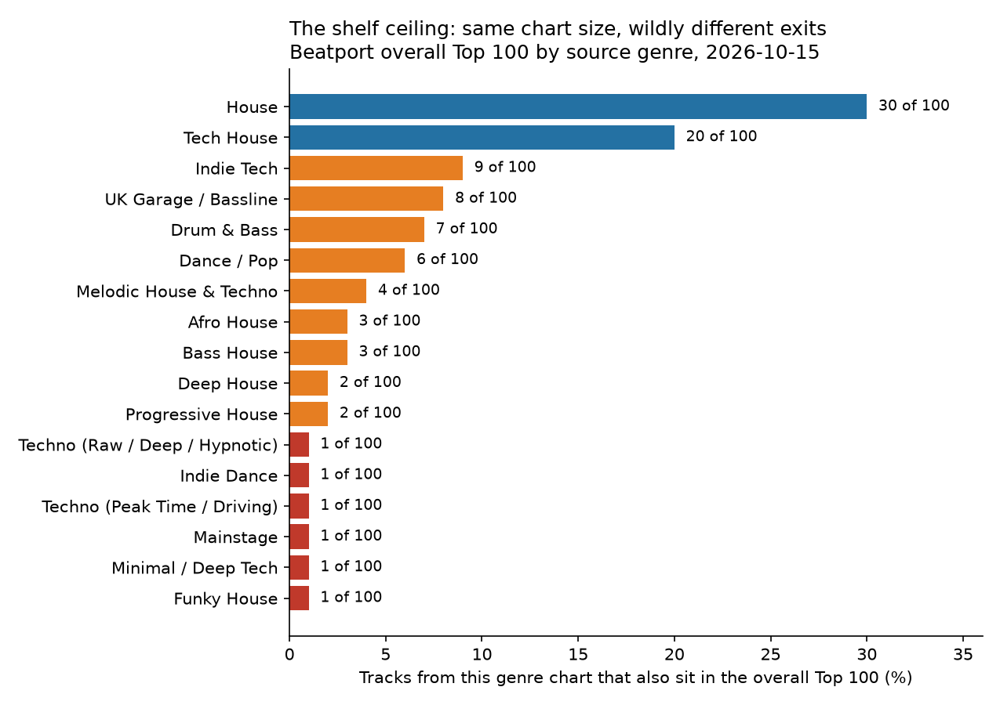
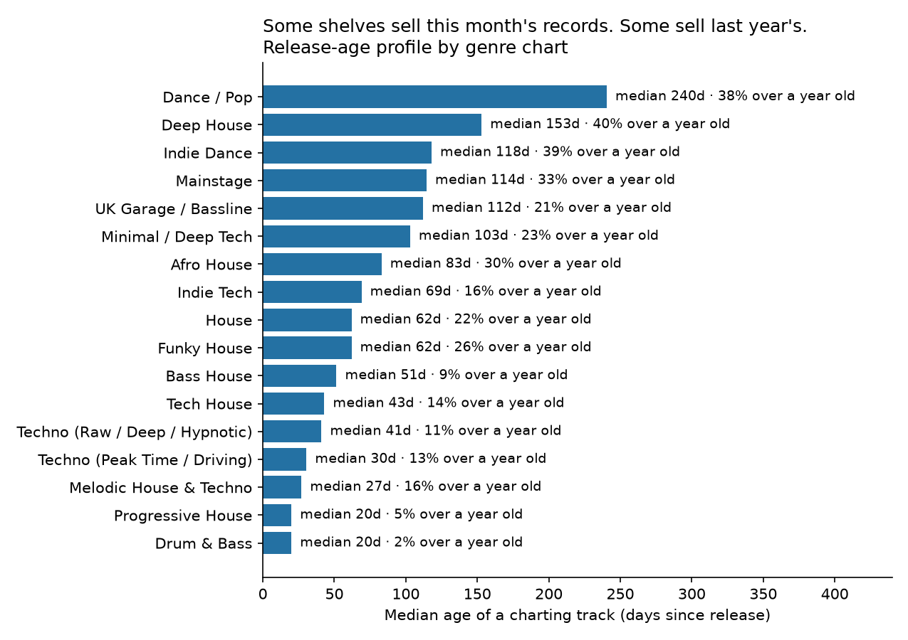
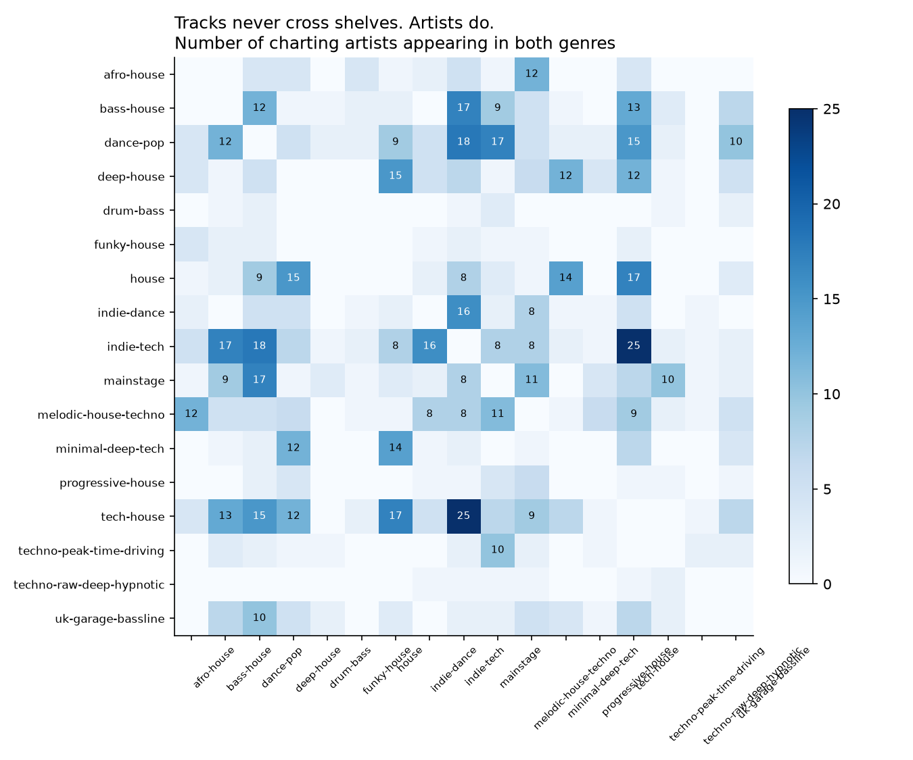
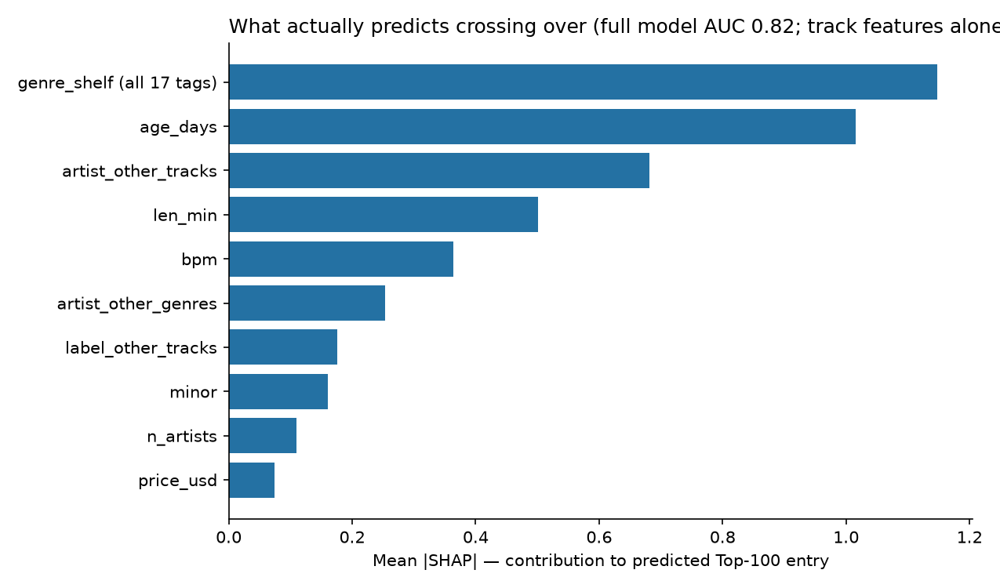

# Your Genre Tag Is Your Ceiling

**On Beatport, every track gets exactly one genre tag, and that tag quietly decides how high the track can climb. A house track on today's chart is thirty times more likely to reach the overall Top 100 than a mainstage or techno track sitting at the same rank on its own shelf. The song does not cross over. The shelf decides first.**

*Musing with Mike · 2026-10-15 · Topic: EDM*

I went into this expecting to map how tracks move between Beatport's genre charts, the way songs cross between radio formats. That map does not exist, and finding out why was the whole story. Beatport's charts look like seventeen different markets. They are really one catalog cut up by a single metadata field, and the cut is not neutral. Some shelves are escalators. Some are closets. Which one your track lands on is decided when it is uploaded, before a single DJ hears it.

## What I built

A one-day census of the working DJ economy: Beatport's overall Top 100 plus all 17 genre Top 100s Beatport promotes in its own homepage navigation, captured 2026-10-15. That is 1,800 chart slots covering 1,700 unique tracks, 1,753 artists, and 756 labels, with each track's genre and sub-genre tags, BPM, key, length, label, release date, price, artist credits, and remixer credits.

| # | Question | Method | Output |
|---|----------|--------|--------|
| 1 | Do tracks ever chart in two genres at once? | Set intersection across all 17 genre charts | `data/findings.json` §partition |
| 2 | How high can each shelf reach, and how fresh is each shelf? | Per-genre conversion into the overall Top 100; release-age profiles; label HHI | `data/genre_stats.csv`, `charts/shelf_ceiling.png`, `charts/freshness.png` |
| 3 | If tracks cannot cross, do artists? | Co-credit network (1,753 artists, 1,300 edges), per-artist genre spread, shared-artist genre pairs, Louvain communities | `data/artist_stats.csv`, `charts/artist_bridges.png` |
| 4 | Is a big-name remix a crossover lever? | Remixer presence vs Top-100 entry, including tracks where the remixer out-charts the original artist | `data/findings.json` §remix |
| 5 | What actually predicts crossing over? | XGBoost ladder (track features, then + genre shelf, then + artist/label incumbency), SHAP on the full model | `data/model.json`, `charts/shap.png` |

Reproduce: `python3 src/01_fetch.py && python3 src/02_analysis.py && python3 src/03_model.py && python3 src/04_charts.py`. Step 1 re-fetches today's charts (the committed snapshot in `data/raw/` is the 2026-10-15 capture used here). Requires pandas, numpy, scikit-learn, xgboost, shap, networkx, matplotlib, requests.

## Findings

**1. The partition is perfect, and it is the story.** Across 1,700 unique charting tracks, the number that appear on two different genre charts is zero. Not close to zero. Zero. Every genre chart is exactly the set of tracks carrying that genre tag, which means a Beatport track has precisely one shelf, one chart it can ever climb, and one audience of DJs browsing that shelf. The overall Top 100 is then drawn entirely from those shelves: all 100 of its tracks also sit on exactly one genre chart. A track cannot test a second genre, cannot be discovered by the techno crowd if it was tagged house, cannot cross over the way a record crosses from dance radio to pop radio. The tag is assigned once, at upload, usually by the label. Everything downstream is arithmetic.

**2. The shelves have wildly different ceilings.** Each genre chart has the same 100 slots, so if the overall chart drew evenly, each genre would send about 6 tracks into the Top 100. Instead: House sends 30 and Tech House sends 20, so one family holds half the overall chart. Indie Tech sends 9, UK Garage / Bassline 8, Drum & Bass 7, Dance / Pop 6. Then the cliff. Melodic House & Techno sends 4, Afro House and Bass House 3 each, Deep House and Progressive House 2 each, and six genres (Funky House, Indie Dance, Mainstage, Minimal / Deep Tech, and both Techno charts) send exactly 1 each. A track at the top of the House chart has a 30% chance of also sitting in the overall Top 100. The same achievement on the Mainstage chart is worth 1%. The overall chart is not a summary of the seventeen markets. It is a house chart with guests.



There is a second ceiling inside the first one. The lone Techno (Raw / Deep / Hypnotic) track that made the overall chart sits at rank 98, and the lone Indie Dance track at 94, while Deep House, with only 2 entries, places them at a median rank of 11. Getting in and getting up are different games, and most shelves lose both.

**3. Each shelf is a different kind of economy, running on a different clock.** Median release age by chart: Drum & Bass and Progressive House turn over fastest at 20 days, with about 45% of each chart under two weeks old. Dance / Pop is the opposite pole, a catalog economy with a median age of 240 days and 38% of its chart over a year old (its chart even includes Tori Amos's "Professional Widow," carrying a release date 12,701 days back). Deep House is nearly as archival: median 153 days, 40% of the chart over a year old. Crossover tracks are fresher than the shelves they leave: overall Top 100 tracks have a median age of 27 days against 55.5 for charting tracks that stay home, and inside House itself the split is 30.5 days for the tracks that crossed versus 86.5 for the ones that did not. Freshness is not the whole game, but stale almost never crosses.



**4. Labels are landlords, but no landlord owns a building.** The 1,700 tracks sit on 756 different labels, and every shelf is fragmented by antitrust standards: the highest label HHI on any chart is Funky House at 744 (PornoStar Records holds 19 of its 100 slots), far below the 1,500 line where regulators start calling a market concentrated. The single biggest landlord anywhere is Drumcode, with 20 of the 100 Peak Time Techno slots. Here is the tension that makes the shelf point land: Drumcode dominates a shelf whose ceiling is 1 track in the overall Top 100. Owning a fifth of a low-ceiling shelf buys less reach than a decent seat on the House shelf, where the top label (LTF Records, 13 tracks) plays in a market that sends 30 tracks up. Shelf first, landlord second.

**5. Tracks cannot cross shelves. Artists can, and the ones who do are the economy's connective tissue.** Of 1,753 charting artists, 246 (14%) appear on two or more genre charts today and 70 appear on three or more, through different tracks carrying different tags. Chris Lake and Tiga each chart in 6 genres. David Guetta has 14 tracks across 5 genres, HUGEL 13 across 5, and the busiest artist on Beatport today, Cloonee, has 17 charting tracks, 15 of them in Tech House with a foot each in House and Indie Tech. The bridges are specific: Indie Tech and Tech House share 25 charting artists, Dance / Pop and Indie Tech share 18, Dance / Pop and Mainstage 17, House and Tech House 17. The co-credit network (artists linked when they share a track credit) has 1,300 edges and one large component of 323 artists; HUGEL has the most distinct collaborators at 24, then David Guetta at 22 and Cloonee at 18. Louvain communities in that network do not respect the shelves: the largest communities mix Dance / Pop, Bass House, and Drum & Bass artists, or Mainstage with Dance / Pop, because collaborators pull each other across tags.



Does crossing pay? In today's snapshot, tracks by artists who chart in one genre only reach the overall Top 100 at 3.5%. For artists spanning two genres that doubles to 7.5%, and for three-genre artists it is 15.9%. Past three genres the samples get thin (64 to 20 tracks per bucket) and the pattern breaks, and the two widest crossers are a useful warning against reading this as a recipe: not one of Chris Lake's or Tiga's 20 combined charting tracks sits in today's overall Top 100. Treat the spread premium as a correlation with a plausible mechanism (more shelves, more DJ audiences, more shots on goal), not a dial you can turn by tagging recklessly. The tag still has to fit the track, because DJs browse shelves looking for a sound.

**6. The remix is not a crossover lever, even when the remixer is the bigger name.** Only 144 of 1,700 charting tracks (8.5%) carry a remixer credit at all, and they reach the overall Top 100 at 2.8%, less than half the 6.2% rate of tracks without one. The obvious excuse is that remixes are lesser versions, so I checked the strongest case: on 33 of those 144 tracks (23%), the remixer has more charting tracks today than the original artist, the classic borrow-a-bigger-audience setup (John Summit and Boris Brejcha are the most frequent remixers in the census, 3 charting remixes each). Those tracks cross over at 3.0%, statistically indistinguishable from the rest of the remixed pool. Whatever a remix does for a record on Beatport (and it may do plenty for streams or bookings, which this data cannot see), it does not appear to move the DJ-sales chart that this census measures.

**7. A model can tell: shelf and incumbency beat sound.** I trained XGBoost classifiers to predict which of the 1,700 tracks sit in the overall Top 100, adding one layer of information at a time (75/25 stratified holdout). Track features alone (BPM, length, age, artist count, remixer, format, key, price) score AUC 0.679, barely better than a good guess. Add one feature, the genre tag, and it jumps to 0.781. Add incumbency (how many other tracks the track's artists and label have on today's charts, computed excluding the track itself, plus the artists' cross-genre spread) and it reaches 0.822. SHAP on the full model ranks the shelf first (mean |SHAP| 1.15 summed across the 17 tags), release age second (1.02), the artists' other charting tracks third (0.68), then length (0.50) and BPM (0.36). Read it plainly: where the track is filed and who else is hot today explain crossover better than anything about how the track itself is built. That is last build's Spotify lesson (sound explained a third of popularity) arriving from the opposite direction, in the DJ economy this time.



## The operator takeaway

A genre tag on Beatport is not a description. It is a distribution decision with a hard ceiling attached, made by whoever uploads the track, at the moment the track has the least information about its own future. Three reads I would act on:

- **For labels:** audit the tag like you would audit a price. The realistic choice is often between two adjacent shelves (House vs Tech House, Indie Tech vs Tech House), and today that choice is the difference between a 30%, 20%, and 9% ceiling. If a track sits near a boundary, the tiebreaker should be the shelf's ceiling and freshness clock, not genre purity.
- **For artists:** you cannot multi-home a track, but you can multi-home a catalog. The artists who show up everywhere (Guetta across 5 shelves, HUGEL across 5, Chris Lake across 6) do it with different tracks tagged for different rooms. That is a portfolio strategy, and it is the only crossover mechanism the system actually offers.
- **For anyone building discovery on top of Beatport:** the overall Top 100 is a biased sample of the platform, half house-family by construction of demand. Any trend read off it (tempos, keys, freshness) is a house-market read wearing a platform-wide costume.

What I did not find: any path for a single track to escape its tag, and any evidence that remixes or big-name remixers beat the ceiling. The system has exactly one door between shelves, and it is shaped like an artist.

## Limitations

- **One-day snapshot.** Charts are dated 2026-10-15 and move daily. Conversion rates and the spread premium are today's values; the partition (zero tracks on two genre charts) is structural to how Beatport builds genre charts from a single genre tag, so it should hold on any date, but the census cannot prove that from one day.
- **Scope.** The census covers the overall chart plus the 17 genre charts in Beatport's homepage navigation. Beatport runs further niche charts outside that nav; nothing here speaks for them.
- **Sales chart, not attention.** Beatport charts rank downloads sold to DJs, not streams, listeners, or ticket sales. A shelf with a low ceiling (Mainstage, Techno) may still be where its audience's money and bookings are; the ceiling measures crossover into the overall sales chart only.
- **Release dates can be original dates.** Catalog and reissue entries carry old release dates (the Tori Amos case above), which inflates age figures for catalog-heavy shelves. That inflation is itself part of the finding (those shelves really do chart old records), but exact ages for individual old tracks should be read as "catalog," not a precise reissue date.
- **Artist identity is the credited name string.** Name variants and duo/member overlaps (Beatport credits "Dimitri Vegas" and "Dimitri Vegas & Like Mike" as different artists) are counted as credited. Network and spread numbers are therefore conservative in places and approximate throughout.
- **Model honesty.** AUCs are one holdout split of one day's snapshot. Incumbency features are measured on the same day's charts (they answer "who else is charting today"), so the 0.822 is a description of today's structure, not a forecast you could trade on next month.
- **Drum & Bass BPM** reads 87 as a median because Beatport lists many drum & bass tracks at half-tempo; I report it as stored and do not build on it.

## Sources

- Beatport, overall Top 100 and the 17 genre Top 100 charts promoted in the homepage navigation (Afro House, Bass House, Dance / Pop, Deep House, Drum & Bass, Funky House, House, Indie Dance, Indie Tech, Mainstage, Melodic House & Techno, Minimal / Deep Tech, Progressive House, Tech House, Techno (Peak Time / Driving), Techno (Raw / Deep / Hypnotic), UK Garage / Bassline), captured 2026-10-15 from the chart pages' embedded data. Raw snapshot: `data/raw/charts_raw.json.gz`; provenance notes in `data/PROVENANCE.md`.
- Methods: network analysis and Louvain communities (NetworkX), XGBoost (Chen & Guestrin 2016) with SHAP TreeExplainer (Lundberg et al. 2020), label concentration via Herfindahl-Hirschman Index with the US DOJ 1,500 threshold as the reference line.

## Layout

```
your-genre-tag-is-your-ceiling/
├── README.md              # this file
├── THREADS_DRAFT.md       # draft post, awaiting approval, do not publish
├── src/
│   ├── 01_fetch.py        # fetch the 18 charts, save raw snapshot
│   ├── 02_analysis.py     # partition, shelf stats, network, remix economy
│   ├── 03_model.py        # XGBoost ladder + SHAP
│   └── 04_charts.py       # all figures
├── data/
│   ├── tracks.csv         # 1,700 unique tracks with tags, credits, chart status
│   ├── appearances.csv    # 1,800 chart slots (chart, rank, track)
│   ├── genre_stats.csv    # per-shelf ceilings, freshness, label concentration
│   ├── artist_stats.csv   # per-artist tracks, genre spread, network metrics
│   ├── findings.json      # every headline number, machine-readable
│   ├── model.json         # AUC ladder + SHAP ranking
│   ├── shap_importance.csv
│   ├── PROVENANCE.md
│   └── raw/charts_raw.json.gz
└── charts/                # shelf_ceiling, freshness, artist_bridges,
                           # main_composition, shap (all .png)
```
