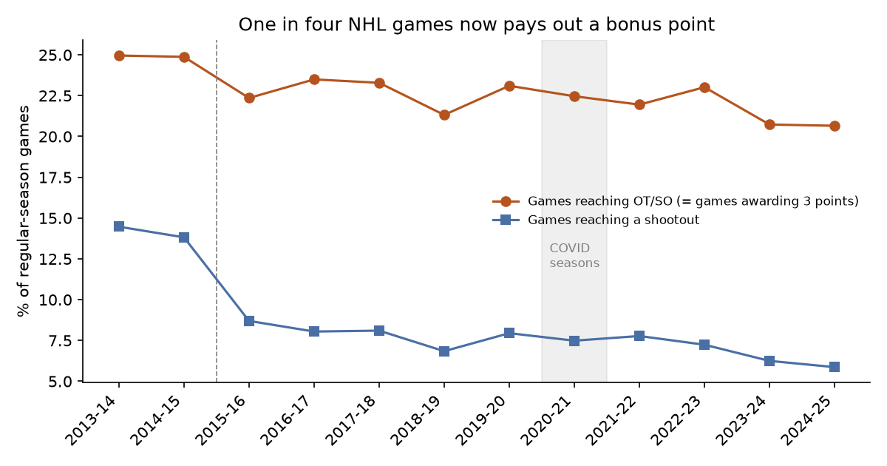
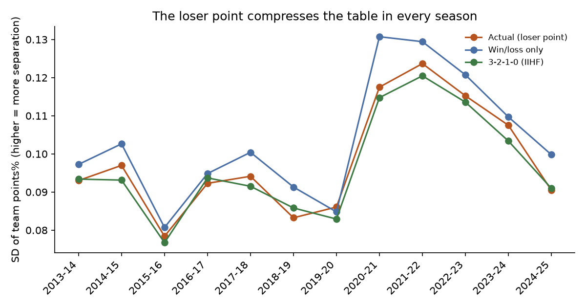
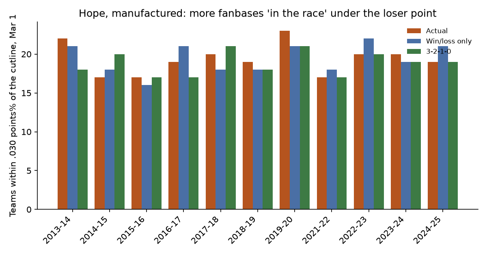
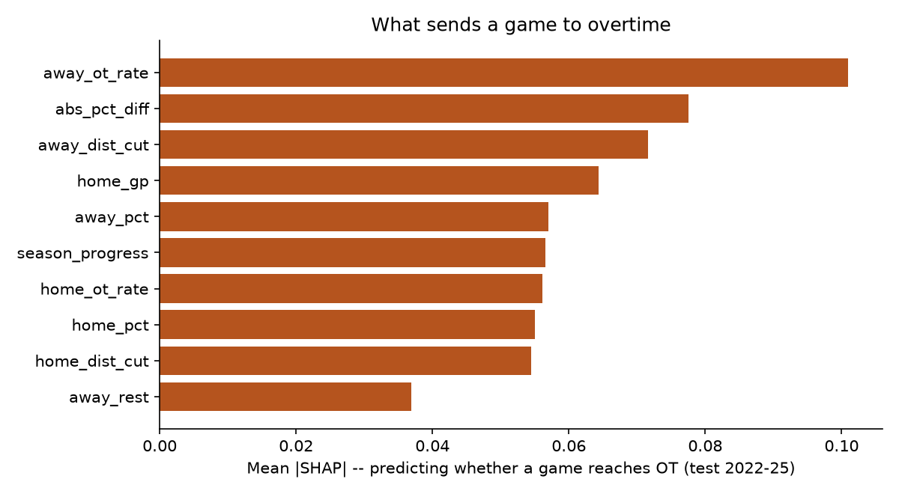

# The Loser Point Doesn't Buy Parity. It Buys the Wrong Playoff Teams.

**Every NHL season, about one standings point in ten is awarded to a team that lost. The standard defense is that this consolation point keeps the table tight and the races alive. I rebuilt twelve seasons of results, all 14,660 games, and re-ranked every year under two systems that handle losing differently. The table barely tightens. What actually changes, in half the seasons, is who makes the playoffs.**

*Musing with Mike · 2026-10-16 · Topic: sports analytics (hockey)*

The loser point is the NHL's strangest product decision. A team that loses in overtime or a shootout takes home one point, half of what the winner gets, for a game it lost. No other major North American league pays you for losing well. Defenders say it creates parity and keeps more fanbases engaged into March. Critics say it rewards mediocrity. Both sides argue from vibes, so I went and rebuilt the standings from scratch to settle which effect is real.

## What I built

Every regular-season game from 2013-14 through 2024-25 from the NHL's public API (game outcome split by regulation, overtime, and shootout, which is what makes the accounting possible), then four pieces of work:

| # | Question | Method | Output |
|---|----------|--------|--------|
| 1 | How much hockey now ends tied after 60 minutes? | Outcome census across 14,660 games | `data/season_trends.csv`, `charts/ot_rate.png` |
| 2 | Does the loser point change who makes the playoffs? | Rebuilt every team-season's record, re-ranked under 3 systems, applied the real playoff format (top 3 per division + 2 wild cards) | `data/playoff_fields.csv`, `data/team_seasons.csv` |
| 3 | Does it at least manufacture close races? | Standings rebuilt at Feb 1 / Mar 1 / Apr 1 each season under each system; counted teams within reach of the cutline two ways | `data/hope_snapshots.csv`, `charts/hope.png`, `charts/spread.png` |
| 4 | Do teams play for the tie late in games that matter? | XGBoost + logistic model of "game reaches OT" on leak-free pre-game features only, trained 2013-22, tested 2022-25 | `data/findings_model.json`, `charts/shap.png` |

Data quality check first, because it produced my favorite detail of the whole build. My rebuilt point totals match the official final standings for 371 of 372 team-seasons. The one miss is Minnesota in 2023-24, where I get 88 points and the league says 87. The game log shows why: an overtime home loss to Vegas on March 30, 2024, the night Minnesota pulled its goalie in overtime, lost, and had the consolation point forfeited under the league's pulled-goalie rule. The only loser point in twelve years that got clawed back, and the audit caught it.

Reproduce: `python3 src/01_fetch.py && python3 src/02_standings_lab.py && python3 src/03_ot_model.py && python3 src/04_charts.py`. Requires pandas, numpy, scikit-learn, xgboost, shap, matplotlib, requests.

## Findings

**1. A tenth of the league's points are paid out for losing, and the shootout era is quietly ending.** Over the twelve seasons, teams collected 3,322 loser points out of 32,642 total points awarded, so 10.2% of the standings is compensation for defeats. The share of games tied after regulation has drifted down, from 25.0% in 2013-14 to 20.7% in 2024-25, and the composition flipped. Shootouts decided 14.5% of all games in 2013-14. Then 3-on-3 overtime arrived in 2015-16, shootouts dropped to 8.7% in one year, and by 2024-25 they decided just 5.9% of games. The league set out to kill the shootout and mostly did. What survived is the point that comes with reaching it.

**2. Delete the loser point and the playoff field changes in half the seasons.** Re-ranking the ten clean-format seasons (2019-20 and 2020-21 excluded for COVID formats) on wins alone, with no consolation points, changes at least one playoff team in five of them. Seven teams swap places across the decade:

- **2015-16:** Colorado and Detroit in; Minnesota and Philadelphia out.
- **2016-17:** Tampa Bay in; Toronto out. That one stings in hindsight, the Leafs' first playoff spring of the Matthews era was loser-point assisted, 15 of their 95 points came from overtime losses.
- **2017-18:** Florida and St. Louis in; Colorado and Philadelphia out. Philadelphia gets bounced by the counterfactual twice in three years.
- **2018-19:** Arizona in; Colorado out. Colorado is on both sides of this ledger in different years, which is the point: the distortion is not a conspiracy, it is weather. Somebody catches it every spring.
- **2023-24:** Detroit in; the Islanders out. This is the cleanest case on record. The Islanders made the real playoffs with 94 points built on 39 wins and 16 overtime losses, only 29 wins in regulation. Detroit won 41 games, Washington won 40, and Detroit went home while both got in.

The 3-2-1-0 system used internationally (three points for a regulation win) changes the field less often, in two of ten seasons: the Kings replace Calgary in 2014-15, and Florida replaces Columbus in 2017-18. Because it still pays a point for an overtime loss, it keeps most of the consolation economy intact and mainly re-prices regulation wins.

**3. The parity defense mostly fails its own test.** If the loser point manufactured close races, the standings should be visibly tighter with it than without it. They are, but by a whisker. The spread of team points percentages is about 5% narrower under the real system than under win/loss only, and on March 1 the average number of teams within reach of the playoff cutline is 19.4 of 31 in points-percentage terms under both the real system and win/loss only. Counting the way broadcasters count, teams within six raw points of the line, the loser point buys the league less than one extra "in the race" team on March 1 (22.2 versus 21.5). A decade of paying for losses purchases a rounding error of extra hope.

**4. Some teams have turned losing close into a business model.** Philadelphia is the twelve-year king of this: 134 loser points, 13.6% of every point the Flyers banked since 2013 came in games they lost. Detroit is right behind at 128 (13.8%), then Anaheim, New Jersey, and the Islanders at 121 each. The single-season records are louder. The 2013-14 Devils banked 18 loser points, 20.5% of their total, in a season where they won 26 games in regulation. The 2014-15 Flyers matched the 18 and got 21.4% of their points from losses. And the 2022-23 Sharks, a team actively rebuilding, got 26.7% of their 60 points by losing in overtime or shootouts, the highest share in the dataset. The loser point is quietly an anti-tank subsidy too: the worse you are, the larger the fraction of your dignity it preserves.

**5. Teams barely play for the tie, because overtime is close to a coin flip.** The folk theory says rational teams, tied late, should coast to guarantee the point, especially two bubble teams or an inter-conference game where the extra point you might hand away costs you nothing. I tested it with a model that only sees pre-game information (season-to-date points percentages, each team's distance to its conference cutline that morning, rest, matchup type, calendar), trained on 10,724 games and tested on 3,936. The XGBoost model scores an AUC of 0.502 out of sample and logistic regression 0.497. That is chance. Nothing about the matchup, the calendar, or the standings tells you whether a game will be tied after 60 minutes. The raw cuts agree: divisional games reach overtime 22.7% of the time, inter-conference games 22.2%, games between two bubble teams 22.6% versus 22.7% for everyone else. The one cut that moves at all is late-season bubble-versus-bubble games, 23.9% across 1,338 games, a nudge of about one extra overtime per eighty games. Whatever is producing all these tied games, it is parity of talent and the structure of hockey scoring, not teams gaming the point. (SHAP values for the model are in `charts/shap.png`, but read them honestly: on a model with no out-of-sample signal, they describe what the model leaned on, not what causes overtime.)

**6. The Oilers, for once, are innocent.** Edmonton fans have their own loser-point grievances, so I checked. The Oilers' playoff status is identical under all three systems in every simulated season: in for the 2017 run and every year from 2022 on, out otherwise. Their loser-point income in the McDavid years is modest, five to nine points a season against a league where the merchants bank double that. The one gaudy line is 2014-15, the last pre-McDavid winter, when 14 of Edmonton's 62 points (22.6%) came from losing. Even the consolation economy could not make that team look respectable, it just made the standings lie a little more politely about how bad things were.

## The operator takeaway

Mechanism design gets judged on what it measurably does, not what the brochure says. By that standard the loser point fails as a parity product (a 5% tighter table, less than one extra team in the March race) and succeeds only as a reallocation product, quietly moving playoff spots to teams that lose close instead of teams that win, in half the seasons on record. Three reads:

- **If the league wants races, price regulation wins.** The 3-2-1-0 system changes the field least but changes incentives most, because a regulation win becomes worth 50% more than an overtime win. Teams protecting a tie late in the third are responding to the current price, where a tie guarantees half a win. Raise the price of winning in 60 minutes and the behaviour follows.
- **Watch the anti-tank side effect nobody priced.** A rebuilding team keeps about a quarter of its points through overtime losses (San Jose, 2022-23). The loser point softens the landing for bad teams in the standings, which is fan-friendly and draft-lottery-relevant at the same time. Any reform debate that ignores the bottom of the table is missing half the product.
- **For anyone modelling hockey:** stop building "plays for the tie" features. A decade of pre-game data says overtime arrival is noise at puck drop (AUC 0.50). The signal in this system lives entirely in the standings arithmetic after the fact, not in behaviour before it.

What I did not find: any real evidence that the loser point keeps meaningfully more fanbases engaged, and any evidence that teams visibly chase it. It persists, I suspect, because it makes almost every team's record look a little better than it is, and nobody votes to make their own numbers worse.
