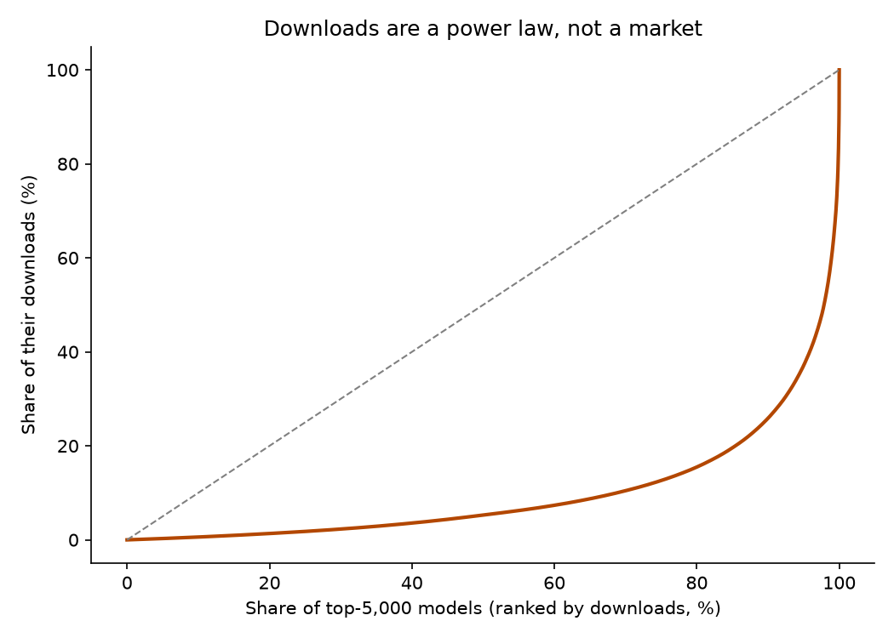
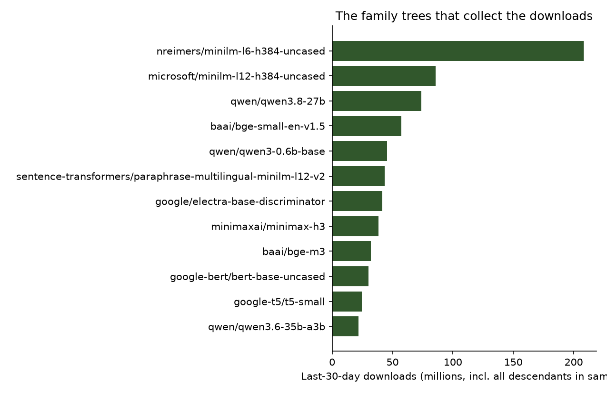
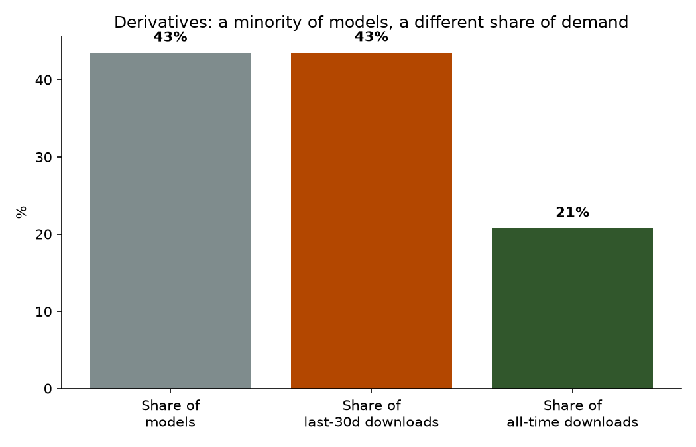
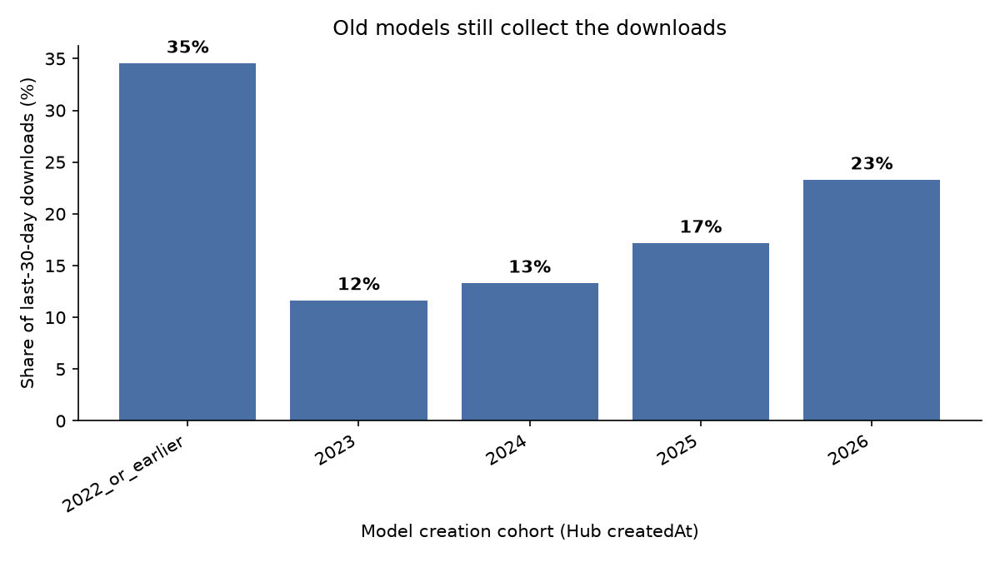
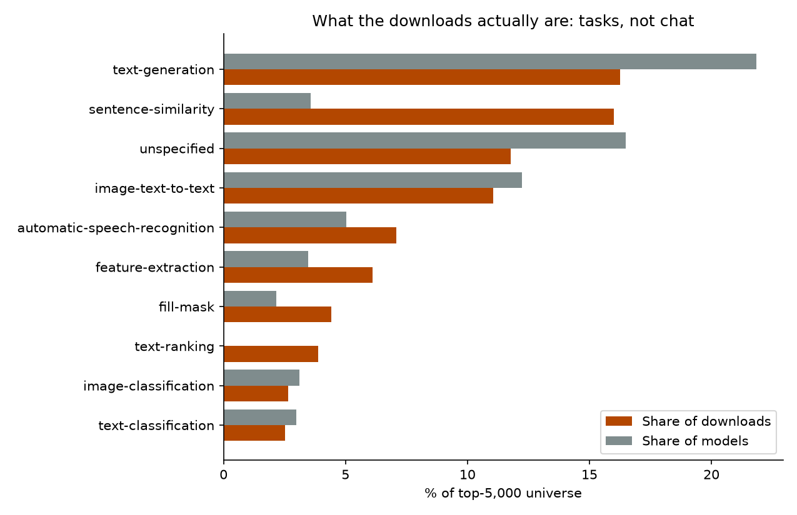
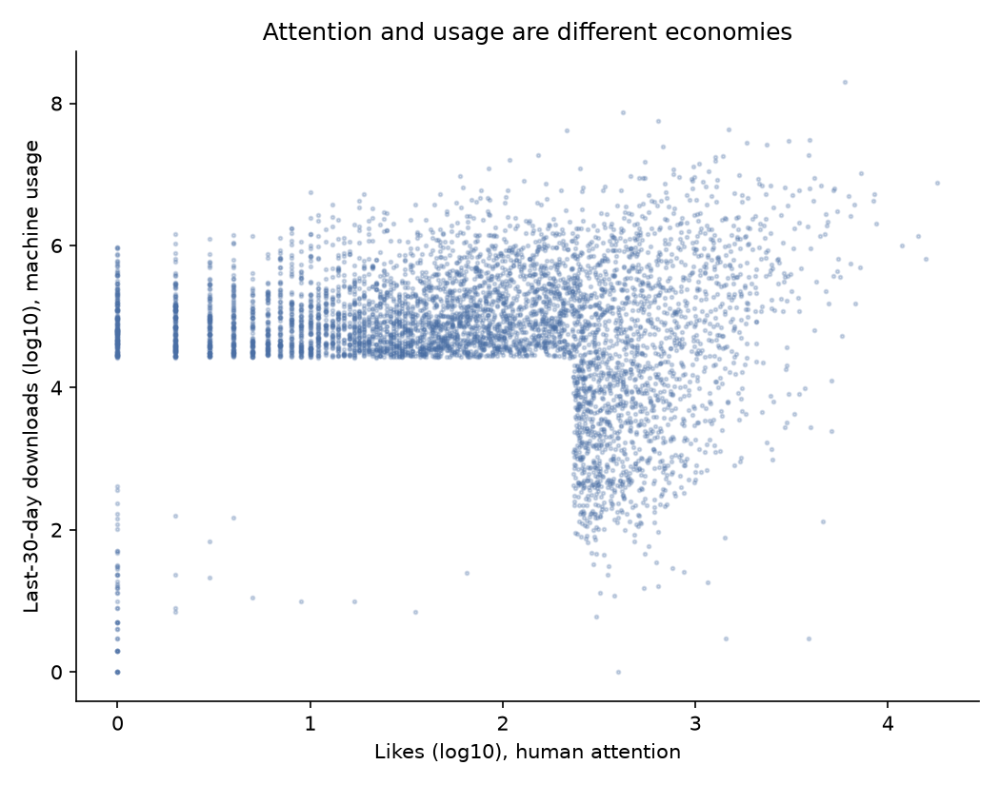
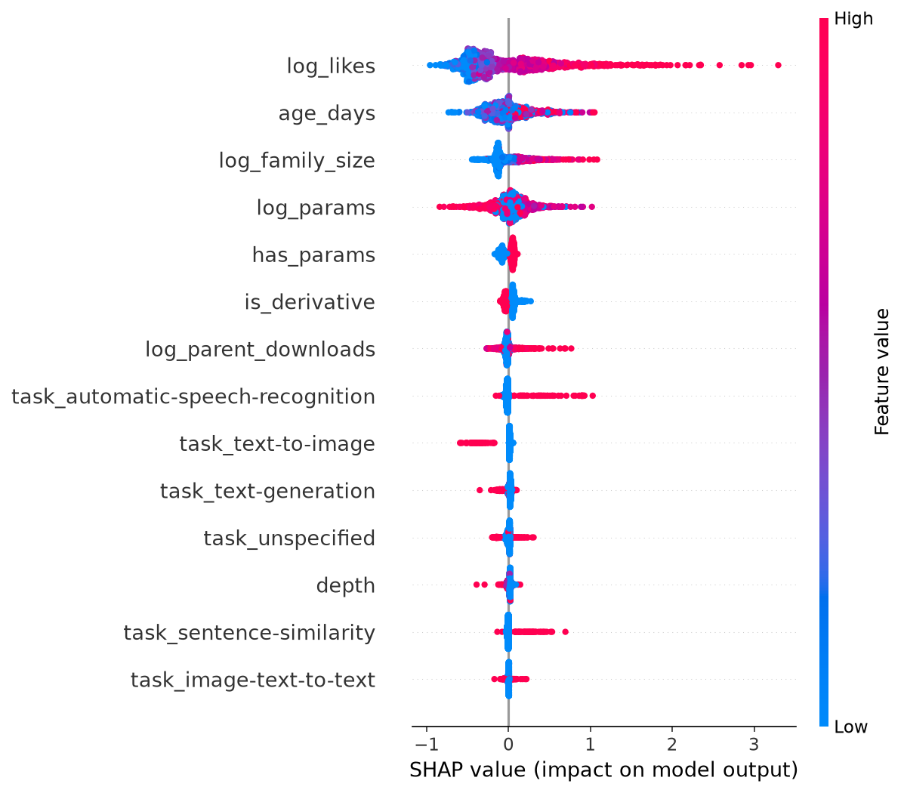

# Open Weights, Closed Genealogy: Hugging Face Is a Family Business

**Date:** 2026-10-21 · **Topic:** tech-industry · Part of the [Daily builds](https://github.com/mzhou-ds/passion-projects) series: *Musing with Mike*

Hugging Face passed a million models a while ago, and the usual way to talk about that is abundance. A million models, thousands of creators, open weights for everyone. Leaderboards reinforce the picture. They rank models one by one, as if each entry was an independent competitor that somebody built from scratch.

Almost nobody asks the genealogy question. Every model on the Hub can declare what it was made from, in `base_model` tags and model card metadata. So I pulled the family trees. Three samples from the Hub API: the top 5,000 models by downloads in the last 30 days (2.51 billion downloads a month, 67.0 billion all time), the top 2,000 by likes, and the 3,000 newest models on the platform. 9,051 unique models after deduping. Then I parsed every declared base relation, walked each model up its tree to a root, and weighted everything by actual downloads.

The million-model ecosystem turns out to be a family business. A small number of labs manufacture the bases. Everybody else repackages them, and the repackagers collect most of the traffic.

## What I built

- `src/01_fetch.py`: Hub API, expand mode (parameter counts, all-time downloads, card metadata) for the three samples → `data/models_raw.jsonl`
- `src/01b_fetch_plain.py`: a second pass on the plain endpoint, because expand mode returns `pipeline_tag` as null everywhere and zeroes whichever counter you did not sort by → `data/models_plain.jsonl`
- `src/02_genealogy.py`: merges both passes (max for counters, first non-null for fields), parses `base_model` relations (finetune, quantized, adapter, merge, declared), resolves roots with a cycle guard, normalizes families → `data/models_genealogy.csv`, `data/families.csv`
- `src/03_analysis.py`: concentration (HHI, effective number of families, Gini), derivative and third-party shares, root-vs-descendant splits, vintage cohorts, task mix, the newest-cohort firehose, attention-vs-usage → `data/summary.json`
- `src/04_model.py`: XGBoost regression with SHAP on log downloads in the demand sample, against likes-only and full linear baselines → `data/model.json`, `charts/shap_downloads.png`
- `src/05_charts.py`: the charts below → `charts/`

## Findings

**1. Five thousand models, seventy-eight effective families.**
The top 5,000 models by monthly downloads span 3,255 distinct family trees. Weighted by downloads, the effective number of families (the inverse of the Herfindahl index) is 78. Go one level up, to the organization that made the root model, and the effective number is 18.5. The top five root organizations collect 43.3% of all downloads in the sample, and the top ten collect 55.7%. Qwen roots alone, spread across 97 different Qwen family trees, account for 17.5% of every download. This is not a long tail with a head. It is an oligopoly with a very long tail attached, and the tail is mostly decoration: 90% of the families in the full sample contain exactly one model.

**2. The root gets almost nothing. The descendants collect.**
Look at where the money flows inside a tree. The single biggest family in the sample is a MiniLM embedding tree rooted at `nreimers/MiniLM-L6-H384-uncased`. The root itself does not even make the top 5,000. Its eight descendants in the sample collect 208 million downloads a month, including the most downloaded model on the platform, `sentence-transformers/all-MiniLM-L6-v2`, at 203 million downloads a month and 4.1 billion all time. It is a 22-million-parameter embedding model from the BERT era, and it is itself a derivative. Or take a current flagship: the Qwen3.8-27B tree has 101 members inside the top 5,000. The base model itself collects 7.7 million downloads a month. Its descendants collect 66.1 million. Qwen's 0.6B base model collects 0.6 million while its descendants collect 44.7 million, a 75-to-1 split. The base model is wholesale. The retail margin is in the fine-tune, the quant, and the repack, and it usually belongs to somebody else (finding 3).

**3. Most derivative traffic is third-party.**
43.5% of the top 5,000 models declare a base, and those derivatives collect 43.5% of monthly downloads. Because under-declaring is common, treat both numbers as floors. Now split derivatives by who made them. 72.8% of derivative download volume goes to models whose author is not the organization that made the root. The base maker keeps only about a quarter of its own tree's derivative traffic. The biggest repackagers by downloads are names any practitioner will recognize as infrastructure, not labs: sentence-transformers (206 million a month, almost all of it other people's bases), cross-encoder (87 million), Comfy-Org (86 million), unsloth (51 million), lmstudio-community (35 million). The main exception proves the rule: Qwen is the top first-party derivative maker too, at 180 million downloads a month from its own instruct fine-tunes of its own bases. Qwen runs the factory and the store. Most labs only run the factory. And one data point from my own employer: roots owned by meta-llama collect 1.0% of the sample's downloads, across 84 models and 22 families. The Llama tree is wide. The download economy runs on other trees, and on old embedding models (finding 4).

**4. Chat is a minority of actual usage.**
Text generation, the thing the whole industry talks about, is 16.3% of downloads in the top 5,000. Sentence similarity alone is 16.0%, and the embedding bloc (sentence similarity, feature extraction, and text ranking together) is about 26%. Speech recognition is 7.1%. The workhorse models of the AI economy are small, old, and boring: embedders, rerankers, recognizers, classifiers, the parts that sit inside other people's pipelines and get pulled by machines on a schedule. The vintage data says the same thing. Models created in 2022 or earlier are 14.3% of the top 5,000 but collect 34.5% of the downloads. The downloads-weighted median model, the one sitting at the exact middle of the month's download volume, is BAAI's bge-reranker from March 2024. The distribution is bimodal: pre-2023 infrastructure at one end, the newest flagship families at the other (the 2026 cohort already holds 23.3%), and the 2023 cohort squeezed in the middle at 11.7%.

**5. Attention and usage are different economies.**
Likes are the human signal on the Hub. Downloads are the machine signal. In the demand sample they correlate at only 0.37 in log terms, and a likes-only model explains 16% of the variance in log downloads. 14.3% of the top 5,000 most downloaded models have zero likes at all. Nobody admires them. Pipelines just pull them, millions of times. The ratio of downloads per like, by task, separates the two economies cleanly. Image classification runs at a median of about 18,000 downloads per like, speech recognition at 13,000, sentence similarity at 5,300. Text-to-image runs at about 690, and image-to-image at 350. A full XGBoost model with genealogy features (family size, parent downloads, depth, derivative status, parameter count, age, task) reaches R² of 0.30 against the 0.16 likes-only baseline, and SHAP puts family size third, behind likes and age and ahead of parameter count. Which tree you are in predicts your downloads independently of how much anyone likes you. Even then, 70% of the variance is unexplained, which is honest: most of usage is decided inside private pipelines nobody can see from the Hub.

**6. The firehose goes nowhere.**
The supply side looks nothing like the demand side. Of the 3,000 newest models, the median has zero downloads in its first month window, 67.3% have exactly zero, 94.6% have under 100, and 95.9% have zero likes. 26.9% of the firehose is declared derivatives, people repackaging bases into a void. The top ten models of the newest cohort capture 32.9% of the cohort's downloads, and the cohort's total is a rounding error next to the top 5,000. Uploading a model in 2026 is like listing a product on a marketplace where the search results were decided two years ago. Which, from my years at Lyft, DoorDash, and Patreon, is exactly what mature marketplaces look like. Supply is free and infinite. Demand is concentrated, habitual, and routed through a small number of names that pipelines already trust.

**Bottom line:** the open model ecosystem is open the way a franchise system is open. Anyone can open a store. The menu, the supply chain, and most of the customer traffic belong to a handful of manufacturers, and the most successful stores are repackagers who understood distribution better than the labs did. If you make base models, your real product is the tree, and you should measure, license, and build for descendants you will never ship. If you build on open models, the durable question is not which model wins a benchmark this month. It is which family tree your pipeline is marrying, because the downloads say everyone else already picked: about eighteen root organizations, seventy-eight effective families, and a 2021 embedding model quietly moving more volume than any chatbot.

## Charts









## Reproduce

```bash
pip install -r requirements.txt
python3 src/01_fetch.py        # Hub API, no key, expand mode
python3 src/01b_fetch_plain.py # Hub API, plain mode (see its docstring for why)
python3 src/02_genealogy.py
python3 src/03_analysis.py
python3 src/04_model.py
python3 src/05_charts.py
```

## Caveats

- `downloads` on the Hub API is a rolling last-30-day counter and counts machine pulls, including CI and pipeline traffic. That is the point of the analysis (usage, not admiration), but it is not a count of humans or of production deployments.
- Derivative status comes from self-declared `base_model` metadata. Many fine-tunes never declare a base, so every derivative share here is a lower bound. Relation *types* are noisier than the derivative flag itself: a few famous embedding models carry a `quantized` relation tag that does not describe them well, so the write-up leans on the derivative flag, on third-party authorship, and on quant markers in model names (51% of derivative models carry one; they take 27% of derivative downloads) rather than on the typed mix alone.
- The demand sample is the top 5,000 by downloads (minimum 26,589 downloads in the month). Concentration figures describe the models that carry essentially all of the platform's volume, not the million-model tail, which the newest-cohort sample covers separately.
- Roots are resolved only through declared parents. A derivative of a derivative whose middle link never declared its own base stops one level early, so depths are floors too. The deepest chain resolved here is five levels.
- `createdAt` for pre-2022 models is the Hub's mass-import date for many of them, so the oldest cohort is reported as "2022 or earlier" rather than by exact year.
- Parameter counts come from safetensors metadata and are missing for many older or non-safetensors models; the model in `src/04_model.py` carries an explicit missingness flag for that reason.
