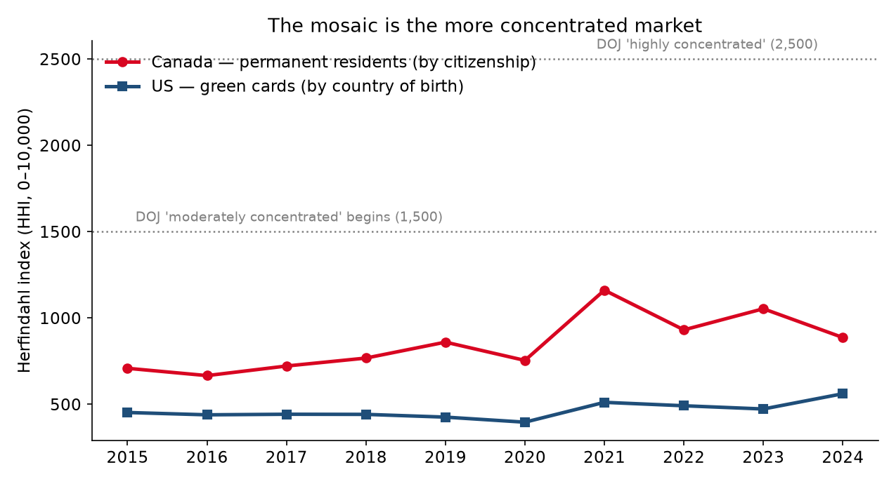
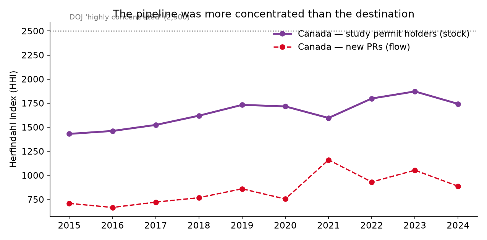
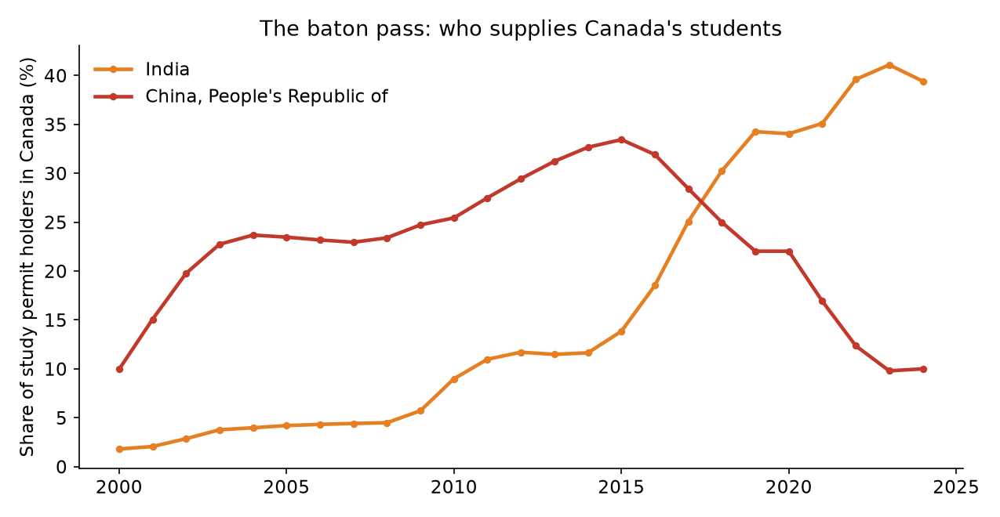

# The One-Country Mosaic

**Canada calls itself a mosaic and America calls itself a melting pot. Measured like a market, the mosaic is the concentrated one: Canada's immigration now runs on 9 to 11 effective source countries, America's on about 20, and a single country supplies most of Canada's concentration.**
*Musing with Mike · 2026-10-22 · Topic: culture*

Every country brand-manages its immigration. Canada's brand is the mosaic, many distinct pieces, no single dominant tile. America's brand is blunter and its politics are louder, so the working assumption, mine included, was that the US system is the one warped around a few source countries and Canada's points system draws from everywhere.

Nobody I know of had actually priced that assumption. So I borrowed the tool antitrust lawyers use to price market concentration, the Herfindahl-Hirschman Index, and ran it on a decade of permanent resident flows from both countries' own statistical agencies: IRCC's admissions by country of citizenship for Canada, the DHS Yearbook's green cards by country of birth for the US. Then I ran it on the pipeline nobody watches, the stock of study permit holders already inside Canada, because that stock is tomorrow's permanent resident flow.

The mosaic lost. It was not close, and the reason fits in one word: India.

## What I built

| # | Question | Data | Script |
|---|----------|------|--------|
| 1 | How concentrated is each country's permanent resident intake, 2015 to 2024? | IRCC Open Data, admissions of permanent residents by country of citizenship (monthly, summed to years); OHSS Yearbook FY2023 and FY2024 workbooks, Table 3, LPRs by country of birth | `src/02_parse_us.py`, `src/03_parse_ca.py`, `src/concentration.py` |
| 2 | Who contributes the concentration, and what would Canada look like shaped like the US? | HHI decomposition by country, counterfactual reweighting of Canada's 2024 intake | `src/04_analysis.py` |
| 3 | How concentrated is the student pipeline that feeds Canada's intake? | IRCC Open Data, study permit holders by country of citizenship, Dec 31 stocks, 2000 to 2024 | `src/03_parse_ca.py`, `src/04_analysis.py` |
| 4 | What is the exposure if the top supplier stumbles? | Per-capita flow intensity (StatCan and US Census population estimates) and a supplier-shock sensitivity on the 2024 intake | `src/04_analysis.py` |

Reproduce: `python3 src/01_fetch.py && python3 src/02_parse_us.py && python3 src/03_parse_ca.py && python3 src/04_analysis.py && python3 src/05_charts.py`. No API keys. One sourcing note: on the morning of this build, ircc.canada.ca was returning gateway timeouts from every network path available to me, so the two IRCC workbooks in `data/raw/` are the Internet Archive's August 3, 2025 snapshots of IRCC's own files (the fetch script tries the live IRCC URLs first and falls back to the snapshots). The files validate cleanly: their internal total rows reproduce IRCC's published annual totals exactly (341,175 in 2019; 483,640 in 2024), and the parsed country rows sum to within 0.2 percent of those totals, which is IRCC's own rounding.

## Findings

**1. The mosaic is roughly twice as concentrated as the melting pot, and has been for years.**
Canada's source-country HHI was 708 in 2015, climbed through 860 in 2019, peaked at 1,161 in 2021, and sat at 887 in 2024. The US figure barely moves: between 396 and 561 across the whole decade, including its two strangest years. In effective-country terms, Canada draws its intake from the equivalent of 9 to 11 equal-sized suppliers. The US draws from about 20. By the Justice Department's bands both PR systems still count as unconcentrated (the line is 1,500), so this is not a monopoly story. It is a portfolio story. One of these countries holds a diversified book. The other holds a concentrated one and markets it as diversity.



**2. It is a one-country position. Take India out and Canada looks exactly like America.**
Decompose Canada's 2024 HHI and India alone accounts for 696 of the 887 points, 78.5 percent of all concentration. At the 2021 peak it was 997 of 1,161 points, 85.9 percent. India's share of new permanent residents went from 14.5 percent in 2015 (39,335 people, when the Philippines was still Canada's top source at 18.8 percent) to 31.6 percent in 2021 and 29.7 percent in 2023 (139,780 people). Now run the counterfactual: give India's 2024 flow its old 2015 share of the intake and rescale everyone else proportionally. Canada's HHI falls to 468, statistically indistinguishable from the US figure of 473 in 2023, and its effective supplier count jumps from 11.3 to 21.4. The entire concentration gap between the two countries is one country's outgrowth. Nothing else in the table matters much.

**3. The pipeline was more concentrated than the destination, the only series here that crosses antitrust lines.**
Study permit holders are a stock, people already in Canada on December 31, and that stock is what the PR system increasingly selects from. Its HHI hit 1,872 in 2023, inside the Justice Department's "moderately concentrated" band and within sight of "highly concentrated," with an effective supplier count of 5.3 countries. At the peak, 426,195 of the 1,037,130 study permit holders in Canada were citizens of India. That is 41.1 percent. Two in five international students in the country came from one country. The PR numbers in finding 1 are the downstream echo of this stock, which is why I do not expect the PR concentration to unwind quickly (finding 5).



**4. The concentration is not new. The flag changed.**
In 2015 the concentrated supplier was China: 117,825 Chinese citizens held study permits, 33.5 percent of the stock, and the stock's HHI was already 1,431. India passed China in 2018 and never looked back, 48,755 holders in 2015 to 426,195 in 2023, an 8.7x run. China's holder count, meanwhile, peaked at 140,530 in 2019 and then fell in absolute terms to 99,650 by 2024, while the total stock nearly tripled. The system did not diversify between 2015 and 2023. It swapped one dominant supplier for a bigger one. For the Canadian-born Chinese side of my own life, the sharper fact sits in the PR table: China's permanent resident flow has been flat at roughly 30,000 a year since 2017 (30,255 then, 29,970 in 2024) while total intake grew about 69 percent, so China's share slid from 10.6 percent to 6.2 percent. The US, for all its dysfunction, kept two mid-sized Asian suppliers at once, China at 5 to 7 percent of green cards and India at 5 to 7 percent, instead of letting one run to 30.



**5. Cutting the volume did not cut the concentration.**
Ottawa capped study permits in January 2024 and cut PR levels in the fall. A year later the study stock had shrunk just 3.9 percent (1,037,130 to 996,340) and its HHI had eased only from 1,872 to 1,743, because a stock built over years does not drain at the speed of a press release. The early 2025 PR data tells the same story from the other side: in the first quarter of 2025 (the last quarter in the published file), Canada's HHI was back up at 1,106 with India at 30.4 percent. Levels are a volume lever. Concentration is a mix property, and nothing in the current policy set pushes on the mix. If anything, the 2024 intake diversified by accident, through asylum channels (Cameroon at 4.4 percent and Eritrea at 3.4 percent of PRs), not by design.

**6. The exposure math is what makes this an operator's problem, not a trivia fact.**
Canada admits about 1,163 new permanent residents per 100,000 residents. The US admits about 401. So Canada pushes roughly 2.9 times the per-capita flow through about half the effective suppliers. Multiply intensity by concentration and a single bilateral relationship becomes macroeconomic: a 25 percent shortfall in the Indian flow alone would remove about 31,800 people, 6.6 percent of Canada's entire 2024 intake, before a single policy changed. That stress test already ran in miniature. The 2023 to 2024 diplomatic freeze between Ottawa and New Delhi, plus the study permit cap, landed on a system with one dominant supplier, and the adjustment showed up as a housing and colleges crisis in Ontario rather than as an immigration statistic. The US has its version of single-channel risk too (its 2024 HHI bump to 561 is mostly one parole program, with Cuba at 13.5 percent of green cards), but a pulse is different from a pipeline. A pulse ends. A pipeline compounds.

**Bottom line:** Canada did not build a diversified immigration portfolio and then lose it. It built a points system that selects whoever the pipeline delivers, let one pipeline (Indian students, then work permits, then PR) scale without a mix constraint, and kept the mosaic branding anyway. America, with its country caps, family queues and sheer mess, accidentally maintains the diversified book: no supplier above 15 percent in a decade. If you run anything with supplier concentration (a marketplace, a creator platform, an admissions system), the lesson transfers directly. Measure the HHI of your inflows, not your stock of good intentions. Your diversification is whatever the decomposition says it is, and if one counterparty is 79 percent of your concentration, you do not have a portfolio. You have a dependency with a flag on it.

## Caveats

- The two series are close cousins, not twins. IRCC counts new permanent residents by country of citizenship; OHSS counts green cards by country of birth. Dual citizens and third-country births blur both at the margin. The comparison is the standard one both governments use in their own bilateral reporting, and no plausible reclassification moves a 2x gap.
- Canada is calendar year, the US is fiscal year (October to September). A three-month phase shift on a ten-year comparison.
- IRCC rounds every cell to the nearest 5 and suppresses cells under 5 (shown as "--"). I treated suppressed cells as 0, which drops a sliver of the smallest countries and can only overstate concentration by a trivial amount; country rows still sum to within 0.2 percent of IRCC's totals.
- The US FY2024 total is inflated by parole-program adjustments (Cuba 184,040 green cards, Afghanistan 50,310). That raises the US 2024 HHI to its decade high of 561, still far below Canada's 2024 reading of 887 on a normal year.
- Canada's 2025 figures are Q1 only, as published in the August 2025 file snapshot, and are labeled that way wherever they appear.
- Study permit figures are IRCC's "total unique persons" stock at December 31. The file's own unique-persons row is the denominator; a person holding permits under one citizenship is counted once.

## Sources

- IRCC Open Data, "Canada - Admissions of Permanent Residents by Country of Citizenship," dataset *Permanent Residents - Monthly IRCC Updates*, Open Government Portal. Live file: `https://www.ircc.canada.ca/opendata-donneesouvertes/data/EN_ODP-PR-Citz.xlsx`; retrieved via the Internet Archive snapshot of 2025-08-03 (see the sourcing note above).
- IRCC Open Data, "Canada - Study permit holders by Country of Citizenship" (year-end), dataset *Temporary Residents: Study Permit Holders - Monthly IRCC Updates*. Live file: `https://www.ircc.canada.ca/opendata-donneesouvertes/data/EN_ODP_annual-TR-Study-IS_CITZ_year_end.xlsx`; retrieved via the Internet Archive snapshot of 2025-08-03.
- US Office of Homeland Security Statistics, *Yearbook of Immigration Statistics* FY2023 and FY2024, Lawful Permanent Residents workbooks, Table 3 (persons obtaining LPR status by region and country of birth). `https://ohss.dhs.gov/topics/immigration/yearbook/2023` and `/2024`.
- Population denominators: Statistics Canada quarterly demographic estimates (Canada, 41,528,680 on Jan 1, 2025); US Census Bureau national population estimate (340,110,988 on Jan 1, 2025).
- Concentration bands: US DOJ/FTC Horizontal Merger Guidelines HHI thresholds (1,500 and 2,500), used here as a reference ruler, not as a legal claim about immigration.

## Layout

```
the-one-country-mosaic/
├── src/
│   ├── 01_fetch.py        # OHSS workbooks + IRCC workbooks (live, Wayback fallback)
│   ├── 02_parse_us.py     # OHSS Table 3 -> tidy US series, FY2014-2024
│   ├── 03_parse_ca.py     # IRCC monthly PR file -> annual; study year-end stocks
│   ├── 04_analysis.py     # HHI series, decompositions, counterfactuals -> summary.json
│   ├── 05_charts.py       # the six charts
│   └── concentration.py   # HHI / effective-N / entropy helpers
├── data/
│   ├── raw/               # source workbooks, untouched
│   ├── us_lpr_by_birth_country.csv
│   ├── ca_pr_by_citizenship.csv
│   ├── ca_study_by_citizenship.csv
│   └── summary.json       # every number cited above
└── charts/                # hhi_race, effective_n, top1_share,
                           # ca_composition, study_pipeline, baton_pass
```
