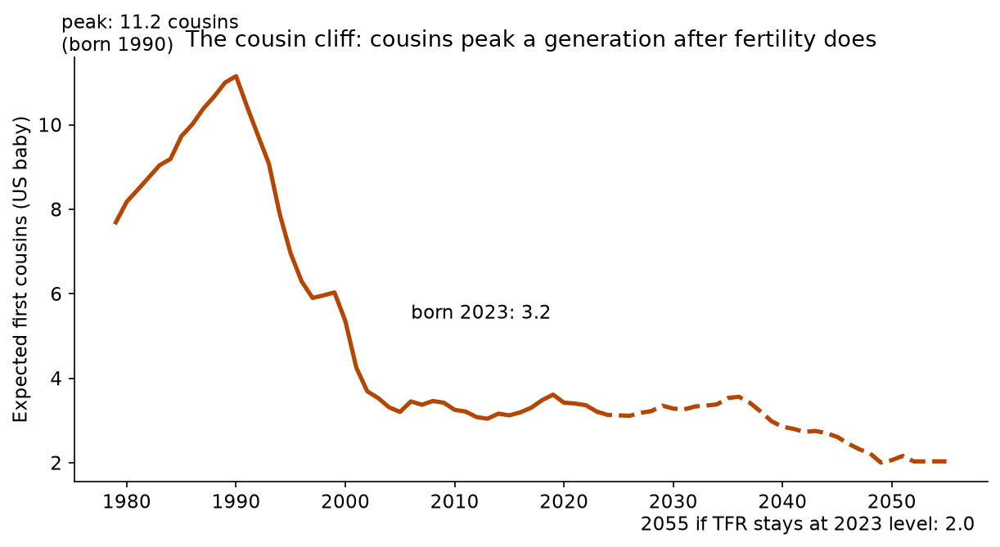
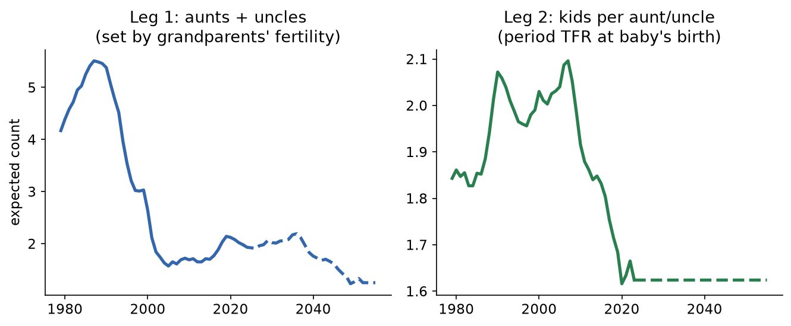
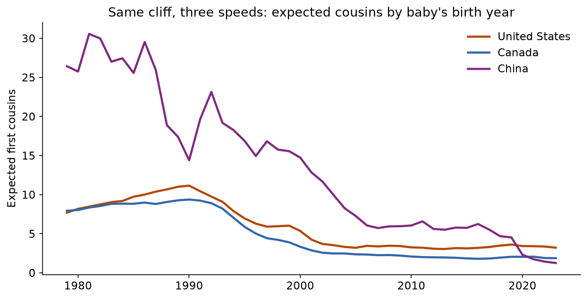
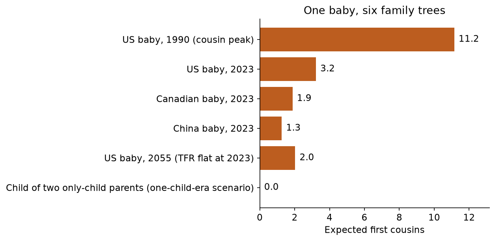
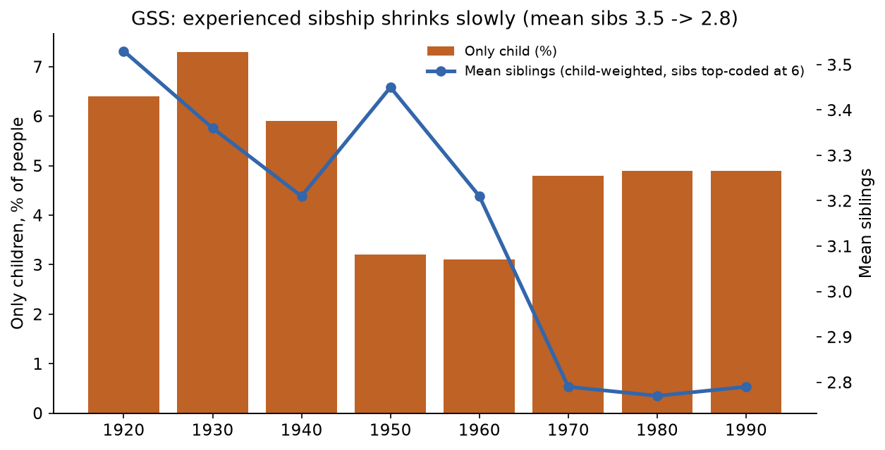
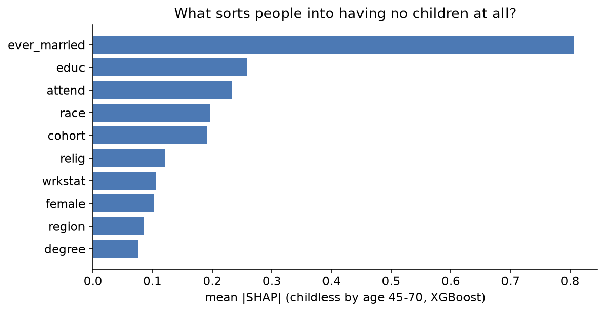

# The Cousin Cliff

**Fertility fell by a fifth in a generation. Cousins fell by more than two thirds. The family did not shrink at the speed everyone is quoting, it shrank at the product of two speeds, and almost nobody is pricing the output: the kin network itself.**
*Musing with Mike · 2026-10-23 · Topic: relationships*

Every fertility headline is about the same number, children per woman, and the same consequences, pensions, schools, population pyramids. That framing treats a baby as a unit of population. But a baby is also a node in a network, and the network does not shrink linearly with the birth rate. It shrinks multiplicatively, because your cousins are a product: the number of aunts and uncles your grandparents produced, times the number of kids each of them had. Cut both terms and the product falls off a cliff, one generation after the fertility fall that caused it, at a moment when the headline fertility rate looks calm.

So I measured the output instead of the input. Using UN period fertility for the US, Canada, and China, I built the expected family tree of a baby born in each year from 1979 to 2023, then checked the lived version of the same story in fifty years of General Social Survey microdata, and modeled who ends up with no children at all, the zero that deletes an entire branch of somebody else's tree.

**Interactive version:** open `site/index.html` and run the kin calculator. Pick a preset family tree or drag the two legs yourself and watch the cousin count move twice as fast as either slider.

## Why this would surprise someone who knows the field

Demographers project kinlessness for older adults, and everyone knows fertility is below replacement. What I have not seen priced anywhere is the cousin count itself, as a time series, with its timing. Cousins did not peak in the baby boom. They peaked around 1990, a full generation later, because the children of the boom inherited the boom's sibling counts as aunts and uncles. And the steepest cousin losses, roughly half the total, happened between 1990 and 2010, in years when US fertility sat near 2.0 and the public story was that births had stabilized. The cliff is a lagged echo, and echoes do not announce themselves.

## What I built

| # | Question | Data | Script |
|---|----------|------|--------|
| 1 | How many cousins, aunts/uncles, and total close kin does a baby born in year Y get, in the US, Canada, and China? | UN World Population Prospects period TFR via Our World in Data, 1950-2023; three-generation period kinship model, formulas stated in full in the script | `src/02_kinship_model.py` |
| 2 | Does lived family size in microdata match the model's story? | GSS cumulative file 1972-2024, `sibs` and `childs` by birth cohort, survey-weighted, with the child-weighting bias handled explicitly | `src/03_gss.py` A-B |
| 3 | Who ends up childless, the branch-deleting zero? | Same file: XGBoost + SHAP on 18,987 respondents aged 45-70 | `src/03_gss.py` C |
| 4 | What do specific family trees look like, including the diaspora case? | Scenario arithmetic on the model, including a child of two only-child parents | `src/02_kinship_model.py`, `site/` |

Reproduce: `python3 src/01_fetch.py && python3 src/02_kinship_model.py && python3 src/03_gss.py && python3 src/04_charts.py`.

## Findings

**1. Cousins peaked in 1990, at 11.2 per American baby, and the peak is a lag, not a boom.** A US baby born in 1990 had parents born around 1961, into a fertility rate of 3.69. Those parents came with siblings, so the baby arrived to an expected 5.4 aunts and uncles, each having kids at the still-healthy 1990 rate of 2.07. Product: 11.2 first cousins, and 23.6 kin within two generations up and one across. The baby boom's real dividend was not the babies of the 1950s. It was the cousins of 1990, paid out thirty years later, to a generation that assumed a big extended family was the default setting of the world.



**2. The cliff happened while fertility looked stable, and that is the whole mechanism.** Between 1990 and 2000, US fertility barely moved, 2.07 to 2.03. Expected cousins fell from 11.2 to 5.4, a halving. Nothing in the birth statistics of the 1990s warns you about this, because the term that collapsed was the other leg: aunts and uncles fell from 5.4 to 2.6, as the parents of 2000s babies turned out to be the children of the 1970s fertility bust (parents born around 1971, fertility then 2.32, down from 3.69 a decade earlier). By 2023 a US baby expects 3.2 cousins, down 71% from the peak, on a fertility decline of only 22% over the same span (2.07 to 1.62). Two legs, each down, product down by the combination. If fertility simply stays at its 2023 level, the 2055 baby expects 2.0 cousins and 9.9 total close kin, less than half the 1990 tree.



**3. Canada fell further, China fell off the map, and the ranking is not the fertility ranking.** A Canadian baby born in 2023 expects 1.9 cousins (1990: 9.4, down 80%), because Canada's fertility fell earlier and lower, 1.35 in 2023 against the US 1.62. A baby born in China in 2023 expects 1.3 cousins (1990: 14.4, down 91%), on a fertility rate of 1.00 and parents who were themselves born into the tightening one-child era. China started with the largest cousin counts in this comparison and ends with the smallest, in one generation. Same cliff, three speeds, and the speed is set two generations deep, which is why none of these countries can reverse it quickly even if births rebound: a fertility recovery in 2030 does not produce aunts and uncles until about 2060.



**4. The extreme case is not in the averages. It is the family tree that becomes a line.** All the numbers above are averages over a whole country. Run the arithmetic for one specific, very common diaspora tree: a baby whose two parents are each only children, the modal outcome for urban Chinese families of the one-child generation, now raising kids in Toronto, Vancouver, Edmonton, or San Francisco. Aunts and uncles: zero, by construction. First cousins: zero, whatever the local fertility rate is, because there is nobody on either side to have them. Expected siblings at Canadian rates: about 0.35, so this child most likely grows up as an only child of only children, with four grandparents and no horizontal family at all. The family stops being a bush and becomes a line, and every function a bush performs, emergency childcare, a couch in another city, somebody to split elder care with, has to be bought or built instead. I am Canadian-born Chinese. This is not an exotic scenario in my community. It is close to the median one for the second generation now having kids.



**5. The survey microdata tells the same story, slower, and the slowness is itself a finding.** In the GSS, mean reported siblings by birth cohort falls from 3.53 for Americans born in the 1920s to 2.79 for those born in the 1970s through 1990s, and the share with four or more siblings falls from 48.5% to about 29%. That decline is much gentler than the fertility decline over the same span, and it should be: surveys sample children, not mothers, so big families cast more votes (a mother of six contributes six potential respondents, an only child's mother contributes one). Experienced family size is child-weighted, which means the kin world people actually grow up in shrinks more slowly than the birth rate, until it does not, because child-weighting cannot rescue a generation whose parents' generation was already small. The stubborn detail: across the 1950s to 1990s cohorts, only children are still just 3 to 5% of *people*, even as they become a much larger share of mothers' outcomes. Being an only child has been rarer, as lived experience, than the fertility statistics make it sound. The cohorts now being born are the first for whom that stops being true.



**6. Childlessness doubled, and it is mostly a marriage variable, which makes it a network variable.** Among GSS respondents old enough to have finished having children, the childless share rose from 8.1% for the 1930s birth cohort to 15.8% and 15.9% for the 1950s and 1960s cohorts, with men higher than women (18.0% vs 14.2% for the 1960s cohort). Each childless adult is a zero in two other people's ledgers: no children means no nieces or nephews for their siblings' kids, one fewer branch on every nephew's tree. An XGBoost model of childlessness at ages 45 to 70 (n = 18,987, held-out AUC 0.785) ranks the sorters, and it is not close: whether someone ever married dominates (mean |SHAP| 0.81, far ahead of everything else), then education (0.26, pointing toward more childlessness), religious attendance (0.23, pointing away from it), race (0.20), and cohort itself (0.19, pointing up). The branch-deleting zero is not randomly distributed. It concentrates exactly where partnership did not happen, which means cousin supply and partnership rates are the same variable read at two different lags.



## The operator takeaway

Kin is infrastructure, and it has been depreciating on a schedule nobody put in a forecast. A 1990 American baby inherited roughly 24 close kin. A 2023 baby inherits about 12, a Canadian baby about 10, and the trend is locked in for decades because the missing aunts and uncles of 2055 were already not born in the 2010s. Every service that extended family used to provide for free, backup childcare, elder care shared across five adult children, a first job through an uncle, a wedding paid for across a clan, a funeral with forty family members instead of six, now has to be purchased in a market, provided by the state, or simply not done. That is a demand forecast hiding inside a family statistic: paid childcare, eldercare, co-living, chosen-family and community products, and formal versions of everything cousins used to be, all get a structural tailwind that has nothing to do with tastes or apps. It is arithmetic that has already happened.

For my own community the point is sharper. When the family tree becomes a line, friendship stops being a lifestyle category and becomes load-bearing infrastructure. The recurring, scheduled, slightly mechanical ways of keeping friends close, the standing dinner, the mahjong night, the calendar nudge, are doing the job cousins did for my parents' generation by default. We did not choose to need them more. The product of two declining numbers chose for us.

## Caveats

- **Period arithmetic, not a registry.** The kinship model applies period fertility to a stylized three-generation tree (generation gap 29 years). Real cousin counts vary enormously around these expectations, and family-level variance is a finding of its own that an expectation model cannot show. Sensitivity: with a 25-year gap the US peak is 10.1 cousins in 1985 and the 2023 figure is 3.18; with the 29-year gap used here, 11.2 in 1990 and 3.21 in 2023. The cliff does not depend on the gap choice.
- **The siblings leg is the model's weakest term.** Expected siblings are written as TFR minus 1, a mother-weighted approximation. A focal child is by construction born to a mother with at least one child, so lived sibling counts run higher (the GSS child-weighted figures in finding 5 show how much). The cousin estimate is not affected the same way: a cousin total is a sum over aunts and uncles of their expected children, and per-woman fertility is the right rate for that sum. Treat the sibling and reunion figures as lower-bound approximations, the cousin figures as central estimates.
- **No mortality, no migration.** Reunion kin is the size of the tree at the focal child's birth, before deaths, and the country models assume the parents' generation was formed under the same country's fertility. Immigration breaks that assumption in both directions: Canada's 2023 baby often has parents whose sibling counts were set in India, China, or the Philippines, importing a family tree the Canadian fertility rate did not build, or, for one-child-era Chinese parents, importing the zero in finding 4. A full treatment would model imported kin separately by source country. That is the obvious sequel.
- **GSS specifics.** `sibs` is top-coded at 6 and child-weighted (finding 5 discusses why that matters); completed-fertility figures use respondents aged 45+, which makes the 1970s cohort thin (n = 928) and partly window-selected, so its childless dip to 13.6% should not be over-read. Weights are `wtssall`; standard survey caveats apply.
- **Projections are scenarios.** Everything past 2023 holds fertility flat at 2023 levels and is labeled `projected` in the data. Canada's announced immigration-driven population growth and any fertility rebound would move the later years; the 2024-2045 portion barely moves under any plausible scenario, because its aunts and uncles are already born.

## Sources

- UN World Population Prospects, period total fertility rate, via Our World in Data grapher file `children-per-woman-UN.csv` (United States, Canada, China, World; 1950-2023). See `data/PROVENANCE.md`.
- Smith, Tom W., Davern, Michael, Freese, Jeremy, and Morgan, Stephen, *General Social Surveys, 1972-2024* [machine-readable data file], NORC at the University of Chicago, cumulative cross-section file via Kieran Healy's `gssr` mirror. Items used: SIBS, CHILDS, COHORT, MARITAL, DIVORCE, EDUC, DEGREE, ATTEND, RELIG, RACE, REGION, WRKSTAT; weight WTSSALL.
- Context, cited not used as data: Alburez-Gutierrez et al. (2023), "Projections of human kinship for all countries," *PNAS Nexus*; Verdery et al. (2020), kinlessness projections, *PNAS*. Their cohort-component projections and this build's period-product model agree on direction; the cousin series, peak timing, and three-country comparison here are computed fresh from the sources above.

## Layout

```
the-cousin-cliff/
├── src/
│   ├── 01_fetch.py          # UN/OWID fertility; GSS extract note
│   ├── 02_kinship_model.py  # cousin product model, scenarios, projections
│   ├── 03_gss.py            # sibship + completed fertility by cohort, XGBoost/SHAP childlessness
│   └── 04_charts.py         # all figures
├── data/                    # fertility_un_owid.csv, gss_extract.csv, kinship_by_year.csv,
│                            # scenarios.csv, gss_cohorts.csv, shap_importance.csv,
│                            # model.json, findings.json, childless_model.json, PROVENANCE.md
├── charts/                  # cousin_cliff, two_legs, three_countries, gss_sibship,
│                            # scenarios, shap_childless, tfr_context
└── site/
    ├── index.html           # kin calculator (presets + sliders)
    └── data.js              # model presets
```
