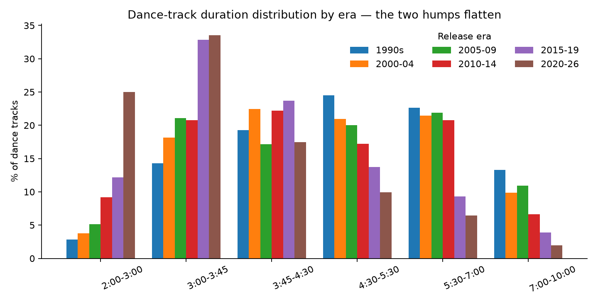
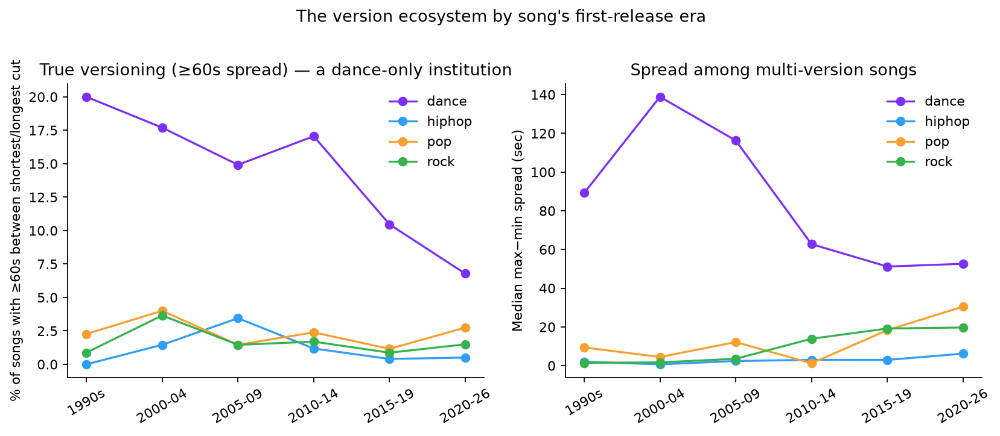
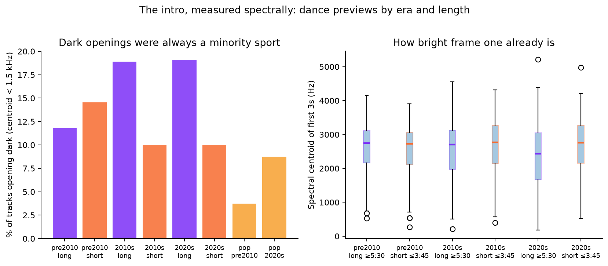
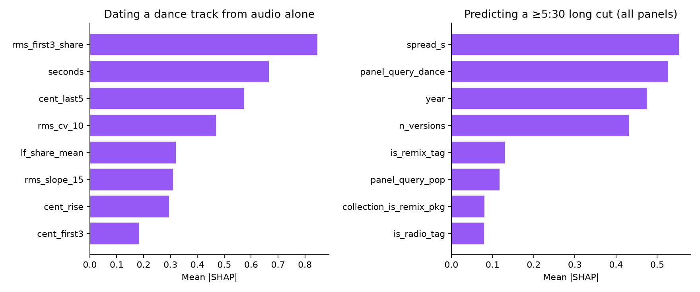

# The Extended Mix Died in the Storefront

**Streaming did not shorten dance music. It deleted the other version of it. The song that used to exist at two lengths, one for radio and one for the club, now exists at one length, and the break happened in about three years.**

*Musing with Mike · 2026-10-24 · Topic: edm · Build #48*

Everyone knows songs got shorter in the streaming era. That story is true and it is also the least interesting part of what happened. Dance music was never just a collection of songs at one length each. It was a versioning business. A single shipped as a short cut built for radio and a long cut built for a DJ to mix with, two products serving two buyers, sold off the same master. deadmau5's "Strobe" is the clean example: the 2009 single carries a Radio Edit at 3:32, a Club Edit at 6:19, and the full cut at 10:37. Daft Punk's "One More Time" shipped at 3:55, 5:20, and an 8:00 12" mix. Underworld's "Born Slippy (Nuxx)" exists at 4:24 and at 11:47.

So instead of measuring song length again, I measured the spread: for every song in a 13,471-track storefront catalog, the distance between its shortest and longest cut. Then I checked whether the versions that remain still do the old jobs, by measuring the openings of 780 tracks from their preview audio. The length story turns out to be a rounding error next to the versioning story.

## Why this would surprise someone who knows the field

Ask a working DJ and they will tell you extended mixes are alive. Beatport still sells them, Traxsource still sells them, and labels still commission them. All true, in the DJ store. What nobody had measured is the storefront where almost everyone actually listens. In that catalog, the share of dance songs that exist at genuinely different lengths fell by two thirds, the radio-plus-club pair that defined the format for twenty years collapsed after 2014 specifically, and the tracks still labeled "Extended" now open at full brightness with no mixable intro at all. The word survived the thing it named. Experts price the DJ store. The deletion happened in the other store, quietly, and the timing gives away the cause: downloads did not do this, playlists did.

## What I built

| # | Question | Data | Script |
|---|----------|------|--------|
| 1 | How did track lengths change, dance vs pop, hip-hop, and rock? | iTunes Search API catalogs for 70 curated artists (36 dance), 13,471 tracks with durations and dates, 1990-2026 | `src/01_fetch.py`, `src/02_catalog.py` |
| 2 | Did songs stop existing at multiple lengths, and when exactly? | Same catalog grouped into 8,531 songs (title stems) with version tags parsed from titles; spread = longest minus shortest cut per song | `src/02_catalog.py` |
| 3 | Do the surviving long cuts and "Extended" tags still contain a DJ intro? | 780 thirty-second previews decoded with ffmpeg; per-second spectral centroid, low-frequency share, and energy features, stratified by era and length | `src/03_audio.py` |
| 4 | What actually predicts a long cut today, and can you hear a long cut's age? | XGBoost + SHAP on the full catalog (long-cut model) and on preview audio of long dance cuts (era model) | `src/04_model.py` |

Reproduce: `python3 src/01_fetch.py && python3 src/02_catalog.py && python3 src/03_audio.py && python3 src/04_model.py && python3 src/05_charts.py`.

## Findings

**1. Yes, dance tracks got shorter. That is the small story.** The median dance track in the catalog falls from 5:02 in the 1990s to 3:24 in 2020-26, a drop of 98 seconds. Pop fell 76 seconds over the same span, hip-hop 55, rock just 16. Tracks under three minutes went from 2.9% of dance releases to 25.0%. Tracks at club length, five and a half minutes or more, went from 37.0% to 8.7%. All of that is the consensus story, and on its own it would not be worth a build.



**2. The big story is the spread. One in five 1990s dance songs existed at genuinely different lengths. Now it is one in fifteen.** Define true versioning as a song whose longest and shortest cuts differ by at least 60 seconds, enough to rule out remasters and reissue duplicates. Dance sits at 20.0% in the 1990s and holds between 15% and 18% through 2014. Then it falls to 10.5% in 2015-19 and 6.8% in 2020-26. The control genres never do this at all: pop, hip-hop, and rock peak at 4.0% true versioning in their best era, and their multi-version songs turn out to be the same cut reissued, with median spreads of 2 to 20 seconds. Versioning was a dance-only institution, built for a buyer the other genres never had: the DJ. Among dance songs that do still have multiple cuts, the median spread peaked at 139 seconds in 2000-04 and is now 53 seconds. The versions that remain are close cousins, not different products.

**3. The radio-plus-club pair held for twenty years and then died in one step, right when playlists took over.** The signature product of the format was a song with both a radio-length cut (3:45 or under) and a club-length cut (5:30 or over) in the same catalog. That pair rate is 6.8% of dance songs in the 1990s, 8.2% in 2000-04, 7.1% in 2005-09, 7.2% in 2010-14. Flat for two decades, through the CD era and the whole download era. Then 1.9% in 2015-19 and 2.0% in 2020-26. Nothing about the iTunes download store killed the pair in fifteen years. The playlist economy killed it in about three, because a playlist slot is one slot: a second, longer version of the same song no longer serves a second buyer, it competes with the first version for the same placement and splits its own play counts.



**4. Remixes survived. They just stopped adding length.** If versioning died, you would expect remix packages to die with it, and they did not. Tracks tagged as remixes rise from 4.2% of dance releases in the 1990s to 17-20% during the 2010s EDM boom and sit at 14.8% in the 2020s. What changed is what a remix is for. Marshmello's "Silence" (2017) got six remixes in its first year, and every one lands within 53 seconds of the 3:01 original: they are substitutions aimed at different playlists and audiences, not longer tools for DJs. FISHER's "Losing It" (2018) tells the same story from the other side, a radio edit at 2:43 and an "original" that is only 4:08. Compare the older economy: Avicii's "Levels" (2011) ran 3:20 on radio against a 5:39 original, and Guetta's "Titanium" stretched from a 4:05 album cut to a 5:12 extended and a 6:44 Alesso remix. The version count held up. The version spread is what was deleted.

**5. The tags became decoration. "Extended" never meant much in the storefront, and now it predicts almost nothing.** Even at its peak, the word "Extended" appears on only 3.1% of dance tracks in this catalog, and "Radio Edit" tags fell from 7.1% of tracks in 2000-04 to 0.6% today, because there is no longer a second cut to distinguish the first one from. In the long-cut model below, the extended tag ranks near the bottom of every feature. The label copy kept the vocabulary of the versioning era after the economics left.

**6. The intro audit: the dark, mixable opening was always an underground trait, and today's extended mixes do not have one.** I measured the first 30 seconds of 780 previews spectrally, because loudness cannot see an intro (a bare kick drum is already loud; a chord pad is already sustained). A DJ intro reads as darkness: energy piled into low frequencies, little happening above 1.2 kHz. Even before 2010, only about 12% of long dance cuts open that dark, and the ones that do are the underground canon: "Strobe" spends its entire preview dark, as do Four Tet's "Swimmer" and Daft Punk's "Veridis Quo", while mainstream long cuts from Tiësto or Paul van Dyk start bright, kick, hats, and riff from frame one. In the 2020s the pattern sharpens, and it is a selection effect: the share of long cuts opening dark actually rises to about 19%, because the long cuts that exited were the bright mainstream ones. The darkest survivors are deadmau5 again ("Re_Jaded", 12 minutes, dark for 93% of its preview), Four Tet, and Caribou: the long form survived as an underground credibility signal. But the thirteen 2020s tracks in the sample literally tagged "Extended" open brightest of any group measured, a mean opening centroid of 3,038 Hz, with zero dark openings. The modern extended mix is the same arrangement with more bars. It is longer, and it is not a DJ tool. Pop, for contrast, moved the other way: pop openings got darker and sparser between eras (median opening centroid 2,947 Hz before 2010, 2,452 Hz in the 2020s), the Billie Eilish effect. Dance's mainstream got brighter and shorter at the same time.



**7. Two models, one conclusion: the calendar and the version family decide length now, tags and sound do not.** An XGBoost model predicting whether a catalog track runs 5:30 or longer (base rate 12.3%, held-out AUC 0.815) ranks its levers clearly: the song's own version spread, being a dance track, the release year, and how many versions the song has. In other words, long cuts now come from songs that still live in a versioning family, in one genre, increasingly rarely as years pass. The second model asks whether you can date a long dance cut from its preview audio alone, pre-2010 vs 2020s. Barely: AUC 0.617, with the top signals being how loud the first three seconds already are and how bright the preview ends. The surviving long cut mostly sounds like the old long cut. What changed is not the sound. It is who still bothers to ship one, and where.



## The operator takeaway

There are now two music economies with two different products, and they stopped cross-subsidizing each other. The DJ store (Beatport, Traxsource) still runs the versioning business: extended mixes, intros, tools, priced per download to working DJs. The storefront runs a one-length business: one canonical cut per song, optimized for playlist slots that pay per play regardless of duration, where a second length is not a second product but a competitor to your own track. That is why the pair rate survived downloads and died with playlists. Downloads still sold units, and two versions were two units. Playlists allocate attention, and two versions split one allocation.

Three consequences worth pricing. First, the DJ tool gap is a real, small market: DJs playing storefront-era tracks have to manufacture their own intros with edits, loops, and stems, which is why edit packs and stem players keep growing while the catalog itself offers less to work with. Second, for labels, the version budget did not shrink, it moved: the money that bought a radio edit and a club mix now buys same-length substitutions, remixes, sped-up and slowed cuts, each aimed at a different playlist surface. Watch remix counts, not remix lengths, if you want to see where a label is spending. Third, length itself became a positioning signal. When the mainstream standardizes at 3:24, shipping a 10-minute cut is no longer a format requirement, it is a statement, and the artists making it (deadmau5, Four Tet, Bicep) are exactly the ones whose brand is being the exception. The extended mix went from infrastructure to identity. Infrastructure is a better business, but identity is what is left.

## Caveats

- **Storefront survivorship.** This is the catalog as sold in October 2026, not a census of what was released in 1998. Delistings, label catalog sales, and reissues shape the older eras. The direction of the bias is worth noting: reissues tend to preserve hits and their famous long versions, so if anything the old eras may look more versioned here than a true period census would show. The post-2014 pair collapse is a within-catalog timing pattern and is the finding least exposed to this bias.
- **The 200-track cap.** The API returns at most 200 songs per artist query, which binds hardest on prolific remix-era catalogs (deadmau5, Tiësto, Guetta). Truncation drops later-alphabetical and lower-priority results unevenly; era counts should be read as samples of superstar catalogs, not genre totals. The panel is 70 major artists by design. Build #39 covered the DJ-store side of this world; this build is the storefront side.
- **Title parsing.** Version tags and song stems are parsed from titles with explicit rules (`src/02_catalog.py`). Skits and interludes sharing a song's title can inflate a handful of individual spreads (a few stems show 30-60 second "versions" that are clearly interludes), and featured-artist strings are normalized to the first-billed artist. Medians, the 60-second threshold, and the pair rate are robust to these cases; the single largest spreads are not individually audited.
- **Dates follow collections.** For some tracks the API's release date is the album or reissue date rather than the original single date. Stem eras use each song's earliest dated version, which limits the damage for the versioning analysis; single-year precision should not be over-read.
- **Previews.** Preview audio is the first 30 seconds of each track at preview loudness, verified against tracks with known openings. Spectral features are computed within each preview and compared as relative quantities; absolute loudness comparisons across tracks would not be meaningful and are not made. The era model in finding 7 uses only long dance cuts (n = 220) and its weakness is reported as a result, not hidden.
- **Model B's family features.** The long-cut model includes stem-level descriptors (the song's spread and version count), which describe the version family a track belongs to. Read its SHAP ranking as a description of the ecosystem's structure, not as causal levers a label can pull independently.

## Sources

- Apple iTunes Search API, US storefront, queried 2026-10-24: track catalogs and 30-second preview URLs for 70 curated artists (36 dance, 12 pop, 10 hip-hop, 12 rock). Full query list, row counts, and field definitions in `data/PROVENANCE.md` and `data/fetch_manifest.json`.
- All durations, version tags, stems, spreads, and audio features are computed from that pull by the scripts in `src/`; derived tables are in `data/` (`tracks_clean.csv`, `stems.csv`, `catalog_by_era.csv`, `stems_by_era.csv`, `preview_features.csv`, model and SHAP outputs).

## Layout

```
the-extended-mix-died/
├── src/
│   ├── 01_fetch.py       # iTunes catalog pull for 70 artists, raw JSON cached
│   ├── 02_catalog.py     # cleaning, version tags, stems, spreads, era stats
│   ├── 03_audio.py       # preview decode (ffmpeg) + spectral intro features
│   ├── 04_model.py       # XGBoost + SHAP: long-cut model, audio era model
│   └── 05_charts.py      # charts
├── data/                 # derived CSVs/JSON + PROVENANCE.md (raw pull gitignored)
└── charts/               # dance_hist, version_spread, intro, shap
```
