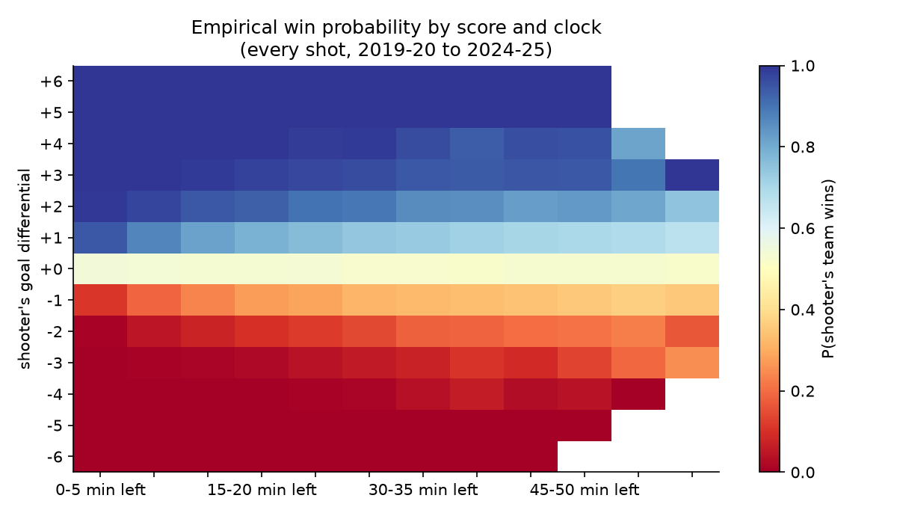
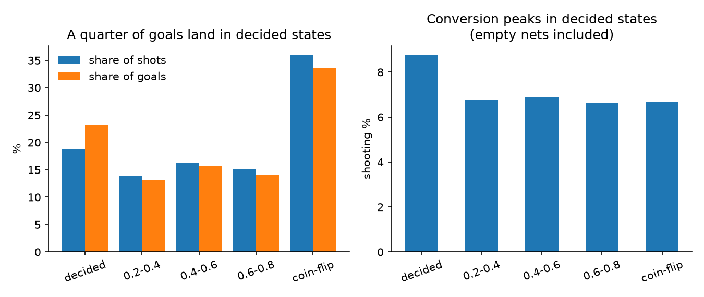
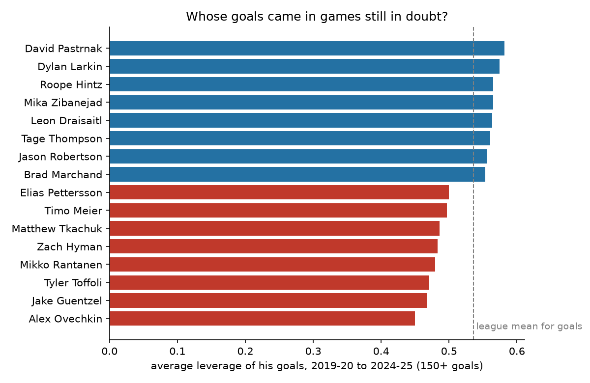
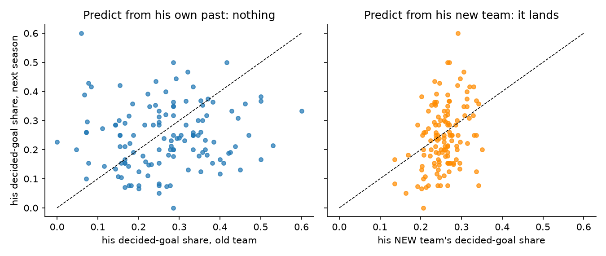
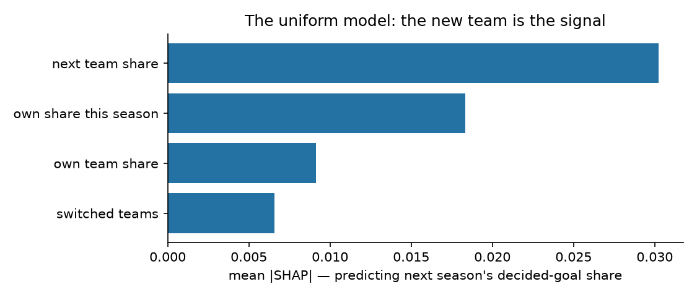

# Garbage Time Is a Uniform, Not a Trait

**One in four NHL goals is scored after the game is already decided. Fans treat the players who score them as stat padders and the players who score in close games as clutch. Both labels are wrong. The profile follows the team, not the player, and when a player changes teams it resets to his new team's profile within one season.**

*Musing with Mike · 2026-10-25 · Topic: sports-analytics · Build #49*

Every scoring race mixes two different products. Some goals change who wins. Some are scored when the win probability is already past 90 percent one way or the other, late in a blowout, into an empty net, or as a consolation goal in a game that ended an hour ago. The record book counts them the same. Contract talks do too, mostly. And fan arguments definitely do, because "he pads his stats in garbage time" and "he scores when it matters" are treated as facts about a player's character.

So I built a win probability surface from 668,622 shot attempts over six seasons (2019-20 to 2024-25, MoneyPuck shot data), scored every goal for leverage, and then ran the one test that separates character from context. Players who changed teams. If a garbage time profile is a trait, it travels with the player. If it is a uniform, it stays with the team he left and he picks up the new one.

## Why this would surprise someone who knows the field

Hockey analysis has leverage ideas borrowed from baseball, and everyone in the sport argues about empty net merchants and clutch scorers as if those were properties of people. Nobody had run the natural experiment the trade market runs every year. A player's decided-goal share this season predicts his share next season at r = 0.05, which is nothing. His new team's share predicts it at r = 0.34. The trait everyone argues about is measurable, it is large, and it belongs to the jersey. Experts scout the player. The number says scout the game states his team plays in.

## What I built

| # | Question | Data | Script |
|---|----------|------|--------|
| 1 | When is an NHL game actually decided? Build an empirical win probability surface from score and clock, validate it out of sample | 668,622 MoneyPuck shot rows, 2019-20 to 2024-25 | `src/01_fetch.py`, `src/02_leverage.py` |
| 2 | How much scoring happens in decided states, and is garbage time actually softer? | Every shot scored for leverage; conversion and xG by leverage bucket, with and without empty-net shots; playoffs compared | `src/03_profiles.py` |
| 3 | Whose goals came in games still in doubt? | Player-season leverage profiles; star table for every 150+ goal scorer of the window | `src/03_profiles.py` |
| 4 | Trait or uniform? Persistence, the switcher test, and the team-level check | 803 player-season pairs (12+ goals); 129 team changes; team goal differentials vs next season win share | `src/04_switchers.py` |
| 5 | What should a front office pay for? Two XGBoost models with SHAP | Next season's decided share (uniform model); next season's goals per attempt from this season's leverage split (pay model) | `src/05_model.py` |

Reproduce: `python3 src/01_fetch.py && python3 src/02_leverage.py && python3 src/03_profiles.py && python3 src/04_switchers.py && python3 src/05_model.py && python3 src/06_charts.py`

The win probability model is deliberately simple. For regulation play it is the empirical win rate of the shooting team grouped by goal differential and five-minute clock bucket. Fit on 2019-20 through 2022-23 and scored on the next two seasons, it posts a Brier score of 0.173 against 0.250 for a constant baseline, and its calibration is within three points in every probability band. Leverage is 1 minus twice the distance of win probability from a coin flip, so 1.0 is a game fully in doubt and 0.0 is a game that is over. A goal is a decided-state goal when leverage is under 0.20, meaning win probability was already outside 10 to 90.

## Findings

**1. A quarter of NHL goals are scored after the game is decided, and the playoffs barely change that.** Of 43,774 regular-season goals in the window, 25.4 percent came in decided states, against 21.3 percent of shots. Strip out every empty-net goal and it is still 21.1 percent of the remaining goals. The playoff number surprises people more: 24.9 percent of playoff goals are also scored in decided states. Playoff hockey is tighter on average, but playoff series still produce blowouts, and a quarter of the goals in them land after the game is gone. The average goal in this dataset carries leverage of 0.536. A quarter of them carry almost none.



**2. Garbage time is not softer hockey. It is emptier hockey.** The lazy version of this story says scoring inflates late in blowouts because defenses relax. The shot data mostly rejects it. Decided-state shots do convert at 8.7 percent against 6.7 percent for coin-flip shots, but 21.7 percent of decided-state goals are empty-net goals, scored on 5.9 percent of decided-state shots against no goalie at all. Remove empty nets and decided-state conversion is 6.9 percent against 6.7 percent in coin-flip states, with xG per shot nearly identical. Defenses do not fall apart. The volume is the story: a fifth of all shots happen in games that are already over, and one goal in eighteen across the whole league is an empty-net goal (2,415 of them, 5.5 percent of all goals, average leverage 0.057, the lowest-value goals in the sport by win probability added).



**3. The star table is a standings table in disguise.** Rank the 150-goal scorers of the last six seasons by the average leverage of their goals and the bottom is a list of players on dominant teams. Alex Ovechkin sits last at 0.450: of his 238 goals in the window, 89 (37.4 percent) came in decided states and 31 were empty-net goals, both driven by a Capitals team that led a lot and a coach who used him to close games out. Jake Guentzel (0.467), Tyler Toffoli (0.471), Mikko Rantanen (0.479) and Zach Hyman (0.483) fill out the bottom five. The top is David Pastrnak (0.582), Dylan Larkin (0.574), Roope Hintz and Mika Zibanejad (0.565), Leon Draisaitl (0.564): stars whose teams played close games, or who carried bad teams through them. Connor McDavid (0.538) and Auston Matthews (0.544) sit almost exactly on the league mean of 0.536. Read the table as character and you learn nothing. Read it as a fingerprint of each team's season and it is exact.



**4. The switcher test ends the argument. The profile stays with the jersey.** Across 803 player-seasons with at least 12 goals, a player's decided-goal share predicts his own share next season at r = 0.05. For players who stayed, 0.04. For players who switched teams, 0.08. There is no trait there to find. For the 129 players who changed teams, his new team's decided-goal share predicts his next-season share at r = 0.34, his old team's at 0.10, and the same-season correlation between a player and his team mean is 0.38. The examples read like a reset button. Johnny Gaudreau scored 42.5 percent of his 2021-22 goals in decided states for Calgary, then 19.0 percent in his first Columbus season. Alex DeBrincat went from 26.8 percent in Chicago to 7.4 percent in Ottawa. Bo Horvat went from 36.8 percent in Vancouver to 18.2 percent with the Islanders, a team whose own share was 16.9 percent. Matthew Tkachuk is the control case: 35.7 percent in Calgary, 30.0 percent in Florida, because Florida also plays in decided games. He did not keep a trait. He changed into a similar uniform.



**5. The model agrees, and it prices the discount instead of deleting the goals.** An XGBoost model predicting next season's decided-goal share (803 player-seasons) ranks the new team's share as its strongest input by SHAP, ahead of the player's own share this season, with his current team's share and the switch flag behind both. The absolute accuracy is modest because single-season shares are noisy, but the ranking is the result: the model reaches for the jersey before it reaches for the player. The second model prices scoring for the following season (524 player-seasons, held-out correlation 0.68 predicting next season's goals per attempt). In the joint linear read, a coin-flip goal per attempt carries a coefficient of 0.42 toward next season's scoring rate, a decided-state goal 0.23, a middle goal 0.24, and xG per attempt 0.52. A garbage time goal is worth roughly half a real one as evidence about the future. It is not worth zero, and treating it as zero is its own mistake.



**6. For teams, do not adjust anything. Decided goals are receipts, not fakes.** The obvious front office move is to strip garbage goals out of goal differential before projecting a team. It does not help. Raw goal differential predicts next season's win share at r = 0.62. Leverage-weighted goal differential predicts it at r = 0.62. Identical. The reason is the same one that runs the whole piece: a team does not luck into decided states. It earns them by being up three in the third period, over and over, and the goals it scores there are a byproduct of the same quality that produced the lead. Delete them and you delete signal. The adjustment belongs on the player side of the ledger, where context is assigned to a person. On the team side, the context is the accomplishment.

## The operator takeaway

Three places this changes a decision. First, player evaluation: any "clutch scorer" or "stat padder" claim made without a leverage split is a claim about his team's game states, and this dataset says the player's own history carries almost none of it (r = 0.05). If you acquire the player, you acquire your own game states, not his old ones. Second, contract math: goals are not fungible as evidence. A decided-state goal carries about half the forward signal of a coin-flip goal in the pay model, so a 40-goal season built on a contender's blowouts and a 40-goal season built on a lottery team's one-goal games are different assets, priced off the same counting stat. Third, the record book: empty-net goals are 5.5 percent of all goals and the lowest-leverage scoring play in the sport, and they count the same as a game-tying goal in the last minute. Ovechkin scored 31 of them in this six-year window alone, during the most scrutinized scoring chase in decades. The chase was real. So is the mix inside it, and the mix is a coaching deployment decision, not a character trait, which is exactly why it should be reported next to the total instead of argued about under it.

## Caveats

- **The win probability surface is coarse.** It uses goal differential and clock only. It does not know about manpower, so a power play goal up two late reads the same as an even strength one, and it does not know about goalie quality or score effects on shot choice. The out-of-sample calibration says the surface is honest at the bucket level. Single-goal leverage values should not be over-read.
- **Overtime uses a fixed rule** (tied 0.50, up or down one 0.72 or 0.28 from the shooter's view) rather than a fitted surface, because sudden-death samples are thin. Overtime goals are a small share of the totals.
- **Primary team assignment.** Players traded mid-season are assigned to the team of most of their attempts that season. The switcher test uses the following season, when the assignment is clean. Clayton Keller's ARI to UTA move is a franchise relocation and sits in the switcher panel; removing franchise moves does not change the direction of any correlation reported.
- **The 2020-21 season was a 56-game COVID season** with a divisional format. It is included for sample size. Its game-state mix was unusual, which if anything adds noise against the switcher result, not for it.
- **Small shares are noisy.** A 12-goal season has a decided-share standard error around ten points. That noise is part of the point (single-season "clutch" leaderboards are mostly noise plus team), and it is why the switcher correlations are reported on 129 changes rather than sold as precise effects.
- **MoneyPuck's xG model** supplies the xG figures, and its public 2024-25 file ships an empty homeWinProbability column, which is why win probability here is empirical. Both choices are documented in `data/PROVENANCE.md`.

## Sources

- MoneyPuck public shot data, seasons 2019-20 through 2024-25, downloaded 2026-10-25 from the links at moneypuck.com/data.htm: 668,622 shot attempts with score state, clock, shooter, empty-net flags, xG, and game results. Full field list and the win probability validation in `data/PROVENANCE.md`, `data/wp_surface.csv`, and `data/wp_calibration.csv`.
- All leverage values, profiles, panels, and model outputs are computed by the scripts in `src/`; derived tables are in `data/` (`bucket_stats.csv`, `player_seasons.csv`, `star_profiles.csv`, `switcher_panel.csv`, `team_panel.csv`, `headline_stats.json`, `persistence_stats.json`, `model_stats.json`, SHAP tables).

## Layout

```
garbage-time-is-a-uniform/
├── src/
│   ├── 01_fetch.py       # MoneyPuck shot zips, 2019-20..2024-25, slim parquet
│   ├── 02_leverage.py    # empirical WP surface, out-of-sample validation, leverage per shot
│   ├── 03_profiles.py    # bucket stats, empty-net audit, player and star profiles
│   ├── 04_switchers.py   # persistence, the switcher test, team differential check
│   ├── 05_model.py       # XGBoost + SHAP: uniform model and pay model
│   └── 06_charts.py      # charts
├── data/                 # derived CSVs/JSON + PROVENANCE.md (raw zips + parquets gitignored)
└── charts/               # wp_surface, buckets, switchers, stars, shap_uniform
```
