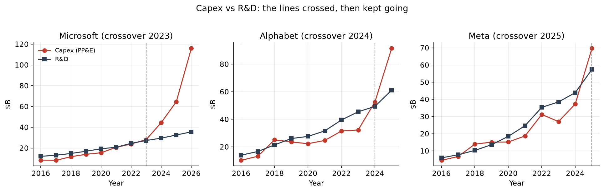
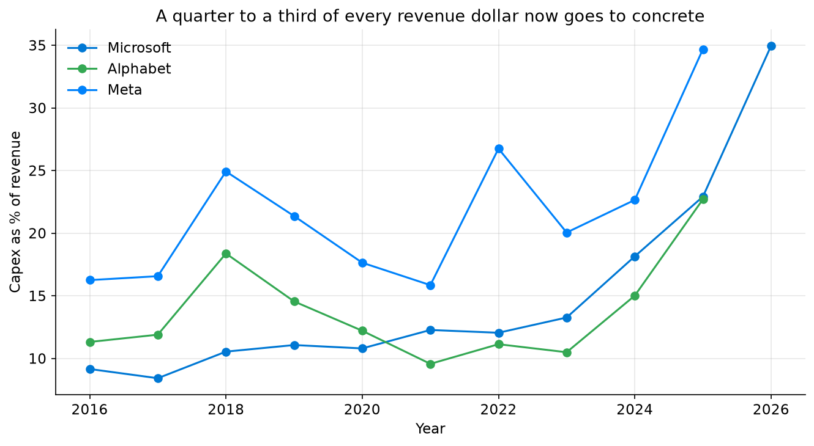
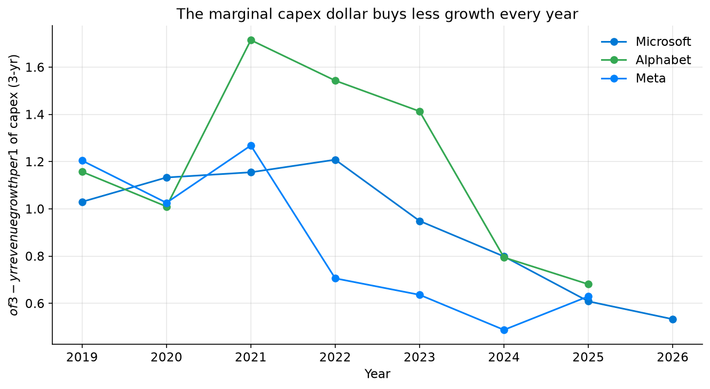
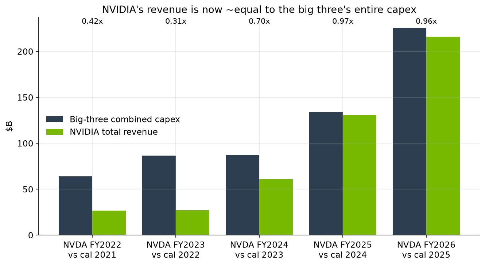
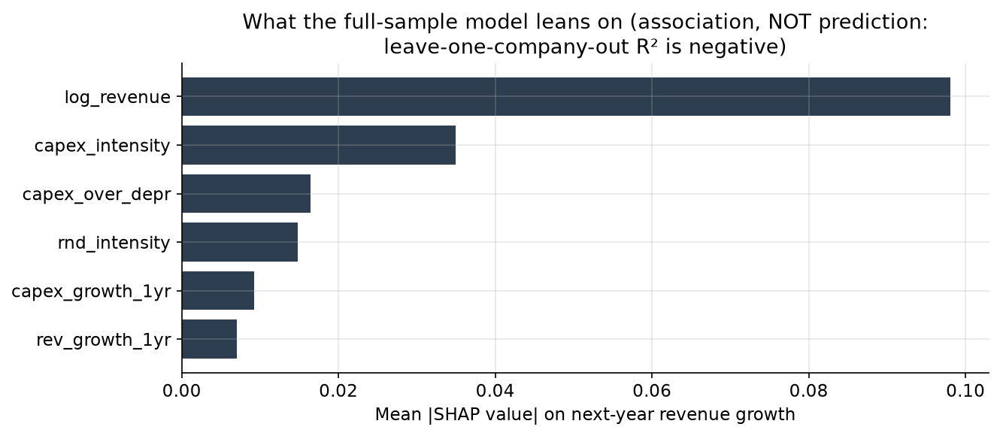

# Concrete Eats Code: Big Tech's Biggest Expense Is No Longer Engineers

**Build #54, Musing with Mike, 2026-10-30. Topic: tech-industry.**

## The novelty case, stated before building

Everybody quotes the hyperscaler capex number. Hundreds of billions for AI
data centers, every quarter, every earnings call. But nobody had measured
that number against the thing it displaced. R&D is the engineer budget, the
line that built these companies. If capex has crossed R&D, the business
changed its shape: from a company that buys brains to a company that buys
buildings. And nobody had priced the marginal dollar either. Capex can
quadruple while revenue doubles, and the gap between those two growth
rates is the whole argument about whether the AI build-out pays. So this
build measures three things straight from SEC filings: the crossover
against R&D, the revenue each new capex dollar actually bought, and how
much of the spend one supplier captures. If you know this field, the
surprise is not that capex is big. It is how recently the lines crossed,
how fast the payoff fell, and how concentrated the capture is.

## What I did

I pulled annual XBRL facts from the SEC EDGAR companyfacts API (public, no
key, fetched 2026-10-30) for Microsoft, Alphabet, Meta, and NVIDIA:
revenue, R&D expense, cash paid for property and equipment (capex), and
depreciation. I kept 10-K annual rows only, keyed by period end date, and
merged across candidate XBRL tags because issuers switch tags mid-history
(Alphabet reported 2022 revenue only under one of its two revenue tags;
NVIDIA's capex lives under PaymentsToAcquireProductiveAssets, not the
standard PP&E tag). Amazon is excluded on purpose: its filings carry no
standard R&D tag (it reports "technology and content" under a
non-standard mapping) and its capex mixes fulfillment warehouses with
data centers, so including it would corrupt the comparison. That
exclusion is a methods choice, not a gap I hid.

Alignment notes, because fiscal years differ: Microsoft's year ends in
June, so its FY ending June of year Y is plotted in year Y. Alphabet and
Meta end in December. NVIDIA ends in January, so NVIDIA's FY ending in
January of year Y mostly overlaps calendar year Y-1, and the capture
ratio matches it against hyperscaler calendar year Y-1. Combined totals
use complete years only (all three hyperscalers present).

Then I built the derived metrics, a panel model, and five charts:

- `src/01_fetch.py`: EDGAR companyfacts fetch → `data/edgar_annual.csv`
- `src/02_analysis.py`: intensities, crossover runs, 3-year revenue
  growth per capex dollar, NVDA capture ratio, mechanical
  counterfactual → `data/derived.csv`, `data/summary.json`
- `src/03_model.py`: ridge and XGBoost predicting next-year revenue
  growth, validated leave-one-company-out, plus SHAP →
  `data/panel.csv`, `data/model.json`
- `src/04_charts.py`: the charts below → `charts/`

## Findings

**1. The crossover happened in the last three years, one company at a
time.** Microsoft crossed first and hardest: capex passed R&D in FY2023
and reached $115.9B against $35.6B of R&D in FY2026, a 3.26x ratio.
Alphabet crossed in 2024 ($91.4B vs $61.1B in 2025, 1.50x). Meta crossed
in 2025 ($69.7B vs $57.4B, 1.21x). Combined, the three spent $225.7B on
capex in 2025 against $150.9B on R&D. In 2019 it was $52.6B against
$56.5B. Capex went from 14.7% of combined revenue to 25.5%. The company
that used to be valued on its engineers is now, by its biggest budget
line, a construction project with a software division attached. And the
build is accelerating past maintenance: Microsoft's capex runs 3.38x its
depreciation, Meta's 3.74x, Alphabet's 4.33x. This is not replacing old
servers. It is adding capacity at three to four times the wear rate.

**2. The marginal capex dollar buys about half what it bought before
the AI boom.** Measure it as three-year revenue growth per dollar of
three-year capex. Against the 2019-2020 baseline, that productivity fell
50.7% at Microsoft (to $0.53 per $1), 43.5% at Meta (to $0.63), and 37.2%
at Alphabet (to $0.68). A mechanical counterfactual makes the gap
concrete: if 2019-2020 productivity had held, the last three years of
capex would have predicted $243B of Microsoft revenue growth instead of
the $120B that arrived, $191B instead of $120B at Alphabet, and $149B
instead of $84B at Meta. That is roughly $259B of "missing" growth across
the three. Read it carefully, because it is not lost money. Part of the
gap is maturing core businesses, and part is timing: data centers built
in 2025 have not had time to pay. But the direction is unambiguous, and
it is the opposite of the build-out pitch. The more they spend, the less
each dollar returns, and the gap is now measured in hundreds of billions.

**3. One supplier's topline now roughly equals the big three's entire
capex.** NVIDIA's total revenue, matched to the prior calendar year's
combined hyperscaler capex, went from 0.31x in FY2023 to 0.97x in FY2025
and 0.96x in FY2026 ($215.9B of NVIDIA revenue against $225.7B of
big-three 2025 capex). Two caveats keep this honest. NVIDIA sells to
far more buyers than these three, and hyperscaler capex includes land,
buildings, power, and network gear, not just chips. So this is a scale
comparison, not a literal flow of dollars. Even with both caveats, the
concentration is the story. The AI boom has a toll collector, and the
toll is now roughly the size of the road budget. From a marketplace
lens, that is the position every platform operator dreams of and every
platform buyer should fear: a single supplier whose revenue scales one
to one with your entire infrastructure spend.

**4. Next year's growth cannot be read off this year's build-out, and
that is itself the finding.** A panel model (35 company-years) predicting
next-year revenue growth from capex intensity, R&D intensity, capex
growth, capex over depreciation, and lagged growth fails out of sample:
leave-one-company-out R² is negative for both ridge (-0.74) and XGBoost
(-2.06), worse than simply predicting that growth persists (RMSE 0.144
vs 0.209 for ridge). In-sample SHAP leans on company scale first, then
capex intensity, but with out-of-sample validation failing, that is
association, not prediction. The honest read: the payoff window is
longer than a year, so anyone claiming this year's capex proves (or
disproves) the AI bet from next year's revenue is reading noise. The
argument has to be fought on the multi-year productivity trend in
finding 2, not on one earnings print.

## Bottom line

Big Tech's biggest line item flipped from people to concrete in 2023
through 2025, the return on each new concrete dollar roughly halved, and
a single supplier now books revenue on the scale of the whole build.
That combination is why the capex debate feels so unresolved: the spend
is real, the payoff is slow and shrinking at the margin, and the most
durable winner so far is the company selling the picks, not the miners.
If you run a platform, the operator question is not whether to build.
It is what your productivity number has to be for the next trillion to
earn its keep, and whether you have a second supplier before you need
one.

## Charts

## Limitations

- Capex here is cash paid for PP&E. It includes land, buildings, power,
  and networking, not just AI accelerators, so the NVIDIA ratio
  overstates any literal chip share. It is a concentration metric, not
  an invoice trace.
- The counterfactual is mechanical: it holds 2019-2020 productivity
  fixed and applies it to recent capex. It does not adjust for core
  business maturity, price changes, or build-out lead times. Treat the
  $259B as the size of the gap to explain, not a loss.
- The panel model has 35 rows and 3 companies. Leave-one-company-out
  validation is the right test at that size, and it says the 1-year
  signal is not there. A longer panel or quarterly data could change
  that, and would be the natural follow-up.
- Microsoft's June year-end vs December year-ends introduces up to a
  six-month alignment offset in combined totals. It does not change any
  crossover year or the direction of any trend.

## Sources and reproducibility

- SEC EDGAR companyfacts API, `https://data.sec.gov/api/xbrl/companyfacts/`,
  CIKs 789019 (Microsoft), 1652044 (Alphabet), 1326801 (Meta), 1045810
  (NVIDIA). Fetched 2026-10-30. Raw tag audit in `data/edgar_raw.json`.
- Rerun: `python3 src/01_fetch.py && python3 src/02_analysis.py &&
  python3 src/03_model.py && python3 src/04_charts.py` (requires
  `requirements.txt`; SEC asks for a descriptive User-Agent, set in the
  fetch script).
