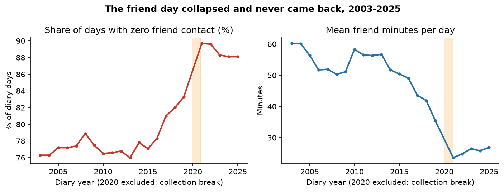
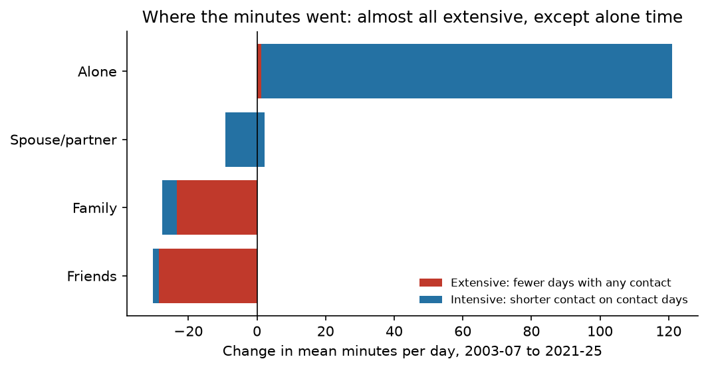
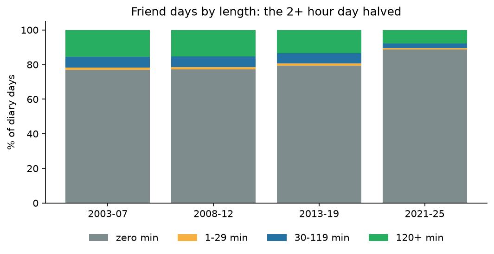
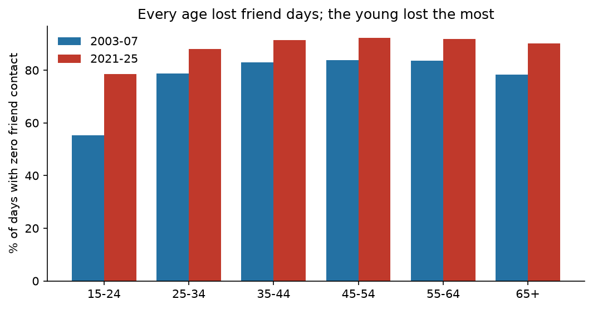
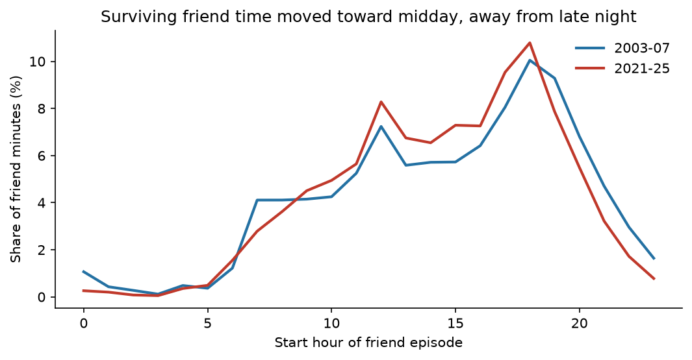
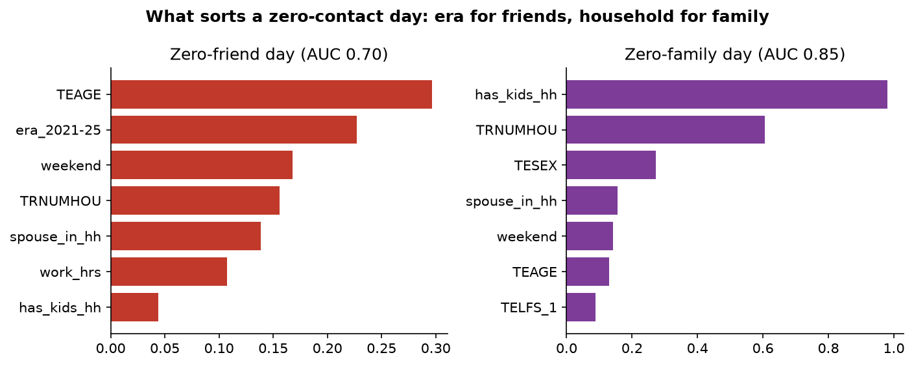

# The Friendless Day

**Nobody lost a little friendship. Millions of people lost the whole day.**

*Musing with Mike · 2026-11-02 · Topic: relationships*

Every loneliness story quotes an average: Americans spend less time with
friends than they used to. Averages hide the shape, and the shape is the whole
story. Using twenty-two years of time diaries, I split the fall in friend time
into two parts: fewer days with any friend contact at all, versus shorter
contact on the days friends still meet. If the first part dominates, friendship
is not thinning. It is going to zero, one day at a time, and the fix is not
"a bit more connection." It is getting a friend day back on the calendar at all.

## Why this would surprise someone who knows the field

The loneliness literature argues about averages and about whether the decline
is real, cohort-driven, or a survey artifact. Almost nobody decomposes the
diary-day distribution, because the headline number (mean minutes) is easier.
That decomposition turns out to be nearly the entire result: 94% of the fall
in friend minutes is extensive, days going to zero, while a surviving friend
day is barely shorter than it was twenty years ago (227 minutes vs 242). And
the same decomposition run on the other ties draws a clean line the literature
does not draw: partner time did not fall at all, family time fell mostly the
same extensive way but less, and alone time grew entirely the other way,
longer alone days, not more of them. Friendship is the only tie with no floor
and no short form, which is why it collapses to zero instead of thinning.
That is a mechanism, not a trend line, and it points at a different
intervention: protect the day, not the minute.

## What I built

| # | Question | Data | Script |
|---|----------|------|--------|
| 1 | Did friend time thin, or go to zero? | ATUS 2003-2025 episode microdata, 250,165 diary days, survey-weighted | `src/01_build.py` |
| 2 | Is the pattern unique to friends? | Same file: family, spouse/partner, alone, sibling minutes, same decomposition | `src/01_build.py` |
| 3 | Who lost friend days, and did anything cushion it? | Age, weekend, kids, spouse in household, work hours | `src/01_build.py` |
| 4 | Who has a zero-friend day, and is it the same sorters as a zero-family day? | XGBoost + SHAP, two models | `src/02_model.py` |
| 5 | Did friend time move home, or earlier in the day? | Episode location (TEWHERE) and start hour | `src/01_build.py` |

Reproduce: `python3 src/01_build.py && python3 src/02_model.py && python3 src/03_charts.py`.
Step 1 reads the ATUS multi-year files cached from the 2026-10-27 build
(see `data/PROVENANCE.md`); the committed `data/respondent_day.csv` reproduces
every headline number on its own.

## Findings

**1. Friendship did not thin. It went to zero, and 94% of the fall is that.**
Mean friend minutes per day fell from 56.0 (2003-07) to 25.5 (2021-25), a loss
of 30.5 minutes. The share of days with zero friend contact rose from 76.9%
to 88.7%. But on days friends do meet, the time barely moved: 242 minutes
then, 227 now, median 188 vs 180. Exact decomposition: -28.6 minutes
extensive, -1.8 intensive. The unit of friendship is the day, not the hour,
and the day is what disappeared.

**2. This is a new plateau, not a COVID blip, and it started before COVID.**
The zero-friend share sat near 77% from 2003 through 2016, drifted up to
83.3% by 2019, then jumped to about 89-90% in 2021 and stayed there through
2025 (88.1% in both 2024 and 2025). Whatever broke in 2020 did not heal. The
evenings version of this story (build 2026-10-14) found a partial recovery in
survey answers; the diaries say the friend day itself never came back.

**3. A friend day is either nothing or an evening. There is no short form.**
Days with 2+ hours of friend time halved, from 15.7% of all days to 7.6%.
Days with under 30 minutes of friend contact were rare in every era (1.5% of
days then, 0.7% now) and flat as a share of friend days (6.5% then and now).
Friends do not do a 15-minute check-in. When friends meet, it takes about
three hours, which is exactly why the tie is fragile: it needs a whole
evening, and evenings are the first thing a busy life sells off.

**4. The partner is the floor. Family bends the same way, less. Alone time is the mirror image.**
Spouse/partner minutes did not fall at all (172.5 to 175.0 per day), and
partner days got longer (327 to 350 minutes when positive). Family minutes
fell 190.1 to 162.5, again mostly extensive (-23.4 of -27.6), but the
zero-family share rose only 7.4 points (39.9% to 47.3%) against friends'
11.8. Alone time grew 284 to 405 minutes, and entirely intensively (+119.8
of +120.7): alone days got longer, not more numerous. The ties with an
obligation or a shared roof behind them have a floor. Friendship is pure
opt-in, so it has none, and it falls to zero instead of thinning.

**5. The young lost the most, and the unpartnered lost the most minutes.**
Zero-friend days for ages 15-24 rose from 55.3% to 78.5%, and their friend
minutes collapsed from 137.5 to 51.6 per day. They were the friend economy
and they lost it first. People with no spouse in the household had the most
friend time to lose (90.3 minutes, zero on 67.4% of days) and lost the most
in absolute terms (down to 36.0 minutes, zero on 84.8% of days). The friend
collapse hit hardest exactly where friendship was the primary bond, not a
supplement to one.

**6. Two alibis fail. Kids do not explain it, and weekends did not save it.**
Households with kids and without lost friend days at the same rate (zero
76.5% vs 77.5% then, 88.6% vs 88.9% now). This is not busy parents. Weekend
friend minutes fell from 74.8 to 39.0 per day, and weekend zero-friend days
rose from 74.3% to 86.1%. Not even Saturdays held.

**7. Friendship did not move home, and it did not move online in the diaries.**
The home share of friend minutes barely moved (18.3% to 21.1%), and
home-only friend days went from 10.9% to 13.5% of friend days. The surviving
friend time did shift a little toward midday (10am-4pm share 40.2% to 46.7%)
and away from late night, but the main event is disappearance, not relocation.

**8. The models say it plainly: family contact is a household variable, friend contact is an era variable.**
A model of zero-family days scores AUC 0.85 and is dominated by one feature,
kids in the household (mean |SHAP| 0.98), then household size. A model of
zero-friend days scores AUC 0.70 and its second-biggest sorter, after age,
is simply living in 2021-25 (mean |SHAP| 0.23). Kids do not even rank near
the top. Family time is explained by who lives with you. Friend time is
explained by when you live.

**9. A coda on siblings: the tie that was already at the floor.**
In-person sibling contact for adults is about 1-2% of days in every era,
unchanged for twenty years. The large sibling numbers for ages 15-24 (about
80 minutes, 35-39% of days) are co-residence, not chosen contact, and they
did not move either. Siblings did not decline because there was almost
nothing to decline: for adults, a sibling is already a holiday, not a
Tuesday. That is the floor in its purest form, and it is what friendship
does not have.

## What this means if you are operating

Stop buying "a little more connection every day." The diary says connection
does not come in little daily doses for friends; it comes in 3-hour days or
not at all. Anything that sells daily micro-connection is fighting the shape
of the tie. What works, if anything works, is a standing day: the same
weeknight, the same people, protected like a lease, because the failure mode
is not a shorter evening. It is an evening that never gets scheduled, and
once a few of those stack up, the friendship is not thinner. It is gone.

## Methods and limits

- One diary day per respondent; a "day" is one person's one day, not a
  person's week. Zero-friend-day shares are population shares of days, and
  they are the right unit for the extensive/intensive question.
- "Who was with you" is not collected for sleeping, personal care, or work
  (79.5% of episodes carry a who record; mean who-eligible time is 803
  minutes per day). Phone calls, texts, and video chats do not count as
  "with." This is a study of in-person company, and the post-2021 plateau
  could partly reflect contact moving to screens. The diaries cannot see
  that move, which is why finding 7 matters: within in-person time, there
  is no offsetting move home.
- Companion minutes overlap: an episode with friends and family counts for
  both, the same way BLS's own TRT variables overlap. Cross-check: my
  episode-built friend means (56.0, 54.5, 46.9, 25.5) match BLS's published
  TRTFRIEND respondent-file means (55.9, 53.5, 45.3, 25.1) to within a minute
  in every era. My family aggregate uses a narrower code set than BLS's
  TRTFAMILY, so those two series are not directly comparable.
- Marital status is not in the ATUS respondent file; "spouse in household"
  is TRSPPRES, presence of a spouse in the household, and is labeled as such.
- ATUS 2020 is excluded throughout (collection suspended March-May 2020).
- All figures are survey-weighted (TUFINLWGT). No causal claim is made: the
  decomposition is accounting, and the models are predictive, not causal.
