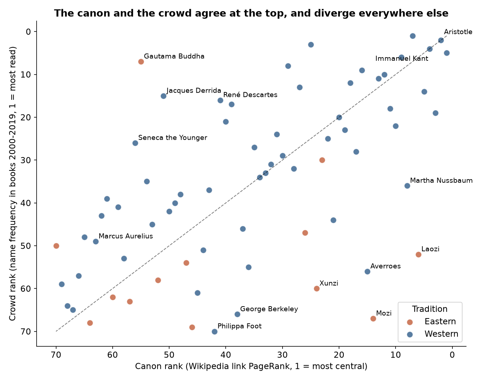
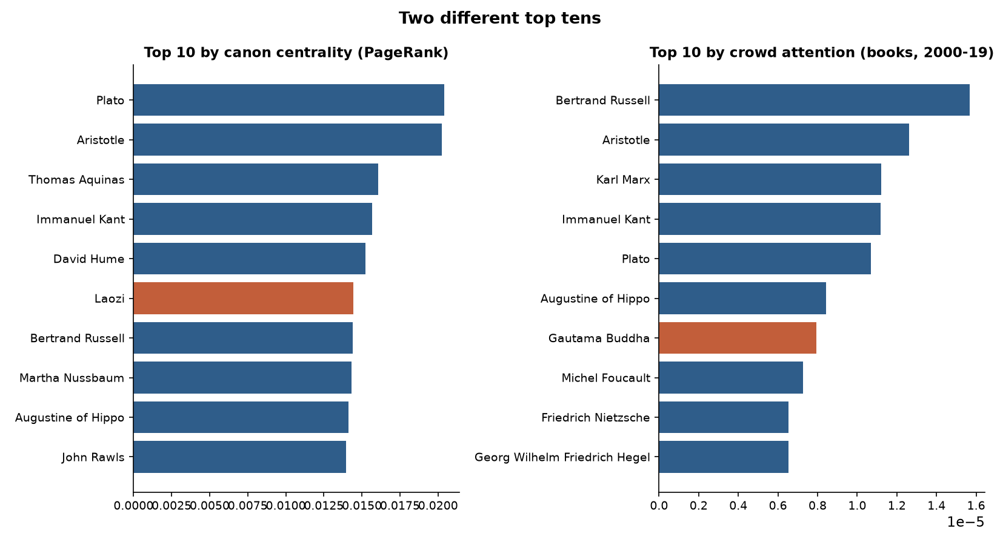
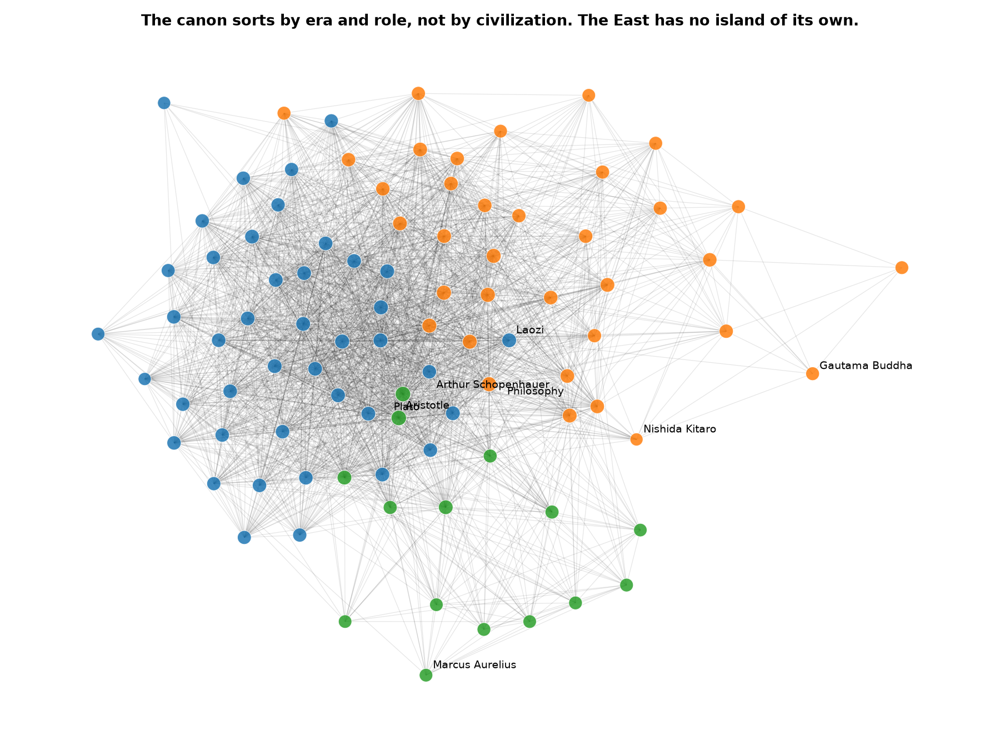
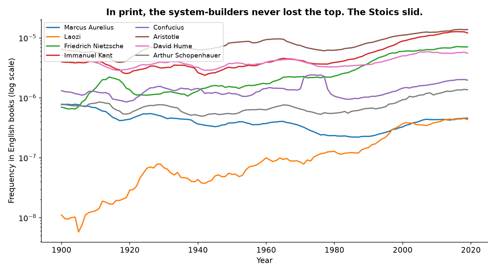
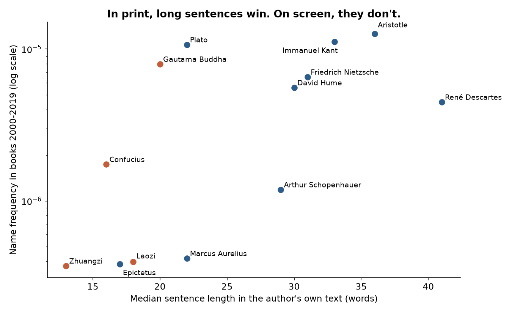

# The Canon and the Crowd

**The field argues with Kant. The public reads Marcus.**

*Musing with Mike · 2026-11-05 · Topic: philosophy · Build #59*

Everyone quotes Marcus Aurelius. Almost nobody in philosophy cites him. I ranked the same 70 philosophers two ways and compared the lists. The first ranking is the canon: how central each figure is in the link structure of Wikipedia, which is the closest thing to a map of how the field argues with itself. The second ranking is the crowd: how often each name shows up in English books from 1900 to 2019, checked against how often their Wikipedia article gets read today. At the top of the mountain the two lists agree. Everywhere else they come apart, and inside the East they do not agree at all.

## Why this would surprise someone who knows the field

People who know philosophy know the canon is Western and know Marcus Aurelius is popular. Neither of those is news. What nobody had measured is whether the field's own map and the public's reading actually rank the same people. The answer has a shape nobody would have guessed. For Western philosophers the two rankings line up well. For Eastern philosophers the correlation is 0.13, which is statistically zero. The field's map of the East and the book world's map of the East are two different maps. The bridge between East and West is not Schopenhauer, the man every intro course names as the bridge. It is Laozi, and a Japanese philosopher most Western readers have never heard of, Nishida Kitaro, who sits on the second most East-West paths in the graph while being the least cited node in it. Nobody links to him. He links to everyone. And the Stoics lost the twentieth century in print in absolute terms, down about 40 to 50 percent, while becoming the second most read philosophers on the screen. The headline is not that the canon and the crowd disagree. It is that they disagree in a pattern, and the pattern has a mechanism: the field selects for argumentative connectivity, print selects for citable system builders, and the screen selects for lines you can live by.

## The question

Two rankings, same 70 names. Where do they agree, where do they split, and what decides which side a philosopher lands on?

## The data

**The panel.** 70 philosophers: 57 Western (ancient, medieval, modern, and 10 women), 13 Eastern (Laozi, Confucius, Zhuangzi, Mencius, Mozi, Han Fei, Xunzi, Wang Yangming, the Buddha, Nagarjuna, Shankara, Dogen, Nishida Kitaro), plus 22 concept articles (Philosophy, Metaphysics, Ethics, Taoism, Buddhism, Stoicism, and the rest) that structure the field. The panel is my own selection, and the middle ranks would move under a different panel. The top is stable.

**The canon.** Every outgoing link of every panel article, pulled from the Wikipedia Action API in November 2026: 92 nodes, 3,773 links inside the panel. Canon centrality is PageRank on that directed graph, with in-degree, shortest path to the Philosophy article, community detection, and a bridge score defined as the share of all Eastern-Western shortest paths that run through each node.

**The crowd, in print.** Google Books Ngram, English 2019 corpus, yearly frequency of each name, 1900 to 2019. Where a full name understated a figure, I used the surname alone and recorded the choice: Russell (35 times the full-name frequency), Hume (11 times), Marx (10 times), Locke (9 times), Popper (8 times), Nussbaum (8 times), Aquinas (4 times), Wollstonecraft (3 times), de Beauvoir (1.5 times). Full names were kept where the surname is a common word (Mill, Foot, Smith) or a place (Berkeley).

**The crowd, on screen.** Median monthly Wikipedia pageviews, January 2023 to September 2026, from the Wikimedia Pageviews API. Median, not mean, because the Laozi article carries the March 2023 step-change bot artifact found in build #31, and a mean would crown a phantom.

**The mechanism test.** Full texts of 13 philosophers from Project Gutenberg, median sentence length and share of sentences under ten words, tested against both crowd measures.

## Finding 1: they agree at the top, and the agreement is the West

Canon PageRank against book frequency correlates at 0.58 (p = 1e-7, n = 70). Against pageviews it is 0.44. Split by tradition, the Western correlation is 0.71 (p = 7e-10) and the Eastern correlation is 0.13 (p = 0.68), which is no correlation at all. The two crowd measures agree with each other at 0.69.

The top five by canon centrality: Plato, Aristotle, Aquinas, Kant, Hume. The top five by book frequency: Russell, Aristotle, Marx, Kant, Plato. The top five by pageviews: Marx (197,812 median monthly views), Marcus Aurelius (193,226), the Buddha (188,594), Nietzsche (162,065), Aristotle (132,489). The canon and the crowd agree on the giants. The disagreement lives everywhere below them.

## Finding 2: the East is a looser cluster, and its giants are one-game giants

The West links to itself at 61 percent of all possible pairs. The East links to itself at 49 percent. The two traditions link to each other at 38 percent. So the East is a real cluster, just a looser one, and the bridge between the traditions is thinner than either side's internal wiring.

The medians tell the same story from the other side. Eastern median PageRank is 0.0087 against 0.0111 Western. Eastern median name frequency in books is 2.0e-7 against 1.5e-6 Western, about seven and a half times less. Eastern median pageviews are 8,807 a month against 48,779 Western. But the East's distribution is top heavy. The Buddha is 7th in books and 55th in the graph. Laozi is 6th in the graph and 52nd in books. No Eastern figure is top ten in both rankings. The East does not lose both games uniformly. It wins one game at a time, with different winners.

The biggest canon wins, central in the graph and rarely named in books: Mozi (canon 14, books 67), Laozi (6 and 52), Averroes (15 and 56), Xunzi (24 and 60), Martha Nussbaum (8 and 36). The biggest crowd wins, named in books far more than the graph would predict: the Buddha (55 and 7), Derrida (51 and 15), Seneca (56 and 26), Descartes (41 and 16), Marx (25 and 3).

## Finding 3: the bridges are Laozi and Nishida, not Schopenhauer

The bridge score counts the share of Eastern-Western shortest paths running through each node. Laozi is first at 0.064. Nishida Kitaro is second at 0.056. Then Metaphysics (0.036), Philosophy (0.029), and Kant (0.028). Schopenhauer, the textbook bridge, the man who read the Upanishads and handed the East to Nietzsche, ranks 25th of 92 at 0.008.

Nishida is the stranger case. He is the founder of the Kyoto School, and his whole system was built to fuse Zen with Western philosophy, so his position makes historical sense. But look at how he holds it: his article links out to 23 panel members and not one panel article links back to him. In-degree zero, out-degree 23, canon rank 70th of 70, bridge rank 2nd. He bridges by reaching out. Nobody reaches back.

The Western figures Eastern articles point at most are Kant (10 of the 13 Eastern articles link to him), Hume (9), and then Aristotle, Nietzsche, Hegel, Locke, Plato, Aquinas, Spinoza and Leibniz (8 each). When the East looks West, it looks at the Germans first.

## Finding 4: the communities sort by era and role, not by civilization

The graph splits into three communities. The moderns: 42 philosophers, 36 Western and 6 Eastern, and the six are Confucius, Mencius, Mozi, Han Fei, Xunzi and Laozi, the Chinese political and Confucian cluster sitting with the Western moderns. The conceptual core: 35 nodes, all 22 concept articles plus 13 philosophers, 7 Eastern and 6 Western, including the Buddha, Shankara, Dogen, Nagarjuna, Nishida, Wang Yangming and Zhuangzi. The ancients: 15 philosophers, all Western, Plato and Aristotle down to Marcus Aurelius and Epictetus. No community is the East. The network does not sort philosophers by civilization. It sorts them by when they lived and whether they are a person or an idea.

## Finding 5: two crowds, opposite tastes, and the Stoics lost the century in print

Here is the mechanism test. In books, long sentences win. Median sentence length against book frequency correlates at 0.67 (p = 0.012, n = 13). Descartes writes 41 word sentences and sits 16th in books. Aristotle writes 36 word sentences and sits 2nd. Kant writes 33 and sits 4th. At the other end Zhuangzi writes 13 word sentences and sits 54th, Confucius 16 words and 30th, Epictetus 17 words and 51st. The aphorism share points the same way and misses significance (minus 0.42, p = 0.16). Print rewards the system builder, the person you cite, not the sage you quote.

On screen, sentence length does nothing (0.31, p = 0.30). Marcus Aurelius writes 22 word sentences and is the second most read philosopher on Wikipedia. The screen rewards the line you can live by.

The twentieth century in print moved from the ancients to the moderns. Derrida rose 45 ranks between 1900 and 2019, Heidegger 34, Sartre 32, Kierkegaard 30, Foucault 29. Marcus Aurelius fell 28 ranks, Thales 23, Hypatia 23, Voltaire 21, Epictetus 21, Seneca 19. And the Stoic fall is absolute, not just relative: Marcus Aurelius's name frequency in books fell to 0.59 times its 1900-09 level by 2010-19, Seneca's to 0.51 times, while Kant tripled and Laozi rose 43 times from near zero. The Stoics lost the century in print and won the decade on screen. The Stoicism boom is a screen phenomenon, and the books never got the memo.

## Finding 6: the public's number two is the canon's number 63

Marcus Aurelius gets 193,226 median monthly pageviews, second only to Marx, and ranks 63rd of 70 in the canon. His article links out to 6 panel members and 15 link back to him. The field treats him as an emperor who kept a diary, not as a node in the argument network. Ayn Rand is the same shape turned up louder: 8th in pageviews at 112,477 a month, 69th in the canon, and only 2 panel articles in the whole graph link to her. Her article links out to 39. She is read enormously and cited by almost no one in the field's own map. One honest caveat: pageviews measure fame, not philosophical readership. Marx's traffic is politics, the Buddha's is religion, Rand's is politics. The screen crowd reads people, not arguments.

## Finding 7: distance is a null

The median shortest path to the Philosophy article is two links for both traditions, and Aristotle's article links to Philosophy directly. Everyone is two clicks from the front door. The gap between East and West is centrality, not distance. The famous first-link game that always ends at Philosophy is not a Western privilege. It is a property of the graph.

## A note on women

Women are near parity in graph centrality (median PageRank 0.0093 against 0.0113 for men) but are named about five times less often in books (median 3.1e-7 against 1.5e-6). Pageviews sit closer (33,686 against 47,724 a month). Nussbaum is the sharpest single case: 8th in the canon, 36th in books, and the fifth biggest canon win in the whole panel.

## The honest limits

Wikipedia's link graph is one field's map as English Wikipedia presents it in November 2026, not the discipline itself. Article length, editor habits, and the 22 concept hubs all shape the links, and the concept articles absorb a large share of PageRank. Ngram names are noisy: Buddha counts every Buddhist mention, Seneca includes the place, Zeno includes Zeno of Elea, and the surname-or-full-name choice moves the middle ranks even though the top is stable. Pageviews measure fame, not philosophical reading. Sentence lengths measure nineteenth century translators (Legge, Jowett, Meiklejohn) as much as authors, and thirteen texts is a small sample, so the sentence finding is suggestive, not causal. Three titles in the first pass (Zhuangzi, Xunzi, Phenomenology) turned out to be disambiguation pages, not articles; they were corrected to Zhuang Zhou, Xunzi the philosopher, and Phenomenology the philosophy article, and the results moved when they were fixed, which is recorded here because it should be. The panel is my own selection of 70 names. A different panel would move the middle. The top would not move much.

## Reproduce

`python3 src/collect.py` pulls everything from the live APIs (Wikipedia links, pageviews, Google Books Ngram, Project Gutenberg) and caches it under `data/cache/`. It takes about twenty minutes, mostly Ngram and Gutendex being slow. `python3 src/analysis.py` reads the cache and writes `results.json`, `findings.txt`, and the six charts. To skip the collection step, run the analysis directly on the cached data.

## Files

- `src/panel.py`: the 70 philosophers, 22 concepts, Ngram phrases, Gutenberg list
- `src/collect.py`: Wikipedia links, pageviews, Ngram series, Gutenberg texts
- `src/gutenberg_fallback.py`: direct Gutenberg downloads for the texts Gutendex failed on
- `src/analysis.py`: graph metrics, correlations, communities, charts
- `data/cache/`: raw API responses and Gutenberg texts (including the Chinese Mencius, excluded from the sentence test)
- `results.json`: every metric per figure
- `findings.txt`: the headline numbers in plain text
- `charts/`: six figures

## Sources

Wikipedia Action API (en.wikipedia.org/w/api.php), Wikimedia Pageviews API (wikimedia.org/api/rest_v1), Google Books Ngram Viewer (books.google.com/ngrams, English 2019 corpus, smoothing 3), Project Gutenberg via Gutendex (gutendex.com) and gutenberg.org. All public, no keys. Collected November 5, 2026.
