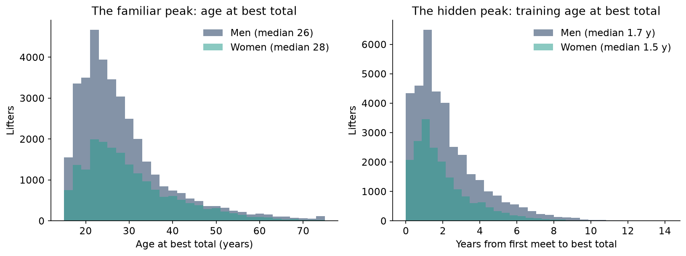
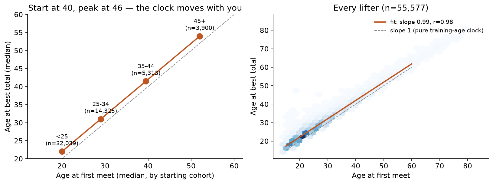
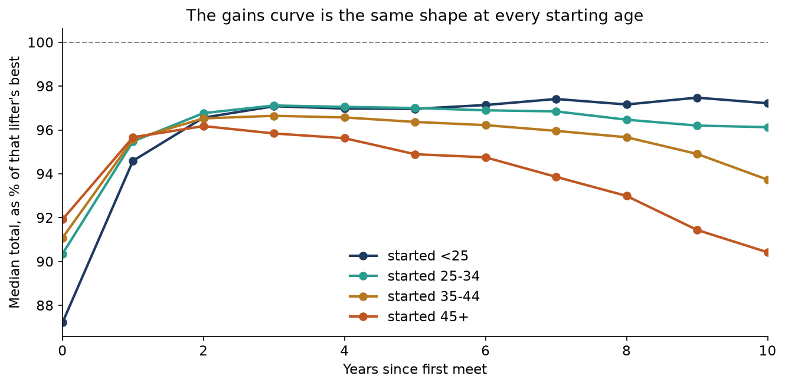
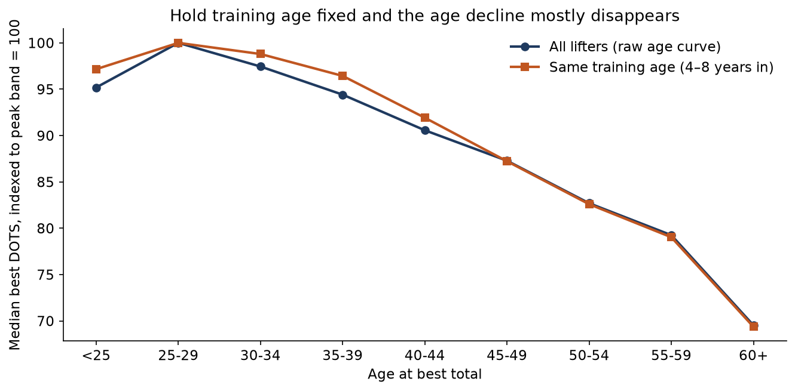
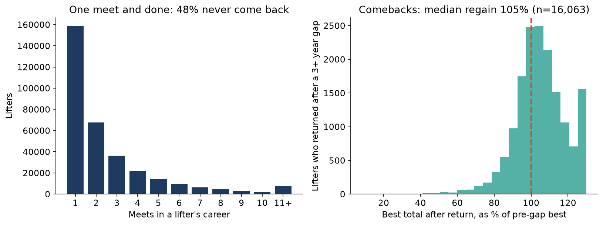

# The Clock Is Training Age

**Your peak is not at 30. It is about a year and a half after you start, at whatever age you start.**

*Musing with Mike · 2026-11-06 · Topic: fitness · Build #60*

Every strength coach knows the line: strength peaks in your late twenties, then biology takes it away. Start young or don't bother. I tested that line on every powerlifter who has ever competed, and it falls apart in a specific way. The age of your peak is not set by your birthday. It is set by the day you walk into your first meet, plus about a year and a half. Start at 22 and you peak at 24. Start at 40 and you peak at 42. Start at 30 and you lose nothing at all compared with starting at 20. The cost of starting late does not show up until about 45, and even then you keep four fifths of it.

## Why this would surprise someone who knows the field

People who know strength sports know two things that sound like they contradict each other. First, the age curve is real: the best 55-year-olds total less than the best 30-year-olds, and everyone can see it in the record books. Second, coaches talk about "training age" as the real clock. Nobody had measured which one is actually doing the work, because nobody had the full career history of a whole sport in one file. I do now: 331,682 lifters and 858,029 meets from the OpenPowerlifting archive.

Three things in here would surprise a coach. First, the peak is absurdly early in training-age terms: the median lifter's lifetime best comes 1.6 years after their first meet, and the median career is two meets long. The "peak at 26" is mostly an attrition artifact: most people quit before year three, so the best total they ever record lands in year two. Second, the gains curve is front-loaded to a degree nobody talks about: lifters with five or more meets are already at about 90 percent of their lifetime best in their first year, and 95 percent by the end of year one, at every starting age. The ten-year grind to a peak is a story about the top 1 percent. For the median lifter there is no long grind, because there is no long career. Third, time off does not erase strength: lifters who vanish for three or more years and come back typically beat their old best within two years. The sport's problem is not biology. It is retention.

One honest correction to my own hypothesis, recorded because it matters: I expected the cross-sectional age decline to flatten once training age was held fixed, which would have meant the decline was a composition effect. It does not flatten at all. At fixed training age the 55-to-59 band still totals 80 percent of the 30-to-34 band, the same as the raw curve. Age genuinely costs strength. The surprise is not that age costs nothing. It is when the bill arrives, and how small it is before then.

## The question

When do powerlifters peak, and is the peak set by biological age or by years since first competition? And what does a late start actually cost, at equal training age?

## The data

**The archive.** The OpenPowerlifting bulk CSV, revision 4a1c65a7, updated October 31, 2026: 4,059,941 meet rows, public domain. One practical note: openpowerlifting.org and data.openpowerlifting.org would not answer from this machine, so the file was pulled from the project's GitLab Pages host of the identical file, same revision and row count, and the checksum of the claim is the row count itself.

**The panel.** Raw, full-power (squat, bench, deadlift), sanctioned meets only, with a positive total and a DOTS score. DOTS is the sport's bodyweight-adjusted score, so totals are comparable across weight classes. First meet in 2010 or later, because database coverage is thin and uneven before that, and a "first meet in the data" from 1998 would be a bad proxy for a first meet ever. That leaves 331,682 lifters and 858,029 meets: 224,967 men, 106,639 women.

**The peak sample.** For the peak analyses I use completed careers only: at least 3 meets, and no meet in the last two years of data (last meet on or before October 31, 2024), so the best total is an observed lifetime best rather than a censored one. That is 55,577 lifters.

**Lifter identity.** OpenPowerlifting has no lifter ID, so a lifter is a name plus sex, which is the standard approach and also the known weak point. I drop lifters whose recorded age ever runs backwards by more than a year across meets (same name, different person) and careers spanning more than 40 years. Name collisions that survive that filter would stretch a few careers and are part of the noise, not the signal.

## Finding 1: the peak follows your start date, not your birth date

Median age at best total is 26.0 overall (25.5 for men, 27.5 for women). That is the number everyone quotes. But the median training age at best total, the time from first meet to best total, is 1.6 years (1.7 men, 1.5 women). Regress age at best on age at first meet and the slope is 0.99 with an intercept of 2.5 years and r of 0.98 across 55,577 lifters. Men: slope 0.99. Women: slope 1.00.

Split by starting cohort, the medians tell the same story. Start under 25 and your best comes at 22.0, after 1.6 years. Start at 25 to 34 and your best comes at 31.0, after 1.6 years. Start at 35 to 44 and your best comes at 41.5, after 1.6 years. Start at 45 or older and your best comes at 54.0, after 1.4 years. The training age at the peak barely moves. The age at the peak moves one for one with the age you start.

A necessary caution, because the regression can mislead: age at best equals age at first plus training age at best, by definition, so a slope near 1 partly reflects the fact that training age at best varies little (interquartile range 0.9 to 2.9 years) while starting age varies enormously. The regression is the picture, not the proof. The proof is the two facts underneath it: training age at best is small, and it is nearly the same in every starting cohort. That is what makes the clock a training-age clock.

## Finding 2: starting at 30 costs you nothing. Starting at 45 costs you a fifth.

The fair comparison is lifters with the same training age. Take lifters whose best total came 4 to 8 years after their first meet (n = 7,144) and compare median best DOTS by starting cohort. Men who started under 25: 420. Women: 389. Men who started at 25 to 34: 418, which is 99.4 percent of the under-25 group. Women: 390, which is 100.3 percent. Starting in your late twenties or early thirties costs literally nothing in relative strength.

The cost opens later. Start at 35 to 44 and you reach about 93 percent of the early starters as a man (389 vs 420) and about 89 percent as a woman (348 vs 389). Start at 45 or older and you reach 80.0 percent as a man (336 vs 420) and 79.6 percent as a woman (310 vs 389). The same pattern holds at training age five years and up (80.2 percent men, 79.3 percent women), and among lifters with at least five meets the cohort medians are 402, 399, 368 and 321, the same staircase.

So the deadline is not 30. It is roughly 45, and even past it you keep four fifths of your relative strength. The folk version of the story, that every year you wait past your twenties is strength you will never get, is wrong in the range where most adults actually make the decision.

## Finding 3: you are at 90 percent of your lifetime best in year one

For lifters with at least five meets, I tracked median DOTS as a share of each lifter's own lifetime best, by year since first meet. In year zero, the first twelve months, the median lifter is already at 87.2 percent of their best if they started under 25, and 90 to 92 percent if they started older. By the end of year one they are at about 95 to 96 percent. By year two, about 97 percent. Then the curve goes flat for young starters and drifts gently down for older ones: by year ten the under-25 starters sit at 97.2 percent of their best and the 45-plus starters at 90.4 percent.

The median lifter in every starting cohort reaches 95 percent of their lifetime best within one year of their first meet. Only 1.2 percent of completed careers peak eight or more years after the first meet, and 0.25 percent peak ten or more years out. The long grind to a peak is real, but it belongs to a tiny elite. For the median lifter the sport is: show up, get almost all of it in year one, and then either keep showing up or stop.

That also reframes what "serious" means. Among lifters with at least five meets the median training age at best is 2.6 years. With at least ten meets it is 4.1 years. With a career spanning at least five years it is 5.1 years. The peak comes later only when the career is longer, and even for the most committed lifters it is a matter of a few years, not a decade.

## Finding 4: the age decline is real, and that is the honest null

Here is the hypothesis that failed, and it failed cleanly. The raw age curve: median best DOTS peaks at 391 in the 25 to 29 band and falls to 310 in the 55 to 59 band, which is 81 percent of the 30 to 34 band. I expected that curve to flatten once training age was held fixed, which would have shown the decline was mostly a composition effect, older lifters being mostly people who started young and had already plateaued. It does not flatten. Holding training age at 4 to 8 years, the curve peaks at 418 in the 25 to 29 band and falls to 331 in the 55 to 59 band, which is 80 percent of the 30 to 34 band. Same shape, higher level throughout, because lifters with four to eight years in are a selected, better group.

So age genuinely costs strength at equal training age. The finding in this build is not that age is free. It is that the price is small until about 45 and the peak itself is set by when you start, not by a biological appointment at 30.

## Finding 5: the sport is a revolving door, and comebacks beat their old best

Almost half of all lifters, 47.8 percent (158,581 of 331,682), compete exactly once and never return. The median career is two meets. Only 14.3 percent reach five meets and 2.9 percent reach ten. The median completed career lasts 2.1 years. The "peak at 26" finding and this one are the same fact viewed twice: the modal powerlifter's lifetime best lands in year two because there is no year three.

But the people who leave are not finished. 16,063 lifters, 4.8 percent of the panel, returned after a gap of three years or more. Within two years of returning, their median best total was 104.5 percent of their pre-gap best. Four in five regained at least 95 percent of their old best, and nearly nine in ten regained at least 90 percent. Time off costs surprisingly little, and the typical returning lifter comes back stronger than they left, which is consistent with returning lifters being the ones who kept training, or who came back with a plan. Either way, the three-year gap is not the end of a lifting life. It is a pause with a better-than-even chance of a personal best on the other side.

## What this is worth to someone deciding

If you are 32 and wondering whether you missed the window: you did not. At equal training age you are indistinguishable from someone who started at 20, and the data has 14,325 lifters who started at 25 to 34 to prove it. If you are 45 and wondering: the price is real, about a fifth of relative strength, and your window for gains is shorter, since the gains curve for 45-plus starters starts fading after year four while younger starters hold flat. But four fifths is not a reason to stay home, and the comeback numbers say a layoff is not a verdict either.

For the sport itself, the actionable number is the attrition curve. A federation that keeps a first-time lifter for a second meet has already beaten the base rate, since 48 percent never come back. Everything downstream of that, coaching, programming, community, is retention work, and the peak-age story the sport tells itself is mostly a story about who quits.

## The honest limits

Lifters are matched by name and sex, and some same-name collisions survive the age-monotonicity filter, which would stretch a few careers and blur a few peaks. First meet in the database is not quite first meet ever for lifters whose early meets were never entered, which is why the panel starts at 2010. DOTS is a bodyweight adjustment, not an age adjustment, and it is the right tool for comparing lifters of different sizes, but it means these comparisons are about relative strength, not absolute totals. The completed-career rule (no meet in two years) will misclassify a few lifters who are merely between meets, and the comeback sample is selected: people who return are the ones who expect to do well. The matched training-age groups are small at the top end, 223 men and 162 women who started at 45-plus and peaked 4 to 8 years in, so the 80 percent figure has real sampling wobble around it. And the regression in Finding 1 is partly arithmetic, as noted: the substance is in the cohort table underneath it, not the slope alone.

## Reproduce

`python3 src/prep.py` loads the bulk CSV and builds the lifter careers (about 75 seconds; it downloads the ~171 MB zip from the project's GitLab Pages host if the CSV is not already under `data/`, since the raw file is too large to commit). `python3 src/analysis.py` runs every analysis and draws the five charts (about 40 seconds). The derived parquet files are committed so the analysis runs without the raw download; `results.json` holds every number in this write-up and `findings.txt` the headline numbers in plain text.

## Files

- `src/prep.py`: load, scope filters, career construction, collision guards
- `src/analysis.py`: attrition, peak timing, cohort matching, gains curve, age curve, comebacks, charts
- `data/openpowerlifting-latest.zip`: the bulk download, revision 4a1c65a7 (not committed: 171 MB, over GitHub's file limit; `src/prep.py` re-downloads it from the URL in Sources if missing)
- `data/careers.parquet`: one row per lifter (331,682)
- `data/meets_clean.parquet`: one row per meet in scope (858,029)
- `data/panel_stats.json`: panel counts
- `results.json`: every metric in this write-up
- `findings.txt`: the headline numbers in plain text
- `charts/`: five figures
- `NOTES.md`: the pre-registered novelty test and scope decisions

## Sources

OpenPowerlifting bulk CSV, revision 4a1c65a7, updated October 31, 2026, downloaded from the project's GitLab Pages host (https://openpowerlifting.gitlab.io/opl-csv/files/openpowerlifting-latest.zip), 4,059,941 rows, public domain. All analysis uses the Dots column supplied in that file. Collected November 6, 2026.
