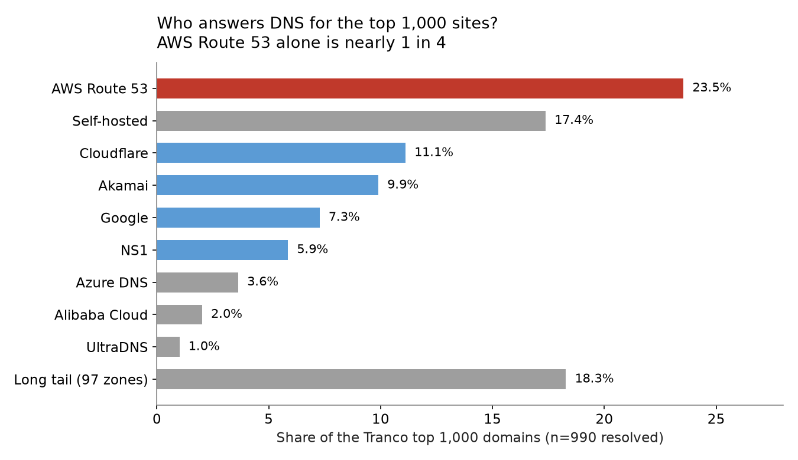
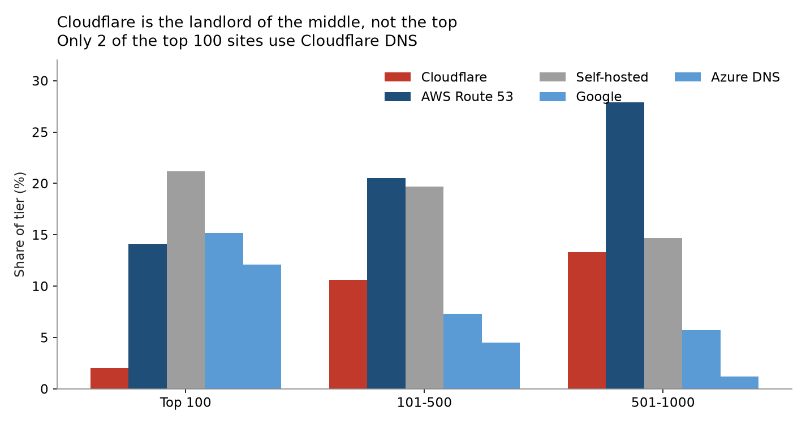
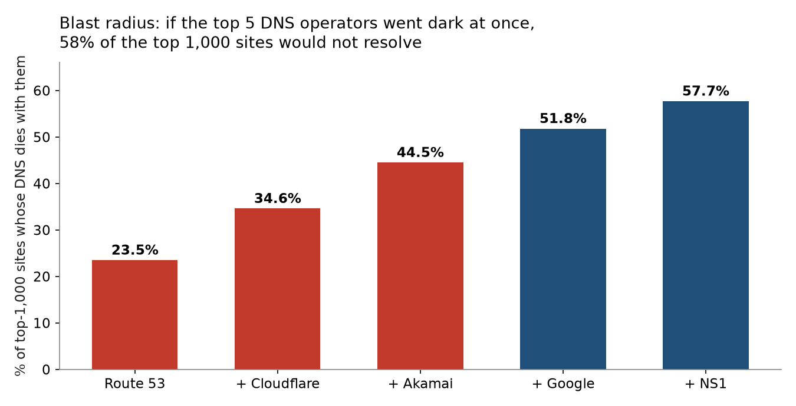
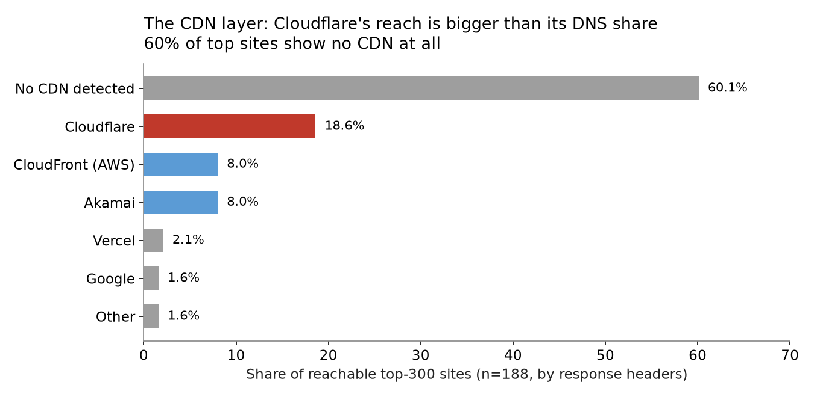

# Five Landlords Own the Internet's Front Door

**Build #63 — Musing with Mike — 2026-11-09 — tech-industry**

On November 18, 2025, Cloudflare went down and took X, ChatGPT, and Spotify with it. The story everyone told afterward was simple: a fifth of the web runs through one company. That story is about traffic. It is not about the front door.

This build measures the front door. It looks up the DNS nameservers for all 1,000 of the Tranco top 1,000 sites and asks who actually answers when someone types in a domain name. The answer is not Cloudflare. The biggest single DNS landlord is Amazon's Route 53, which answers for 233 of the top 1,000 sites, nearly one in four. Five named providers answer for 57.7 percent of the top 1,000. And Cloudflare, the company in the outage headlines, holds just 2 of the top 100 sites. It is the landlord of the middle of the internet, not the top.

## The novelty case, stated before building

Everyone knows the internet is concentrated. Nobody had measured the DNS layer of the top 1,000 sites in one reproducible pass, with the operators named and the blast radius counted. The folk wisdom says Cloudflare runs the internet, because Cloudflare's outage was the visible one. But DNS and CDN are different layers with different landlords, and the outage that makes the news is not always the dependency that matters most. The bet was that the ranking would invert the folk wisdom, and it did. An expert who knows the Cloudflare outage story would still be surprised to learn that Route 53 answers DNS for more top sites than Cloudflare and Akamai combined, and that the top 100 sites mostly run their own DNS. That inversion is the finding, and it only shows up if you measure the layer nobody is looking at.

## Findings

**1. Five named providers answer DNS for 57.7 percent of the top 1,000 sites.** Route 53 leads at 23.5 percent (233 sites). Then Cloudflare at 11.1 percent, Akamai at 9.9 percent, Google at 7.3 percent, and NS1 at 5.9 percent. The Herfindahl index is 0.1188, which works out to 8.4 effective operators for the whole top 1,000. That is concentrated, but it is not a monopoly. It is an oligopoly with a long tail: 97 smaller zones split the remaining 18.3 percent.

**2. Cloudflare is the landlord of the middle, not the top.** Only 2 of the top 100 sites use Cloudflare DNS. Its share climbs as you go down the ranking: 10.6 percent of ranks 101 to 500, and 13.3 percent of ranks 501 to 1,000. The top 100 mostly self-host their DNS (21.2 percent) or sit on the clouds: Google at 15.2 percent, Route 53 at 14.1 percent, Azure DNS at 12.1 percent. The mechanism is a scale game. Running your own authoritative DNS is fixed-cost work that only pays off at the top, and the giants at the top already run the infrastructure. Cloudflare's free tier captured the middle, where the sites are big enough to need real DNS and too small to run it themselves. The November 2025 outage was real and huge, but it was a CDN and proxy outage. At the DNS layer, Cloudflare is a middleweight.

**3. The biggest sites buy a second landlord, and nobody else does.** 164 of the 990 resolved sites (16.6 percent) split their nameservers across two operators, which is deliberate secondary DNS. GitHub runs NS1 plus Route 53. LinkedIn, Bing, and MSN run NS1 plus Azure. Spotify runs NS1 plus Google Cloud DNS. GoDaddy's own domaincontrol.com runs Akamai plus GoDaddy. The other 83.4 percent have every nameserver with a single operator, which means a single operator failure takes the site off the internet. The hedge exists, but only the sites big enough to pay for two landlords have it.

**4. DNS and CDN are bundled at Cloudflare and unbundled at AWS.** Of the reachable top-300 sites that use Cloudflare DNS, 15 of 18 also use Cloudflare's CDN (83 percent). Of those on Route 53, only 9 of 33 use CloudFront (27 percent). Cloudflare sells a stack and its DNS customers mostly buy the whole thing. AWS sells parts and its DNS customers mostly shop elsewhere for the CDN. The flip side is that Cloudflare's CDN reach is bigger than its DNS share: 18.6 percent of reachable top-300 sites sit behind Cloudflare's CDN, and 20 of those 35 do not use Cloudflare DNS at all. The outage story and the DNS story diverge because Cloudflare's CDN footprint is much larger than its DNS footprint.

**5. Self-hosting rises with rank, and the long tail has mini-landlords.** 21.2 percent of the top 100 run their own DNS, against 14.7 percent of ranks 501 to 1,000. And the "self-hosted" category is not one thing: it is 172 different operators. The long tail even has its own tiny landlords. Apple's apple.com zone answers DNS for 8 top-1,000 domains, including iCloud. Meta's facebook.com zone answers for 5. Xiaomi's dnsv5.com answers for 11. Concentration is fractal. Every layer has its landlords.

**6. The blast radius is 58 percent for five operators, 23.5 percent for one.** If Route 53 alone stopped answering, 233 of the top 1,000 sites would not resolve. Add Cloudflare and it is 34.6 percent. Add Akamai, Google, and NS1 and it is 57.7 percent. Among rented DNS only (excluding the 172 self-hosted sites), Route 53's share is 28.5 percent. That is the number to remember. One AWS service answers the front door for more than a quarter of the rented top 1,000.









## How it was measured

The Tranco top-1m list was downloaded on 2026-11-09 and the top 1,000 domains were taken. Nameserver records were fetched for each domain over DNS-over-HTTPS, using Google's DNS JSON API first and Cloudflare's DoH endpoint as fallback, because outbound UDP port 53 is blocked on the measurement host. Two slow retry passes recovered most failures, and 990 of 1,000 domains resolved. Each nameserver hostname was mapped to its operator: Cloudflare, Route 53, Google (Cloud DNS plus the google.com first-party zone), Akamai (six zones), NS1, Azure DNS, GoDaddy, Alibaba Cloud, and the rest, with nameservers under a site's own domain (including same-company zones on other TLDs) counted as self-hosted. A second layer probed the top 300 domains over HTTPS and fingerprinted the CDN from response headers (cf-ray, x-amz-cf-id, Akamai server headers, and friends). 188 of 300 answered. `explorer.html` holds the full per-domain table, searchable and filterable by operator.

## Caveats

Shares are by domain count, not by traffic. A traffic-weighted view would look more concentrated, because the self-hosted giants (Google, Apple, Meta) dominate traffic. The CDN numbers come from the 188 reachable top-300 sites, not all 300, though the failure rate was roughly uniform across DNS providers, so the comparison across operators is fair. Ten domains did not resolve: three are Tranco artifacts (w2rt6byl5nf1opmc-a.com, www.gov.uk, resolver.arpa) and seven real domains failed DoH after three attempts (criteo.com, tencent-cloud.net, myqcloud.com, list-manage.com, singtelchina.cn, ovscdns.com, networkadvertising.org). DNS answers change over time, so this is a snapshot of November 9, 2026, not a permanent ranking.

## What this means if you run a site

If you are on Route 53, you are in the biggest blast radius on the internet. That is not a reason to leave, since Route 53 is also the most battle-tested DNS on earth. It is a reason to do what GitHub and Spotify do and run secondary DNS with a second operator. It costs little and it is the only move that removes the single point of failure. If you are on Cloudflare DNS, know that you probably also bought the CDN, and the two fail together. And if you are choosing a DNS provider by reputation, remember the outage headlines measure the CDN layer. The DNS layer has different landlords, and the biggest one is Amazon.

## Sources

- Tranco top-1m list, downloaded 2026-11-09: https://tranco-list.eu/
- DNS answers via Google DNS-over-HTTPS (dns.google) and Cloudflare DoH (cloudflare-dns.com), queried 2026-11-09
- Cloudflare's own postmortem of the November 18, 2025 outage: https://blog.cloudflare.com/18-november-2025-outage

## Reproduce it

```bash
python3 -m venv .venv && .venv/bin/pip install -r requirements.txt
python3 src/collect.py        # Tranco download + DoH NS lookups + HTTP probes
python3 src/collect_ns.py     # NS lookups via DoH (UDP/53 is blocked on some hosts)
python3 src/retry_ns.py       # slow retry pass for failed NS lookups
python3 src/analyze.py        # operator rollup, tiers, HHI, CDN cross-tab
python3 src/charts.py         # charts/
```

`data/raw.json` holds every NS record and HTTP probe. `data/summary.json` holds the computed numbers. `data/dns_by_domain.json` holds the per-domain table behind `explorer.html`.
