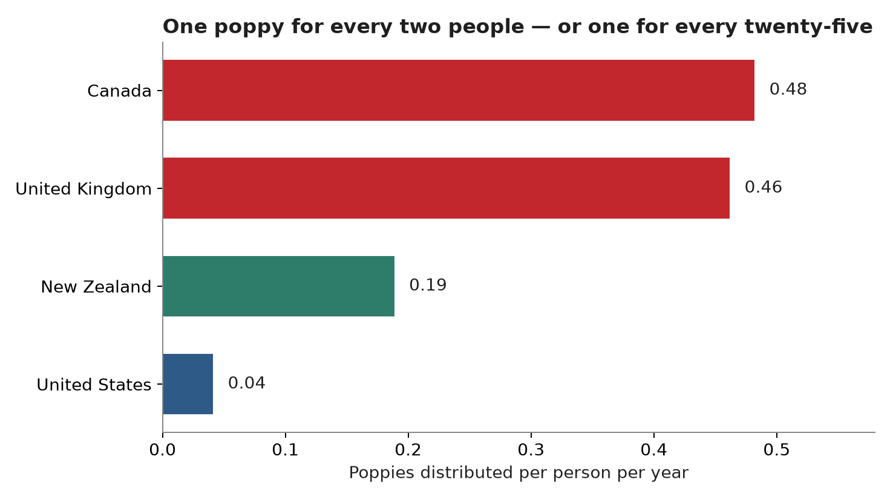
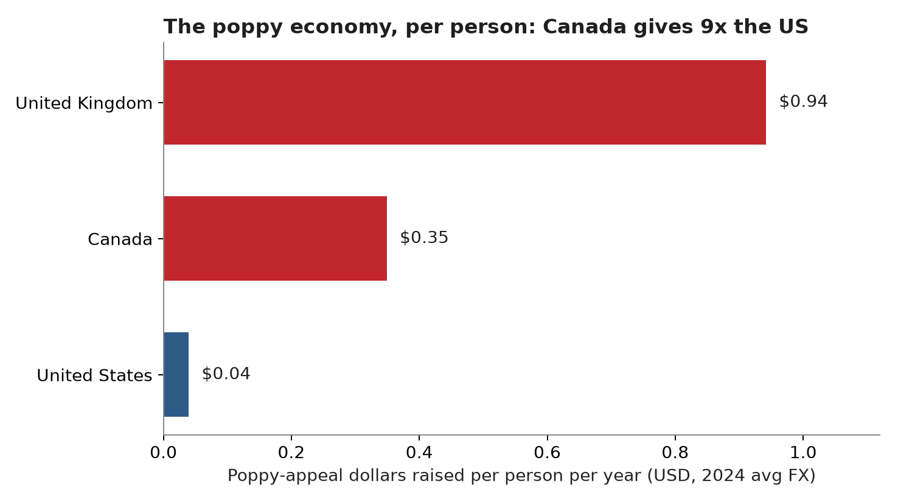
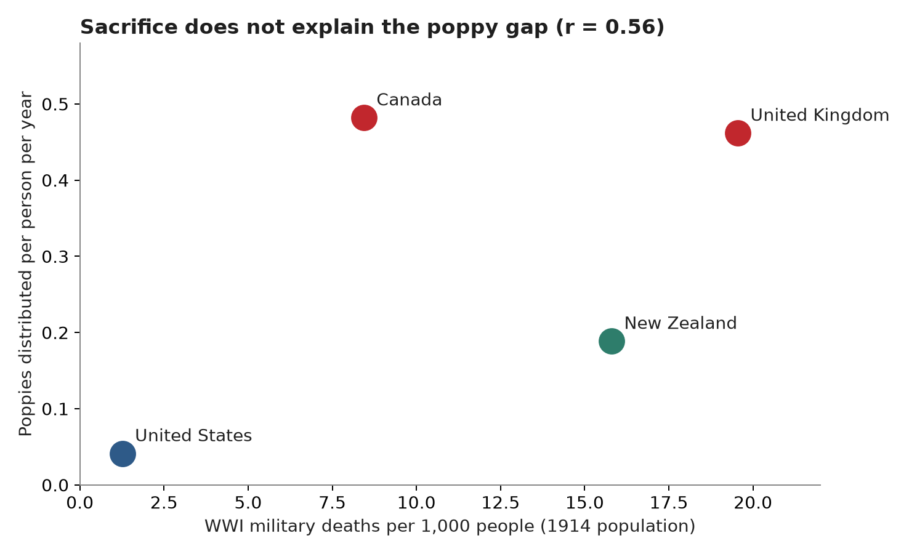
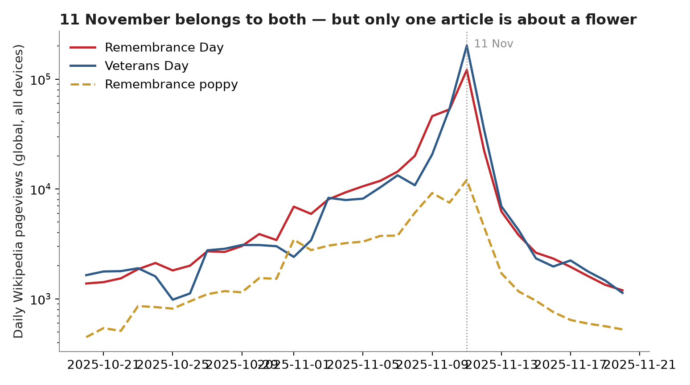
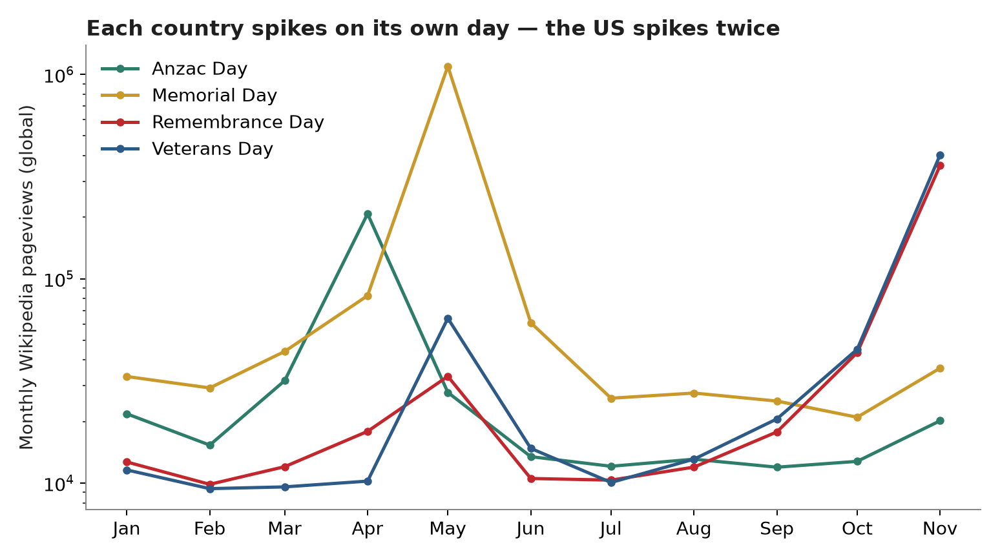

# The Poppy Gap

**Why the red poppy blankets Canada every November and barely registers in the United States, measured in dollars, flowers, and attention. And why the obvious explanation is wrong.**

Yesterday I tried to get a poppy in San Francisco. There is no Legion branch on the corner, no box at the grocery store, no cadet on the sidewalk. The route that worked was emailing the Canadian consulate to ask whether I could pick one up. That is the whole build in one anecdote: in Canada the poppy finds you, in America you have to go find it, and the distance is bigger than anyone has measured.

## What I built

Three measurements of the same gap, from public data:

1. **The poppy economy.** How many poppies each country's veterans' organization distributes per person per year, and how many dollars the appeal raises per person. Sources: the Royal Canadian Legion, the Royal British Legion, the VFW, and the RSA in New Zealand.
2. **The sacrifice test.** WWI military deaths per capita for each country, from Wikipedia's casualty table, plotted against poppies per person. The question is whether the gap is just proportional to how much each country lost.
3. **The attention test.** Daily and monthly Wikipedia pageviews for Remembrance Day, Veterans Day, Memorial Day, Anzac Day, and Remembrance poppy across 2025, pulled from the Wikimedia Pageviews API. Pageviews are a bad measure of reverence and a good measure of when a country thinks about its war dead.

Code, data, and charts are in this folder. Everything reruns from `src/`.

## The findings

### 1. The gap is about twelve to one, per person

| Country | Poppies per person / year | Appeal dollars per person / year (USD) |
|---|---|---|
| Canada | 0.48 | $0.35 |
| United Kingdom | 0.46 | $0.94 |
| New Zealand | 0.19 | not published |
| United States | 0.04 | $0.04 |

Canada distributes roughly 20 million poppies a year to 41.5 million people, and the Legion raises close to $20 million CAD. The VFW distributes about 14 million Buddy Poppies to 340 million people and raises on the order of $13.5 million. Per person, Canada wears **11.7x** as many poppies as the US and gives **8.8x** as much money through the appeal. The UK is right there with Canada on flowers and ahead on money. This is not a small cultural difference. It is an order of magnitude.

### 2. Sacrifice does not explain it

The first theory anyone reaches for is that Canada remembers harder because it lost more. Canada did lose more, per capita, than the US: about 8.4 WWI military deaths per 1,000 people against America's 1.3. But the theory falls apart on the next country over. New Zealand lost 15.8 per 1,000, nearly double Canada's rate and the second-highest in the table, and it wears 0.19 poppies per person, less than half Canada's rate. The correlation across the four countries with poppy data is r = 0.56, which with four points means nothing, and the New Zealand-Canada inversion is the whole story in one pair: the country that sacrificed the most per capita is not the country that wears the most poppies.

### 3. The poppy survived where 11 November stayed the only day

Look at when each country actually thinks about its war dead. In 2025, the Remembrance Day article got 67% of its entire year's pageviews in November. The Veterans Day article got 66% of its in November. Anzac Day got 54% of its in April. Memorial Day got 74% of its in May, and that May spike, 1.1 million views, was the single biggest remembrance-attention event of the year anywhere, 2.7 times bigger than Veterans Day's November peak.

That is the mechanism. The UK and Canada kept one day, 11 November, and one flower for it. Australia and New Zealand moved the emotional centre of remembrance to Anzac Day, 25 April, the Gallipoli landing, and their poppy went with it: New Zealand's Poppy Day is the Friday before Anzac Day, not November. The United States split remembrance in two. Memorial Day in May took the dead, flags, barbecues, and the 1.1 million pageviews. Veterans Day in November took the living, and turned into a retail event. The poppy is a flower for the dead, and in America its day belongs to May while its name belongs to November, so it fell between the two days and never became a national ritual.

### 4. America had the poppy first, and let it go

This is the part that surprised me most. The poppy is a Canadian poem and an American invention as a symbol. John McCrae, a Canadian doctor, wrote "In Flanders Fields" in May 1915. Moina Michael, a professor at the University of Georgia working for the YMCA overseas, read it, wrote a reply poem, and on 9 November 1918 bought 25 silk poppies and handed them out at a conference. She campaigned for the symbol, the American Legion adopted the poppy as its official flower in April 1920, and the first US Poppy Day was the week before Memorial Day in 1921. Canada adopted it months later, on 11 November 1921, after a French organizer named Anna Guerin brought the idea to the Great War Veterans Association with help from Lillian Freiman. The VFW adopted its Buddy Poppy in 1922 and has distributed more than a billion since.

So the US did not reject the poppy. It invented the poppy as a wearable symbol, then let Memorial Day absorb it while Canada built an institution around it. The divergence is not about who cared more in 1921. It is about what each country did with the next hundred Novembers.

### 5. The two minutes of silence are the tell

On 11 November at 11am, Canada stops. Schools, workplaces, and legislatures observe two minutes of silence, and the Legion now runs an advertising blackout with hundreds of participating locations. The United States has no equivalent moment on Veterans Day. Its legislated moment of silence, the National Moment of Remembrance, is at 3pm on Memorial Day. Even the silence split across the two days. And while Veterans Day is one of the biggest sale weekends in American retail, Remembrance Day is a statutory holiday across most of Canada, which means the day is protected from commerce rather than built on it.

### 6. Distribution is destiny, and the Legion knows it

The part of this that would interest an operator: the Legion treats the poppy as a distribution problem, not a sentiment problem. 1,400 branches. More than 34,000 poppy boxes in stores and offices. Tap-to-donate boxes, 2,000 of them in 2026, plus a storefront on Amazon.ca that ships poppies to your door. That is how a 105-year-old ritual survives contact with a cashless, doorstep-delivery country. The VFW's Buddy Poppy has a better story, each one is assembled by disabled veterans, and a worse distribution system: it depends on volunteers staffing tables outside grocery stores twice a year. A great product with no shelf space loses to a good product with 34,000 shelves. That is a marketplace lesson wearing a red flower.

## The personal bit

I grew up in Edmonton, where the poppy is the air in November. You get one at the mall, at school, at the rink, and you lose it by lunch and get another one. Moving to San Francisco, the first November felt like the flower had been edited out of the season. This build is the measurement of that feeling, and the answer is that the feeling is accurate and the reason is structural, not sentimental. It is not that Americans care less. It is that their remembrance has two homes and the poppy has none, while Canada gave it one address and kept paying the rent for a century. If you are a Canadian in America this week and you want a poppy, the consulate is the honest answer, and the Legion's Amazon storefront is the practical one.

## Methods and reproduction

- `src/fetch_pageviews.py` pulls daily (15 Oct - 20 Nov 2025, plus 15 Apr - 31 May 2025) and monthly (Jan - Nov 2025) pageviews for five articles from the Wikimedia Pageviews API. No key needed.
- `src/fetch_trends.py` pulls Google Trends for "remembrance day" vs "veterans day" and "veterans day sale" vs "remembrance day sale" in Canada and the US. **Note:** this failed from this environment. trends.google.com read-times-out on every attempt, so the Trends leg is not in the analysis and no Trends CSVs are committed. The script is kept so the pull can be rerun elsewhere.
- `src/analysis.py` builds the country table, computes per-capita figures, runs the correlation, and makes all five charts.
- `data/country_table.csv` is the hand-assembled source table with a source note on every row. `data/country_table_computed.csv` is the output with derived columns.

Run it with:

```bash
pip install -r requirements.txt
python3 src/fetch_pageviews.py
python3 src/analysis.py
```

## Caveats

- The US Buddy Poppy dollar total is the weakest number in the build. The VFW does not publish a current national total. The $13.5M figure is the midpoint of two 2018 sources ("more than $15 million" and "$12 million"). If the true 2024 number were double that, the Canada/US money gap would be 4.4x instead of 8.8x. The flower gap, 11.7x, uses the VFW's own distribution count and is not sensitive to this.
- Canada's 20 million poppies is the Legion's figure, cited in 2018 and consistent with 21.5 million in 2016. The 2024 campaign raised $19.8M per the Legion's 2025 reporting.
- New Zealand publishes no national dollar total for its Poppy Appeal, so it appears in the flower chart but not the money chart. Its poppies are a gold-coin collection, roughly NZ$1-2 per poppy.
- Australia publishes no national Poppy Appeal total or poppy count, so it appears only in the casualty table. RSL Victoria alone raised more than $8M across its Anzac and Poppy Appeals in 2024, which suggests the national figure is substantial, but I will not print a number I cannot source.
- Wikipedia pageviews are global English Wikipedia, not split by reader country, so they measure attention, not observance. The US population dominates English Wikipedia, which is why Veterans Day outdraws Remembrance Day on 11 November itself (201,524 vs 121,209 views). The argument in this build uses the shape of attention across months, not the raw totals.
- The casualty correlation uses four countries. That is not enough to prove a mechanism, only to falsify the simple one, which the New Zealand data point does on its own.

## Sources

- Royal Canadian Legion, 2024/2026 National Poppy Campaign releases (GlobeNewswire, legion.ca): close to $20M donated yearly; ~20M poppies distributed.
- Royal British Legion via RBL county pages and Medequip (2025): Poppy Appeal 2024 raised GBP 51.4M; 32 million poppies and 127,000 wreaths distributed.
- VFW, "VFW Celebrates 100 Years of the Buddy Poppy" (2022) and VFW Post 8870: ~14 million Buddy Poppies distributed annually; $12-15M raised yearly; 1 billion+ distributed since 1922.
- RNZRSA / DigitalNZ: Poppy Day began 24 April 1922; "we average close to a million poppies sold each year."
- Wikipedia, "World War I casualties": military deaths and 1914 populations by country (UK 887,858 / 45.4M; Canada 56,639-64,996 / 7.2M; Australia 59,330-62,149 / 5.0M; NZ 16,711-18,060 / 1.1M; US 116,708 / 92.0M). Midpoints used where a range is given.
- Government of Canada (canada.ca), "The poppy: a symbol of remembrance": Moina Michael, 9 Nov 1918; American Legion adoption, April 1920; Canada's first Poppy Day, 11 Nov 1921.
- Wikipedia, "Remembrance poppy": Guerin's first US Poppy Day, week before Memorial Day 1921; adoption dates for UK, Australia (1921) and NZ (1922).
- Wikimedia Pageviews API: daily and monthly views, 2025, for Remembrance Day, Veterans Day, Memorial Day, Anzac Day, Remembrance poppy.
- Populations 2024: UK ~69.3M, Canada ~41.5M, US ~340.1M, NZ ~5.3M. FX 2024 averages: GBP/USD 1.27, CAD/USD 0.73.

## Charts






