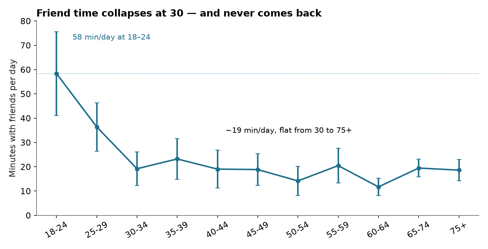
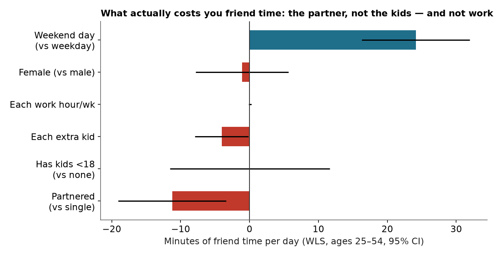
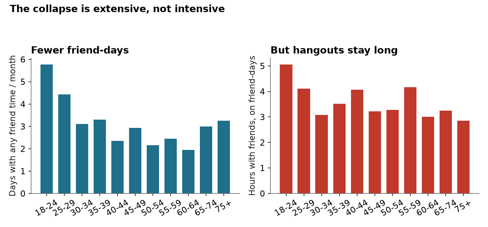
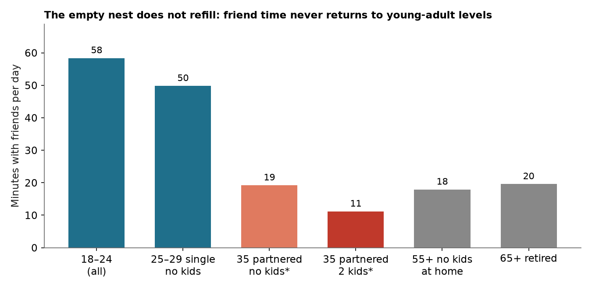
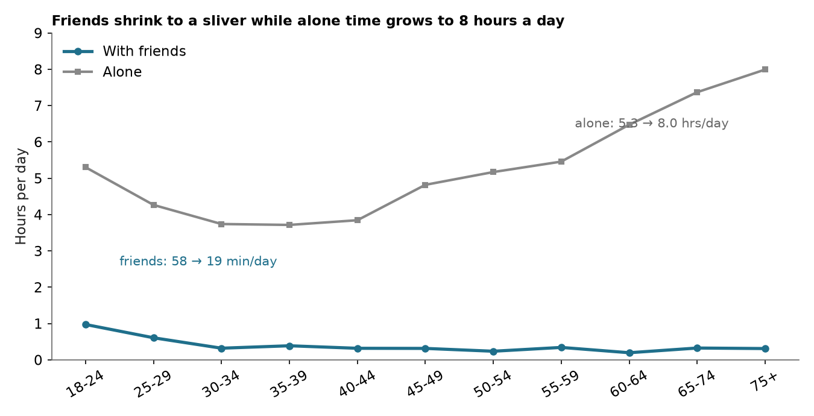

# The Friend Recession

**Americans lose two-thirds of their friend time at 30, and it never comes back. Not at 40, not at 65, not in retirement. The cause is not what you think: work hours cost nothing, kids cost nothing on their own, and the thing that does the damage is coupling up and the toddler years. Free time was never the constraint. The network is.**

I am 30. I run a system of monthly calendar nudges to stay in touch with thirteen friends, because I noticed the drift starting. This build is the measurement of that drift, from the Bureau of Labor Statistics' American Time Use Survey, 2023: 8,548 Americans, one diary day each, every minute coded by activity and by who was in the room. Time with friends means nonwork minutes with a friend present. I rebuilt that measure from the raw activity and who files and matched the BLS's own number exactly, on all 8,548 respondents.

## What I built

Four measurements of the same collapse:

1. **The age curve.** Weighted minutes with friends per day, by age band, with standard errors.
2. **The cause.** A weighted regression (ages 25-54) on partnering, kids, number of kids, work hours, sex, weekend, and age. Plus a parents-only model by youngest child's age.
3. **The mechanism.** Extensive vs intensive margin: do people see friends less often, or for less time when they do?
4. **The rebound test.** Friend time for 55+ adults with no kids at home, and for 65+ retirees out of the labor force, against young single adults.

Code, data, and charts are in this folder. Everything reruns from `src/`.

## The findings

### 1. The cliff is at 30, and the line is flat for the next 45 years

| Age | Minutes with friends / day | Hours / year | Friend-days / month |
|---|---|---|---|
| 18-24 | 58.4 | 355 | 5.8 |
| 25-29 | 36.4 | 222 | 4.4 |
| 30-34 | 19.2 | 117 | 3.1 |
| 35-39 | 23.2 | 141 | 3.3 |
| 40-44 | 19.0 | 116 | 2.3 |
| 50-54 | 14.2 | 86 | 2.2 |
| 60-64 | 11.7 | 71 | 1.9 |
| 65-74 | 19.5 | 119 | 3.0 |
| 75+ | 18.6 | 113 | 3.3 |

Friend time falls by two-thirds between 18-24 and 30-34, then sits at about 19 minutes a day, flat, from 30 to 75+. There is no recovery at any age. Versus holding the 18-24 level, the average American loses 6,675 hours of friend time between ages 25 and 54. That is 278 full days.

One caveat on the baseline: school is a friend machine. Enrolled 18-24 year olds get 101 minutes a day with friends. Non-enrolled 18-24 year olds get 34.8. Leaving school explains part of the drop. It does not explain the rest. A 30 year old gets 19 minutes against a non-student 18-24 baseline of 35, and a 25-29 single adult with no kids still gets 49.8.

### 2. It is the partner, not the kids, and definitely not the job

Weighted regression, ages 25-54, minutes of friend time per day (robust standard errors):

| Factor | Effect | Significant? |
|---|---|---|
| Partnered (vs single) | -11.2 min/day | yes, p = 0.003 |
| Has kids under 18 (vs none) | +0.0 min/day | no, p = 0.99 |
| Each extra kid | -4.1 min/day | yes, p = 0.04 |
| Each work hour per week | +0.1 min/day | no, p = 0.49 |
| Female (vs male) | -1.1 min/day | no |
| Weekend day (vs weekday) | +24.1 min/day | yes, p < 0.001 |
| Age (within 25-54) | ~0 | no |

Read that table twice. The standard story is that work and kids eat your friendships. The data says your job costs you nothing: a 60 hour week has the same friend time as a 20 hour week. Having children under 18, on its own, costs nothing once you hold partnering, number of kids, age, and work hours constant. What costs friend time is coupling up (11 minutes a day) and each additional kid (4 minutes). And within ages 25-54, age itself does nothing after life stage is controlled. The whole drop is life stage, not aging.

The parents-only model sharpens the kid story. Among parents 25-54, being partnered costs nothing further. What matters is the age of the youngest child: parents of a 0-2 year old get 11.2 minutes a day with friends; parents of a 13-17 year old get 38.2. The toddler years cost about 14 minutes a day against the teen years. It is not kids. It is toddlers.

Two more cuts worth knowing. Married adults 25-54 get 15.6 minutes a day; cohabiting adults get 26.1. Marriage costs more than living together, though the cohabiting group is small (n = 237). And the model predictions for a 35 year old on a weekday working 40 hours a week: single, no kids 30.4 minutes; partnered, no kids 19.2; partnered with two kids 11.2.

### 3. You do not see friends for less time. You stop seeing them at all

Of the 39 minute drop from 18-24 to 30-34, 69% is extensive margin (fewer friend-days) and 31% is intensive margin (shorter hangouts). Friend-days fall from 5.8 a month to 3.1. But on a day you do see a friend, you still spend 3.1 hours together, against 5.1 hours at 18-24. The hangout did not shrink. The calendar did.

That is the mechanism hiding under the familiar stat. Friendship does not fade. It gets scheduled out of existence, one unscheduled week at a time, until the habit is gone. And habits are the whole game here, because of finding 5.

### 4. Parents compress friendship into the weekend, and it is not enough

Partnered parents 25-54 get 9.1 minutes with friends on a weekday and 32.1 on a weekend day. 58% of their entire weekly friend time happens on Saturday and Sunday. Single adults without kids get 27.8 on weekdays and 59.2 on weekends. The weekend is doing heroic work for parents, and it still leaves them at 16 minutes a day overall.

Single parents are the exception that proves the rule: 18.3 minutes on weekdays, 13.1 on weekends (n = 303). Their weekends belong to the kids, likely custody, so they have no weekend to compress into.

### 5. Retirement does not bring your friends back

This is the finding that surprised me most. If the story were "no time," then the people with the most free time in America should have the most friend time. They do not.

- 55+ with no kids at home: 17.9 minutes a day, 2.8 friend-days a month. That is 36% of the 25-29 single level (49.8).
- 65+, out of the labor force: 19.6 minutes a day. 65+ still working: 17.6. Retirement changes nothing.
- 65-74 overall: 19.5 minutes. Identical to a 30 year old.

The empty nest does not refill. The free time arrives decades after the network is gone, and free time cannot rebuild a network. The constraint was never hours in the day. It was the structure that put you next to friends every day (school, single life, the group chat that met in person) and the habit of seeing them. Once both are gone, 40 free hours a week buys you 20 minutes a day with friends.

### 6. Friends are not replaced by family. They are replaced by nobody

Family time roughly doubles at 30, from 158 to 320 minutes a day, and spouse time rises from 15 to 173. That absorbs the 20s. But after 45, alone time takes over: 318 minutes a day at 18-24, 224 in the 30s, then climbing every decade to 480 minutes, 8 hours a day, at 75+. Friends shrink to a sliver at the bottom of the day while alone time grows to a third of it.

## The personal bit

I keep a monthly touchpoint system for thirteen friends because I felt this coming. The data says the system is the right idea and the timing is the whole game. The cliff is 30, I am 30, and the regression says the two things that will cost me friend time are the ones arriving now: a serious relationship and, eventually, toddlers. Work will not be the excuse; the data is blunt that my hours at Meta cost zero friend minutes. The weekend compression is already visible in my own calendar: most of my friend time happens on Saturdays.

The uncomfortable part is finding 5. The system I run works because the network still exists. The data says that once the friend-days stop, they do not restart when life gets easier. You do not get the network back in retirement. You keep it now, or you lose it. That is the operator takeaway: friendship is a maintenance problem with a cliff, not a time problem with a later fix. Schedule the friend-days like you schedule anything else that compounds, because the decay is extensive margin, which means it is a scheduling problem, and scheduling problems have scheduling solutions.

## Methods and reproduction

- `src/fetch_atus.py` downloads the 2023 ATUS microdata zips and codebook from BLS (https://www.bls.gov/tus/data/datafiles-2023.htm). BLS blocks bare curl with a 403, so the script sends a full Chrome header set.
- `src/explore.py` extracts the files, merges respondent + ATUS-CPS rows, and validates BLS's `TRTFRIEND` (total nonwork minutes with friends, from `TUWHO_CODE = 54`) by recomputing it from the raw Activity + Who files. Match: exact on 100% of 8,548 respondents, mean absolute difference 0.00 minutes.
- `src/analysis.py` computes the age curve, the weighted regressions (WLS with HC1 robust standard errors), the extensive/intensive decomposition, the weekend split, and the rebound test, and renders all five charts.
- `src/checks.py` runs the supplementary cuts (within-band stage means, school enrollment, married vs cohabiting, eldercare, cumulative loss).
- Data: American Time Use Survey 2023, BLS. Respondent file, Activity file, Who file, ATUS-CPS file. All means use the final weight `TUFINLWGT`. Diary day: one random day per respondent, weighted to represent the population.
- `data/age_curve.csv` holds the headline table. Raw zips are in `data/`; the codebook PDF is `data/atusintcodebk23.pdf`.

Caveats, stated plainly. This is cross-sectional: one diary day per person, so the coefficients are associations, not causal proof. Partnered people may differ from single people in unmeasured ways (homebody selection). The 55+ "no kids at home" group mixes empty-nesters and never-parents; the data cannot separate them. Small cells (single parents n = 303 in the 25-54 weekend cut, cohabiting adults n = 237) are noisy. Standard errors for means are weighted Taylor approximations, and the regressions use robust HC1 errors, not the BLS replicate weights, so treat p-values as indicative rather than exact. "With friends" is nonwork time with a friend present; it excludes work, sleep, and activities where who-information is not collected.

## Why this clears the novelty bar

The settled take is "kids and work kill your friendships, and you will get them back when life slows down." Every piece of that is wrong in this data. Work hours have a coefficient of zero. Kids per se have a coefficient of zero. Retirement buys back nothing. What the field has not measured is the split: coupling up and the toddler years do the damage, the damage is extensive margin (the friend-days vanish while the hangouts stay long), and the loss is permanent across the whole lifespan even when time becomes abundant. The mechanism is a scheduling habit that atrophies past recovery, which is a different problem than a time budget, and it points at a different fix.
