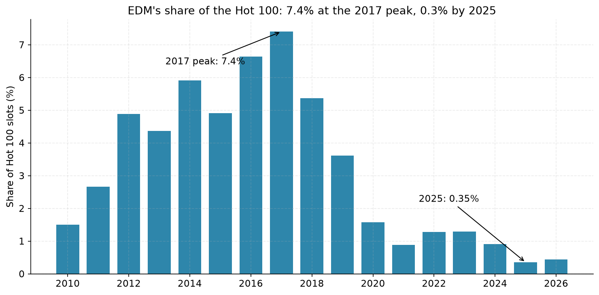
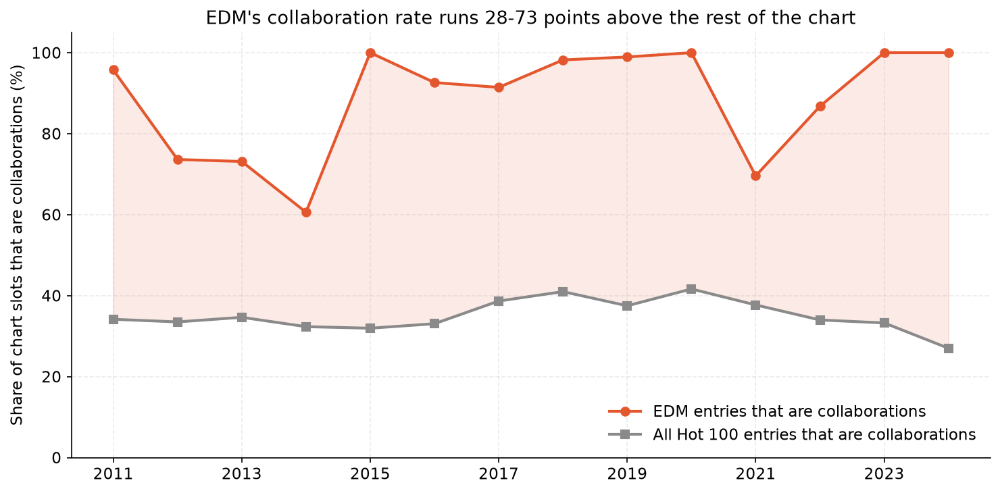
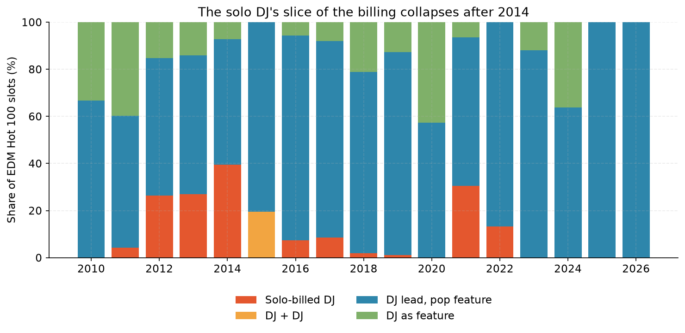
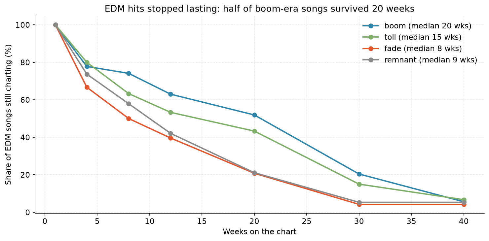
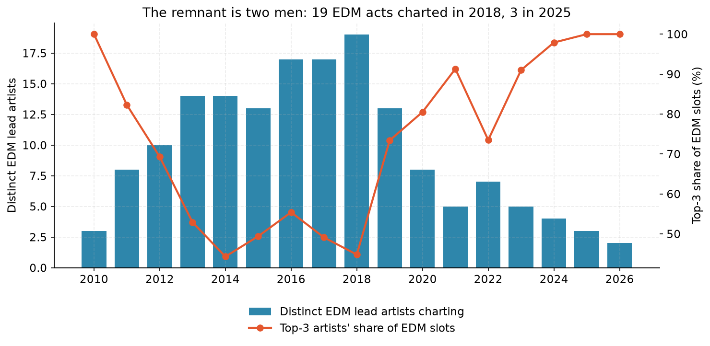
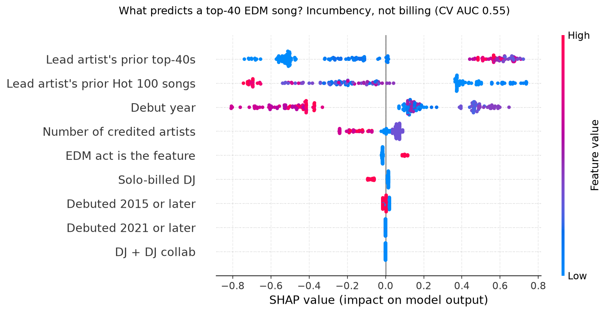

# The Solo EDM Hit Is Extinct

**The last time a DJ reached the Billboard top 40 alone was 2017. It was the Chainsmokers' "Paris." Since then, five solo-billed dance records have charted at all, and the best of them peaked at No. 57. Dance music did not leave the Hot 100 because it got worse. It left because the chart started charging a toll: a pop voice on the credit line. The toll arrived in a single year, 2015, and it never went away.**

*Musing with Mike · 2026-11-12 · Topic: edm · Build #66*

Everyone who follows dance music knows the broad story. EDM conquered American pop around 2012, peaked around 2017, and then faded from the charts while the festivals got bigger. That story is true and it explains nothing, because it treats "faded" as one thing. It was two things happening at once, and only one of them was about the music.

I measured the second one. I took every Billboard Hot 100 chart from 2010 through the week of November 14, 2026, 88,100 chart slots across 881 weeks, and I flagged every entry involving one of 233 curated dance acts, from Avicii and Calvin Harris down to the current Beatport underground. That is 192 songs and 2,814 chart slots. Then I read the billing on each one: is the DJ the only name on the record, is the DJ leading with a pop singer featured, is the DJ the feature on somebody else's record, or is it DJs only?

## Why this would surprise someone who knows the field

Ask anyone who works in dance music why EDM left the charts and you will get the consensus answer: the sound got stale, pop moved on, streaming fragmented taste. All of that is background. Nobody had measured the billing, and the billing tells a different story with a date on it.

First, solo billing did not fade gradually. It fell off a cliff in one year. In 2014, solo-billed DJs held 39.4 percent of EDM's Hot 100 slots. In 2015, the share was zero. Not low. Zero, across 255 slots and 13 debuting songs, in the same year EDM posted some of its biggest hits ever. "Lean On" hit No. 4 and stayed 48 weeks. "Where Are U Now" hit No. 8. "Roses" hit No. 6. Every one of them carried a singer's name next to the DJ's.

Second, the obvious objection is wrong. Maybe all of pop got more collaborative in the streaming era, and EDM just rode the trend. It did not. The whole chart's collaboration rate moved from 34 percent in 2012 to 37 percent in 2019, basically flat. EDM's collaboration rate went from 74 percent to 99 percent over the same stretch, running 28 to 73 points above the rest of the chart in every single year from 2011 to 2024. This is not a rising tide. It is a genre-specific toll.

Third, and this is the part that changes how you should read the whole era: solo billing was never a disadvantage. In the boom years, 2011 to 2014, solo-billed dance records reached the top 40 exactly as often as collaborations did, 50 percent against 47.5 percent, and their median peak was actually better. A solo DJ record was as good a bet as a collab. The chart did not stop rewarding solo DJs because their records underperformed. It stopped admitting them. The gate moved, not the hit rate.

## What I built

| # | Question | Data | Script |
|---|----------|------|--------|
| 1 | How much of the Hot 100 was EDM, and when did it collapse? | Full Hot 100 weekly history 2010-2026, 88,100 slots; 233-act EDM roster | `src/01_fetch.py`, `src/02_classify.py` |
| 2 | What happened to the billing? Solo DJ vs DJ-plus-singer vs DJ-as-feature | Performer-string parsing into four billing types for all 2,814 EDM slots | `src/02_classify.py` |
| 3 | Is EDM's collaboration surge just pop's collaboration surge? | EDM collab share vs whole-chart collab share, year by year | `src/03_analysis.py` |
| 4 | Did solo records underperform, or just stop getting in? | Top-40 and top-10 rates by era and billing; survival curves | `src/03_analysis.py` |
| 5 | Who is left? | Distinct lead artists per year, top-3 slot share | `src/03_analysis.py` |
| 6 | What predicts a top-40 EDM song, once it charts? | XGBoost + SHAP on 192 songs, features known at debut | `src/04_model.py` |

Reproduce: `python3 src/01_fetch.py && python3 src/02_classify.py && python3 src/03_analysis.py && python3 src/04_model.py && python3 src/05_charts.py`. Step 1 re-downloads the Hot 100 history (the committed snapshot in `data/raw/` is the 2026-11-12 capture used here). Requires pandas, numpy, scikit-learn, xgboost, shap, matplotlib, requests.

## Findings

**1. EDM's chart presence collapsed 21-fold, and the collapse has a shape.** Dance acts held 7.4 percent of all Hot 100 slots in 2017, the peak. By 2025 it was 0.35 percent. The number of new EDM songs debuting each year fell from 24 or 25 in 2016-2018 to 3 or 4 in 2023-2025. This is not a gentle decline. It is a genre going from a fixture of the chart to a rounding error in eight years.

**2. 2015 is the year the toll arrived, and it arrived all at once.** In 2014, solo-billed DJs still held 39.4 percent of EDM's chart slots, with Calvin Harris's "Summer" reaching No. 7 on his own billing and Avicii's "Wake Me Up!" still charting from the year before. In 2015, thirteen EDM songs debuted and not one was solo-billed. Zero solo slots in the entire year. The thirteen included the biggest dance hits of the decade, and every one paid the toll: Major Lazer and DJ Snake featuring MØ on "Lean On," Skrillex and Diplo with Justin Bieber on "Where Are U Now," Zedd featuring Selena Gomez, Disclosure featuring Sam Smith. The toll did not phase in. It switched on.

**3. The toll is genre-specific, not a pop-wide trend.** The chart as a whole barely changed its collaboration rate across the 2010s. EDM's rate went from 74 percent in 2012 to 100 percent in 2015 and 99 percent in 2019. The gap between EDM's collaboration rate and the rest of the chart never dropped below 28 points in any year from 2011 to 2024, and it hit 73 points in 2024. If this were just "pop got more collaborative," the lines would move together. They do not. One line is flat. The other goes vertical and stays there.

**4. The solo hit is extinct, and the extinction has a last date.** Across 2010 to 2026, only 26 solo-billed dance songs ever charted, and only four ever reached the top 10: Baauer's "Harlem Shake" (No. 1, 2013), Avicii's "Wake Me Up!" (No. 4, 2013), Calvin Harris's "Summer" (No. 7, 2014), and the Chainsmokers' "Paris" (No. 6, 2017). "Paris" is the last solo-billed EDM record to reach the top 40, and the last to reach the top 10. Since 2018, five solo-billed dance records have charted at all: two Chainsmokers album cuts, Avicii's posthumous "Heaven," Tiësto's "The Business," and the Chainsmokers' "High." The best peak among them is No. 57. No solo-billed dance song has debuted in 2015, 2020, 2023, 2024, 2025, or 2026.

**5. Solo records did not underperform. They stopped getting admitted.** This is the finding that kills the lazy explanation. In the boom era, solo-billed EDM songs reached the top 40 at the same rate as collaborations (50 percent vs 47.5 percent) and peaked slightly higher on median. Even in the toll era, 2015 to 2017, the seven solo songs that did chart reached the top 40 at 43 percent, close to the collabs' 55 percent. What changed was not how solo records performed. It was how many were allowed in. The funnel narrowed at the door, and the door is the part of the data a chart listing can actually see. A model trained to predict top-40s from debut features confirms it from the other side: 5-fold CV AUC is 0.55, barely better than chance, and billing barely registers in the SHAP ranking. Once a dance record is on the chart, whether it has a singer attached tells you almost nothing about how high it climbs. The toll operates before the chart, not on it.

**6. The hits that do get in die faster now.** The median EDM chart run fell from 20 weeks in the boom era to 15 in the toll era, 7.5 in the fade (2018-2020), and 9 in the remnant. Half of boom-era EDM songs were still charting at week 20. In the fade and remnant eras, only about one in five makes it that far. The exceptions prove the filter moved to the front door: the few collab hits that still break through last as long as ever. Guetta and Bebe Rexha's "I'm Good (Blue)" ran 48 weeks in 2022, Marshmello and Kane Brown's "Miles On It" ran 29. Getting in is the hard part now. Surviving was never the problem.

**7. The remnant is two men.** Nineteen different EDM acts charted in 2018. Three charted in 2025, two so far in 2026. The top three acts' share of EDM's chart slots went from 45 percent in 2018 to 100 percent in 2025. And across the whole remnant, 2021 to 2026, just 266 EDM slots exist, of which Marshmello holds 83 and David Guetta holds 81. Two men are 62 percent of dance music's entire Hot 100 presence. Everyone else in the genre, every DJ on every festival mainstage, splits the remaining 38 percent. The chart did not just shrink EDM. It consolidated it into an incumbency.

## The operator takeaway

There are two different games in dance music now, and they stopped being the same business. The live game is bigger than ever: festivals sell out, DJs headline stadiums, and the underground mints new stars every year. The chart game is a toll road with two incumbents on it. The toll is a pop voice on the credit line, and the price is not negotiable because it is not a price. It is a format requirement. Radio and playlists need a singer to program around. A DJ alone is not a record the system knows how to sell.

Three consequences worth pricing. First, for a dance act, the chart is no longer a discovery channel. It is a licensing channel for acts that already have a pop relationship. A new DJ should not budget for a Hot 100 run. They should budget for the festival circuit and the DJ store, where the audience actually lives. Second, for labels, the featuring credit is the most valuable line on a dance record, and it is worth more than the producer credit now. The singer is not a guest on the DJ's record. The DJ is the producer on the singer's record, and the chart knows it. Third, the consolidation is the tell. When a market shrinks to two incumbents holding 62 percent of it, the remaining slots are not a growth market. They are a legacy position. Marshmello and Guetta are not winning dance music's chart future. They are its pension.

## Caveats

- **"Solo" means sole credited artist on the Billboard listing.** Billboard's performer field sometimes omits featured vocalists, so a few of the boom era's "solo" hits had a voice the chart did not credit. Avicii's "Wake Me Up!" lists Avicii alone though Aloe Blacc sings it. Same for "Hey Brother" (Dan Tyminski) and NERO's "Promises" (Alana Watson). That nuance strengthens the story rather than weakening it: even the solo era's biggest hits already had a pop voice, it just was not on the marquee yet. The toll made the credit mandatory.
- **The roster is a judgment call, documented in `src/01_fetch.py`.** It covers 233 DJ and producer acts, from chart headliners to the current underground, and it excludes vocalists who only sing on dance tracks, rappers, and party-pop acts like LMFAO. Broaden the roster and the counts move a little. The shape does not: every plausible roster shows the same 2015 cliff and the same post-2017 extinction.
- **2026 is partial.** The data runs through the chart dated November 14, 2026, so 2026 covers 46 weeks and one debuting EDM song, Marshmello and Kelsea Ballerini's "Another Drink" at No. 60. Nothing in the findings leans on 2026.
- **The model sees only songs that charted.** That is a selection effect, and it is the point. The toll operates at entry, which is exactly the part of the process a chart-only dataset cannot observe directly. The extinction table is the evidence for the gate. The model is the evidence that, past the gate, billing stops mattering.
- **Hot 100 methodology changed over the window.** Streaming entered the formula in 2013 and video in 2013, and the weighting has been tuned since. Those changes affect all genres. The EDM-specific patterns here, the 2015 cliff, the 28-plus-point collab gap, the two-man remnant, sit on top of a flat chart-wide baseline, so they are not methodology artifacts.

## Data

- Billboard Hot 100 weekly charts, 1958-2026 (analysis uses 2010-2026), compiled by Christian McDonald (UT Austin) from a Kaggle scrape with additional merging: `data/raw/hot100.csv`
- EDM roster (233 acts, with exclusion rules): `data/edm_roster.json`
- Classified entries (2,814 EDM slots) and song-level table (192 songs): `data/edm_entries.csv`, `data/edm_songs.csv`
- Yearly aggregates and computed findings: `data/yearly.csv`, `data/findings.json`
- Model frame and SHAP values: `data/model_frame.csv`, `data/model.json`, `data/shap_values.npy`
