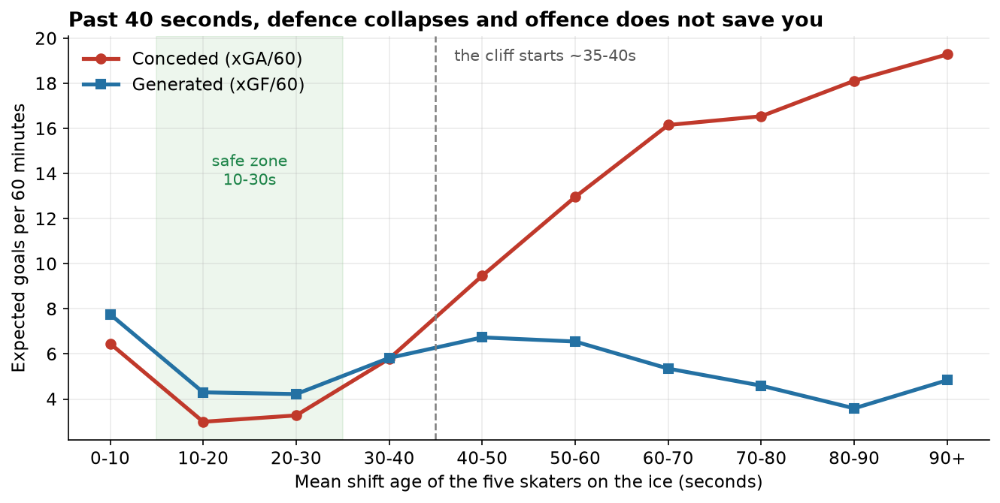
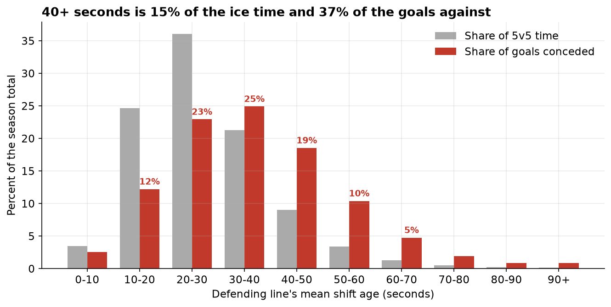
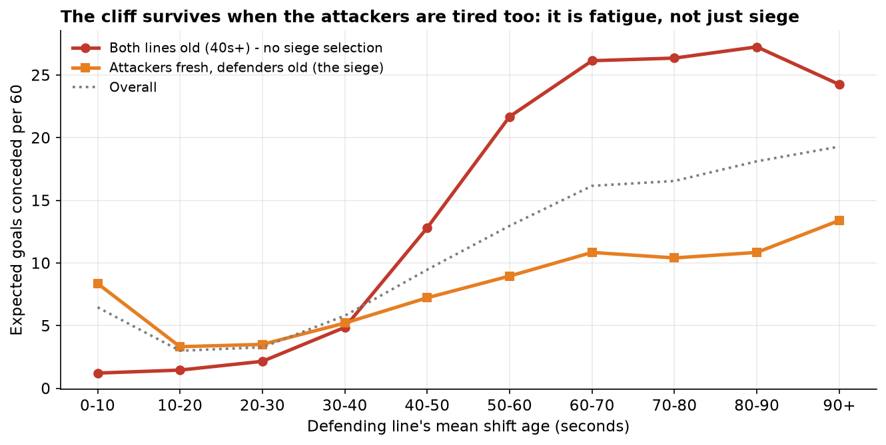
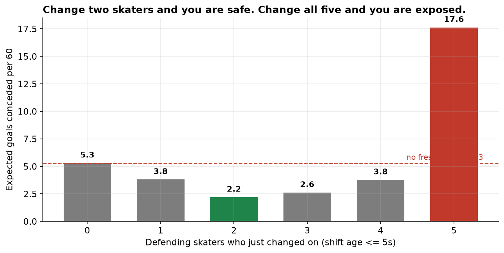
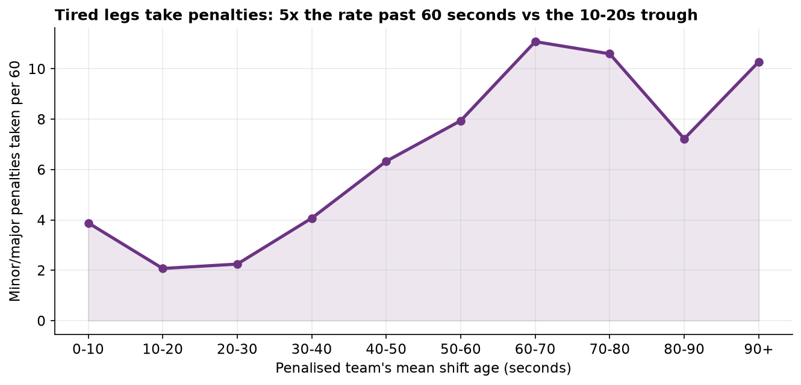
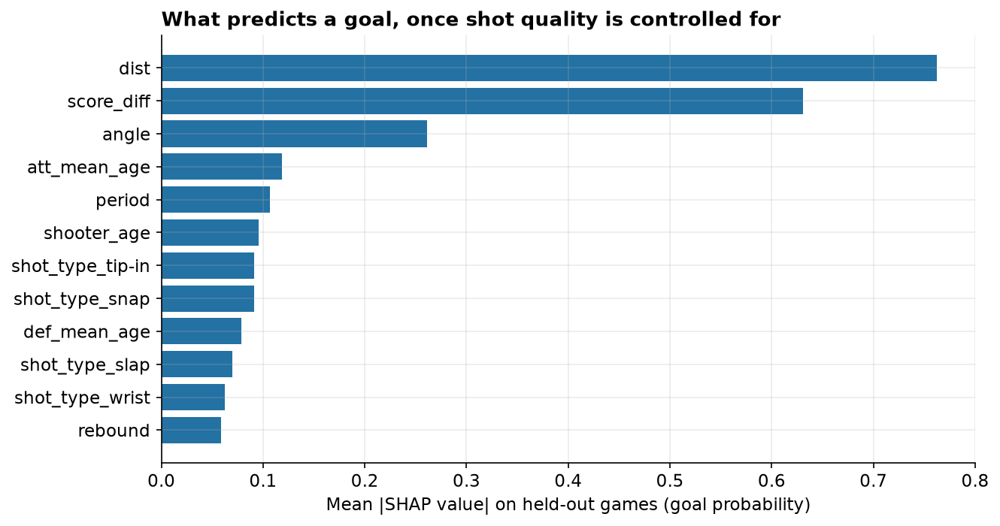

# The Forty-Second Cliff

**The average NHL shift lasts 48 seconds. The cliff starts at 40. Every second past it, a team's defence falls apart at a rate no one had measured, and the league's best players are the worst offenders.**

*Musing with Mike · 2026-11-13 · Topic: sports-analytics · Build #67*

Ask a coach how long a shift should be and you will get the folk answer: about 45 seconds, change on the fly, don't get caught. Everyone in hockey knows long shifts are bad. Nobody had measured exactly how bad, or when "long" starts, or whether the damage is the fatigue itself or just the fact that a line only gets stuck out there when it is already losing. I measured it across the entire 2025-26 season: all 1,312 regular-season games, every shift chart joined to every shot attempt, 120,992 shots at five-on-five, with the clock on every skater's legs.

## Why this would surprise someone who knows the field

First, it is not a slope. It is a cliff with a safe zone in front of it. Between 10 and 30 seconds into a shift, a team concedes 3.0 expected goals per 60 minutes, the safest hockey there is. Between 30 and 40 seconds it nearly doubles to 5.8. Between 40 and 50 it is 9.5. Past 60 it is 16 to 19, six times the safe zone. The biggest single jump in the whole curve is from the 30-40 bucket to the 40-50 bucket. Forty seconds is the line, not forty-five, and the league's average shift, 48.2 seconds, already runs past it. The folk wisdom is five seconds too generous, and five seconds is where the damage starts.

Second, the obvious objection is wrong, and it is wrong in the surprising direction. The natural story is selection: a line only stays out for 70 seconds because it is trapped in its own zone getting shelled, so of course the numbers look bad. I split the data on the attacking line's age to test that. When the attackers are fresh and cycling in against a trapped line, the classic siege, the cliff is 3.3 times. When the attackers are just as old as the defenders, long continuous play with nobody able to change, no siege selection at all, the cliff is 14.4 times: 1.8 expected goals against per 60 in the safe zone, 26.0 past 60 seconds. Fatigue is not a footnote to the selection story. When you remove the selection, the cliff gets steeper.

Third, changing is safe and changing wrong is fatal, and the difference is how many skaters go at once. When two defenders change on the fly while their mates cover for them, the team concedes 2.2 expected goals per 60, the safest state in the dataset. When all five skaters change at once, a full line change, it concedes 17.6, the most dangerous state in the dataset, with 658 shot attempts against per 60. Coaches warn about getting caught on a change. The data says getting caught is a full-line problem, not a change problem. Change in pairs and you are fine. Change everybody while the other team has the puck and you are bleeding.

## What I built

| # | Question | Data | Script |
|---|----------|------|--------|
| 1 | How does danger rise with shift age? | All 1,312 games of 2025-26; shift charts joined to play-by-play; 120,992 5v5 shot attempts, 5,376 goals | `src/01_fetch.py`, `src/02_parse.py` |
| 2 | Is it shot volume, shot quality, or both? | Logistic xG model (distance, angle, shot type, rebound), AUC 0.825 on held-out games | `src/03_analysis.py` |
| 3 | Is it fatigue or just being trapped? | Joint-bucket split: defenders old while attackers fresh (siege) vs both lines old (continuous play) | `src/03_analysis.py` |
| 4 | What does changing cost? | Goals and xG against by how many defenders just changed on (0 to 5) | `src/03_analysis.py` |
| 5 | Do tired legs take penalties? | 7,209 penalties at 5v5, rate by shift age | `src/03_analysis.py` |
| 6 | Which teams and stars live past the cliff? | Shift-length and time-at-40s+ rankings for all 32 teams and all skaters | `src/03_analysis.py` |
| 7 | Does shift age predict goals once shot quality is known? | XGBoost + SHAP on 5v5 shots, with and without shift features | `src/04_model.py` |

Reproduce: `python3 src/01_fetch.py && python3 src/02_parse.py && python3 src/03_analysis.py && python3 src/04_model.py && python3 src/05_charts.py`. Step 1 re-downloads the season (the committed snapshots in `data/raw/` are the 2026-11-13 capture used here). Requires pandas, numpy, scikit-learn, xgboost, shap, matplotlib, requests.

## Findings

**1. The safe zone is 10 to 30 seconds, and the cliff starts at 40.** A defending line in its first 10 seconds concedes 6.5 expected goals per 60, elevated because full line changes usually happen under pressure. Settle in and it drops to 3.0 at 10-20 seconds and 3.3 at 20-30. Then it climbs: 5.8 at 30-40, 9.5 at 40-50, 13.0 at 50-60, 16.2 at 60-70, and 19.3 past 90 seconds. Goals follow the same shape, from 2.5 per 60 in the safe zone to 24.8 past 90 seconds. Offence does not save you: a tired attacking line generates less, not more, falling from 5.5 expected goals per 60 in the safe zone to 4.6 past 60 seconds. The damage is almost all on the defensive side.

**2. Forty-plus seconds is 15 percent of the ice time and 37 percent of the goals against.** This version needs no assumptions at all: it compares the share of the season's 5v5 time spent in each shift-age bucket with the share of the season's goals conceded there. Teams spend 14.6 percent of their 5v5 time with their line averaging 40 seconds or more, and 37.4 percent of the goals they concede arrive in those minutes. At 60 seconds and up it is 2.2 percent of the time and 8.5 percent of the goals. The overrepresentation factor runs from 1.9x at 40-50 seconds to 3.8x past 90.

**3. The cliff is fatigue, not just selection, and removing the selection makes it steeper.** Split the shots by the attacking line's age. In the siege slice, attackers fresh (0-30s) against defenders at 60-plus, expected goals against run 11.4 per 60 against a 3.4 baseline, a 3.3x ratio. In the both-old slice, attackers at 40-plus too, long continuous play where nobody can change, it runs 26.0 per 60 against a 1.8 baseline, a 14.4x ratio. If long shifts were only a symptom of being trapped, the both-old slice would be flat. It is the steepest curve in the project.

**4. Change two skaters and you are safe. Change all five and you are exposed.** By the number of defending skaters with less than 5 seconds on their shift: zero fresh, 5.3 expected goals against per 60; one fresh, 3.8; two fresh, 2.2, the safest state measured; three fresh, 2.6; four fresh, 3.8; all five fresh, 17.6, with 658 attempts against per 60, more than eleven times the rate of the two-fresh state. The full line change is the most dangerous moment in hockey that is not a penalty kill, and it is a coaching choice.

**5. Tired legs take penalties at five times the fresh rate.** Minor and major penalties at 5v5 run 2.1 per 60 when the penalised team's line is 10-20 seconds in, and 11.1 per 60 past 60 seconds. Tripping, hooking, and holding dominate the tired end, which is what fatigue looks like in a penalty box: sticks and hands instead of feet. A tired line does not just concede more, it also hands the other team power plays.

**6. The stars are the worst offenders, and the Oilers live past the cliff.** The league's average shift is 48.2 seconds (median 46). Quinn Hughes averages 70.1 seconds a shift, the longest in the league, followed by Kaprizov at 63.7 and McDavid at 61.4, fifth longest among high-volume skaters. Draisaitl averages 58.7, Hyman 58.1, Bouchard 57.7. The best players stay out longest because coaches trust them, and the curve says those extra 15 to 20 seconds are the most expensive ice time in the game. By team, Minnesota spends 21.1 percent of its 5v5 time with its line at 40 seconds or more, the worst discipline in the league; Ottawa spends 9.0 percent, the best. Edmonton is sixth worst at 16.7 percent. At league-average rates, Minnesota would save about 37 expected goals a season, roughly six standings points, with Ottawa's shift profile, and Edmonton would save about 25, roughly four points. Both teams already defend better than the league curve predicts given their profiles, so treat those as the size of the lever, not a forecast.

**7. The model agrees, and it says the damage is volume, not finishing.** An XGBoost goal-probability model on 5v5 shots scores AUC 0.871 from shot quality alone (distance, angle, shot type, rebound, score, period) and 0.876 with shift-age features added. The lift is small because most of the cliff works through shot volume and shot location: tired defenders give up far more attempts from far better spots, and the per-shot conversion bump is secondary. In SHAP terms, attacking shift age is the fifth most important predictor of a goal, ahead of defending shift age, which fits the mechanism: a fresh attacking line finishes better, and a tired defending line gives it the chances to finish.

## The operator's version

If you run a bench, the rule is not "keep shifts under 45." It is "get forwards off at 30, and never let a line see 40." The ten seconds from 30 to 40 nearly double the danger of the safe zone, and every ten seconds after that adds more. Change in pairs on the fly; never change all five while the other team has the puck in your end. And the star problem is real: the players you trust most are the ones taking the longest shifts, which means your best line is also playing your worst defensive minutes. Shorten McDavid's shifts by ten seconds and you have not benched your best player. You have taken away the minutes where he is a liability.

## Methods and limitations

Shift age is measured from the NHL's official shift charts (api.nhle.com/stats/rest) joined to play-by-play (api-web.nhle.com) for every 2025-26 regular-season game. A shot is assigned the on-ice skaters' shift age at the second it happened. Two measurement traps matter and both are handled in the code. First, goalies appear in the shift charts, so they are excluded by roster position, 123 goalies identified league-wide. Second, the NHL ends a skater's shift at the exact second of a goal or a penalty call, so reading the state at the event second returns the fresh post-event line; every event is evaluated at t minus 0.5 seconds, which restores the line that was actually on the ice. Before that fix, 79 percent of goals showed a defending shift age under 5 seconds. After it, the goal and non-goal age distributions line up.

Rates per 60 use defending exposure equal to half of a team's 5v5 time in each bucket, because the league's possession split is 50/50 by construction. The 0.5 factor is constant across buckets, so the shape of every curve is unaffected; only the level depends on it. The share-versus-time finding in section 2 needs no such assumption. Exposure includes a small amount of post-goal stoppage time where a line stays out, which slightly dilutes rates in older buckets, so the cliff as reported is, if anything, a touch understated.

The team counterfactuals in section 6 apply league-average rates to a team's shift-age profile. They measure the size of the shift-management lever, not a prediction for that team, since teams differ in talent and goaltending. The XGBoost SHAP chart excludes the `shot_type_unknown` category: the NHL records shot type for goals but usually not for missed or blocked shots, so "unknown" is a recording artifact that predicts non-goals, not a real shot type. Overtime is excluded throughout (three-on-three, different dynamics) and all rates are five-on-five regulation only.

## Sources

- NHL shift charts: `api.nhle.com/stats/rest/en/shiftcharts` (public, no key), 1,312 games, 0 failed fetches
- NHL play-by-play: `api-web.nhle.com/v1/gamecenter/{gameId}/play-by-play` (public, no key)
- Expected goals: logistic regression fit on this season's own shots (distance, angle, shot type, rebound), AUC 0.825 on held-out games
- Standings-point conversion uses the standard rule of thumb of about 6 goals per standings point
