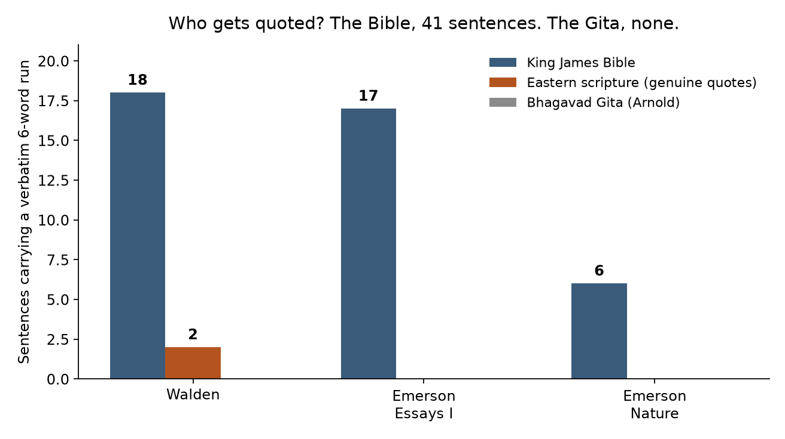
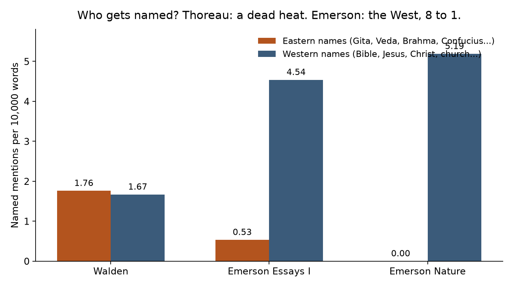
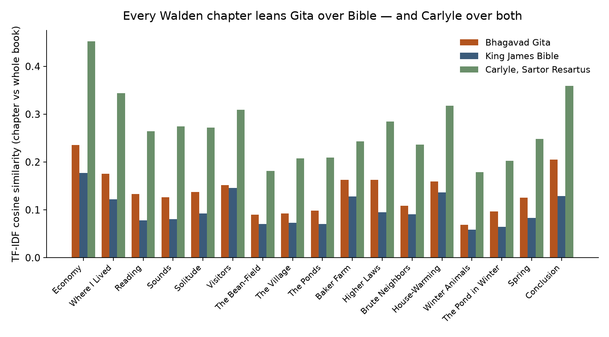
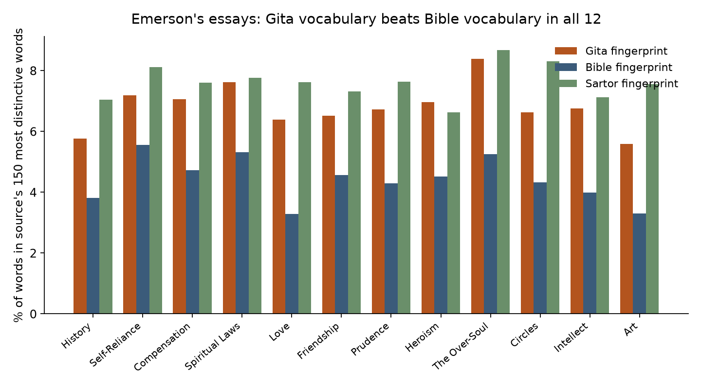

# He Bathed in the Gita and Quoted the Bible

**Thoreau praised the Bhagavad Gita above every book he owned, and never once borrowed a sentence from it. The Bible, the book he argues with, is the one whose words actually live in his prose. Emerson does the exact opposite.**

*Musing with Mike · 2026-11-14 · Topic: philosophy · Build #68*

## Why this would surprise someone who knows the field

Everybody who knows American philosophy knows the story: Thoreau read the Bhagavad Gita at Walden Pond, Emerson built transcendentalism partly out of the Upanishads, and the East is the secret second scripture of Concord. That story is true at the level of ideas. What nobody had done, as far as I can find, is count it at the level of sentences. So I did. I lined up Walden, Emerson's first series of essays, and Nature against the four Eastern scriptures the transcendentalists actually read, plus the King James Bible and Carlyle's Sartor Resartus as controls, and measured two things separately: how often each man *names* a tradition, and how often he *quotes* it word for word.

The two measures point in opposite directions, and they point in opposite directions for the two men. Thoreau names the East as often as the West and quotes the Bible 18 times against 2 Eastern quotations. Emerson names the West eight times as often as the East, yet his vocabulary overlaps the Gita more than the Bible in all twelve essays. The Gita is the most praised and least quoted book in Walden. That split is the finding, and it has a mechanism: quotation is what you do with a text you argue with. Thoreau quotes the Bible to dispute it. The Gita he treats as doctrine to live by, so he paraphrases its teaching into his own sentences and leaves its wording alone. Influence, in other words, does not look like quotation. Sometimes it looks like the opposite.

## The question

How much of Emerson and Thoreau is, literally, Eastern scripture? And does the answer change when you measure naming, quoting, and vocabulary separately?

## The data

Nine public-domain texts from Project Gutenberg, all downloaded and verified by header this week. Full manifest in `data/raw/manifest.json`.

| Text | Gutenberg # | Words |
|---|---|---|
| Walden (Civil Disobedience removed) | 205 | 107,807 |
| Emerson, Essays: First Series (1841) | 2944 | 74,891 |
| Emerson, Nature (1836) | 29433 | 15,417 |
| Bhagavad Gita, Edwin Arnold (1885) | 2388 | 20,602 |
| The Upanishads, Max Muller (1879) | 3283 | 17,804 |
| Vishnu Purana, Dutt/Wilson | 66208 | 154,215 |
| Confucian Analects, James Legge (1861) | 4094 | 29,965 |
| King James Bible | 10 | 792,180 |
| Carlyle, Sartor Resartus (1831) | 1051 | 82,031 |

Three measures. First, **quotation**: distinct word 6-grams and 8-grams shared between each target and each source, plus the count of target sentences containing a 6-gram match. Second, **naming**: exact-word counts of Eastern names (Gita, Veda, Brahma, Confucius, Zoroaster, Hindoo, and the rest) against Western ones (Bible, Jesus, Christ, church, and the rest), per 10,000 words. Third, **vocabulary**: TF-IDF cosine between each Walden chapter and each source book, and a fingerprint test that scores each text against each source's 150 most distinctive words.

## Finding 1: the Gita is the most praised and least quoted book in Walden

Thoreau names the Gita twice, both times in superlatives. In Economy: "How much more admirable the Bhagvat-Geeta than all the ruins of the East!" In The Pond in Winter: "In the morning I bathe my intellect in the stupendous and cosmogonal philosophy of the Bhagvat Geeta, since whose composition years of the gods have elapsed, and in comparison with which our modern world and its literature seem puny and trivial."

It contributes zero six-word runs to Walden. Not one. Across 107,807 words, there is no sentence in Walden that shares six consecutive words with Arnold's Gita. The Upanishads contribute one six-word run, and it is a generic phrase ("I think that I do not"). The Analects contribute one, also generic ("I have not been able to"). The Bible contributes 83 distinct six-word runs and 59 eight-word runs, spread across 18 sentences, half a percent of the book.

Some of those 18 are marked quotations, and Thoreau quotes the Bible the way a lawyer quotes a hostile witness. "What mean ye by saying that the poor ye have always with you, or that the fathers have eaten sour grapes, and the children's teeth are set on edge? As I live, saith the Lord God, ye shall not have occasion any more to use this proverb." He lifts Ezekiel to argue with it. Others are echoes so deep in his ear they surface unmarked: "Remember thy Creator in the days of thy youth." "The mountains do indeed skip like rams and the little hills like lambs."

The East does get quoted in Walden, exactly twice, and both times it is the Vishnu Purana, both times introduced with an attribution. The other six sentences that share a six-word run with the Vishnu Purana are generic phrases the two books happen to share ("on the surface of the earth", "at the other end of the town"), not borrowings. In Economy: "Whatever have been thy failures hitherto, 'be not afflicted, my child, for who shall assign to thee what thou hast left undone?'" In House-Warming: "The Vishnu Purana says, 'The house-holder is to remain at eventide in his court-yard as long as it takes to milk a cow, or longer if he pleases, to await the arrival of a guest.'" So the scoreboard for Walden is 18 Bible sentences, 2 Eastern sentences, 0 Gita sentences. Emerson is cleaner still: 17 Bible sentences in the essays and 6 in Nature, zero genuine Eastern quotations anywhere. The single six-word overlap his essays share with the Vishnu Purana is the generic phrase "is the soul of the whole."

That Vishnu Purana result matters for more than the count. It is the positive control inside the East. Same author, same book, same method: when Thoreau quotes an Eastern text verbatim, the test catches it. The Gita zero is not a failure of the method. It is a fact about the Gita in Walden.



## Finding 2: Thoreau names the East as often as the West. Emerson does not.

Count the names instead of the sentences and Thoreau looks like a different man. Walden names Eastern figures and books 19 times (1.76 per 10,000 words) and Western ones 18 times (1.67). A dead heat. Emerson's essays name the West 34 times against 4 for the East, 4.54 against 0.53 per 10,000 words, an eight-to-one ratio. Nature names the East not once.

So Thoreau's East lives in his names and Emerson's East does not even live there. Thoreau also quotes Confucius twice by name, in Economy and in Solitude, with quotation marks and the sage's name attached: "To know that we know what we know, and that we do not know what we do not know, that is true knowledge." Those lines do not match Legge's Analects word for word, which is why they score zero on the verbatim test. He was quoting from memory or from another translation. The name does the work the wording does not.



## Finding 3: Emerson writes the East. Thoreau writes the Bible. Carlyle beats them both.

The vocabulary tests tell the other half of the inversion. Compare each Walden chapter to each source book by TF-IDF cosine, and the Gita beats the Bible in all 17 chapters I could segment. Economy: 0.235 against 0.177. Conclusion: 0.205 against 0.129. Even Higher Laws, the chapter about hunting and diet and purity, the one every reader assumes is the Gita chapter, leans Gita over Bible, 0.163 to 0.094. But the Gita never wins the chapter. Carlyle's Sartor Resartus does, every time, by roughly two to one. Economy against Sartor is 0.452.

The fingerprint test says the same thing from a different angle. Take each source's 150 most distinctive words and ask what share of a target's words fall in that set. For Emerson's essays, the Gita fingerprint beats the Bible fingerprint in all twelve essays. The Over-Soul, his most Upanishadic essay, is the most Gita-like of all at 8.38 percent against 5.25 for the Bible. For Walden the two fingerprints tie, 3.78 against 3.72. And Sartor has the highest fingerprint for both men, 5.41 percent for Walden and 7.69 for the essays.

Read those three measures together and the picture is clean. Thoreau: names the East 1 to 1, quotes the Bible 18 to 2, vocabulary a tie between Gita and Bible, all of it under Carlyle. Emerson: names the Bible 8 to 1, quotes the Bible 23 to 0, vocabulary leaning Gita in every essay, all of it under Carlyle. The two men split the East-West difference in opposite directions. One puts the East in his names and the Bible in his sentences. The other puts the Bible in his names and the East in his words. And both of them are writing in a diction they learned, measurably, from Carlyle, the man who carried German idealism to Concord. The East reached the pond partly through a German filter, and the numbers now say so.





## Finding 4: even Higher Laws does not quote the East

Higher Laws deserves its own check because it is the obvious objection. It is the chapter where Thoreau writes about hunting, eating meat, and purity, the chapter that reads most like karma yoga in plain English. Its Eastern 6-gram share is higher than the book average but not significantly so. A permutation test that shuffles sentences across chapters and rebuilds a Higher Laws of the same size puts the p-value at 0.091. Its Upanishad fingerprint is the highest of any Walden chapter at 4.36 percent, but that is vocabulary, not quotation. The chapter that most sounds like the Gita quotes the Gita exactly as much as the rest of the book does: not at all.

## What this means

The mechanism is the boring-sounding one that turns out to matter. Quotation is a move you make with a text you are arguing with, or a text whose authority you need to borrow for a point. Thoreau quotes the Bible because he is disputing it in public, in its own language, in front of readers who know it. He does not quote the Gita because he is not disputing it and he is not borrowing its authority. He is living it, or trying to, and living a teaching means restating it in your own sentences. That is why the Gita's ideas are everywhere in Walden and its wording is nowhere. Detachment, action without attachment to results, the self as something larger than the ego: all of it is in the book as Thoreau's own prose.

There is an operator's lesson in that, and it is the same one as in the marketplace work. When you want to know what shaped a thing, do not count the citations. Count the sentences that could only have been written by someone who read it, and count separately the names that get dropped. Citations are politics. Wording is DNA. Thoreau's citations say he was a biblical writer with an Eastern hobby. His wording says he was an Eastern thinker arguing with the Bible in its own language, in a German accent he picked up from Carlyle.

## Caveats, stated plainly

First, the translation gap. Thoreau read the Gita in Charles Wilkins's 1785 prose translation, not Edwin Arnold's 1885 verse translation, which is the one I tested. The verbatim test is conservative: it can only undercount Eastern borrowing, because a sentence Thoreau lifted from Wilkins would not match Arnold's wording. Two things limit the damage. The Vishnu Purana positive control shows the test catches Eastern quotation when it happens. And the Upanishads test used Muller's translation, which postdates Thoreau too, yet the same pattern holds. If a Wilkins text were available I would rerun the Gita panel against it, and I expect the count to stay low, because Thoreau's Gita passages in Walden are paraphrases even where he signals a quotation. That expectation is a guess, and I am marking it as one.

Second, six-word runs measure verbatim borrowing by design. Paraphrase is invisible to them, which is exactly why the TF-IDF and fingerprint panels are in the build. The three measures disagree on purpose. The finding is in the disagreement.

Third, fingerprints are ranking evidence only. The null is large: the King James Bible itself scores 11.06 percent on the Gita fingerprint, because the two books share a philosophical vocabulary of soul, spirit, god, and one. The fingerprint numbers in this build are only meaningful as comparisons inside one target text, which is how I use them. The full null matrix is in the code output if you want to check it.

Fourth, the Walden chapter split covers 17 of 18 chapters. The Gutenberg file does not carry a recoverable standalone heading for "Former Inhabitants; and Winter Visitors", so that chapter's text sits inside the House-Warming chunk. Nothing in the chapter findings depends on it.

Fifth, Emerson's essays are the 1841 first series, and Nature is the 1836 text. Later essays, including the ones where Emerson engages the East most directly, are not in this panel. The Over-Soul result is the strongest hint that a wider Emerson panel would lean further East, not less.

## How to reproduce

```bash
python3 src/fetch_texts.py   # resolve Gutenberg IDs via Gutendex, download with curl
python3 src/fetch_rest.py    # remaining titles by candidate ID, header-verified
python3 src/analyze.py       # containment tables, Walden chapters, TF-IDF, permutation test
python3 src/analyze2.py      # exact-word mentions, quotation inspection, fingerprints
python3 src/analyze3.py      # Analects panel, fingerprint null, final numbers
python3 src/charts.py        # figures
```

Data note: the egress proxy in this environment drops `requests.Session` keep-alive connections, so the fetch scripts shell out to `curl` with fresh connections. Gutendex is flaky through the same proxy and returns 503s, so `fetch_rest.py` falls back to candidate Gutenberg IDs verified against each file's header. Three candidate IDs were wrong on the first pass (23842 is a Chinese novel, 12956 is a history of Indian philosophy) and were caught by the header check, not by luck. The Laws of Manu could not be resolved to a Gutenberg plain-text edition in the time available, so the panel runs on three Eastern scriptures plus the Analects rather than four.

## Files

- `src/fetch_texts.py`, `src/fetch_rest.py` — corpus acquisition
- `src/analyze.py`, `src/analyze2.py`, `src/analyze3.py` — the three analysis passes
- `src/charts.py` — figures
- `data/raw/` — the nine Gutenberg texts plus `manifest.json`
- `data/containment.json`, `data/mentions.json`, `data/results.json` — headline numbers
- `data/walden_chapters.json`, `data/walden_tfidf.json`, `data/emerson_essays.json` — chapter and essay tables
- `data/mention_contexts.json` — every Eastern mention in context
- `charts/` — the four figures
