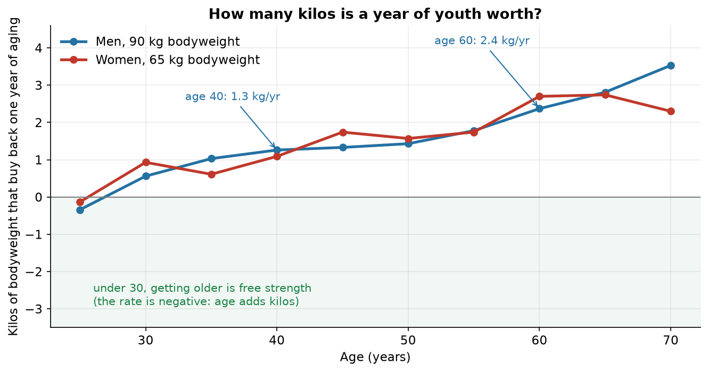
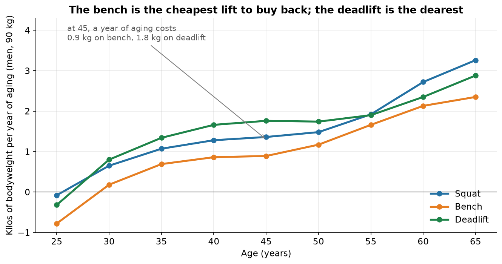
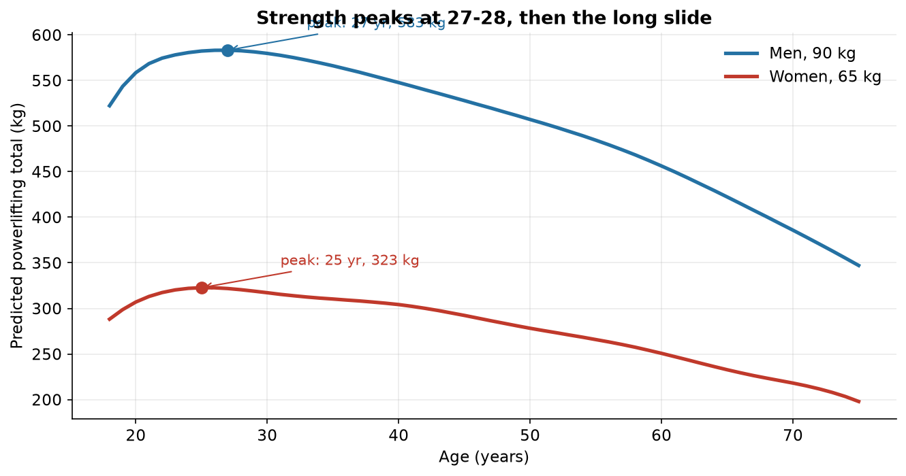
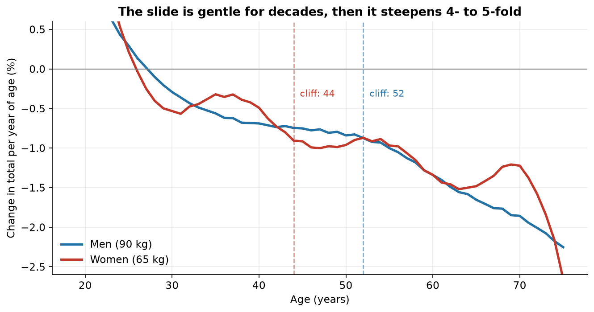
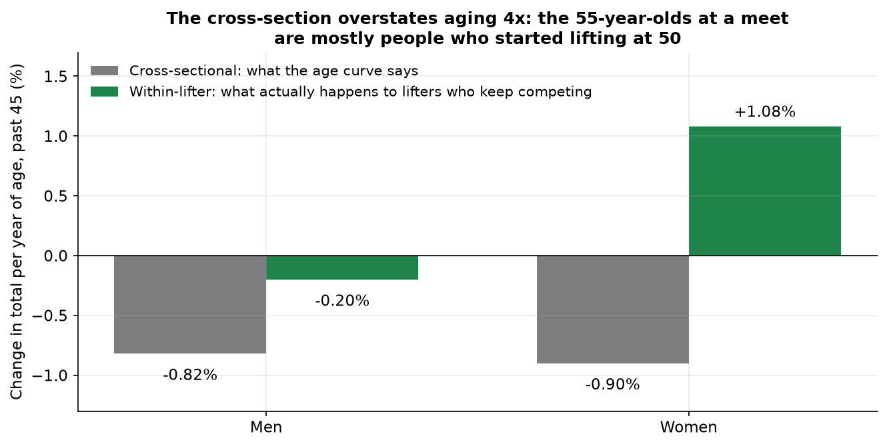

# How Many Kilos Is a Year of Youth Worth?

**At 40, a year of aging costs a 90-kilo man about 1.3 kilos of bodyweight. At 60 it costs 2.4. The bench press is the cheapest lift to buy back and the deadlift is the dearest, and the aging curve everyone quotes overstates what actually happens to a lifter who keeps training by a factor of four.**

*Musing with Mike · 2026-11-15 · Topic: fitness · Build #69*

Every lifter knows two facts. Strength falls as you age, and strength rises as you get heavier. Coaches trade these off by feel: move up a weight class to stay competitive, or cut down and accept the loss. Nobody had priced the trade. I measured it on the whole sport: 877,655 raw full-power meets from 338,398 lifters, 357 federations, 2000 to 2026, and turned the age curve and the bodyweight curve into one number, the kilos of bodyweight that buy back one year of aging.

## Why this would surprise someone who knows the field

First, it is a price, not a vibe, and the price has a shape nobody had drawn. At 90 kilos, a man pays 1.3 kilos a year at 40 and 2.4 at 60. That is a number you can use: a 42-year-old who wants his 40-year-old total back needs about 2.6 kilos, and a 60-year-old who wants his 59-year-old total back needs 2.4 kilos for a single year. Under 30 the price is negative. At 20, getting older still adds about 2.2 percent of total a year, which is why the exchange rate only turns positive around 28. Youth is not just free before 30, it pays you.

Second, the three lifts do not share one price. At 45, buying back a year costs 0.9 kilos on the bench, 1.4 on the squat and 1.8 on the deadlift. Bodyweight is roughly twice as effective at buying bench as deadlift, which is the quantified version of something every coach feels in their gut and nobody had put a number on. The ordering holds at every age I measured. If you are a masters lifter deciding where your next five kilos go, the answer is mostly bench.

Third, the aging curve is largely not aging. Lifters who keep competing past 45 lose 0.20 percent a year. The cross-sectional curve says 0.82 percent. The gap is composition: the 55-year-olds at a meet are mostly people who started lifting at 50, so the curve mixes aging with short training history. Women past 45 are still gaining, plus 1.08 percent a year on the median. This is the year-on-year side of what build #60 found: at equal training age, older lifters still total less (80 percent at 55 to 59 versus 30 to 34), so age genuinely costs strength in level terms. What it does not do is make a continuing lifter fall off a cliff year to year. The cliff exists, but it is a level gap for late starters, not a fast decline for people already in the sport.

## The question

How many kilos of bodyweight does it take to buy back one year of aging, and how does that price change with age, sex, and lift? The sub-questions are where the cliff is, whether mass ever stops paying, and how much of the age curve survives when you follow the same lifters over time.

## The data

**The archive.** The OpenPowerlifting bulk CSV, revision 6b8787a8, updated November 14, 2026: 4,067,854 rows, licensed ODbL with attribution. The official host would not answer from this machine, so the file came from the project's GitLab Pages mirror of the identical file, the same revision and row count. Build #60 verified that route the same way.

**The panel.** Raw, full-power (squat, bench, deadlift), with a positive total and all three lifts completed, age 14 to 85, bodyweight 40 to 200 kilos, meets from 2000 onward. That leaves 877,655 meets from 338,398 lifters: 582,662 men's meets and 294,993 women's, across 357 federations. Lifter identity is name plus sex, with a guard that drops identities whose recorded age ever runs backwards by more than a year (5,477 identities removed, the standard name-collision fix).

**The model.** Per sex, log(total) on a cubic spline in age plus log bodyweight plus their interaction, ridge regression. Cross-validated R2 is 0.475 for men and 0.284 for women on the total. A gradient boosting model with the same two features reaches 0.51 and 0.32, so the spline is capturing nearly all the signal age and bodyweight carry. The exchange rate is the ratio of the two partial derivatives, computed numerically: the yearly age slope divided by the per-kilo bodyweight slope, in kilos per year. The same model is fit per lift.

## What I built

| # | Question | Data | Script |
|---|----------|------|--------|
| 1 | What is the exchange rate, by age and sex? | Spline model on 877,655 meets; derivatives at reference bodyweights (90 kg men, 65 kg women) | `src/03_analysis.py` |
| 2 | Does the price differ by lift? | Same model fit separately to squat, bench and deadlift | `src/03_analysis.py` |
| 3 | Where does strength peak, and what does a decade cost? | Model predictions at fixed bodyweight, ages 25 to 65 | `src/03_analysis.py` |
| 4 | Is there a masters cliff, and where? | Piecewise-linear knot search on the model curve | `src/03_analysis.py` |
| 5 | How much of the age curve is real decline? | Within-lifter slopes for lifters with 4+ meets past 45 spanning 5+ years (n = 2,206 men, 1,091 women) | `src/03_analysis.py`, `src/04_checks.py` |
| 6 | Does mass ever stop paying? | Marginal return to bodyweight by age, plus raw median totals by bodyweight bin | `src/03_analysis.py`, `src/04_checks.py` |
| 7 | Is the model just curve-fitting? | Gradient boosting check with the same two features, plus raw binned medians as a model-free check | `src/03_analysis.py`, `src/04_checks.py` |

Reproduce: `python3 src/01_fetch.py && python3 src/02_clean.py && python3 src/03_analysis.py && python3 src/04_checks.py && python3 src/05_charts.py`. Step 1 downloads the 164 MB bulk zip from the GitLab Pages mirror (the zip itself is gitignored; the committed `data/clean_lifts.csv.gz` is the 877,655-row sample if you want to skip straight to the analysis). Requires pandas, numpy, scikit-learn, scipy, matplotlib.

## Findings

**1. A year of youth costs 1.3 kilos at 40 and 2.4 at 60.** For a man at 90 kilos, the exchange rate on the total runs 0.6 kilos a year at 30, 1.0 at 35, 1.3 at 40, 1.4 at 50, 1.8 at 55, 2.4 at 60 and 2.8 at 65. For a woman at 65 kilos it runs 1.1 at 40, 1.6 at 50, 2.7 at 60 and 2.7 at 65. The price roughly doubles between 40 and 60. Before 30 it is negative, which is just the model saying what every 22-year-old knows: time is still on your side.

**2. The bench is the cheapest lift to buy back. The deadlift is the dearest.** At 45, a year costs 0.9 kilos on the bench, 1.4 on the squat and 1.8 on the deadlift. At 60 it costs 2.1 on the bench, 2.7 on the squat and 2.4 on the deadlift. The bench responds so strongly to bodyweight that mass is about twice as effective there as on the deadlift at 45. The practical read for a masters lifter: if you are going to carry extra mass for strength, it pays for itself fastest on the bench, and the deadlift is the lift where extra mass helps least.

**3. Strength peaks at 27 for men and 25 for women, then the slide is slow until it is not.** At fixed bodyweight the model puts peak total at 27 for men (583 kilos at 90 kilos) and 25 for women (323 kilos at 65 kilos), earlier than the folk wisdom of early thirties. The decade costs make the shape concrete. A man loses 2.8 percent of his total from 25 to 35, 6.7 percent from 35 to 45, 8.2 percent from 45 to 55 and 12.9 percent from 55 to 65. Women lose 3.8, 5.8, 9.0 and 12.5 percent over the same spans. The bill is small for a long time and then it arrives all at once.

**4. The cliff is 52 for men and 44 for women.** The piecewise fit finds the knot where the yearly decline steepens most. Men decline 0.46 percent a year before 52 and 2.06 percent after, a 4.5x steepening. Women decline 0.28 percent a year before 44 and 1.53 percent after, a 5.5x steepening. The women's cliff lands eight years earlier, which lines up with the earlier peak and the faster early slide, and it is the number a women's masters coach should have taped to the wall.

**5. The cross-section overstates aging fourfold.** This is the check that changes how to read the whole curve. Lifters who keep competing past 45 lose 0.20 percent a year (men, median within-lifter slope, n = 2,206) against 0.82 percent a year in the cross-sectional curve. Women past 45 are still gaining at plus 1.08 percent a year (n = 1,091), against a cross-sectional decline of 0.90 percent. The cross-section is honest about the room: a 55-year-old at a meet totals less than a 30-year-old. It is misleading about the trajectory: the 55-year-olds in the room are mostly people who started at 50, so their totals reflect five years of training, not thirty years of aging. Keep training and the year-on-year decline is a quarter of what the curve suggests. Build #60's companion result keeps this honest: at equal training age, the 55 to 59 band still totals 80 percent of the 30 to 34 band, so the level cost of age is real. It is the slope that is exaggerated, not the gap.

**6. Mass never stops paying.** The marginal return to another kilo is about 0.57 percent of total per kilo at 90 kilos for a man, and it is the same at 25, 40 and 55 (0.61, 0.57, 0.58). It never falls below 0.3 percent anywhere from 50 to 160 kilos. The raw medians say the same thing with no model at all: men aged 40 to 49 total 485 kilos at 70 to 80 kilos bodyweight and 655.5 kilos at 125 kilos plus, a smooth climb with no plateau. There is no weight where gaining mass stops buying strength. The constraint on getting heavier is health, blood pressure, sleep apnea, knees, not the total. That is worth saying plainly, because the sport's weight-class system trains everyone to think in plateaus, and the data has none.

**7. Two numbers carry half the signal.** Age and bodyweight alone explain 47.5 percent of the variance in men's totals and 28.4 percent of women's. A gradient boosting model with the same two features barely does better (0.51 and 0.32), which means the spline is not leaving signal on the table. Everything else, training, genetics, programming, drugs, coaching, lives in the other half. For women the explained share is lower, which fits a younger sport with more late starters and wider variation in training history.

## The operator's version

If you lift and you are over 35, here is the trade in one paragraph. A year costs you about a kilo and a third of bodyweight at 40 and about two and a half at 60, and the price is cheapest on the bench and dearest on the deadlift, so if you move up a class to defend your total, expect the bench to thank you and the deadlift to shrug. The real cliff is 52 for men and 44 for women, before that the decline is under half a percent a year. And the curve that scares you is mostly a composition trick: the older lifters you compare yourself to are mostly newer lifters, and the ones who kept training are declining at a fifth of the advertised rate. The actionable version is boring and therefore true: start before 45 if you can, keep showing up after 45 either way, and treat bodyweight as a dial with a known price, not a mystery.

## Methods and caveats

The exchange rate is a ratio of two cross-sectional slopes, not a causal estimate. Lifters choose their bodyweight, and the lifters who choose to be heavy are not a random sample. Untested federations are in the sample, so part of the bodyweight effect is pharmacology, not physiology. The model holds bodyweight fixed while age moves, which is the right counterfactual for pricing the trade, but no lifter actually ages at fixed bodyweight. Ages 70 and up are thin (4,701 men, 1,645 women) and the spline wobbles there, so every headline number stops at 65. Within-lifter slopes are medians over self-selected long-career lifters, lifters who quit do not appear, so treat them as the decline for people who stay, not for everyone who ever lifted. Women's numbers carry an extra caveat: the sport's women's field is younger and many masters women are still on the novice-gains curve, which is why their within-lifter slope past 45 is positive. Full tables are in `data/exchange_rates.csv`, `data/age_curves.csv`, `data/decade_cost.csv`, `data/longitudinal_45plus.csv` and `data/analysis.json`.

## Sources

- OpenPowerlifting bulk CSV, revision 6b8787a8, updated 2026-11-14, 4,067,854 rows. ODbL licensed, attribution: data from the OpenPowerlifting project, https://www.openpowerlifting.org. Fetched from the project's GitLab Pages mirror at https://openpowerlifting.gitlab.io/opl-csv/files/openpowerlifting-latest.zip (the official host does not answer from this machine).
- Build #60, "The Clock Is Training Age" (2026-11-06), same archive, for the training-age results cited in Finding 5.
