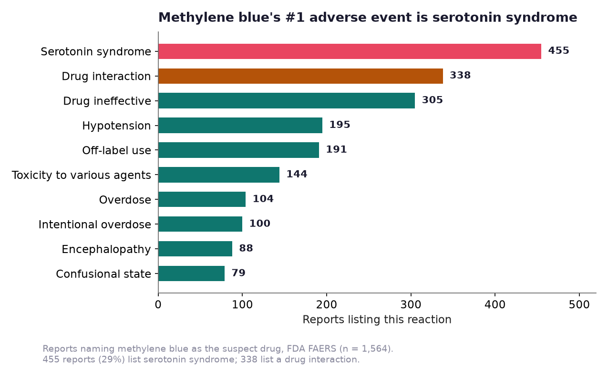
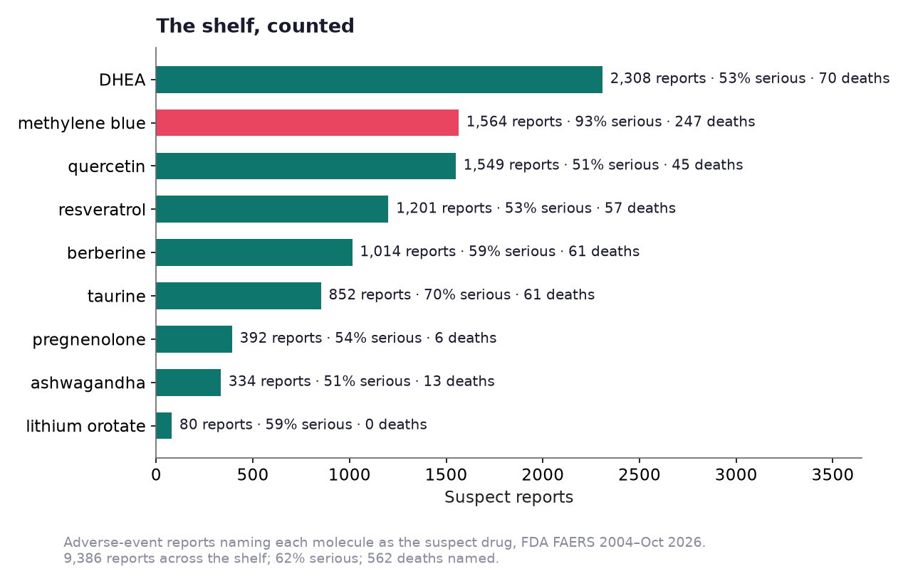
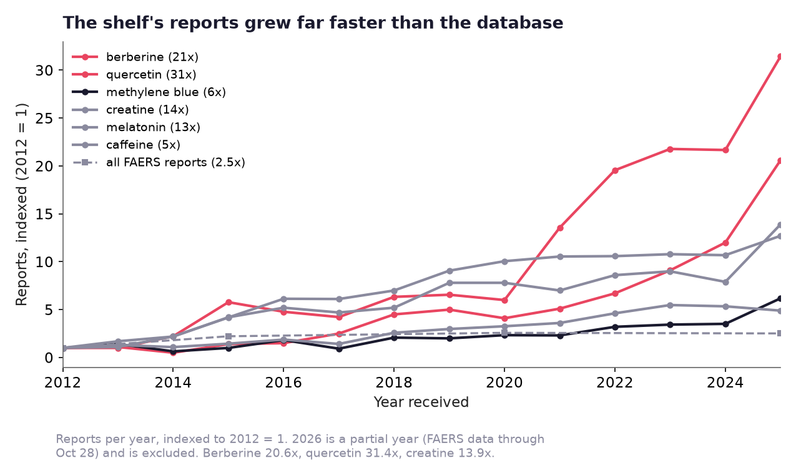
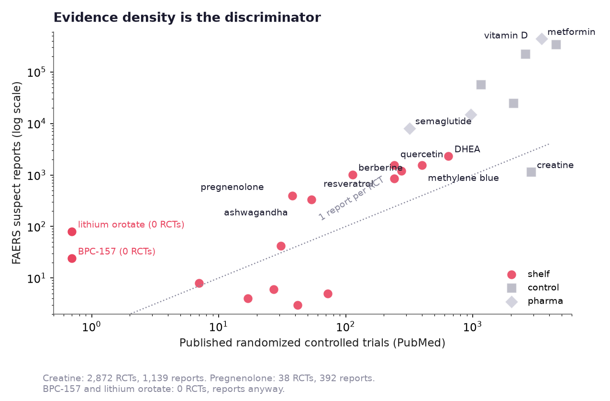
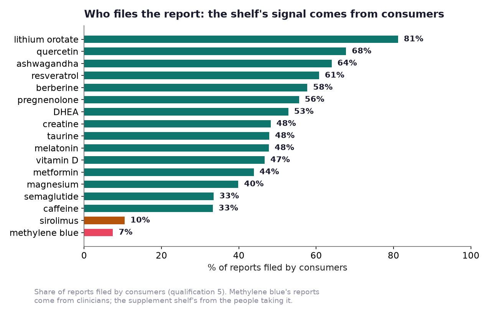

# The Side-Effect Shelf

**Build #71 — Musing with Mike — 2026-11-17 — topic: biohacking**

Biohacking talks about upside. Lifespan, energy, focus, recovery. Every molecule on the shelf gets a podcast episode about what it might do for you. Almost nobody talks about what it has already done to other people.

That is strange, because the FDA keeps a public record of exactly that. The FDA Adverse Event Reporting System (FAERS) holds millions of reports of bad outcomes after taking a drug or supplement, filed by patients, doctors, and pharmacists. This build puts the standard biohacking stack into that database and counts what comes back: 16 molecules, from berberine to BPC-157, against boring controls and prescription benchmarks, with the evidence for each molecule (registered trials, published RCTs) alongside the harm signal.

The shelf is not harmless. Across the 16 molecules, 9,386 reports name one of them as the suspect drug. 62% are serious. 562 name death as the outcome. And one molecule stands apart from all the rest, in a way that would surprise even people who follow this space closely.

## The novelty case, stated before building

Three claims, each checkable, each new as a measurement.

First, nobody has put the biohacking shelf into FAERS and counted it. The evidence audits in this series (Builds 2026-09-13, 2026-09-22, 2026-10-02) measured trials and attention. Nobody measured the other side of the ledger: adverse-event reports naming these molecules as the suspect. The counts, the serious-outcome shares, the specific reactions, and who files the reports are all new numbers.

Second, the headline is not "supplements have side effects," which everyone knows. It is that one molecule's harm profile is specific, mechanistically coherent, and dominant: methylene blue's most common adverse event is serotonin syndrome, a potentially fatal interaction with the most widely prescribed psychiatric drugs in America. If that shows up as the number one reaction at scale, it changes the conversation from "everything has some risk" to "this specific molecule has a specific, known, fatal interaction, and it is being sold as a focus supplement."

Third, the comparison that matters is not shelf versus controls in aggregate. It is evidence density: how many adverse reports each molecule generates per published randomized trial. Creatine, the most studied supplement in the set, generates 0.4 reports per RCT. Pregnenolone generates 10.3. Two molecules generate reports with zero RCTs at all. That ratio is a measurement nobody has made, and it is the one a smart operator would actually use to rank a stack.

## The headline

**Methylene blue's number one adverse event is serotonin syndrome.** 455 reports name it, 29% of all methylene blue reports, and 2.5% of every serotonin-syndrome report in the entire FAERS database names methylene blue as the suspect drug. No other molecule on the shelf has a single reaction anywhere near that dominant. Its 1,564 reports are 93% serious, the highest serious share of all 24 compounds in this build, higher than sirolimus, higher than caffeine, higher than every prescription benchmark. 247 name death as the outcome, 935 name hospitalization.

The FDA warned about this exact interaction in a Drug Safety Communication in July 2011, updated October 2011: methylene blue inhibits monoamine oxidase A, the enzyme that breaks down serotonin, and combined with serotonergic psychiatric medications it can cause serotonin syndrome. The cases behind that warning were mostly intravenous methylene blue at 1 to 8 mg/kg during surgery, in patients on SSRIs, SNRIs, or clomipramine. The FDA said at the time it was not known whether the risk extends to oral routes or lower doses. That uncertainty is the whole story for biohackers: the molecule is now sold in dropper bottles as a focus and mitochondrial supplement, at unregulated doses, to a population that heavily overlaps with SSRI users, and the database shows what the interaction looks like at scale. This build does not settle the oral-dose question. It counts the database, and the database is loud.



## Finding 1: the shelf, counted

Nine of the sixteen shelf molecules have 80 or more suspect reports. DHEA leads on volume at 2,308. Methylene blue leads on severity. Berberine has 1,014 reports, 59% serious, 61 deaths named. Quercetin has 1,549, 51% serious, 45 deaths. Resveratrol has 1,201, 53% serious, 57 deaths. Taurine has 852, 70% serious, 61 deaths, and seizure is one of its top reactions at 46 reports. Pregnenolone has 392 reports, 54% serious. Ashwagandha has 334, 51% serious, 13 deaths. Lithium orotate has 80 reports, 59% serious, and zero published RCTs.

The shelf totals: 9,386 reports, 5,789 serious (62%), 2,539 hospitalizations, 685 life-threatening outcomes, 476 disabilities, 562 deaths named. Methylene blue alone accounts for 44% of the shelf's deaths and 37% of its hospitalizations.

The generic reactions dominate everywhere else. For berberine the top reactions are diarrhoea (120), fatigue (110), and nausea (92). For quercetin, fatigue (221) and headache (124). For resveratrol, fatigue (152) and headache (97). Only methylene blue has a specific, named, mechanistically coherent reaction at the top of its list. That specificity is the signal. Everything else on the shelf mostly makes people tired, nauseous, and headachy. Methylene blue sends people to the hospital with a named syndrome.



## Finding 2: the reports are compounding

Reports naming berberine grew from 10 in 2012 to 206 in 2025, a 20.6x rise, about 26% a year. Quercetin grew from 9 to 283, a 31.4x rise, about 30% a year. Creatine grew 13.9x, melatonin 12.7x. The whole FAERS database grew only 2.5x over the same period, from 551,378 reports in 2012 to 1,386,644 in 2025. So berberine's reporting grew about 8x faster than the database, and quercetin's about 12x faster. That is not a database artifact. It is usage growth, or awareness growth, or both, and it means the shelf's harm signal is getting louder faster than the system that records it.

Methylene blue grew 6.2x, from 39 to 241 reports a year, with its biggest year yet in 2025. Caffeine, the slowest grower in the set at 4.9x, is the closest thing to a mature baseline.



## Finding 3: evidence density is the discriminator

Plot each molecule's published RCTs against its adverse reports and the shelf splits cleanly. Creatine sits far to the right: 2,872 published RCTs, 1,139 reports, 0.4 reports per RCT. It is the most studied supplement on the list and the quietest per unit of evidence. Berberine has 113 RCTs and 9.0 reports per RCT. Pregnenolone has 38 RCTs and 10.3 reports per RCT, the highest ratio on the shelf. Ashwagandha has 54 RCTs and 6.2 reports per RCT. Quercetin has 242 RCTs and 6.4.

Then the corner that should worry anyone: BPC-157 has 24 reports and zero published RCTs. Lithium orotate has 80 reports and zero published RCTs. Both are sold openly, one as a grey-market peptide and one as a supplement, with no randomized human evidence at all and a non-zero adverse-event record. That is the exact shape of the evidence black hole from Build 2026-10-02, wearing a new costume.

The new NAD+ molecules are the mirror image. NMN has 17 RCTs and 4 reports. Nicotinamide riboside has 31 RCTs and 42 reports. Spermidine has 42 RCTs and 3 reports. Urolithin A has 27 RCTs and 6 reports. They are quiet in FAERS, but that is absence of signal, not proof of safety. FAERS is a drug database. Supplements are underreported in it by design, and these molecules are new, with small user bases and short exposure histories. NMN's regulatory status alone tells you how unsettled this corner is: the FDA said in 2022 that NMN was excluded from the dietary-supplement definition, then reversed that position in September 2025. A molecule can be both barely reported and barely regulated.



## Finding 4: two different worlds of harm visibility

Who files the report tells you where the harm is visible. For the supplement shelf, the signal comes from consumers: 68% of quercetin reports, 64% of ashwagandha, 61% of resveratrol, 58% of berberine, 53% of DHEA, 81% of lithium orotate. Report-weighted across the shelf, about half of all reports are filed by the people taking the molecules, not by their doctors.

Methylene blue is the opposite: 7% consumer, 93% clinician (56% other health professionals, 29% physicians, 8% pharmacists). Its harm is visible inside hospitals, because most of its reports come from clinical use: intravenous drug, surgical dye, methemoglobinemia treatment. The supplement shelf's harm is visible outside hospitals, because it is filed by consumers into a database built for drugs. That is a strange place for a safety signal to live, and it is probably why the conversation about these molecules stays focused on upside. The people experiencing the downside are filing paperwork, not publishing papers.



## What I built

- `src/01_fetch.py`: pulls FAERS suspect-report counts, serious outcomes, top reactions, reporter qualifications, and 2012-2026 yearly trends for 24 compounds from openFDA, plus registered-trial counts from ClinicalTrials.gov and published-RCT counts from PubMed. About 400 API requests, with retries for openFDA's transient 500s and its 404-for-zero-results behavior. Raw responses saved per compound under `data/raw/`.
- `src/01b_targeted.py`: targeted follow-ups. Direct-search counts for liver-injury reactions, drug interactions, and serotonin syndrome per compound, plus the FAERS-wide serotonin-syndrome total (18,029 suspect reports) that methylene blue's 455 is measured against.
- `src/02_analyze.py`: derived metrics, `data/compound_table.csv`, `data/trend_table.csv`, `output/results.json`.
- `src/03_charts.py`: five charts in `charts/`.
- `data/faers_summary.json`: the full per-compound record, including top-15 reactions and yearly trends.

## Methods and caveats

Read this before quoting any number above. Every headline in this build is a count of reports, not a rate of harm, and the difference matters.

**FAERS is spontaneous reporting.** There are no denominators. Nobody knows how many people take berberine, so 1,014 reports cannot become an incidence rate, and this build does not try. Comparisons are between compounds in the same database, not against the general population.

**"Deaths named" is not "deaths caused."** A report lists death as the outcome and the molecule as the suspect drug. That is the reporter's judgment, not an adjudicated causal finding. People in FAERS are often sick, often on many drugs, and the molecule may be incidental. The honest reading of "61 deaths named for berberine" is "61 reports in which someone died while berberine was listed as the suspect drug." The build uses that phrasing throughout for a reason.

**Serious means what FAERS says it means.** A report is serious if the outcome was death, hospitalization, life-threatening illness, disability, congenital anomaly, or required intervention. FAERS skews serious by design: mild effects mostly never get reported. So a 51-93% serious share is partly a property of the database, not of the molecule. What is comparable is the ranking between compounds in the same database, and methylene blue's 93% is the highest of all 24.

**Supplements are underrepresented.** FAERS is a drug database. Supplement adverse events mostly go to a different FDA system (CAERS, the food/supplement system), whose product names are brand names and do not match cleanly to molecules. Small counts for NMN (4), spermidine (3), urolithin A (6), fisetin (8), and NAD+ (5) are consistent with underreporting, newness, and small user bases. Do not read them as safety.

**Ubiquitous ingredients inflate counts.** Vitamin D (341,660 reports), magnesium (221,916), melatonin (57,174), caffeine (24,796), and metformin (437,440) appear as suspect in reports where they were co-administered with the actual culprit, especially in hospitalized patients on many drugs. Their totals are not comparable harm signals, which is why this build does not use them to normalize the shelf and does not headline any shelf-versus-control aggregate. They are in the tables for transparency, and the scatter chart shows them in grey for exactly that reason.

**Methylene blue's reports are mostly clinical.** Its 93% clinician reporting, its top reactions (serotonin syndrome, drug interaction, hypotension, vasoplegia, cardiac arrest), and its use as an intravenous drug and surgical dye all say these reports come from hospitals, not from people taking drops at home. The biohacking relevance is the molecule's interaction profile, which travels with it into supplement form, not a claim that supplement users generated these 455 reports. Typical supplement doses are also far below the 1 to 8 mg/kg intravenous doses in the FDA's 2011 cases, and the FDA said the oral risk is not known. This build counts the database. It does not settle the oral-dose question.

**The DHEA trend has an unexplained break.** DHEA reports run 75 to 392 a year from 2012 to 2021, then collapse to 8 to 12 a year from 2022 onward, with no change in the query. That looks like a product-name or reporting change in the underlying data, not a real decline in events. DHEA is excluded from all trend conclusions in this build.

**2026 is a partial year.** openFDA's data was last updated October 28, 2026, so 2026 counts cover about ten months. Trends use 2012 to 2025.

**A small counting discrepancy.** Methylene blue's drug-interaction count is 338 by the count endpoint and 347 by direct search. The chart and text use 338. The difference is a known openFDA quirk between the two endpoints and does not change any conclusion.

**Product-name matching is a lower bound.** FAERS matches on the medicinal product name as reported. Misspellings, brand names, and combination products that do not contain the molecule name are missed. Every count here is a floor, not a ceiling.

## Reproduce

```bash
pip install -r requirements.txt
python3 src/01_fetch.py    # ~8 minutes, ~400 requests to openFDA, ClinicalTrials.gov, PubMed
python3 src/01b_targeted.py
python3 src/02_analyze.py
python3 src/03_charts.py
```

Data fetched 2026-11-17. openFDA drug event endpoint (FAERS), last updated 2026-10-28. ClinicalTrials.gov API v2, intervention-name filter. PubMed E-utilities, title/abstract search with the randomized-controlled-trial publication type.

## Sources

- FDA Adverse Event Reporting System (FAERS) via openFDA drug event API: https://open.fda.gov/apis/drug/event/
- ClinicalTrials.gov API v2: https://clinicaltrials.gov/api/v2/studies
- PubMed E-utilities ESearch: https://eutils.ncbi.nlm.nih.gov/entrez/eutils/esearch.fcgi
- FDA Drug Safety Communication, methylene blue and serotonergic psychiatric medications, July 26, 2011, updated October 21, 2011
- FDA citizen-petition response on NMN, September 29, 2025; NDI letters reinstated December 2, 2025
- FAERS-wide yearly totals queried directly from openFDA, 2026-11-17: 551,378 reports in 2012; 1,386,644 in 2025
