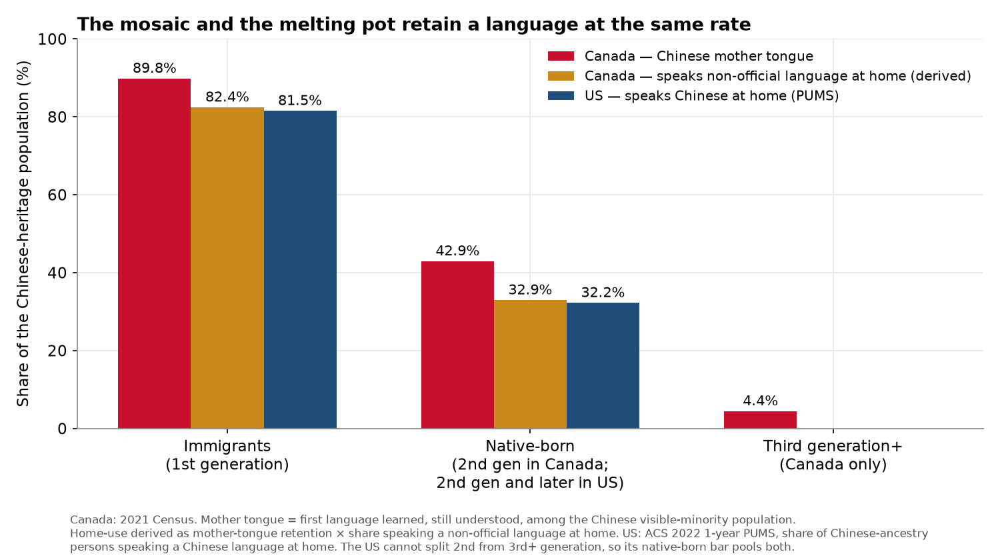
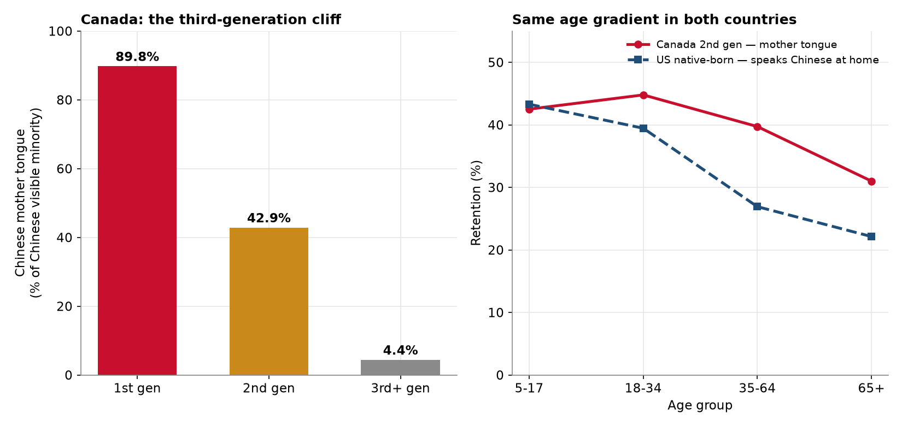
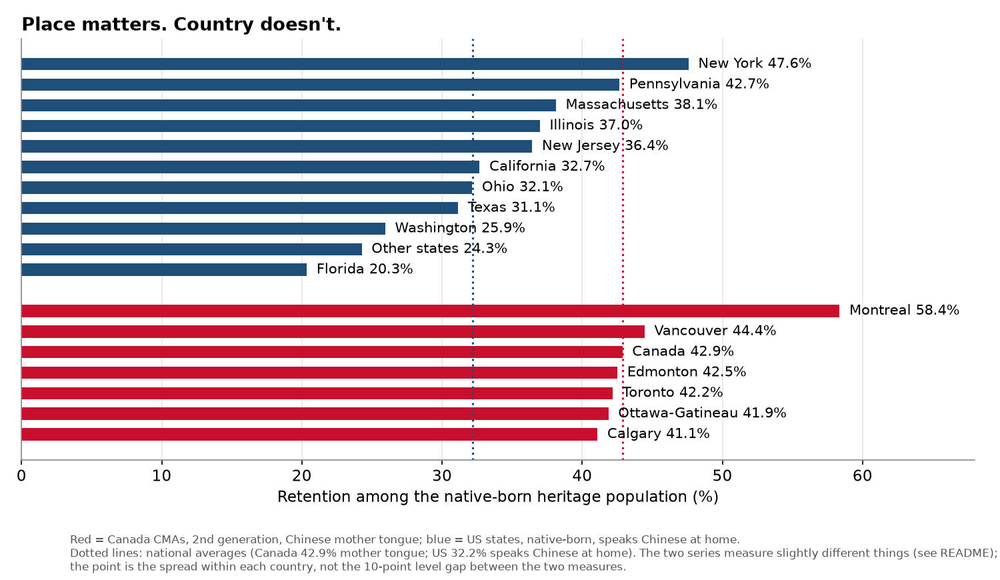
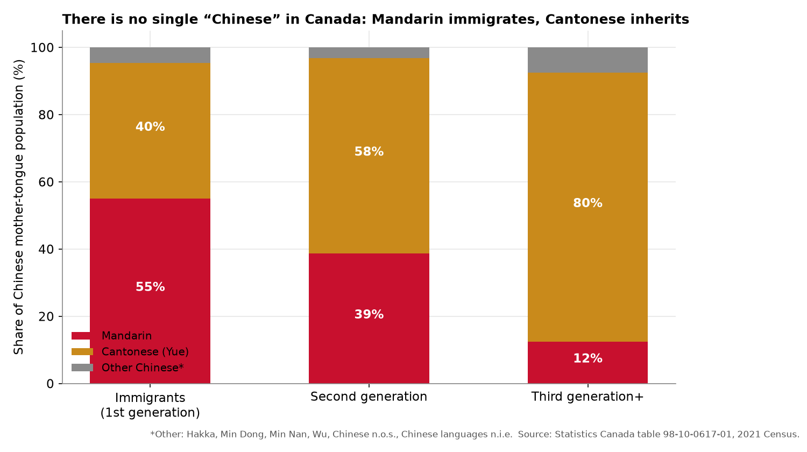

# The Retention Gap

**Canada calls itself a mosaic. America calls itself a melting pot. I measured whether either story is true for the Chinese language, generation by generation, and the answer is that the two countries produce the same number.**

*Musing with Mike · 2026-11-19 · Topic: culture (Canada vs US / Canadian-born Chinese)*

I grew up in Edmonton as a Canadian-born Chinese kid, and the question of whether the language survives is not abstract for me. It is the question of whether my kids will talk to their grandparents in the language their grandparents think in. Canada tells a story about itself: multiculturalism preserves heritage, the mosaic keeps the pieces distinct. America tells the opposite story: the melting pot assimilates, and the second generation speaks English. Both stories cannot be the mechanism, and it turns out neither one is. Measured properly, from each country's own census, the retention rates are within a point of each other in every generation. The country does not matter. The generation does, the city does, and the wave does.

## What I built

Four measurements of the same question, from public census data:

| # | Question | Data | Script |
|---|----------|------|--------|
| 1 | What share of the Chinese-heritage population still has a Chinese mother tongue, by generation, in Canada? | Statistics Canada 2021 Census, table 98-10-0617-01 (language by generation status) crossed with table 98-10-0324-01 (Chinese visible minority by generation status) | `src/parse_statcan.py`, `src/parse_statcan_vm.py` |
| 2 | What share speaks a Chinese language at home, by nativity, in the US? | ACS 2022 1-year PUMS microdata (3.37M person records; 45,367 Chinese-ancestry records, PWGTP-weighted) | `src/parse_pums.py` |
| 3 | Does retention vary by city, and does enclave density explain it? | Same sources, split by Canadian CMA and US state, plus a second PUMS pass for state age composition | `src/analysis.py`, `src/us_state_age.py` |
| 4 | Is "Chinese" one language or two? Mandarin vs Cantonese by generation and age | StatCan mother-tongue components, split by age | `src/ca_mt_split_age.py` |

Reproduce: `python3 src/parse_statcan.py && python3 src/parse_statcan_vm.py && python3 src/parse_pums.py && python3 src/analysis.py && python3 src/us_state_age.py && python3 src/ca_mt_split_age.py && python3 src/charts.py`. No API keys. The two big downloads (StatCan 333 MB, PUMS 591 MB) are in `data/` as zips; the parsed outputs are small CSVs. Note the Census API now requires a free key for data endpoints, which is why the US side uses the bulk PUMS files instead.

## The findings

### 1. The mosaic and the melting pot are the same number

This is the headline, and it is not close to what either country's story predicts.

| Generation | Canada (derived: speaks a non-official language at home) | US (speaks Chinese at home) |
|---|---|---|
| Immigrants (1st generation / foreign-born) | 82.4% | 81.5% |
| Native-born (2nd generation in Canada; 2nd gen and later in the US) | 32.9% | 32.2% |

Immigrants keep the language at home about four times in five. Their native-born children keep it about one time in three. And the country makes no difference: the gap is 0.9 points for immigrants and 0.7 points for the native-born, smaller than the sampling error on the US figure (about plus or minus 1 point). Canada's multiculturalism policy and America's assimilation pressure produce, on this measure, the same outcome. The branding is doing the work, not the policy.

The stricter Canadian measure tells the same story in a different key. Mother tongue means the first language you learned in childhood and still understand. Among Chinese Canadians, 89.8% of immigrants report a Chinese mother tongue, 42.9% of the second generation do, and 4.4% of the third generation or later do. Home use is lower than mother tongue in every generation, because some people keep the language in their head and stop using it at the table. The two measures bracket the same fact: the language survives the crossing and then halves, then nearly vanishes.

### 2. The third-generation cliff is the real story

The language does not fade gradually. It falls off a cliff between the second and third generations: 42.9% to 4.4% in Canada, a tenfold drop. Heritage language is a two-generation asset. The second generation is the whole ballgame. If the kids born here do not carry it, their kids will not recover it, because there is almost nothing left to recover: only 2,640 third-generation-or-later Chinese Canadians in the entire country report a Chinese mother tongue.

That reframes the usual worry. People argue about whether immigrant parents speak enough of the heritage language at home. The data says the parents are fine: 76.7% of second-generation Chinese Canadians with a Chinese mother tongue still speak a non-official language at home. The cliff is not about the parents. It is about what happens when the second generation becomes parents themselves, and the household's default language flips to English. Nobody in the data is failing at transmission in generation two. Generation three is where transmission stops being a choice and becomes archaeology.

### 3. Place matters. Country doesn't.

National averages hide a spread that is bigger than any gap between the two countries. In Canada, second-generation mother-tongue retention runs from 41.1% in Calgary to 58.4% in Montreal. In the US, native-born home use runs from 20.3% in Florida to 47.6% in New York. The within-country range is about two to one. The between-country gap is about zero.

Two theories fail here. The first is enclave density: Vancouver has the densest Chinese population in Canada (19.0% of the metro) and middling retention (44.4%), while Montreal has the sparsest (3.4%) and the highest (58.4%). The correlation between Chinese share of a metro and retention is negative in Canada (r = -0.33, seven metros) and weakly positive in the US (r = +0.38, eleven states). Density is not the mechanism.

The second failed theory is age composition. New York retains far more than California (47.6% vs 32.7%), and I expected that to be because New York's native-born Chinese skew younger, children of recent immigrants. They do not, not enough to matter: 30.2% of New York's native-born Chinese are 5 to 17, against 29.6% in California. And New York beats California inside every age band: 58.0% vs 41.5% at ages 5 to 17, 57.3% vs 39.6% at 18 to 34, 50.6% vs 30.6% at 35 to 64. It is a place effect, not a cohort effect. What differs is the wave and the neighbourhood: New York's Chinese immigration is more recent and more concentrated in dense, working-class enclaves like Flushing and Sunset Park, while California's native-born population includes far more descendants of pre-1965 families and suburban professionals. Montreal is the same story from the other side: the smallest Chinese community of the six big Canadian metros, and the highest retention, plausibly because its Chinese population is newer, more concentrated, and growing up in a city where English is not the automatic default.

### 4. There is no single "Chinese" in Canada: Mandarin immigrates, Cantonese inherits

The language split is the part I did not expect. Among first-generation Chinese Canadians, Mandarin is 55% of mother tongues and Cantonese is 40%. Among the second generation it flips: 39% Mandarin, 58% Cantonese. Among the third generation it is 12% Mandarin and 80% Cantonese. The heritage language of Canada today is Cantonese, because the second generation's parents came in the Hong Kong wave of the 1970s to 1990s, and the Mandarin wave is too recent for its children to be adults yet: among second-generation kids under 15, Mandarin is already 68% of Chinese mother tongues, against 31% Cantonese.

So the "Chinese language" in Canada is two languages on two different clocks. Cantonese is the language of inheritance, Mandarin the language of arrival, and in twenty years the inheritance will flip to Mandarin as today's Mandarin-speaking kids grow up. Anyone building heritage schools, media, or community institutions on the assumption that "Chinese" means one thing is building for the wrong generation.

### 5. Even immigrant children shift fast

One more cut that surprised me. Among first-generation Chinese Canadians, mother-tongue retention rises steeply with age: 70.0% for child immigrants aged 0 to 14, up to 95.0% for those 75 and over. A child who immigrates young often ends up reporting English as their mother tongue, because the census asks for the first language learned in childhood, and a three-year-old who arrives and grows up in English can honestly answer English. The shift starts before the second generation. It starts on the plane.

## The personal bit

I have spent a lot of my life hearing that Canada keeps cultures alive and America melts them down. I wanted that to be true, because I am the product it describes. The data says the story is flattering and wrong, in the nicest possible way: both countries keep the language for exactly one native-born generation, and then it goes. That is not a policy failure. It is the normal lifecycle of a heritage language in an English-dominant country, and it runs on the same clock on both sides of the border. The useful question is not which country's story is better. It is what the second generation does with the one generation it gets.

## Methods and reproduction

- `src/parse_statcan.py` streams the 5.3 GB StatCan table 98-10-0617-01 CSV (wide format: the home-language dimension is one column per member) with a byte-level geography pre-filter, keeping Canada plus Toronto, Vancouver, Montreal, Calgary, Edmonton, and Ottawa-Gatineau. Outputs `data/ca_retention.csv` (Chinese mother tongue by generation), `data/ca_homeuse.csv` (share of Chinese-mother-tongue persons speaking any non-official language at home), `data/ca_mt_split.csv` (Mandarin/Cantonese/etc.), and `data/ca_age.csv`.
- `src/parse_statcan_vm.py` parses table 98-10-0324-01 for the denominator: Chinese visible-minority population by generation and age (`data/ca_vm.csv`). Retention is Chinese mother tongue divided by Chinese visible minority, by generation.
- `src/parse_pums.py` reads the ACS 2022 1-year PUMS person files (`psam_pusa.csv`, `psam_pusb.csv`) in chunks with only the needed columns. Chinese ancestry is ANC1P or ANC2P = 706; Chinese spoken at home is LANP in {1970 Chinese, 2000 Mandarin, 2030 Min Nan, 2050 Cantonese}; weights are PWGTP. Outputs `data/us_retention.csv`, `data/us_age.csv`, `data/us_state.csv`, `data/us_lanp_check.csv`.
- `src/analysis.py` joins the two sides, computes the derived Canadian home-use rate, the enclave correlations, and the state totals.
- `src/us_state_age.py` is a second PUMS pass for native-born age composition and retention by age within states.
- `src/ca_mt_split_age.py` is a second StatCan pass for the Mandarin/Cantonese split by age.
- `src/charts.py` makes all four charts.

## Caveats

- **The two countries do not measure the same thing, and I do not pretend they do.** Canada's headline is mother tongue (first language learned, still understood) among the Chinese visible-minority population. The US headline is language spoken at home among people reporting Chinese ancestry. The derived Canadian home-use figure bridges them: mother-tongue retention times home use given mother tongue. That derivation assumes home use is near zero among Chinese-origin people without a Chinese mother tongue, which makes it a lower bound; heritage learners who speak Chinese at home without it being their mother tongue would push the true Canadian number a bit above 32.9%. The US figure counts those learners. If anything, that bias favors the US, and the gap is still under a point.
- **The US cannot split the second from the third generation.** The ACS has no parental birthplace variable, so the US native-born bar pools second-generation and later. Canada's third generation retains at 4.4%, so the pooled US figure of 32.2% understates the true US second-generation rate. Both biases (the one above and this one) are small and push in opposite directions; the honest statement is that the two countries are within a few points of each other, not that the gap is exactly 0.7.
- **Years differ by one.** Canada is the 2021 Census, the US is ACS 2022. Nothing in the comparison turns on one year.
- **StatCan rounds counts to the nearest 5** and suppresses tiny cells. Third-generation counts are small (2,640 mother-tongue holders nationally), so treat the 4.4% as approximate; the cliff itself is far too large to be a rounding artifact.
- **PUMS is a sample.** 45,367 unweighted Chinese-ancestry records (18,626 native-born). The sampling error on the 32.2% native-born figure is about plus or minus 1 point at 95% confidence before design effects. The Canada-US gap is smaller than that.
- **"Chinese" is a census category, not a language.** The analysis groups Mandarin, Cantonese, Hakka, Min Dong, Min Nan, Wu, and smaller varieties together for the headline, then splits Mandarin and Cantonese where the data allows. Retention of "a Chinese language" is not retention of the same language across generations, as finding 4 shows.
- **Montreal's lead is a finding, not an explanation.** I report the 58.4% and offer the recency/concentration/French-environment hypotheses, but the census tables used here cannot distinguish them. That is a follow-up, not a conclusion.

## Sources

- Statistics Canada, 2021 Census, table 98-10-0617-01, "All languages spoken at home by mother tongue, knowledge of official languages and generation status," 25% sample data. https://www150.statcan.gc.ca/t1/tbl1/en/tv.action?pid=9810061701
- Statistics Canada, 2021 Census, table 98-10-0324-01, "Visible minority and population group by generation status." https://www150.statcan.gc.ca/t1/tbl1/en/tv.action?pid=9810032401
- U.S. Census Bureau, American Community Survey 2022 1-year Public Use Microdata Sample, person files. https://www2.census.gov/programs-surveys/acs/data/pums/2022/1-Year/csv_pus.zip
- Census API group metadata for B16001/B16005/B16005D checked during source research; the API now requires a key for data endpoints, which is why the US side uses bulk PUMS files.
