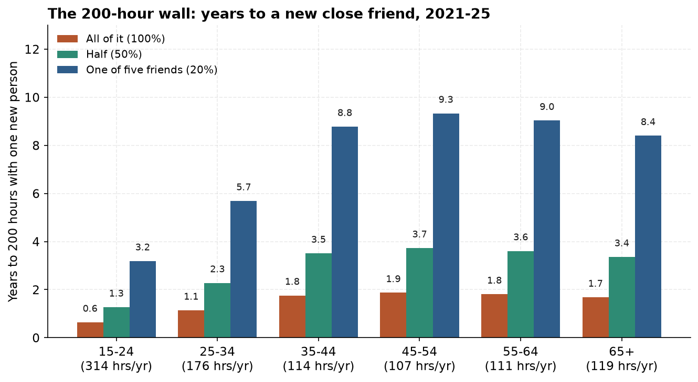
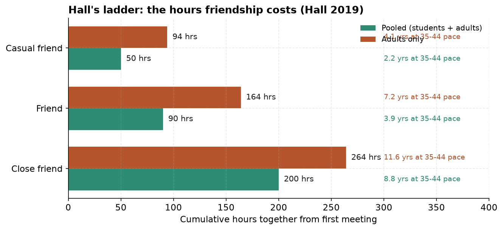
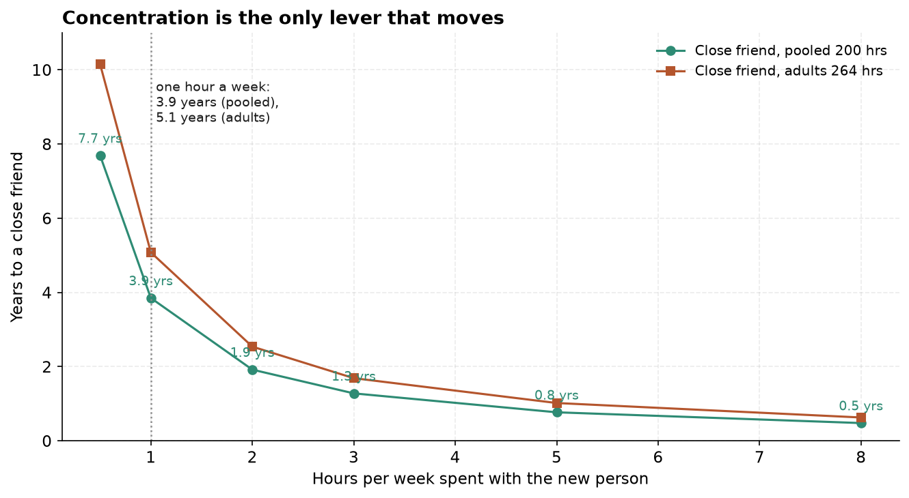
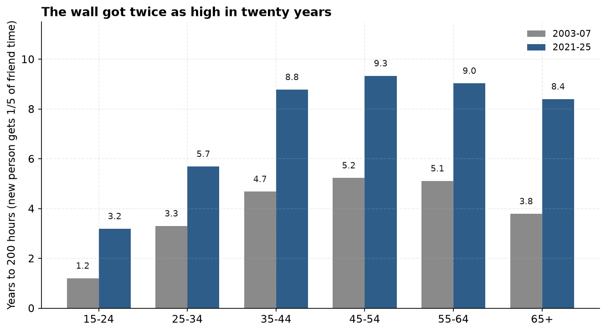

# The 200-Hour Wall

**It takes 200 hours together to make a close friend. A typical 35-year-old has 114 friend-hours a year, split across everyone they know. Do the division and a new best friend is a nine-year project. That is not a personality problem. It is arithmetic.**

*Musing with Mike · 2026-11-20 · Topic: relationships · Build #74*

I am 30. I run monthly calendar nudges to thirteen friends because I noticed the drift starting. Two earlier builds measured that drift: the friend recession (friend time falls by two-thirds at 30 and never comes back) and the friendless day (the fall is days going to zero, not shorter visits). This build asks the question those two left open. If you meet someone great tomorrow, how long until they are a close friend? Not in effort. In years.

## Why this would surprise someone who knows the field

The loneliness literature argues about averages, and the 200-hour number is famous as a pop psychology factoid. Nobody has priced it in calendar years. Take the most cited friendship study there is, Jeffrey Hall's 2019 paper that put numbers on the ladder, and divide it by the most boring dataset in social science, the American Time Use Survey's diary of who Americans actually spend minutes with. The result is not a trend line. It is a wall, and the wall has a height in years for every age band.

Three things in the result are not in the literature as stated. First, the binding constraint is the split, not the total. A 35-year-old who gave 100 percent of their friend time to one new person would still need about two years to reach 200 hours. Nobody does that, so the realistic number is nine. Second, the adult version of Hall's ladder is steeper than the famous version: adults need about 94 hours to a casual friend and about 264 to a close friend, against 50 and 200 pooled. The pop number understates the adult problem by a third. Third, the wall doubled in twenty years at every age, including for the young. A 20-year-old in 2003 could bank 200 hours with a new person in about fourteen months at a one-in-five share. Today it takes more than three years. The school machine that used to manufacture best friends in a semester now takes years to do the same job.

## What I built

| # | Question | Data | Script |
|---|----------|------|--------|
| 1 | How many friend-hours a year does each age band actually have? | ATUS diary microdata 2003-2025, 250,165 diary days, survey-weighted (extract from the 2026-11-02 build) | `src/01_analysis.py` |
| 2 | How many years is Hall's ladder at each age, at each share of friend time? | Hall (2019) thresholds, pooled and adult-only, crossed with the ATUS age curve | `src/01_analysis.py` |
| 3 | What moves the number: more total time, or more concentration? | Cadence table, hours per week with one person | `src/01_analysis.py` |
| 4 | Did the wall get higher, or was it always this high? | 2003-07 vs 2021-25, same model | `src/01_analysis.py` |
| 5 | Run your own numbers | Interactive calculator: age band, existing friends, dedicated hours, annual trip | `site/index.html` |

Reproduce: `python3 src/01_analysis.py && python3 src/02_charts.py`. Step 1 recomputes the ATUS age curve from the committed 2026-11-02 extract when it is in the repo, and otherwise uses the committed aggregate in `data/age_friend_hours.csv`.

**Interactive version:** open `site/index.html` and move the sliders. Pick your age band, how many close friends you already split time across, and how many hours a week you can give one new person, and it tells you the years to each rung.

## The findings

### 1. At a realistic share, a new close friend takes nine years after 35

Annual friend time in 2021-25, from the diary data:

| Age | Friend minutes/day | Friend hours/year |
|---|---|---|
| 15-24 | 51.6 | 314 |
| 25-34 | 28.9 | 176 |
| 35-44 | 18.7 | 114 |
| 45-54 | 17.6 | 107 |
| 55-64 | 18.2 | 111 |
| 65+ | 19.6 | 119 |

Now divide. A new person who gets one fifth of your friend time, the share they get if you have five close friends and split evenly, receives about 23 hours a year from a 35-year-old. Hall's close-friend rung is 200 hours pooled, about 264 for adults. That is 8.8 years on the pooled ladder and 11.6 on the adult ladder. Even a casual friend takes 2.2 years at that share, 4.1 on the adult ladder.

The optimistic bound is the shock. Give the new person everything, all 114 hours a year, no other friends, no group dinners, and a close friend still takes 1.8 years, 2.3 on the adult ladder. There is no version of an adult schedule where a best friend forms quickly. The only fast path ever existed was school, and it is gone.



### 2. The adult ladder is steeper than the famous number

The 50/90/200 figures everyone quotes pool Hall's two samples: 112 freshmen tracked for nine weeks, and 355 adults who had just moved. Split them, and the adult numbers are 94 hours to a casual friend, 164 to a friend, and about 264 to a close friend. Students do it in 43, about 100, and about 119. The pooled headline understates the adult cost by roughly a third at every rung, which is exactly the audience that needs the number. The rest of this build uses the pooled ladder for the headline and the adult ladder as the honest version. Both point the same way.



### 3. Concentration is the only lever. Total social time is not one.

The model has two inputs: how much friend time you have, and what share one person gets. The first barely moves after 25. The second is everything. A standing two hours a week with the same person gets you to a close friend in 1.9 years pooled, 2.5 adult. One hour a week takes 3.9, 5.1 adult. Half an hour a week takes 7.7, 10.2 adult, which is roughly what a monthly dinner buys you, and it is why monthly dinners do not make best friends.

The trip is the cheat code, and it is the only one. Three days together is about 30 waking hours. A monthly two-hour dinner is 24 hours in a whole year. One long weekend with a new friend buys more shared hours than a year of monthly dinners, and more than a year of the default pace at 35, where a new person at a one-in-five share gets 23 hours a year. Hall's own data says the same thing from the other side: the students who upgraded a friendship doubled their hours with that person and halved time with everyone else. Nobody upgraded a friendship by adding a little more total social time. They upgraded it by concentrating.



### 4. The wall doubled in twenty years, at every age

Same model, same share, 2003-07 against 2021-25. Years to a close friend at a one-in-five share:

| Age | 2003-07 | 2021-25 |
|---|---|---|
| 15-24 | 1.2 | 3.2 |
| 25-34 | 3.3 | 5.7 |
| 35-44 | 4.7 | 8.8 |
| 45-54 | 5.2 | 9.3 |
| 55-64 | 5.1 | 9.0 |
| 65+ | 3.8 | 8.4 |

The young lost the most in absolute hours, from 837 friend-hours a year to 314, and the old lost the most in relative terms. Retirement does not fix it: a 65-year-old has 119 hours a year and faces an 8.4-year wall, worse than a 25-year-old faced twenty years ago. The friend recession build found no rebound at any age. This is the same fact priced in years. There is no life stage where the clock runs fast again.



### 5. Your five closest friends are a decade of investment

Five close friends at 200 hours each is 1,000 hours. At 114 friend-hours a year, that is 8.8 years of your entire adult friend-time budget, and that is before maintenance, before any of them move away, and before you meet anyone new. It is also why losing one matters so much. If a close friendship ends at 35, replacing it at the realistic pace takes nine to twelve years. That is longer than the average person stays in one city or one job. Adult best friendships are almost always inherited from youth, not because adults are worse at friendship, but because youth is the only period when the clock ran fast enough to build them. The 15-to-24 band in 2003 got 837 friend-hours a year. Even today they get 314, nearly triple any adult band. The window is real, and it closes.

One more Hall detail belongs here, because it rules out the obvious workaround. Hours spent working together do not move closeness. Neither do shared projects, teams, or classes. What moves it is relaxed time: hanging out, joking around, catching up. Your coworkers are not your 200 hours. Your gym class is not your 200 hours. The hours have to be the loose kind, and the loose kind is the kind adults have least of.

## The operator takeaway

Friendship formation is a capital budgeting problem, and most adults are running it with no budget and no plan. The fix is not "meet more people." Meeting people is cheap. The fix is concentration: pick one person, give them a standing slot, and take a trip together. Two hours a week with the same person is a 1.9-year project. A monthly dinner is an 8-year project that will probably not survive eight years of life happening. If you run a friend group, a company, or a community, the product insight is the same. Do not optimize for introductions. Optimize for repeated, relaxed, concentrated hours between the same two people. That is the only input the research says works, and it is the input nobody's social product sells, because it looks boring next to a new match. The boring thing is the whole game.

For me, personally: the monthly nudges I run to thirteen friends are maintenance, and maintenance is real. But this build says maintenance is not formation. If I want a new close friend at 30, the math says I need to pick one person and give them two hours a week, every week, for two years, or take them on a trip. A nudge is not that. A standing dinner is.

## Caveats

The model is optimistic on purpose, so treat every number as a lower bound. ATUS "friend present" minutes count group hangouts, where the new person may be one of several, so true one-on-one hours are lower. Hall's thresholds are the point where the odds of transitioning pass 50 percent, in two specific samples (recent movers and freshmen), not a guarantee and not a schedule. The model assumes no decay, no missed weeks, no chemistry failure, and no geography. The adult close-friend figure of about 264 hours is 164 plus about 100 additional hours, as reported in the Greater Good summary of the paper; the paper's pooled headline is 200 plus. Sensitivity: at a one-in-five share for a 35-to-44-year-old, the years to a close friend are 6.6 at a 150-hour threshold, 8.8 at 200, 11.6 at 264, and 13.2 at 300. The conclusion does not depend on which threshold you pick. It depends on the division, and the division is the same at any threshold.

## Sources

- Hall, J. A. (2019). How many hours does it take to make a friend? *Journal of Social and Personal Relationships, 36*(4), 1278-1296. DOI: 10.1177/0265407518761225. Pooled thresholds 50/90/200+ hours; adult vs student splits via Greater Good Science Center, "How Long Does It Take to Make a Friend?" (UC Berkeley).
- U.S. Bureau of Labor Statistics, American Time Use Survey, multi-year microdata 2003-2025 (Activity, Who, Respondent files). Diary-day extract with survey weights from the 2026-11-02 build in this repo; see `data/PROVENANCE.md`. Weighted means by age band; standard errors under 4 minutes a day in every cell.
- Prior builds in this repo: "The Friend Recession" (2026-11-11), "The Friendless Day" (2026-11-02), "The Friendship Portfolio" (2026-09-16).

## Reproduce

```
python3 src/01_analysis.py   # ATUS age curve, years-to-threshold tables, results.json
python3 src/02_charts.py     # charts/*.png
```

Then open `site/index.html` for the calculator. Requirements: pandas, numpy, matplotlib.
