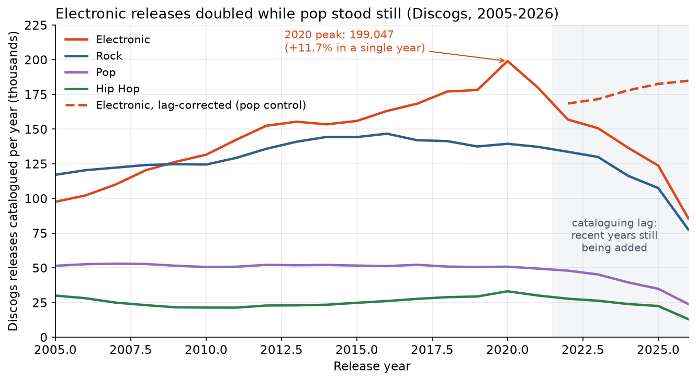
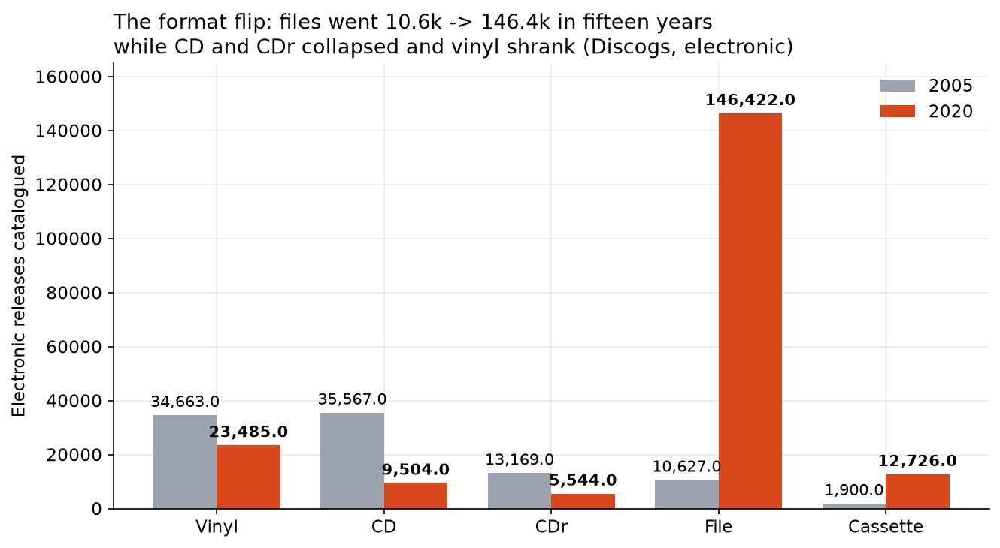
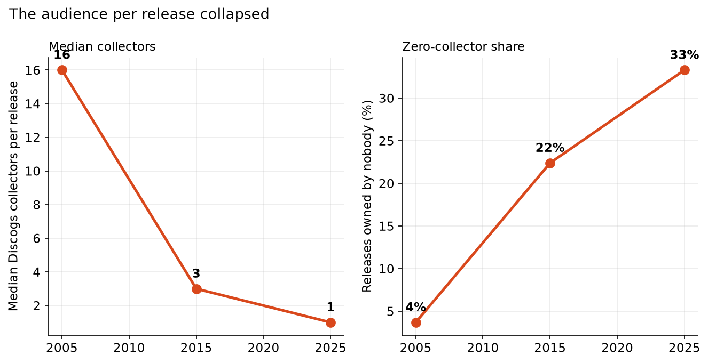
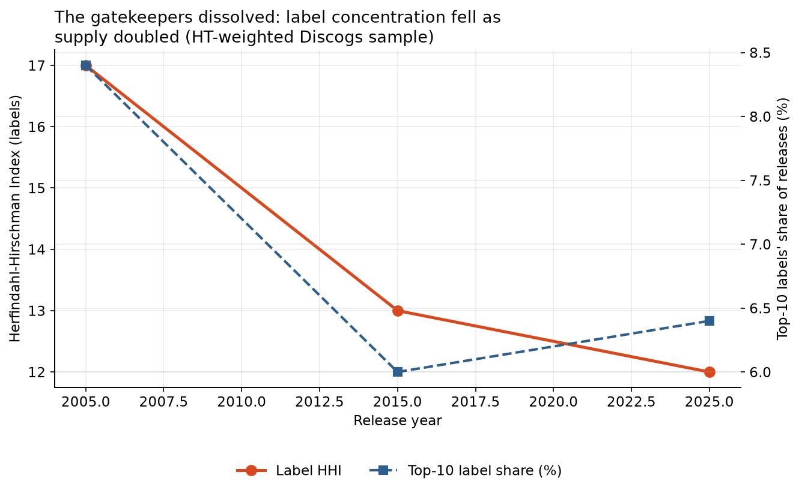
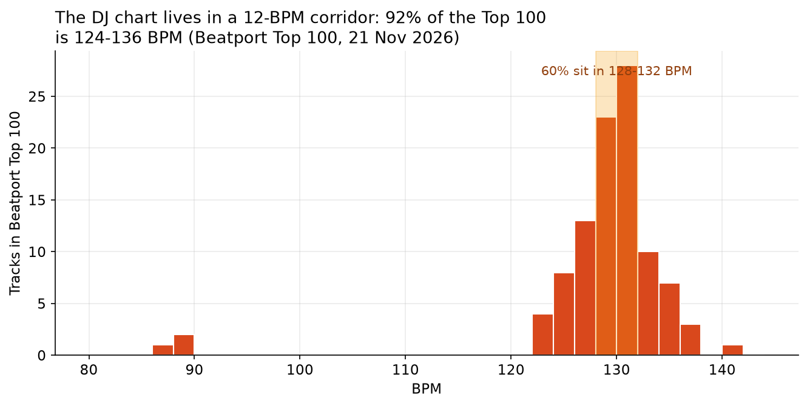
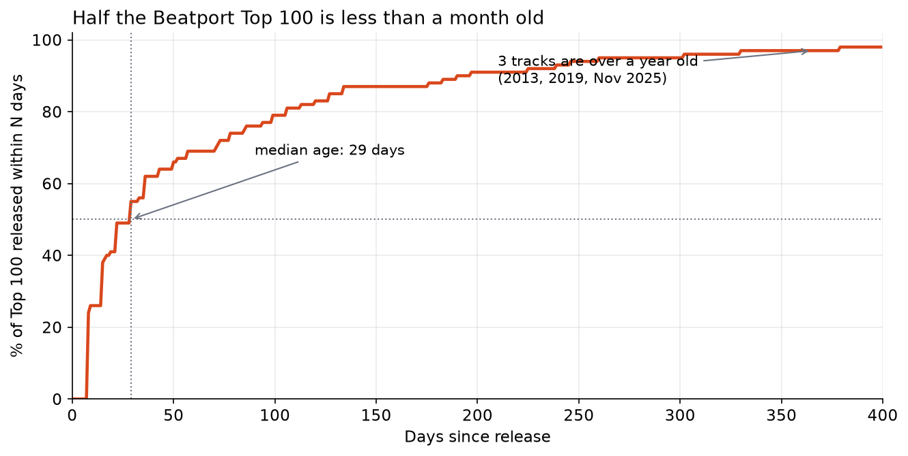
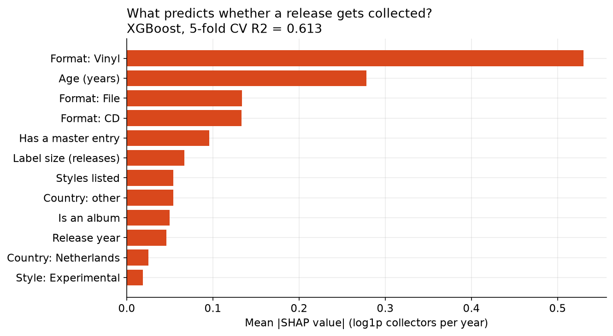
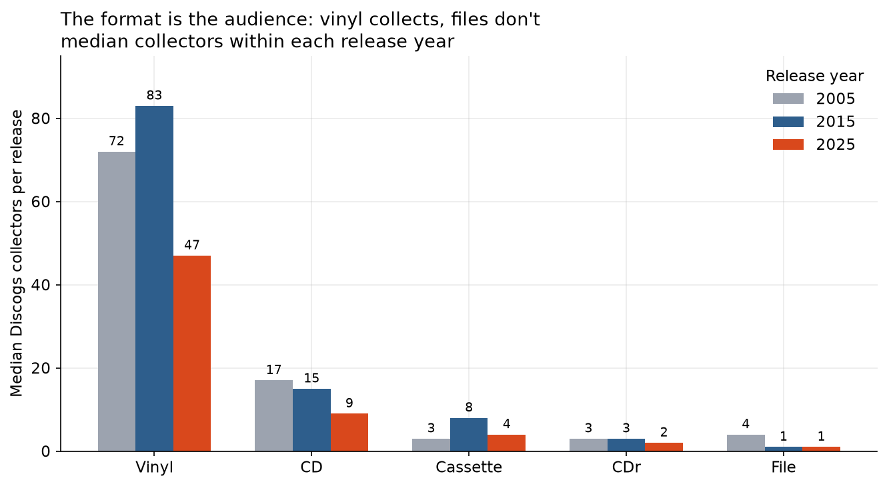

# The Release Glut

**Electronic music doubled its output in fifteen years while the average release lost its audience — and the chart at the top got narrower and faster at the same time.**

*Musing with Mike · 2026-11-21 · Topic: edm · Build #75*

Ask anyone in dance music why the scene feels oversaturated and you will get the consensus answer: anyone can release music now, so everyone does. That answer is fifteen years stale. It describes the door opening, not what walked through it. Nobody had measured the catalog itself: how many electronic releases actually exist per year, what format they come in, who releases them, and what happens to each one after it lands. I measured it, from the Discogs catalog — every electronic release it lists, 2005 to 2026 — plus a snapshot of today's Beatport Top 100.

## Why this would surprise someone who knows the field

Three things in here contradict what working DJs and label people believe.

First, the glut is real but it stopped growing. Electronic releases on Discogs doubled from 97,657 in 2005 to 199,047 in 2020, while pop stayed dead flat at ~51,000 a year and rock grew 19 percent. Then it plateaued: correcting for the cataloguing lag (recent releases take years to be added — measured off pop's own decline, cross-checked against rock), 2025 lands at roughly 163,000-183,000, not above the 2020 peak. The story is not "supply grows forever." It is "supply doubled, then saturated." The year it peaked is 2020 — the lockdown year, up 11.7 percent in a single year, the biggest jump in the series. The bedroom-producer boom is visible in the catalog as a spike, and then the shelf stopped getting longer.

Second, the growth is entirely one format. Files went from 10,627 electronic releases in 2005 to 146,422 in 2020 — a 13.8x explosion, from 11 percent of the shelf to 74 percent. CD collapsed from 35,567 to 9,504 and CDr from 13,169 to 5,544. Vinyl did not die and did not come back: it sits flat at ~23,000-24,000 releases a year from 2020 to 2025. The "vinyl revival" in the recent numbers is a cataloguing artifact — digital files are added to Discogs more slowly than vinyl, so recent years undercount files. The file share of file-plus-vinyl falls monotonically with recency (86 percent in 2020, 78 percent in 2025), which is the signature of lag, not a format comeback. And cassettes, the format everyone treats as a joke, grew 6.7x, from 1,900 to 12,726.

Third — and this is the part the sample work adds — the audience per release collapsed while the label system dissolved. The median electronic release had 16 Discogs collectors in 2005, 3 in 2015, and 1 in 2025. A third of 2025's releases are owned by nobody at all, up from 4 percent in 2005. And the collapse has a mechanism: it is almost entirely a format-composition effect. Within every single year, a vinyl release has a median of 47-83 collectors and a file release has a median of 1-4. The shelf stopped being collectable when it stopped being physical. The label side is just as stark: the top 10 labels hold 6-8 percent of releases, the concentration index sits at 12-17 on a 10,000 scale, and the single biggest "label" in all three cohorts is literally "Not On Label."

The gate at the top moved the other way. The Beatport Top 100 on 21 November 2026 lives in a 12-BPM corridor: 92 percent of it is 124-136 BPM, 60 percent sits in 128-132, and the median track is 129 BPM. Sixty-two percent is in a minor key. Half the chart is less than a month old (median age 29 days) and a quarter of it is under two weeks old, while three tracks are over a year old — a 2013 Armand Van Helden record, a 2019-dated Stardust record, and a 2025 track that never left. The shelf is infinite and the gate is narrow, minor-key, 129 BPM, and two weeks wide.

## What I built

| # | Question | Data | Script |
|---|----------|------|--------|
| 1 | Did electronic supply actually grow, or just get catalogued more? | Discogs release counts by genre x year, 2005-2026 (4 genres, 88 queries) | `src/01_fetch_counts.py`, `src/03_analysis_counts_beatport.py` |
| 2 | Is the post-2020 fall real or cataloguing lag? | Pop and rock as lag controls (both flat pre-2022); two independent corrections | `src/03_analysis_counts_beatport.py` |
| 3 | What format is the glut? | Population format totals (Vinyl/File/CD/CDr/Cassette) for 2005/2015/2020/2025 + file-vs-vinyl lag test 2021-2025 | `data/format_totals.csv`, `src/05_charts.py` |
| 4 | What happened to the audience per release? | Stratified random sample, 8,351 (2005) + 11,362 (2015) + 9,078 (2025) releases, Horvitz-Thompson weighted (hierarchy-aware matching) | `src/02_fetch_samples.py`, `src/04_analysis_samples.py` |
| 5 | Did labels consolidate or dissolve? | Weighted label shares, top-10 share, HHI; "Not On Label" share | `src/04_analysis_samples.py` |
| 6 | What does the DJ chart actually sound like now? | Beatport Top 100 snapshot, 21 Nov 2026 (BPM, key, length, age) | `src/03_analysis_counts_beatport.py` |
| 7 | What predicts whether a release gets collected? | XGBoost + SHAP on pooled electronic sample, target log1p(collectors per year of age) | `src/04_analysis_samples.py` |

Reproduce: `python3 src/01_fetch_counts.py && python3 src/02_fetch_samples.py && python3 src/03_analysis_counts_beatport.py && python3 src/04_analysis_samples.py && python3 src/05_charts.py`. Steps 1-2 re-download from the live Discogs API (the committed snapshots in `data/raw/` are the 2026-11-21 capture used here). Requires pandas, numpy, requests, matplotlib, scikit-learn, xgboost, shap. Full provenance, including the sampling design and its calibration, in `data/PROVENANCE.md`.

## Findings

**1. Electronic is the only genre whose supply doubled — and then it stopped.**
Electronic releases catalogued per year: 97,657 (2005) → 199,047 (2020) → 123,719 raw in 2025 (lag-corrected 163,000-183,000). Over the same 2005-2020 stretch rock grew 19 percent, hip hop 10 percent, pop shrank 1 percent. Electronic went from a third of the four-genre catalog to 47 percent, and from 1.9x pop's volume to 3.9x. It overtook rock in absolute volume in 2009 and never gave it back.

**2. The 2020 spike is the lockdown producer boom, with a date on it.**
Electronic's biggest single-year jump in the whole series is 2019→2020: +11.7 percent, 178,198 to 199,047. No other genre spiked that year (rock +1.4 percent, pop +0.4 percent, hip hop +12.7 percent off a much smaller base — hip hop's 2020 also jumps, which is the same lockdown story in a smaller genre). Then supply plateaus. The glut is not still accelerating. It saturated.

**3. The glut is a file-format glut, and the vinyl revival is a mirage.**
Files: 10,627 (2005) → 102,587 (2015) → 146,422 (2020). CD: 35,567 → 16,366 → 9,504. CDr: 13,169 → 8,863 → 5,544. Vinyl: 34,663 → 19,774 → 23,485 — and then flat at ~23,000-24,000 a year through 2025. Cassettes: 1,900 → 8,028 → 12,726. The format totals nearly partition each year's catalog (they sum to within 1 percent of the genre total), so these are population counts, not estimates. The apparent vinyl-share rise in 2024-2025 is differential cataloguing lag: files are added to Discogs more slowly than vinyl, so the file share of file-plus-vinyl falls monotonically with recency (86 percent in 2020 to 78 percent in 2025). Read the 2025 format shares as provisional; the 2005-2020 ones are mature.

**4. The audience per release collapsed — median collectors 16 → 3 → 1.**
The median electronic release had 16 Discogs collectors in 2005, 3 in 2015, and 1 in 2025 (means 70, 34, 23 — the mean is dragged up by a few hits). The share owned by nobody at all went 3.7 percent → 22.4 percent → 33.3 percent. The share with five or fewer collectors went 31 percent → 66 percent → 72 percent. The share with a hundred or more went 19 percent → 8 percent → 5 percent. Median "want" (people who want a copy but don't own one) fell 13 → 1 → 0. Part of the gap is age — a 2005 release had 21 years to accumulate collectors and a 2025 release had 1.4 — but the 2015 cohort had 11 years and still sits at a median of 3, and the format split below shows the mechanism is composition, not time. The EP is the file era's native format: EPs went from 5 percent of releases in 2005 to 20 percent in 2015, while singles barely moved (8 → 9 → 11 percent) and albums went 19 → 27 → 24 percent. Releases are also losing their masters: the share with a Discogs master entry fell 58 → 42 → 34 percent, and the share of SKUs that are extra format variants of an already-listed master fell 26 → 22 → 19 percent — the catalog is fragmenting into one-off files rather than accumulating editions of the same record.

**5. The label system dissolved; self-release is the biggest "label".**
Label concentration (Herfindahl-Hirschman Index, 0-10,000 scale) went 17 → 13 → 12. For scale, the US DOJ calls a market unconcentrated below 1,500. The top 10 labels' share of releases went 8.4 percent → 6.0 percent → 6.4 percent. The single biggest "label" in every cohort is "Not On Label" — 2.6 percent in 2005, 2.9 percent in 2015, 1.9 percent in 2025 — ahead of EMI, Virgin, and Sony BMG in 2005 and ahead of everything in 2025. There are no gatekeepers left by volume; there is a long tail of thousands of labels (3,880 distinct labels in the 2005 sample alone, 6,017 in 2015) and a self-release economy on top of it. One cautionary tale from the methods: the raw sample briefly suggested a single label, Eyra Music, held 5.9 percent of 2025 — that turned out to be a sampling artifact of Discogs' clustered result ordering (its 981 near-identical Deep House MP3s sit on one page), caught by a direct population count that puts it at 0.79 percent. The corrected top-10 share above uses the fixed weights.

Geography went placeless at the same time: the UK was the top country in 2005 (20 percent) and 2025 (15 percent), the US in 2015 (19 percent), and by 2025 the third-largest "country" is "Worldwide" at 12 percent — digital releases with no country at all. Germany faded from 13 to 9 percent.

**6. The Beatport Top 100 is a 12-BPM corridor with a two-week memory.**
Median 129 BPM (IQR 127-130); 92 percent within 124-136 BPM, 60 percent within 128-132. Sixty-two percent minor key; the most common keys are F minor (10 tracks), E major and A minor (8 each). Median length 5:21, a quarter of tracks run over six minutes. Median age 29 days; 49 percent released within four weeks, 26 percent within two. The bottom of the chart churns faster than the top: the bottom 10's median age is 19 days against the top 10's 31. And three zombies refuse to die: Armand Van Helden's "I Want Your Soul" (2013, No. 90), Stardust's "Music Sounds Better With You" (2019, No. 75), and "Jamaican (Bam Bam)" (Nov 2025, No. 39).

**7. The format is the audience: a vinyl release collects 45x faster than a file.**
An XGBoost model predicting log1p(collectors per year of age) on the pooled 27,157-release electronic sample scores 5-fold CV R² = 0.613. The top SHAP feature by a wide margin is being a vinyl release (0.53), ahead of age (0.28) and being a file (0.13) or a CD (0.13). Having a master entry (0.10), label size (0.07), and being an album (0.05) matter a little; the release year itself barely registers (0.05). The direction is unambiguous and it holds within every cohort: median collectors for vinyl are 72 (2005), 83 (2015), 47 (2025); for files they are 4, 1, 1. A vinyl release is owned by nobody 0.6-1.4 percent of the time; a file release 10-49 percent of the time. The collapse in finding 4 is not mainly that people stopped collecting. It is that the shelf changed into a format people do not collect. Press it on vinyl and it gets owned; upload it as an MP3 and it mostly doesn't — and the model says that fact alone explains more of a release's fate than its year, its label, or its style.

## What this means if you make or sell dance music

- The shelf is not getting longer anymore. The competition is not against next year's supply, it is against a fixed ~170,000 releases a year, about two-thirds of them digital files. Differentiation has to come from somewhere other than "I released something."
- If you want your release to be owned rather than streamed past, press it. The format gap is 45x at the median, within every year. A file release's modal fate is one collector or none; a vinyl release's is dozens. The cheapest audience a dance label can buy is a pressing plant.
- The label is not the moat anymore. The top 10 labels hold 6 percent of the shelf and "Not On Label" is the biggest label in the catalog. Distribution is the moat now — or the playlist, or the DJ chart.
- The DJ chart is a narrow gate: 129 BPM, minor key, under a month old. If you are making music for DJs rather than for streaming, those are the coordinates, and the window is about two weeks. The zombie tracks are the exception that proves the gate: a 2013 record can sit at No. 90, but it takes a decade of goodwill to get there.
- Vinyl is a stable ~23,000 releases a year, not a growth market and not a dying one. It is a fixed-size room. Price accordingly.

## Limitations

- Discogs is a user-built catalog, not a census of all releases. It skews toward collector culture (vinyl, physical) and toward releases someone cared enough to document. Streaming-only releases that nobody catalogues are invisible here. The direction of that bias is toward understating the file glut, not overstating it.
- Recent years (2022-2026) are undercounted and the undercount differs by format; the lag correction uses pop and rock as controls and assumes the lag curve is genre-neutral. Electronic's long tail may be catalogued more slowly, which would make the corrected 2025 figures lower bounds.
- Discogs `have` counts are collectors, not listeners or buyers. A release can be streamed millions of times and owned by nobody on Discogs, especially a file-only single. The demand story is about the collector economy, and it should be read that way.
- The Beatport snapshot is one day (21 Nov 2026). BPM and key distributions move slowly; the age distribution moves weekly.
- The sample's Horvitz-Thompson weights run ~10-15% below genre totals (see `data/PROVENANCE.md` for the calibration); shares and medians are robust to that, weight totals are not used as findings.
