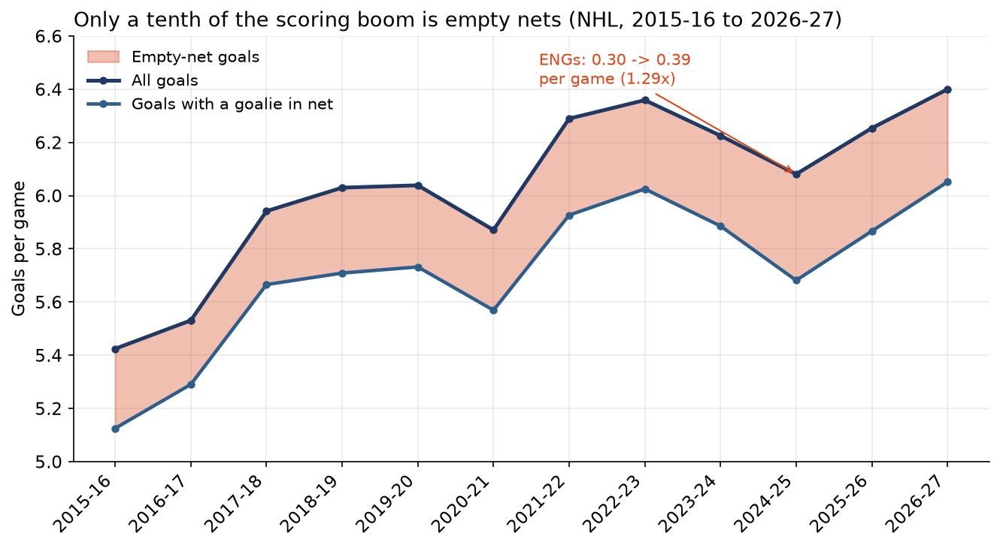
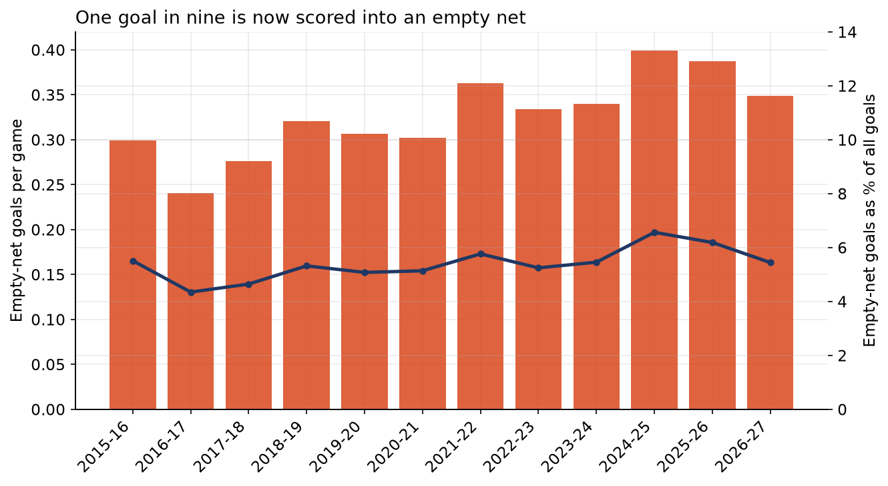
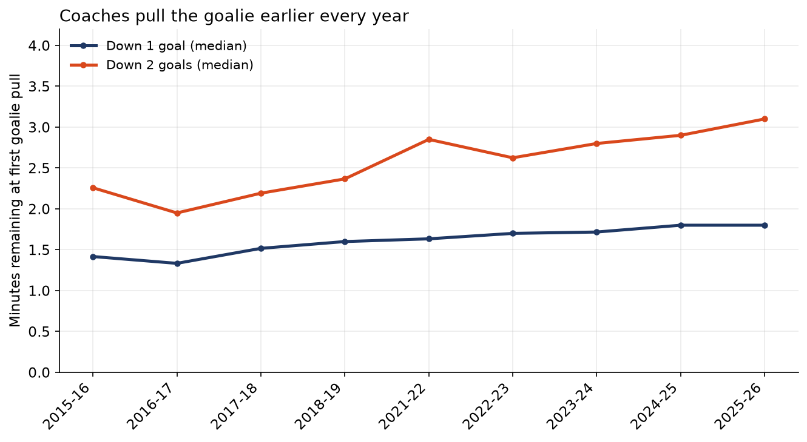
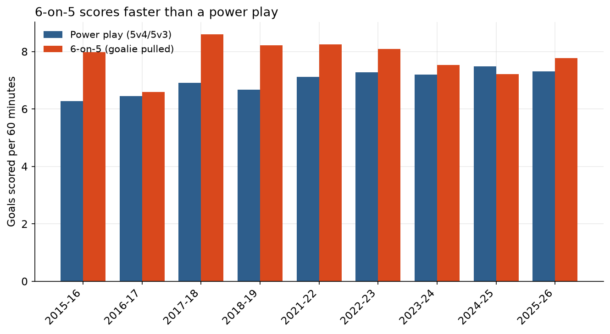
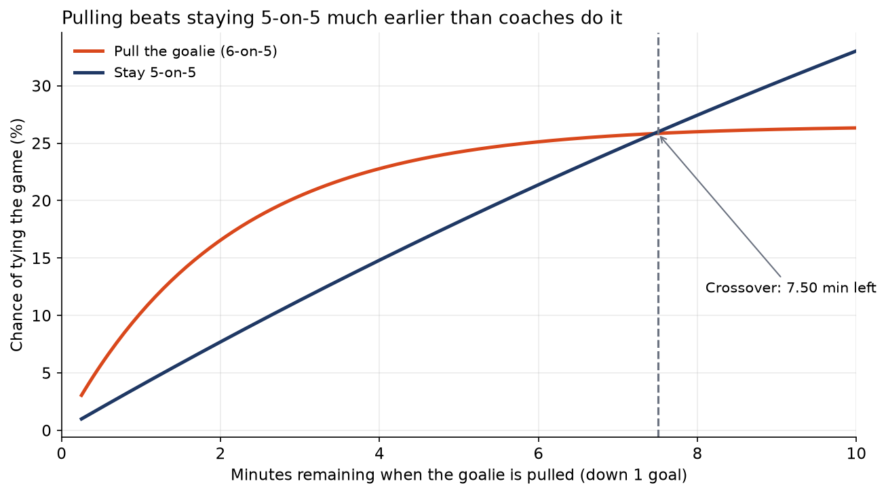
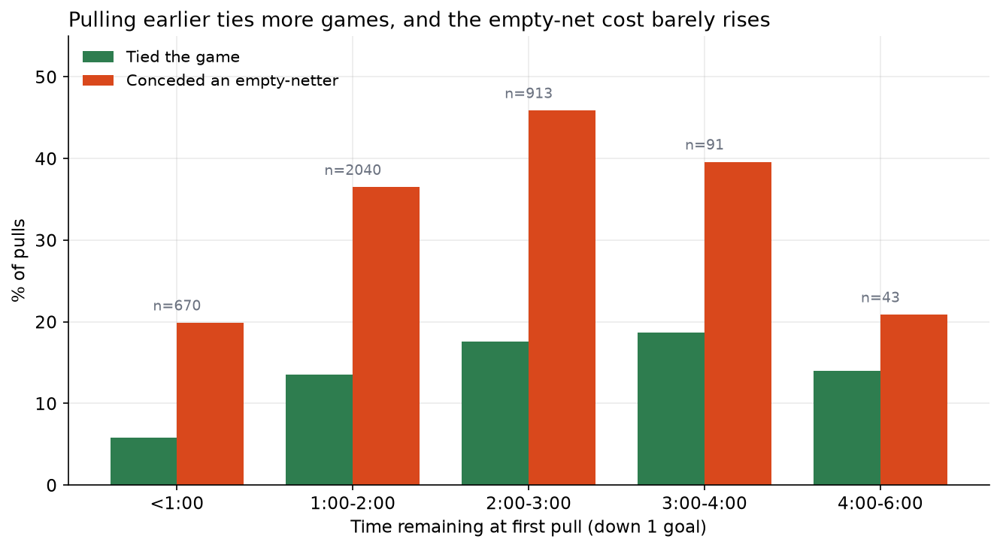
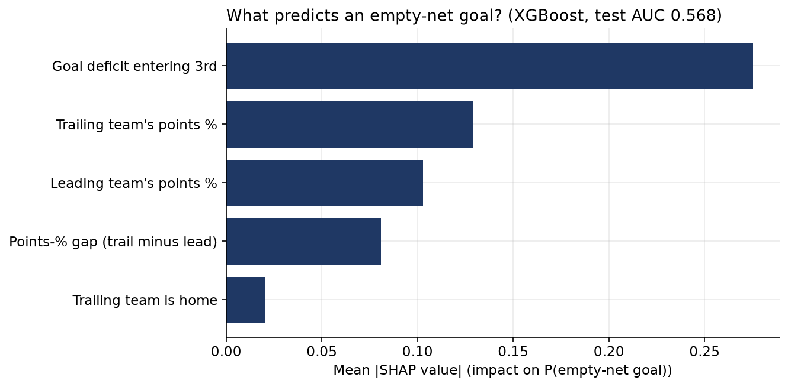
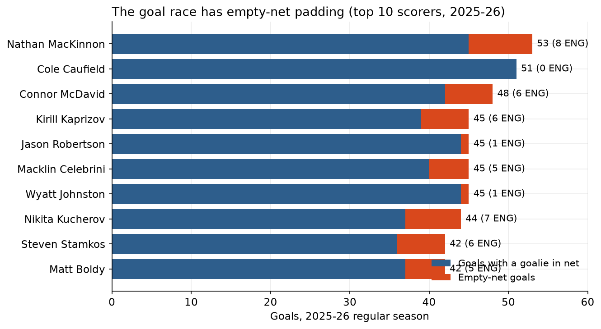

# The Empty-Net Era

**6-on-5 is the best power play in hockey, and the scoring boom is real anyway.**

*Musing with Mike · 2026-11-22 · Topic: sports-analytics · Build #76*

Every hockey fan has watched the same ritual a thousand times: a team down a goal, the goalie skates to the bench with two minutes left, six skaters swarm the zone, and a third of the time the puck ends up in the empty net at the other end. The analytics case for pulling earlier has been made for years, and the empty-net goal has become a talking point of its own. But nobody had measured the whole thing at once, on the full census of games: how much of the scoring boom is actually empty nets, how the pulled-goalie offense really compares to a power play, when coaches actually pull, and what all of it does to the goal race. I pulled every regular-season play-by-play from 2015-16 through the first 370 games of 2026-27, 13,882 games, 83,635 goals, and measured it.

## Why this would surprise someone who knows the field

Four things in here cut against what people who follow the game believe.

First, the scoring boom is not an empty-net boom. Goals per game rose from 5.42 in 2015-16 to 6.25 in 2025-26, and empty-netters explain only about a tenth of that rise. Empty-net goals went from 0.30 to 0.39 a game while goals with a goalie in net went from 5.13 to 5.87. The Daily Faceoff piece from November 2024 that kicked off the "rise of the empty-net goal" conversation was right that ENGs are up, but the implication that they are inflating the scoring boom is wrong. The boom is real hockey: more goals past actual goalies. One goal in sixteen is an empty-netter, and that share has barely moved in a decade.

Second, 6-on-5 outscores a power play. Pooled across the decade, a team with its goalie pulled scores 7.79 goals per 60 minutes, against 6.97 for a power play. Both situations have the extra skater. The only difference is the goalie, so the measurement isolates the value of the goalie himself: his presence suppresses scoring more than the extra skater adds. The twist is that the gap has closed to nothing. Power plays improved from 6.28 goals per 60 in 2015-16 to about 7.4 now, while 6-on-5 stayed flat. In 2024-25 the power play actually outscored 6-on-5. The pulled goalie used to be the best offense in hockey; the power play has caught it.

Third, coaches are still pulling far too late, and the gap has barely moved in eleven seasons. The median first pull down a goal went from 85 seconds left in 2015-16 to 108 seconds in 2025-26, a gain of 23 seconds in a decade. Published models put the optimum much earlier: Brown and Asness (2018) said 6:10, and a 2026 dynamic-programming model put it at 3:35. My own back-of-the-envelope Poisson model puts the pull-versus-stay crossover at 7.5 minutes. The observed outcomes agree with the models: pulling with under a minute left ties the game 5.8% of the time, pulling with two to three minutes left ties it 17.6%. Yet only 6.1% of down-one pulls happen with three or more minutes left. A decade of analytics papers moved the median pull by less than half a minute.

Fourth, pulling down two goals is nearly hopeless, and the numbers say why. Down two, a pull ties the game 1.6% of the time and concedes an empty-netter 51.8% of the time. You need two goals in about two minutes of 6-on-5, and the empty-net rate during a pull is 21.59 goals per 60, nearly three times the rate at which the pulling team scores. The models say to pull at 13 minutes down two. Nobody does, and the payoff for doing it is thin anyway: the tie is a lottery ticket and the ENG is the likely outcome.

## What I built

| # | Question | Data | Script |
|---|----------|------|--------|
| 1 | How much of the scoring boom is empty nets? | All goals and ENGs per season, 13,882 games | `src/01_fetch.py`, `src/02_analysis.py` |
| 2 | Are coaches pulling earlier? | First endgame pull time per game (trailing, 6:00 or less left), by season | `src/01_fetch.py`, `src/02_analysis.py` |
| 3 | Is 6-on-5 better than a power play? | Goals per 60 for 6v5 vs 5v4/5v3, pooled and by season | `src/02_analysis.py` |
| 4 | When should you pull? | Poisson first-goal model from empirical scoring rates; observed tie rates by pull-time bucket | `src/02_analysis.py` |
| 5 | What predicts an empty-net goal? | XGBoost + SHAP, train to 2022-23, test from 2023-24 | `src/02_analysis.py` |
| 6 | How padded is the goal race? | ENG share of top-10 scorers and career ENG leaders, 2015-16 onward | `src/02_analysis.py` |
| 7 | What does it look like for the Oilers? | Edmonton ENG for/against and pull timing by season | `src/02_analysis.py` |

Reproduce: `python3 src/01_fetch.py && python3 src/02_analysis.py && python3 src/03_charts.py`. Step 1 re-downloads all play-by-play from the NHL API (the committed snapshots in `data/` are the 2026-11-22 capture used here). Requires pandas, numpy, requests, matplotlib, scikit-learn, xgboost, shap. Full provenance, including how pull intervals are derived from situation codes and how delayed-penalty pulls are separated out, in `data/PROVENANCE.md`.

## Findings

**1. Only a tenth of the scoring boom is empty nets.**

Goals per game (both teams) went from 5.42 in 2015-16 to 6.25 in 2025-26. Empty-net goals went from 0.30 to 0.39 a game, a 1.29x rise. Goals with a goalie in net went from 5.13 to 5.87. Of the 0.83 goals per game added over the decade, 0.09 were empty-netters: 10.6%. The ENG share of all goals moved from 5.5% to 6.2%. In the partial 2026-27 season so far it is 5.5%, so the 2024-25 peak of 6.6% looks like a high-water mark rather than a new normal. The scoring boom is a real-goals boom, and anyone adjusting goal totals for empty nets is adjusting for a tenth of the story.

**2. One goal in eighteen is an empty-netter, and the rate is flat.**

Empty-net goals per game: 0.30 (2015-16), 0.24 (2016-17), 0.28, 0.32, 0.31, 0.30, 0.36, 0.33, 0.34, 0.40, 0.39. There is no steady climb, just noise around a slow rise. The 2024-25 season, 0.40 a game, is the highest in the census, and it is the season the Daily Faceoff piece was written about. Read the long series and it looks like a level shift in the early 2020s, not an ongoing explosion.

**3. Coaches pull earlier every year, by seconds.**

Median first endgame pull down one goal: 85 seconds left in 2015-16, 108 in 2025-26. Down two: 136 seconds to 186. The share of down-one pulls made with two or more minutes left went from 16.5% to 37.7%, and with three or more minutes left from 1.7% to 6.1%. The share of games with an endgame pull at all barely moved, 64.9% to 63.5%: coaches are not pulling more often, they are pulling a little earlier when they do. A 2026 longitudinal study found the same drift, about a tenth of a minute per season. The interesting thing is how little a decade of papers moved the number.

**4. 6-on-5 outscores a power play, but the power play has caught up.**

Pooled across full seasons: power play 6.97 goals per 60 minutes (2,005 hours of PP time), 6-on-5 7.79 goals-for per 60 (152 hours). But by season the story is convergence. In 2015-16 the gap was 7.99 to 6.28. In 2024-25 the power play led, 7.49 to 7.21, and in 2025-26 it was 7.78 to 7.31. Power plays got better; 6-on-5 did not. The cost side never changed: while the goalie is out, the other team scores into the empty net at 21.59 goals per 60, almost three times the rate the pulling team scores. That is the whole trade in one ratio.

**5. Pulling beats staying 5-on-5 until about seven and a half minutes remain, and coaches pull at one minute forty-eight.**

A Poisson first-goal model from the empirical rates (5-on-5: 2.41 goals per 60 for the trailing team; 6-on-5: 7.79 for, 21.59 against) says pulling gives a better chance of tying than staying 5-on-5 whenever fewer than about 7.5 minutes remain. Pulling at 2:00 left gives a 16.6% tie chance against 7.7% for staying 5-on-5; pulling at 5:00 gives 24.2% against 18.2%. The tie chance from pulling saturates near 26%, because three of four first goals in a 6-on-5 go into your own empty net, so the model is a ceiling, not a promise. Published dynamic-programming models put the optimum lower, 3:35 to 6:10 down one goal, because they price in standings points rather than just the tie. Either way the median actual pull, 1:48, is late. The observed outcomes back the models: down one, pulling with under a minute left ties 5.8% of the time and concedes 19.9%; pulling with two to three minutes left ties 17.6% and concedes 45.9%. Earlier pulls tie about three times as often, and the empty-net cost roughly doubles. Coaches are buying the cheap version of a good trade.

**6. Down two, the pull is a lottery ticket that usually pays the other team.**

Across 3,757 down-one pulls, the pulling team tied 13.3% of the time and conceded an empty-netter 35.7% of the time. Across 2,716 down-two pulls, the tie rate was 1.6% and the concede rate 51.8%. Pulling down two means needing two goals in roughly two minutes of 6-on-5 while the other team shoots at an empty net at 21.59 goals per 60. The models say pull at 13 minutes down two. Nobody does, and the 1.6% tie rate is the reason the bench does not listen.

**7. Beyond the score, an empty-net goal is nearly unpredictable.**

An XGBoost model predicting whether a game produces an empty-net goal, trained through 2022-23 and tested from 2023-24, manages an AUC of 0.568 against a 35.2% base rate. The deficit entering the third period is almost the whole story (mean absolute SHAP 0.275, more than double the next feature). Team quality helps a little, home ice barely matters. The ENG rate by deficit entering the third: down one 31.9%, down two 37.1%, down three 28.0%, down four 12.0%, down five 4.1%. The down-two peak is the tell: a two-goal deficit is the sweet spot for producing an empty-netter, because the trailing team pulls earlier and longer and still rarely ties. Down three the rate falls, because teams down three pull less and the game is already gone.

**8. The goal race has empty-net padding, and it is not evenly spread.**

In 2025-26, Nathan MacKinnon led the league with 53 goals, 8 of them empty-netters (15.1%). Cole Caufield was second with 51 goals and zero empty-netters. Connor McDavid scored 48 with 6 empty-netters (12.5%), Nikita Kucherov 44 with 7 (15.9%), Steven Stamkos 42 with 6 (14.3%). The year before, Leon Draisaitl won the Rocket Richard with 52 goals and only 2 empty-netters (3.8%), while Alex Ovechkin scored 44 with 8 (18.2%). Career empty-net leaders since 2015-16: Ovechkin 48 of 455 goals (10.5%), Brandon Hagel 33 of 174 (19.0%), Brad Marchand 33, Sidney Crosby 32, Sebastian Aho 32. Hagel's share is the outlier: nearly a fifth of his goals since 2015-16 went into an empty net. The ENG-adjusted goal race rarely changes the winner, but it changes how you read the runners-up.

**9. The Oilers are early pullers with a positive empty-net balance.**

Edmonton has scored 142 empty-netters and conceded 115 since 2015-16, a plus-27 differential. The Oilers' median first pull in 2024-25 was 160 seconds, against a league median of 108: they were among the earliest pullers in the league that season, then fell back to 103 seconds in 2025-26. McDavid has 30 empty-netters in 422 goals since 2015-16 (7.1%), Draisaitl 18 in 454 (4.0%). For comparison, Auston Matthews has 18 in 442 (4.1%). The Oilers' empty-net edge is a real, if small, part of their goal differential.

## Methods and limitations

Play-by-play comes from the NHL public API, no key, fetched 2026-11-22. An empty-net goal is a goal whose details carry no `goalieInNetId`. Pull intervals are derived from `situationCode` transitions in period 3: the code is four characters, away goalie, away skaters, home skaters, home goalie, so `1560` means the home goalie is pulled. An endgame pull is a goalie-out interval in period 3 with the pulling team trailing and at most 6:00 left. Goalie-out intervals outside that definition are almost entirely delayed-penalty pulls, which last seconds and are excluded from the 6-on-5 rates. The API emits no explicit goalie-pulled event, so this derivation is the measurement.

Validation: `goals_total` equals the official final score in all 13,882 games, and the 2023-24 team ENG totals reproduce StatMuse and Daily Faceoff exactly (Winnipeg 24, Tampa Bay 23, Florida 21, San Jose 4, Edmonton 12; league average 13.8 per team).

Limitations: 2019-20 and 2020-21 are COVID-shortened seasons, so season aggregates are per-game rates. 2026-27 is partial (370 games through 2026-11-21). The break-even model is a Poisson first-goal calculation, not a win-probability model: it assumes goal arrivals are memoryless and treats going down two as terminal, which overstates the cost of pulling a little and ignores that a team that ties puts its goalie back in. The XGBoost team-quality feature uses season-end points percentage, a mild look-ahead. The 5-on-5 time in the break-even model subtracts a flat four minutes per game for 4-on-4 and 3-on-3 time.

Prior work this build stands on: Brown and Asness (2018), who put the optimal down-one pull at 6:10 and down-two at 13:00; the "Pull the Goalie Sooner" model (October 2026), which put the optimum at 3:35 down one and 7:21 down two on 4,072 games and estimated late pulls cost the league about 13 standings points a season; Ali and Mohamed (2026), who measured the pull-timing drift on 7,047 pulls in 10,250 games; and the Daily Faceoff piece from November 2024 that documented the rise in empty-net goals. This build's contributions are the full 12-season census, the scoring-boom decomposition, the head-to-head 6-on-5 versus power-play rates, and the game-level pull outcomes.

## Sources

- NHL public API (`api-web.nhle.com`), play-by-play for all regular-season games, 2015-16 to 2026-27
- Brown, A. and Asness, C. (2018), "When Should You Pull the Goalie?" (SSRN)
- "Pull the Goalie Sooner" (Devpost, October 2026), https://devpost.com/software/pull-the-goalie-sooner
- Ali, S. and Mohamed, H. (2026), "Closing the Gap: A Longitudinal, Covariate-Adjusted Analysis of NHL Goalie Pull Timing" (LINHAC 2026)
- Daily Faceoff (November 2024), "The rise of empty net goals is changing the NHL"
- StatMuse team empty-net goal totals, 2023-24 (external validation)
