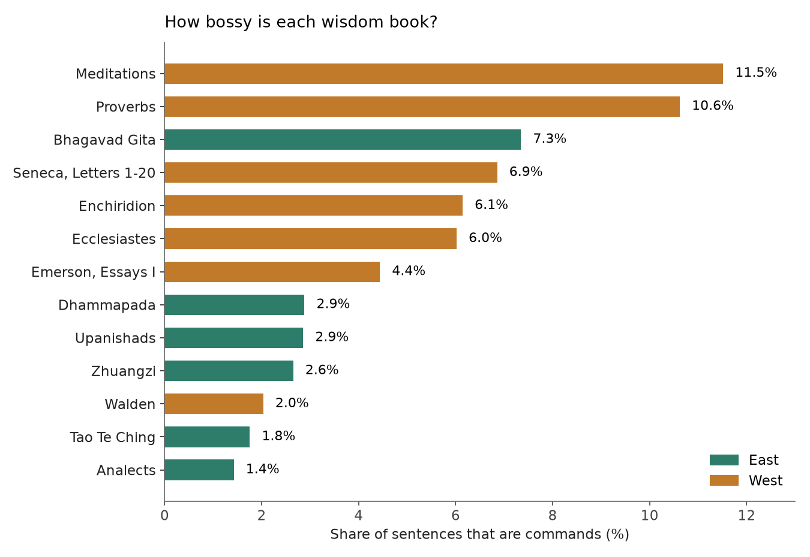
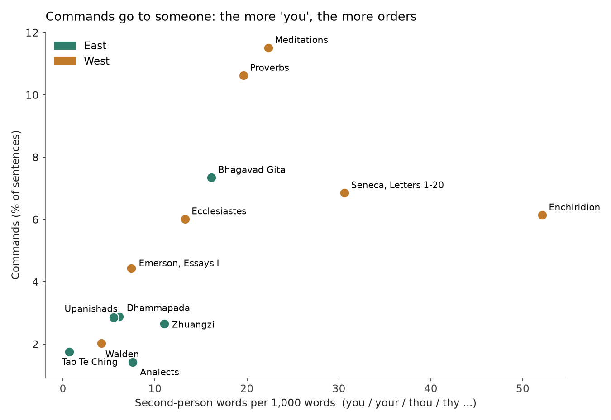
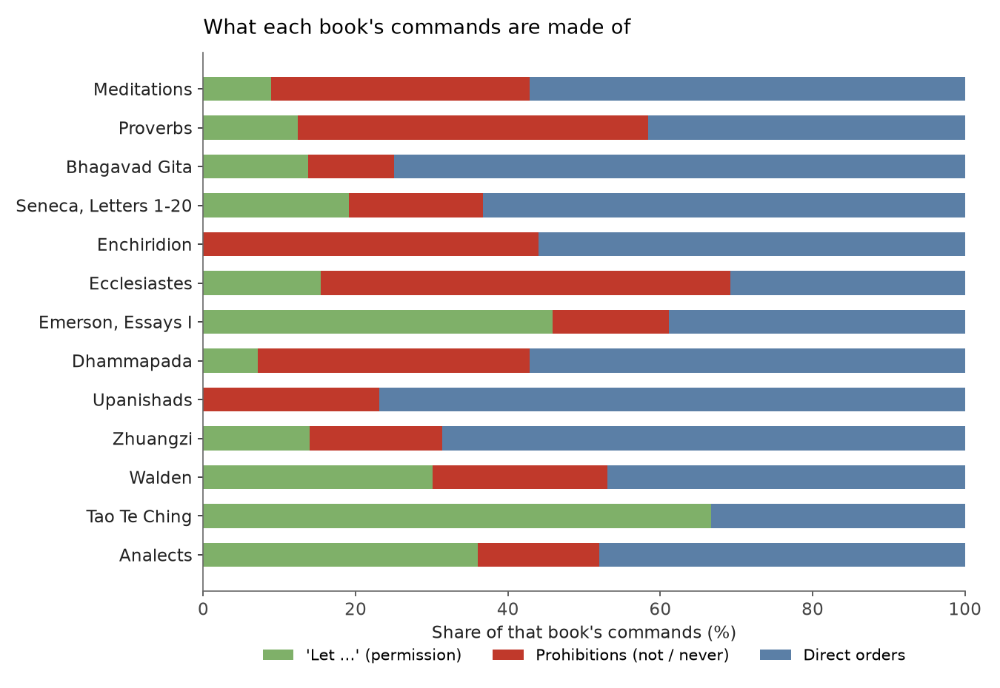
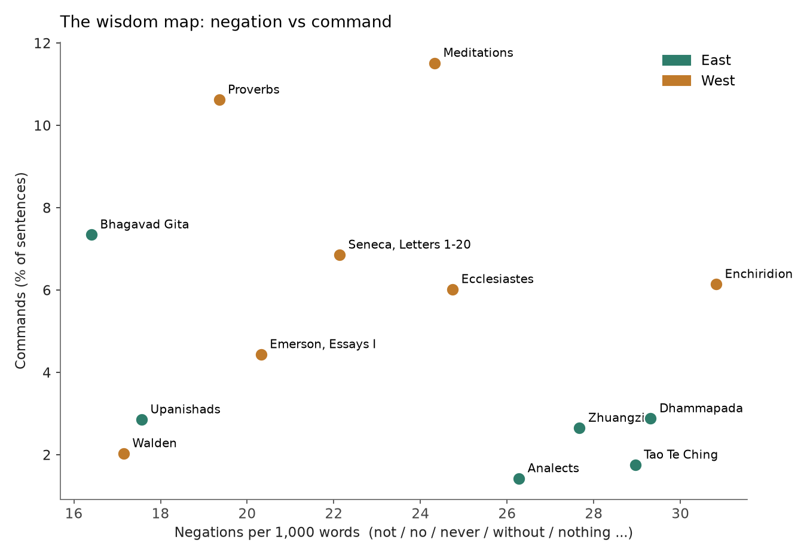

# The Wisdom Books Are Bossy

**The Tao Te Ching issues nine commands in 513 sentences, and six of them are "let." The bossiest book in the canon is a private diary. Marcus Aurelius spent his evenings ordering himself around.**

*Musing with Mike · 2026-11-23 · Topic: philosophy · Build #77*

## Why this would surprise someone who knows the field

Everybody who knows philosophy knows the story: Eastern wisdom is about letting go, Western wisdom is about doing. The East teaches non-action, the West teaches action. That story is true at the level of ideas. What nobody had done, as far as I can find, is count it at the level of sentences. So I did. I took thirteen wisdom texts, East and West, from the Tao Te Ching to Walden, and measured how much of each one is literally telling you what to do.

The familiar story does not survive the count. It survives in a stranger form. The East does not command letting go. It barely commands at all. The Tao Te Ching contains nine commands in the whole book, and six of them start with "let," which is permission, not an order. Non-action is not an instruction in the Tao. It is a description of how the world works. The Analects, the rulebook of Confucianism, is the least commanding book in the corpus at 1.4 percent. The rulebook barely gives rules.

And the most commanding book is not a sermon or a law code. It is a diary nobody was supposed to read. Marcus Aurelius's Meditations orders its reader around in 11.5 percent of its sentences, and almost half of those orders are addressed to "thou." He is not advising you. He is commanding himself, in the second person, in private. Stoicism turns out to be, literally, self-command.

## The question

How much of the world's wisdom literature is actually a command? And does the East/West split hold when you measure orders, questions, negations, and who the text is talking to, instead of arguing about ideas?

## The data

Thirteen public-domain texts, 24,178 sentences, about 482,000 words. Full manifest in `data/raw/manifest.json`.

| Text | Tradition | Edition | Words | Sentences |
|---|---|---|---|---|
| Tao Te Ching | East | Legge 1891 | 10,426 | 513 |
| Analects | East | Legge 1861 | 30,444 | 1,755 |
| Zhuangzi | East | Giles 1889 | 101,681 | 7,585 |
| Dhammapada | East | Muller 1881 | 12,026 | 486 |
| Bhagavad Gita | East | Arnold 1885 | 20,149 | 1,089 |
| Upanishads | East | Muller 1879 | 17,648 | 911 |
| Meditations | West | Haines 1916 | 46,999 | 1,763 |
| Enchiridion | West | Rolleston 1881 | 9,384 | 407 |
| Seneca, Letters 1-20 | West | Gummere 1917 | 22,463 | 992 |
| Ecclesiastes | West | KJV 1611 | 5,582 | 216 |
| Proverbs | West | KJV 1611 | 15,038 | 838 |
| Emerson, Essays: First Series | West | 1841 | 74,186 | 3,538 |
| Walden | West | 1854 | 115,813 | 4,085 |

Project Gutenberg was down for maintenance on the day of the build, so six texts come from Wikisource's proofread transcriptions of the same public-domain translations, fetched through its API with revision IDs recorded. Seven come from the verified Gutenberg downloads of build #68. Seneca is Letters 1-20 only, a disclosed subset. Ecclesiastes and Proverbs were extracted from the King James Bible, Gutenberg #10.

## The method, in one paragraph

A sentence counts as a command when it opens with a base-form verb from a curated list, or with "let," "do not," or "never" plus a verb, subject to guards that exclude questions, cross-references ("See ch. i."), hypotheses ("Suppose they were virtuous"), proper names (the emperor Shun), and subject-verb statements ("Love is..."). The classifier was built in the open: four rounds of hand-labelling, 120 sentences per round, 480 sentences total, with each round's errors fixed before the next. The final held-out sample (seed 2026) scores precision 96.7 percent and recall 98.3 percent. Reproduce it with `python3 src/validate_classifier.py`. The full metrics are in `data/processed/metrics.csv`, and every number in this write-up comes from that file.

## Finding 1: the West commands, the East describes

Eastern texts command in 3.15 percent of sentences on average. Western texts command in 6.80 percent. The gap is 3.65 points, and a permutation test puts it at p = 0.018. That is not a subtle difference. It is a factor of two.

The bottom of the list is all East: Analects 1.4 percent, Tao Te Ching 1.8 percent, Zhuangzi 2.6 percent, Dhammapada and Upanishads 2.9 percent. The only Eastern text that commands like a Western one is the Bhagavad Gita at 7.3 percent, third in the whole corpus. That is the exception that proves the mechanism, because the Gita is not a treatise. It is a battlefield dialogue in which a god orders a warrior. Genre beats tradition. Dialogue commands. Treatise describes.

The Tao's nine commands are worth listing in full, because they are the whole case. Six start with "let": "Let it be still, and it will gradually become clear." "Let movement go on, and the condition of rest will gradually arise." "Let him keep his mouth closed, and shut up the portals (of his nostrils), and all his life he will be exempt from laborious exertion." The book of non-action does not order you not to act. It gives you permission to stop. Its most common command verb is "let," at 66.7 percent of its commands. One of the nine is a known false positive of the classifier ("Calm and repose are what he prizes," where "calm" is a noun), so the true count is eight. The finding gets stronger, not weaker.

## Finding 2: the bossiest book is a private diary

Meditations commands in 11.5 percent of its sentences, 203 commands in 1,763 sentences, more than any other text. Proverbs is second at 10.6 percent. Marcus Aurelius was an emperor writing notes to himself at night, and he writes like a drill sergeant talking to one recruit: himself. 48.3 percent of his commands are addressed to "thou," "thy," or "thyself." "Say to thyself at daybreak: I shall come across the busy-body, the thankless, the bully, the treacherous, the envious, the unneighbourly." "Put thy thought thus: thou art an old man; let this be a thrall no longer, no more a puppet pulled aside by every selfish impulse." "Keep the ruling Reason in thine own power."

He is also the most questioning writer in the corpus, tied with Ecclesiastes at 15.3 percent of sentences ending in a question mark. The same book that orders the most also asks the most. That is the mechanism. Meditations is not a lecture. It is an argument with himself, and the argument has two moves: ask a question, then answer it with an order. "Have I done some social act? ... Make no difference in doing thy duty whether thou art shivering or warm, drowsy or sleep-satisfied, defamed or extolled, dying or anything else."

The second-person rate tells the same story from the other side. Epictetus's Enchiridion addresses "you" 52 times per 1,000 words, more than twice any other text. It is a handbook written to a student. Seneca's letters run 30.6. Marcus runs 22.3, and his "you" is himself. The Tao runs 0.7. It speaks to no one. Across all thirteen texts, command rate correlates with second-person rate at 0.55. Commands go to someone. The Tao has no someone, so it has almost no commands.

## Finding 3: the Bible forbids, the Tao permits

Commands come in three registers: permission ("let"), prohibition ("do not"), and direct order ("do"). Every text picks a different mix, and the mix is the fingerprint.

The Bible's wisdom books command by forbidding. 53.9 percent of Proverbs' commands are prohibitions, and 61.5 percent of Ecclesiastes'. "Labour not to be rich: cease from thine own wisdom." "Be not rash with thy mouth, and let not thine heart be hasty to utter any thing before God." "Remove not the ancient landmark, which thy fathers have set." The Enchiridion is the same shape at 44.0 percent prohibitions: "Do not laugh much, nor at many things, nor unrestrainedly." "Wish not ever to seem wise."

The Tao is the mirror image. 66.7 percent of its commands are "let." The Analects is 36.0 percent "let." Emerson is 45.9 percent "let," 72 of his 157 commands: "Let a Stoic open the resources of man and tell men they are not leaning willows, but can and must endure." "Let us affront and reprimand the smooth mediocrity and squalid contentment of the times." Walden is 30.1 percent "let." The transcendentalists inherited the Tao's register, not the Bible's. They permit; they do not forbid.

The Upanishads are the one text with zero "let" commands. Their commands are direct: "Ask for lands of vast extent and live thyself as many autumns as thou desirest." "Know also the intellect to be the driver and mind the reins."

## Finding 4: "let" is the canon's favorite command

"Let" is the most common command verb in 9 of the 13 texts. It is the top verb in the Tao, the Analects, Zhuangzi, the Gita, Meditations, Seneca, Proverbs, Emerson, and Walden. That is a strange fact about the literature of advice. The verb that opens the most commands in the books that lasted two thousand years is not "do," "seek," or "be." It is "let," the verb of allowing something to happen rather than making it happen.

The negation story is subtler than the familiar version. The East does negate more, 24.4 negations per 1,000 words against 22.7 in the West, but the gap is small, and the single most negating text is the Enchiridion, a Western text, at 30.8. What differs is not how much each tradition negates. It is what the negation is doing. Eastern negation is mostly descriptive: "The Tao that can be described is not the enduring and unchanging Tao." Western negation is mostly prohibitive: it sits inside commands, telling you what not to do. The correlation between command rate and negation rate across the thirteen texts is -0.22, effectively zero. Negation and command are independent dimensions, and the traditions differ on command, not on negation.

Two more details that fell out of the counts. First, Walden says "I" more than any text in the corpus, 34.2 times per 1,000 words, and uses the words self, soul, mind, heart, and spirit less than any text, 0.6 per 1,000. Thoreau writes about himself constantly and about the self almost never. The Upanishads are the opposite: 14.3 self-words per 1,000, the highest in the corpus, and only 13.3 first-person words. The book about the self barely says "I." Second, the West also prescribes more with modals: "must," "should," "ought," and "shall" run 9.2 per 1,000 words in the West against 4.0 in the East, driven by Proverbs at 17.6 and Ecclesiastes at 13.6. The King James "thou shalt" is doing real work in that number.

## So what

If you write advice, coach people, or lead a team, the form matters more than the content, and the canon's form is not what modern advice writing defaults to. Modern advice defaults to direct order: do X, seven steps, no excuses. The books that survived two thousand years do not default to it. The Tao never uses direct order at all. Emerson uses it a quarter of the time. The work splits three ways: the Tao permits, the Bible forbids, and the Stoics order themselves around in the second person.

Two moves in particular are worth stealing. The first is the Meditations recipe: a command you issue to yourself, in the second person, with a prohibition attached. "Do not turn thine eyes aside, but keep to the straight path." It is the most commanding book in the canon, and it is a private diary, which suggests the most persuasive orders are the ones nobody hears you give. The second is the Tao's: when you want someone to stop doing something, do not forbid it. Permit the alternative. "Let it be still, and it will gradually become clear" is doing the same work as "stop striving," and it has lasted twenty-five centuries.

## Methods and limitations

Sentence splitting is regex-based with abbreviation protection, because the NLTK data downloads are blocked in this environment, so no punkt tokenizer. The imperative classifier is rule-based on the sentence's first content word, with guards for questions, cross-references, hypotheses, proper names, and subject-verb statements. It was validated on a hand-labelled stratified sample of 120 sentences (60 predicted commands, 60 predicted not), precision 96.7 percent, recall 98.3 percent. The two false positives are a concessive "let" ("Let any say or do what he will, I must for my part be good") and a noun subject ("Harm to thee cannot depend on another's ruling Reason"). The one false negative is a command that ends in a rhetorical question ("Suffer not thy mouth to cause thy flesh to sin... wherefore should God be angry at thy voice?"). Known limitations: the classifier counts form, not force, so conditional commands ("Commit a crime, and the earth is made of glass") count as commands; quoted commands inside narrative sentences do not count as commands, by design; translations are 19th-century, so the counts measure Legge, Giles, Muller, Haines, Rolleston, and the King James translators as much as Laozi and Marcus; and the Tao's 1.8 percent includes one known false positive, so its true rate is about 1.6 percent. The East/West labels are the conventional ones and the panel is my own selection. Run everything with `python3 src/clean.py && python3 src/analyze.py && python3 src/deeper.py && python3 src/charts.py` from this directory. Requirements: matplotlib and numpy only.

## Full results

| Text | Commands | Questions | Negations /1k | Must/should /1k | You /1k | I /1k | Self-words /1k | Median sent. len |
|---|---|---|---|---|---|---|---|---|
| Tao Te Ching | 1.8% | 6.4% | 29.0 | 3.9 | 0.7 | 13.0 | 1.1 | 18 |
| Analects | 1.4% | 4.8% | 26.3 | 4.8 | 7.6 | 18.4 | 0.9 | 14 |
| Zhuangzi | 2.6% | 4.2% | 27.7 | 3.0 | 11.0 | 17.4 | 2.7 | 11 |
| Dhammapada | 2.9% | 2.9% | 29.3 | 3.3 | 6.1 | 8.3 | 4.9 | 24 |
| Bhagavad Gita | 7.3% | 5.1% | 16.4 | 4.5 | 16.2 | 28.3 | 11.9 | 15 |
| Upanishads | 2.9% | 3.3% | 17.6 | 4.6 | 5.5 | 13.3 | 14.3 | 17 |
| Meditations | 11.5% | 15.3% | 24.3 | 4.9 | 22.3 | 13.9 | 4.5 | 19 |
| Enchiridion | 6.1% | 13.0% | 30.8 | 10.6 | 52.1 | 14.4 | 2.4 | 19 |
| Seneca, Letters 1-20 | 6.9% | 8.8% | 22.1 | 9.3 | 30.6 | 31.7 | 3.9 | 19 |
| Ecclesiastes | 6.0% | 15.3% | 24.7 | 13.6 | 13.3 | 23.8 | 11.5 | 21 |
| Proverbs | 10.6% | 5.8% | 19.4 | 17.6 | 19.6 | 13.1 | 9.0 | 16 |
| Emerson, Essays I | 4.4% | 5.6% | 20.3 | 5.8 | 7.4 | 28.4 | 5.8 | 17 |
| Walden | 2.0% | 6.5% | 17.1 | 2.9 | 4.2 | 34.2 | 0.6 | 22 |
