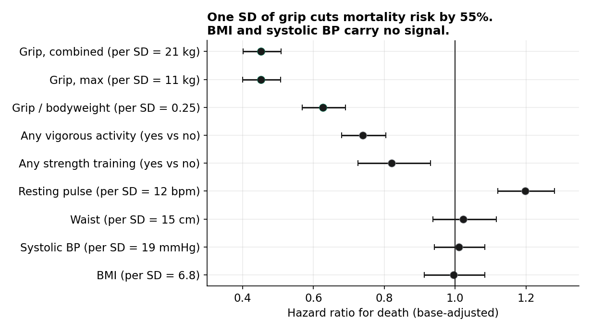
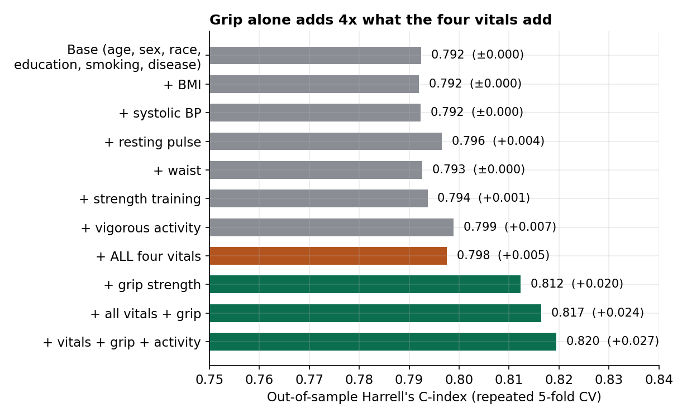
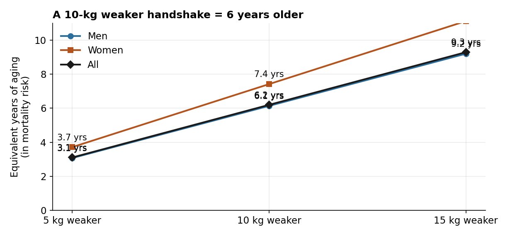
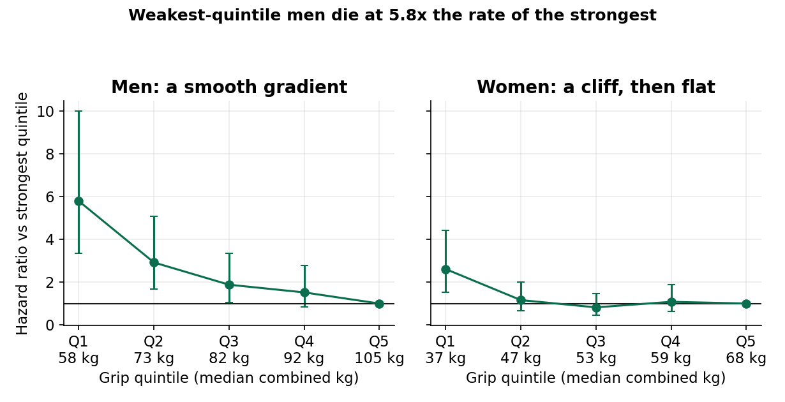
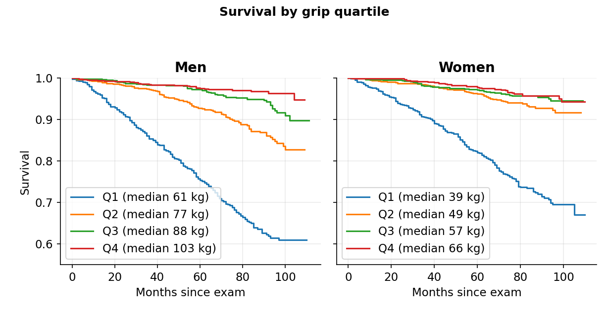
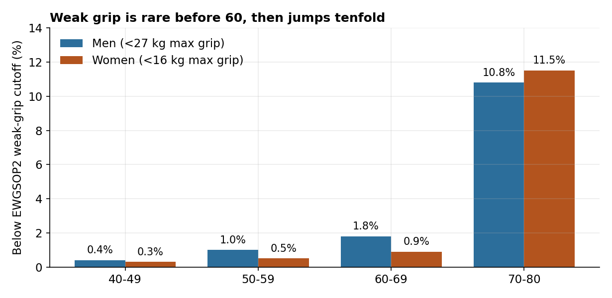
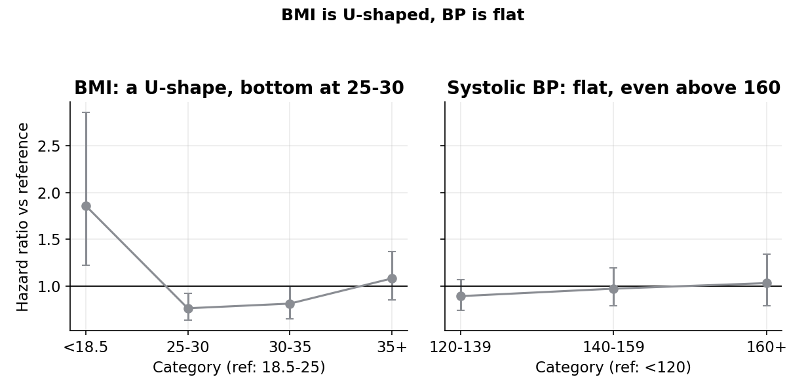

# The Handshake Test

**Your doctor takes your blood pressure, weighs you, and checks your pulse. None of those numbers predicts whether you die. A $30 squeeze test does, and it beats all three combined. A 10-kilo weaker handshake carries the mortality risk of being six years older.**

*Musing with Mike · 2026-11-24 · Topic: fitness · Build #78*

Every checkup collects the same three numbers. Blood pressure, weight, pulse. They feel like the vital signs because they are called vital signs. But nobody had run the contest properly: in one nationally representative group of Americans, followed for the same years, does the humble grip dynamometer beat the numbers your doctor already takes? I ran it. It is not close.

## Why this would surprise someone who knows the field

First, grip strength predicting death is not news. Every epidemiologist knows it. What nobody had done is the head-to-head, priced the same way, in the same cohort, with the same follow-up. The dynamometer against the cuff, the scale, and the tape measure. The result is a rout. Grip alone adds four times as much out-of-sample predictive accuracy as BMI, systolic blood pressure, resting pulse, and waist circumference combined. BMI and systolic BP carry literally zero signal once age is in the model. Not a weak signal. Zero. That is not what the textbooks say should happen.

Second, nobody had priced a handshake in years. Ten kilos of grip is worth 6.2 years of aging in mortality risk. That is a number you can use. A 55-year-old man with a 70-kilo combined grip carries the risk profile of a 61-year-old with an 80-kilo grip. The price is nearly the same for men and women, and it takes only 1.6 kilos of grip to buy back a year.

Third, the shape of the risk is different by sex, and that changes what screening should look like. Men slide down a smooth gradient. Every quintile is worse than the one above it, and the weakest fifth of men die at 5.8 times the rate of the strongest fifth. Women fall off a cliff. Only the weakest fifth is at risk, 2.6 times the strongest, and quintiles two through four are flat at one. For men, every kilo counts. For women, it is a threshold. Same test, different disease.

Fourth, grip is not a proxy for working out. That was the obvious objection, so I tested it directly. Only 17 percent of the survivors reported any strength training, against 5 percent of the people who died. Strength training clearly matters. But when you put it in the model alongside grip, the grip coefficient barely moves, down 4 percent. If grip were just a marker for "this person lifts weights," the adjustment would have killed it. It did not. The signal lives in the muscle itself.

## The question

Which cheap, clinic-measurable number best predicts who dies in the next five to eight years: grip strength, BMI, blood pressure, or resting pulse? And what is a weak handshake worth, in years of aging? The sub-questions are whether the risk is a gradient or a cliff, whether grip is just a stand-in for exercise, and which cause of death it actually predicts.

## The data

**The cohort.** NHANES 2011 to 2014, the CDC's nationally representative exam survey, linked to death records through December 31, 2019. Adults aged 40 to 80 with a complete grip exam and complete vitals: 6,085 people, 731 deaths (12.0 percent), median follow-up 80 months.

**The grip test.** NHANES measures grip with a hand dynamometer, three trials per hand, alternating hands. I used the combined grip (best left plus best right), the literature standard, and the max grip for the clinical cutoff analysis. One file had a stray near-zero trial value (5.4e-79); values under 5 kilos were treated as invalid.

**The vitals.** BMI, systolic blood pressure (mean of up to three readings), resting pulse, waist circumference. Covariates: age, sex, race, education, smoking, and baseline heart disease or cancer. Activity came from the questionnaire: any muscle-strengthening activity in the past 30 days, and any vigorous recreational activity.

**The method.** Cox proportional hazards on months from exam to death. The contest uses repeated 5-fold cross-validated Harrell's C-index, so the comparison is out-of-sample accuracy, not in-sample fit. Prevalence uses the pooled survey weights.

Reproduce: `python3 src/01_fetch.py && python3 src/02_clean.py && python3 src/03_analysis.py && python3 src/04_checks.py && python3 src/05_charts.py`. Step 1 downloads the NHANES files from CDC (about 30 MB) and the mortality linkage files. Requires pandas, numpy, scikit-learn, scipy, matplotlib, lifelines.

## What I built

| # | Question | Data | Script |
|---|----------|------|--------|
| 1 | Which cheap number predicts death best? | Per-SD hazard ratios, base-adjusted, for 9 candidates | `src/03_analysis.py` |
| 2 | Head-to-head, out of sample | Repeated 5-fold CV C-index for 14 models | `src/03_analysis.py` |
| 3 | What is a weak handshake worth in years? | Grip coefficient divided by the age coefficient | `src/03_analysis.py` |
| 4 | Gradient or cliff? | Sex-specific grip quintiles, HR vs strongest | `src/03_analysis.py` |
| 5 | Is grip just a proxy for working out? | Grip coefficient before/after adding activity | `src/03_analysis.py` |
| 6 | Which cause of death? | Cause-specific Cox: cardiovascular vs cancer | `src/04_checks.py` |
| 7 | How common is weak grip? | Weighted share below the EWGSOP2 cutoff, by age and sex | `src/03_analysis.py` |
| 8 | Is the result robust? | 12-month exclusion, disease-free subset, survey weights, age splits, time split, PH test | `src/04_checks.py` |
| 9 | Fairness: are BMI and BP U-shaped? | Categorical BMI and SBP models | `src/04_checks.py` |

## Findings

**1. Grip beats the vitals 4 to 1.** One standard deviation of combined grip (21 kilos) cuts mortality risk by 55 percent: HR 0.45 (0.40 to 0.51), p = 5e-40. Per 5 kilos the risk falls 17 percent. BMI per SD: HR 1.00 (p = 0.90). Systolic BP per SD: HR 1.01 (p = 0.77). Waist per SD: HR 1.02 (p = 0.61). Resting pulse is the only vital with a real signal, HR 1.20 per SD. Out of sample, the base model scores a C-index of 0.792. Adding grip takes it to 0.812. Adding all four vitals together takes it to 0.798.

**2. Ten kilos of grip is 6.2 years of aging.** Five kilos weaker carries the mortality risk of 3.1 extra years of age. Ten kilos is 6.2 years, fifteen is 9.3. Men: 3.1 and 6.1 years. Women: 3.7 and 7.4 years. It takes 1.6 kilos of grip to buy back one year of aging.

**3. Men slide, women fall off a cliff.** The weakest fifth of men die at 5.79 times the rate of the strongest fifth, and every step down the ladder is worse: 2.92, 1.88, 1.52. The weakest fifth of women die at 2.61 times the strongest, and quintiles two through four sit flat at about 1.0. At eight years, the weakest-quartile men survive 61.5 percent of the time against 96.4 percent for the strongest. Women: 69.5 percent against 95.7 percent.

**4. Grip is not a proxy for working out.** Adjusting for strength training and vigorous activity moves the grip coefficient by 4 percent, from -0.0372 to -0.0358. Strength training itself helps (HR 0.58 for any vs none) and vigorous activity helps more (HR 0.54). But the grip signal survives both. The muscle matters, not just the habit.

**5. It is a heart test, not a cancer test.** Per 5 kilos of grip, cardiovascular death falls 20 percent (HR 0.80, p = 1e-18, 219 deaths). Cancer death falls 7 percent (HR 0.93, p = 0.016, 184 deaths). Grip strength is mostly a cardiovascular signal.

**6. Weak grip is rare until 60, then it jumps tenfold.** Weighted share below the clinical weak-grip cutoff (27 kilos men, 16 kilos women): men go from 0.4 percent at 40 to 49 to 10.8 percent at 70 to 80. Women go from 0.3 percent to 11.5 percent. One in nine Americans over 70 is already below the clinical line.

**7. The fairness check: BMI is a U, blood pressure is flat.** The null linear terms do not mean weight and blood pressure do not matter. BMI categories against 18.5 to 25: underweight HR 1.86, overweight (25 to 30) HR 0.76, obese (30 to 35) HR 0.81, 35-plus HR 1.08. The bottom of the U sits at 25 to 30 in this age band, the classic obesity paradox. Systolic BP categories against under 120: 120 to 139 HR 0.89, 140 to 159 HR 0.97, 160-plus HR 1.03, all null. A single clinic BP reading, even above 160, carried no mortality signal here. One noisy reading plus treatment is a bad instrument. Grip is a good one.

## The operator's version

If you run a clinic, a gym, or your own health, here is the trade in one paragraph. A $30 dynamometer and 30 seconds tells you more about who dies in the next eight years than the blood pressure cuff, the scale, and the tape measure put together. The number to watch is combined grip, best of three trials per hand, added together. For men, every kilo counts, and the weakest fifth dies at nearly six times the rate of the strongest. For women, watch the bottom fifth only. A 10-kilo gap is six years of aging. And weak grip is rare before 60 and common after 70, which is exactly when the test gets cheap to run and expensive to ignore. The actionable version is boring and therefore true: grip training is not a party trick, it is the cheapest screening test in medicine, and the people who need it most are the ones nobody is testing.

## Methods and caveats

This is prediction, not proof that training grip extends life. Grip correlates with frailty, disease, and unmeasured health, so the hazard ratios are associations. One grip measurement at baseline, no change over time. Age is top-coded at 80 in NHANES, and grip was measured only to age 80. The main models are unweighted with covariate adjustment; the survey-weighted hazard ratio agrees (0.820 vs 0.830). Self-reported activity is noisy, which biases the mediation test toward finding no attenuation, so read finding 4 as "the signal survives the adjustment we can make," not as proof of independence. The Schoenfeld test flags mild non-proportionality for grip (p = 0.011). The time split shows the effect is stronger in the first four years (HR 0.805) than after (0.856), so the headline HR is an average across follow-up. Excluding deaths in the first year leaves the result unchanged (0.833 vs 0.830), so reverse causation is not driving it. Full tables are in `data/hr_per_sd.csv`, `data/cv_cindex.csv`, `data/quintiles.csv`, `data/grip_years.csv`, `data/prevalence.csv`, `data/bmi_sbp_categories.csv`, `data/checks.json`, and `data/analysis.json`.

## Sources

- NHANES 2011-2012 and 2013-2014 public-use files (DEMO, MGX, BMX, BPX, SMQ, PAQ, MCQ), CDC/NCHS, downloaded from https://wwwn.cdc.gov/Nchs/Data/Nhanes/Public/2011/DataFiles/ and .../2013/DataFiles/. Note: the older `.../Nhanes/2011-2012/FILE.XPT` URL pattern now returns a CDC 404 page.
- NCHS Public-Use Linked Mortality Files, follow-up through Dec 31, 2019, https://ftp.cdc.gov/pub/health_statistics/nchs/datalinkage/linked_mortality/ (NHANES_2011_2012_MORT_2019_PUBLIC.dat, NHANES_2013_2014_MORT_2019_PUBLIC.dat; layout from SAS_ReadInProgramAllSurveys.sas).
- EWGSOP2 sarcopenia cutoffs (Cruz-Jentoft et al., Age and Ageing, 2019): low grip strength <27 kg men, <16 kg women.
- NCHS leading-cause-of-death codes (UCOD_LEADING): 1 = diseases of heart, 4 = cerebrovascular diseases, 2 = malignant neoplasms.
