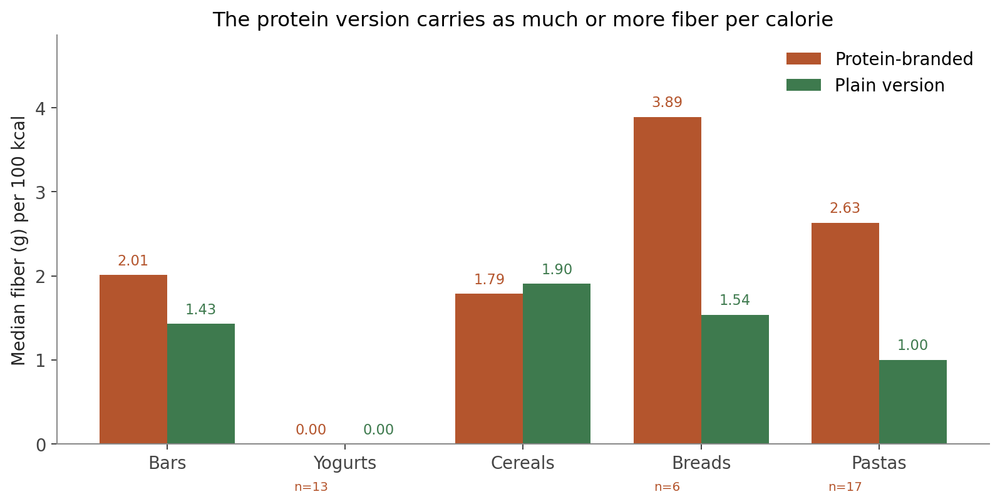
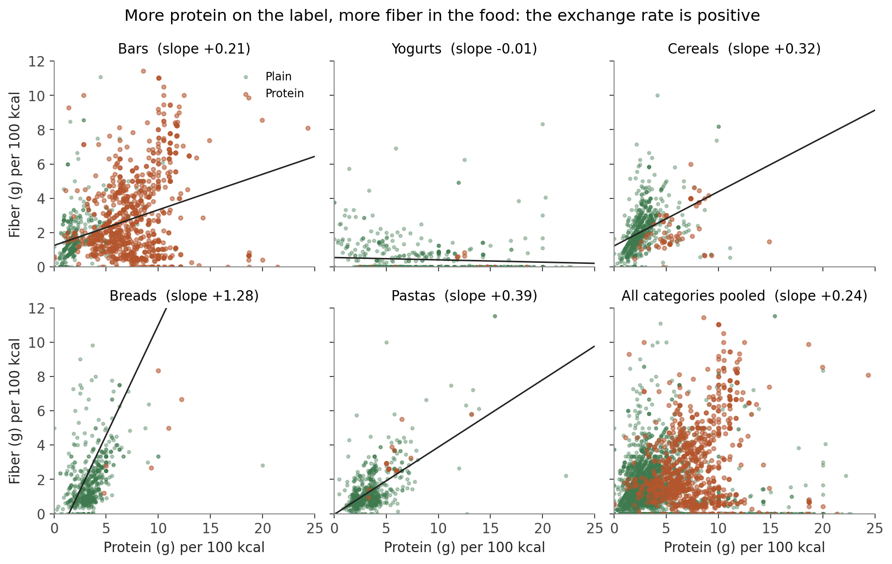
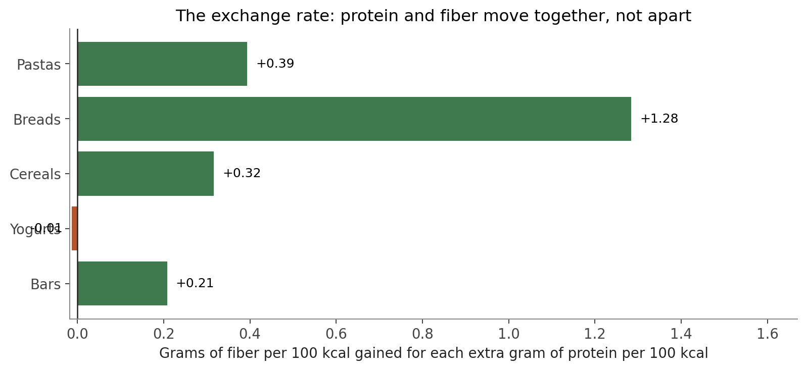
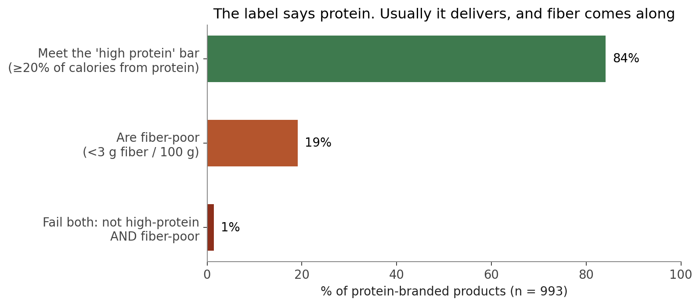
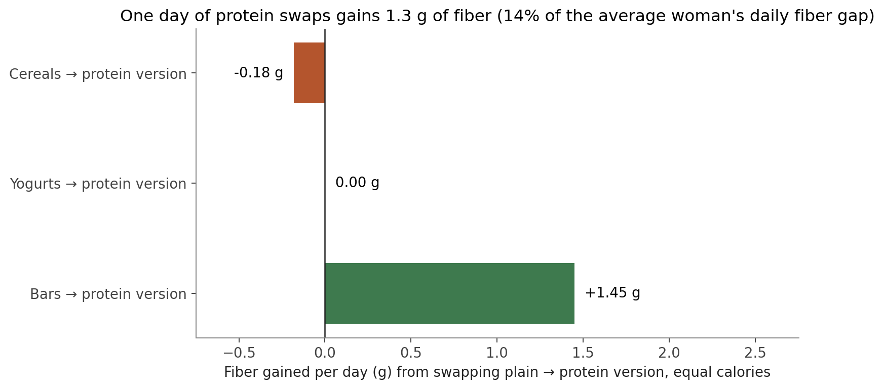

# The Protein Tax Is a Myth

**Everyone "knows" the protein craze is crowding out fiber. I measured it across 4,576 products on US shelves, and the opposite is true. Protein-branded foods carry 80 percent more fiber per calorie than the plain versions they replace. The protein bar is not the candy bar. The plain bar is.**

*Musing with Mike · 2026-11-26 · Topic: nutrition · Build #79*

I went in expecting to price a tax. The story writes itself: America is obsessed with protein, 95 percent of us miss our fiber target, and every grocery aisle now has a protein version of the thing you used to buy. Surely the protein version trades fiber away. That is what dietitians warn about, what the fiber-gap literature implies, and what I assumed when I designed this build. Then the data said no, in every aisle, with p-values that have fifty zeros in them. So this build is a refutation of its own premise, which is the best kind of result. The headline is not that protein foods are good for you. It is that the protein label, for reasons nobody planned, points at the more fiber-dense product on the shelf.

## Why this would surprise someone who knows the field

First, the direction is backwards from the settled worry. The standard critique of the protein craze is that it sells people a nutrient they already get enough of while displacing the one they do not. The numbers behind that worry are real: 92.8 percent of Americans meet their protein recommendation, only 9.5 percent meet their fiber recommendation, and average fiber intake sits near 16 grams a day against targets of 25 for women and 38 for men. Everything about that setup predicts a fiber cost to protein branding. The measurement says the cost is negative. Protein-branded products deliver a median of 2.00 grams of fiber per 100 calories against 1.11 for the plain versions, an 80 percent advantage. In bars it is 2.01 against 1.43. In pasta it is 2.63 against 1.00. In cereals it is a wash. Nowhere is it a loss.

Second, nobody had priced the exchange rate. The question is not just which side has more fiber, it is what one more gram of protein costs you in fiber, holding the aisle fixed. The pooled answer, with category fixed effects, is plus 0.24 grams of fiber per extra gram of protein per 100 calories. The slope is positive in bars (+0.21), cereals (+0.32), pastas (+0.39), and breads (+1.28). The only flat line is yogurt, where fiber is zero on both sides. Protein and fiber move together on the shelf, not apart.

Third, the label mostly delivers what it promises, which is not what the cynical take expects. Eighty-four percent of protein-branded products clear the EU bar for a "high protein" claim (20 percent of calories from protein), and only 1.4 percent fail both tests at once, not high-protein and fiber-poor. The classic scam product, a candy bar with "protein" on the wrapper, is rare. The plain aisle is where the junk lives: 37 percent of plain products are fiber-poor, and 73 percent of plain bars score Nutri-Score D or E, against 24 percent of protein bars.

Fourth, the mechanism is visible in the ingredient lists and the product names. Protein pasta gets its protein from chickpeas and lentils, which bring fiber with them. Barilla Protein+, red lentil rotini, chickpea pasta. Protein bread is seeded whole-grain loaves and high-fiber wraps. Protein bars get chicory root fiber and soluble corn fiber as binders, and 42 percent of them list an added isolated fiber, against 29 percent of plain bars. The protein is not displacing fiber. It is riding on fiber-rich bases, because that is how you build a product that can carry the claim and still hold together.

Fifth, the honest version of the story is about positioning, not protein. Protein-branded foods are marketed to health-conscious buyers, so they are built to a health-conscious spec: less sugar, more fiber, better overall scores. The median protein bar has 10.4 grams of sugar per 100 grams. The median plain bar has 25. That is the real gap. The protein is mostly a flag that says "this product was designed for someone who reads labels." The nutrient you are actually buying when you buy the protein version is not protein. It is everything else that comes with the flag.

## The question

Does buying the protein-branded version of a grocery staple cost you fiber? And what is the exchange rate: grams of fiber lost per gram of protein gained, within the same aisle? The sub-questions are whether protein-branded products actually meet the "high protein" bar, whether they score worse overall, what a full day of protein swaps does to your fiber intake, and whether the fiber in protein bars is real food fiber or added isolates.

## The data

**The shelf.** Open Food Facts, the crowdsourced grocery database, US products only, fetched November 26, 2026. Seven categories: protein bars, cereal bars, yogurts, breakfast cereals, breads, pastas, cookies. I pulled the most-scanned products in each category, up to 1,000 per group, because scan counts are the best available proxy for what people actually buy. Raw pull: 5,063 products. After dropping items with no name, no code, or unusable nutrition data: 4,874. After dropping items with no declared fiber: 4,576 in the main analysis (993 protein-branded, 3,583 plain).

**The treatment.** "Protein-branded" means the product name carries the word protein, or the label carries a high-protein claim. Bars are classified by category instead: protein-bars versus cereal-bars. That is the marketing, not the nutrient. A product counts as protein-branded because of what the box says, which is exactly the decision a shopper faces.

**The thresholds.** "High protein" is the EU claim bar: at least 20 percent of calories from protein. "Source of fibre" is the EU bar: at least 3 grams of fiber per 100 grams. "Fiber-poor" is below that line.

**The background numbers.** NHANES 2013 to 2018: 92.8 percent of Americans meet their protein recommendation, 9.5 percent meet their fiber recommendation. Mean fiber intake is about 16 grams a day; the targets are 25 grams for women and 38 for men. Those come from the published literature, not from this dataset.

**The Thanksgiving plate.** USDA FoodData Central values for a typical plate: 150g roast turkey breast, 200g mashed potatoes, 100g stuffing, 60g cranberry sauce, 120g pumpkin pie, 100g green beans. The stuffing entry is the dry mix, so its protein is an upper bound.

Reproduce: `python3 src/01_fetch.py && python3 src/01b_ingredients.py && python3 src/02_clean.py && python3 src/03_analysis.py && python3 src/04_checks.py && python3 src/05_charts.py && python3 src/06_thanksgiving.py`. The fetch hits the Open Food Facts API, which rate-limits hard: expect 503s, retries, and a cap near 10 pages per query. Requires pandas, numpy, scipy, matplotlib.

## What I built

| # | Question | Data | Script |
|---|----------|------|--------|
| 1 | Does the protein version carry less fiber per calorie? | Median fiber per 100 kcal, protein vs plain, 6 categories | `src/03_analysis.py` |
| 2 | What is the exchange rate? | OLS of fiber per 100 kcal on protein per 100 kcal, per category and pooled with fixed effects | `src/03_analysis.py` |
| 3 | Does the label deliver? | Share of protein-branded products meeting the high-protein bar, and share fiber-poor | `src/03_analysis.py` |
| 4 | Does the protein version score worse overall? | Nutri-Score D/E share, and median sugar | `src/03_analysis.py` |
| 5 | What does a day of swaps cost? | Cereal + yogurt + bar, plain vs protein at equal calories | `src/03_analysis.py` |
| 6 | Is the bars fiber real or added isolates? | Ingredient lists for 100 protein bars vs 100 plain bars | `src/01b_ingredients.py` |
| 7 | Is it robust? | Per-100g comparison, drop fiber-named products, drop top brand per category, means vs medians | `src/04_checks.py` |
| 8 | What about Thanksgiving? | USDA plate: protein and fiber totals, ratio vs guidelines | `src/06_thanksgiving.py` |

## Findings

**1. There is no protein tax. Protein-branded foods carry 80 percent more fiber per calorie.** Pooled median: 2.00 grams of fiber per 100 calories for protein-branded products, 1.11 for plain (Mann-Whitney p = 9e-57). Per 100 grams the gap is wider: 8.0 against 3.6. By aisle: bars 2.01 vs 1.43 (p = 4e-14), pastas 2.63 vs 1.00 (p = 3e-08), breads 3.89 vs 1.54 (small sample, n = 6 protein breads), cereals 1.79 vs 1.90 (no difference, p = 0.79), yogurts 0.00 vs 0.00 (both zero). No protein cookies exist in the most-scanned US sample, so cookies drop out of the comparison. The pooled number is dominated by bars, 898 of the 993 protein-branded products are bars, so read the per-aisle table as the real evidence and the pooled number as the bar story.

**2. The exchange rate is positive: each extra gram of protein comes with 0.24 grams more fiber.** Pooled with category fixed effects, the slope of fiber per 100 kcal on protein per 100 kcal is +0.24 (SE 0.011, p = 4e-96). By aisle: bars +0.21, cereals +0.32, pastas +0.39, breads +1.28, yogurts -0.01. If protein fortification displaced fiber, every one of these slopes would be negative. None is.

**3. The label mostly delivers, and the scam product is rare.** Eighty-four percent of protein-branded products meet the EU high-protein bar. Nineteen percent are fiber-poor, against 37 percent of plain products. Only 1.4 percent are both not-high-protein and fiber-poor, the profile of a candy bar wearing a protein costume. Protein-branded products are also less likely to score Nutri-Score D or E: 24 percent against 29 percent overall, and in bars the gap is 24 percent against 73 percent.

**4. The plain bar is the candy bar.** The median plain cereal bar carries 25.0 grams of sugar per 100 grams, against 10.4 for the median protein bar. Seventy-three percent of plain bars score Nutri-Score D or E. The product dietitians warn you about, the protein bar, is the better bar on every axis except the one on its label. The protein is not the point. The point is that the protein flag marks the product that was built for someone who reads labels.

**5. A day of protein swaps gains 1.3 grams of fiber, not loses it.** Swapping a 40g bowl of cereal, a 170g yogurt, and a 60g bar to their protein versions at equal calories gains 1.3 grams of fiber a day: bars +1.45, cereals -0.18, yogurts 0.00. That is 14 percent of the average woman's 9-gram daily fiber gap. The same swaps add 25 grams of protein a day, which is the punchline: you do not need the protein. Ninety-three percent of Americans already clear their protein target. You are buying fiber and less sugar, and the protein is the receipt.

**6. Some of the bars fiber is added, not intrinsic, and that is the honest caveat.** Forty-two percent of protein bars list an added isolated fiber, chicory root fiber, soluble corn fiber, polydextrose, or inulin, against 29 percent of plain bars. Added fibers count on the label and they feed gut bacteria, but the evidence for them matching whole-food fiber on satiety and metabolic outcomes is thinner. The protein-bar fiber advantage is real on the label and partly engineered in the factory. It still beats the plain bar, which gets its texture from sugar.

**7. Thanksgiving is the one day the protein-first pattern actually shows up.** The typical plate carries 66.9 grams of protein and 12.1 grams of fiber, a ratio of 5.5 to 1 against the guidelines' implied 1.8 to 1. One plate delivers more than a full day of protein for most adults and less than half a day of fiber for a woman. Turkey alone is 45 grams of protein and zero fiber. The grocery store never taxes your fiber for protein. Thanksgiving dinner does, in a single sitting, and nobody minds, because it is delicious.

## The operator's version

If you buy bars, buy the protein bar, and buy it for the fiber and the sugar, not the protein. The median protein bar has 8 grams of fiber and 10 grams of sugar per 100 grams. The median plain bar has 5.7 grams of fiber and 25 grams of sugar. That is the whole decision. Do not pay a premium for the protein itself: you almost certainly already eat enough of it, and the 25 extra grams a day the swaps add is surplus. If you want fiber, the protein aisle is accidentally the fiber aisle, because protein claims are built on legumes, whole grains, seeds, and added fibers. Check the ingredient list for chicory root fiber if you want to know how much of it is engineered. And if you are cooking today, know that the Thanksgiving plate is the most protein-skewed meal of the year, 5.5 grams of protein per gram of fiber, so the green beans are doing more work than they look.

## Methods and caveats

This is a cross-sectional comparison of products on the shelf, not a trial, and the comparison is confounded by health-positioning: protein-branded products are designed for label-readers, so the protein flag correlates with everything else a health-conscious buyer wants. That is the mechanism, not a flaw in the measurement, but it means the result says "the protein version is the better product," not "adding protein causes fiber." Open Food Facts is crowdsourced, so label errors exist; the spot-check of classified product names found sensible items, with a couple of category strays (one KIND bar sitting in protein-bars, one rolled-oats product sitting in pastas). The sample is the most-scanned products, which skews toward popular brands. Fiber is missing for 4 percent of protein-branded and 6 percent of plain products, and those are excluded from fiber analyses. The pooled numbers are dominated by bars, so the per-aisle table is the evidence. Protein breads (n = 6) and protein pastas (n = 17) are small samples; their medians point the same direction as bars but should not be quoted to two decimal places. No protein cookies turned up in the most-scanned US sample, so cookies have no protein side. The daily swap excludes breads and pastas for the same small-sample reason. Nutri-Score is missing for about 30 percent of products. Robustness checks: per-100g comparison (8.0 vs 3.6), dropping fiber-named products, dropping the top brand in each category, and means instead of medians all leave the result unchanged. Full tables are in `data/category_table.csv`, `data/exchange_rates.csv`, `data/claim_audit.csv`, `data/swap_scenario.csv`, `data/checks.json`, `data/analysis.json`, and `data/thanksgiving.json`.

## Sources

- Open Food Facts, world.openfoodfacts.org, US products, fetched November 26, 2026 via api/v2/search (categories protein-bars, cereal-bars, yogurts, breakfast-cereals, breads, pastas, cookies; most-scanned first). Note: the API rate-limits aggressively (frequent 503s, results cap near 10 pages per query, search_terms ignored when combined with a category filter). Raw data in `data/raw_products.jsonl`, fetch log in `data/fetch_log.json`.
- USDA FoodData Central (api.nal.usda.gov, DEMO_KEY) for the Thanksgiving plate values.
- Fiber and protein adequacy: "Differences in Intakes of Select Nutrients by Urbanization Level in the United States Population 2 Years and Older, NHANES 2013-2018" (92.8 percent meet protein recommendations, 9.5 percent meet fiber recommendations), https://pmc.ncbi.nlm.nih.gov/articles/PMC10900191/.
- Fiber intake gap: USDA ARS, "Filling America's fiber intake gap" (J Nutr 2012;142:1390S-1401S) and What We Eat in America, NHANES 2009-2010, Dietary Data Brief No. 12 (mean intake about 16 g/day; more than 90 percent fall short).
- EU claim thresholds: Regulation (EC) No 1924/2006 ("high protein" at 20 percent of energy from protein; "source of fibre" at 3 g per 100 g).
