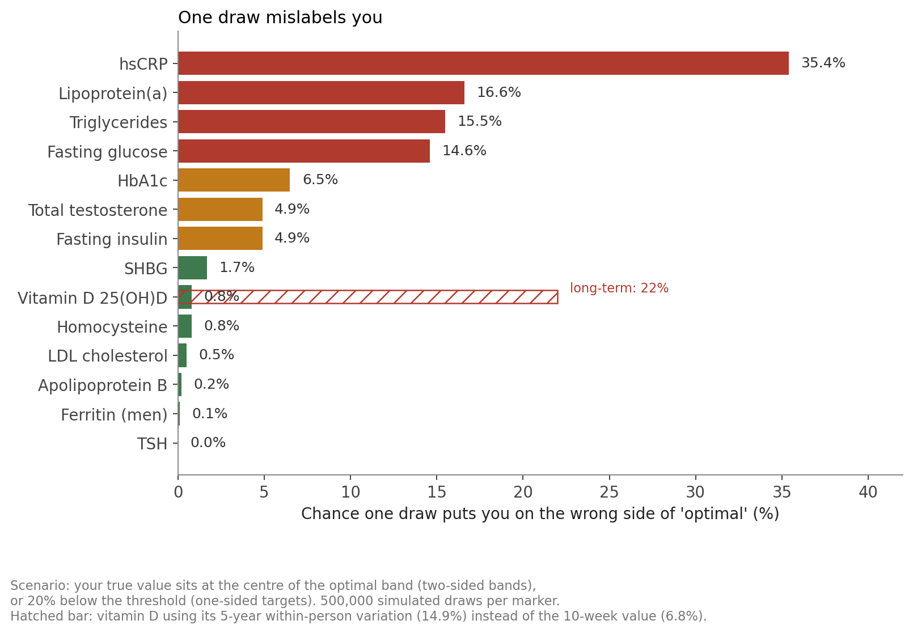
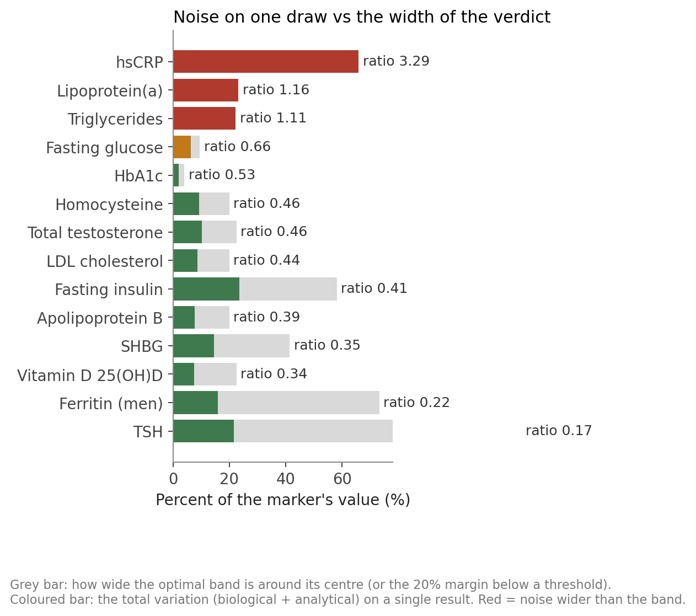
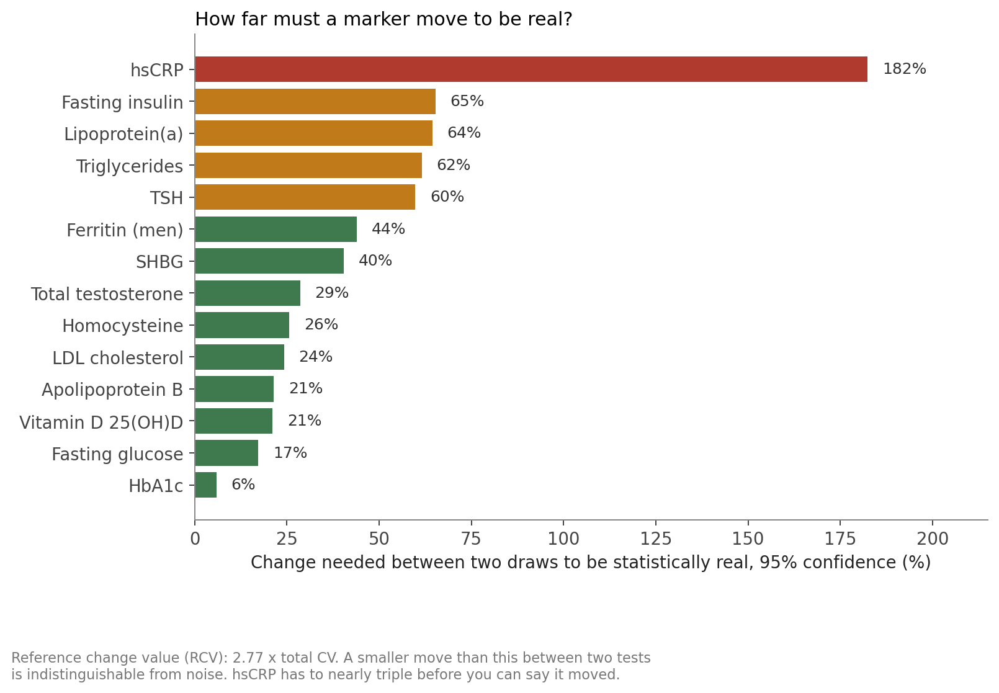

# The Optimal Range Is Narrower Than the Noise

**Build #80 — Musing with Mike — 2026-11-27 — topic: biohacking**

The longevity-testing business sells a simple promise: test, don't guess. Pay $499 a year, get a hundred biomarkers, and find out whether each one sits inside its "optimal" range. The pitch is that the lab range tells you whether you are sick and the optimal range tells you whether you are well.

This build asks whether the test can even deliver that verdict. A blood result is not a measurement of a fixed number. Your body wanders around its own set point from day to day, and the assay adds its own error on top. Laboratory medicine has measured that wandering for decades: every analyte has a within-subject biological variation (CVi) and an analytical variation (CVa), published in the Ricos database and the EFLM Biological Variation Database. The question nobody has asked is what those numbers do to the optimal bands the testing companies sell. If the noise on one draw is wider than the band you are being graded against, the verdict is a coin flip, and no amount of "optimization" fixes it, because the problem is in the measurement, not in you.

## The novelty case, stated before building

Three claims, each checkable, each new as a measurement.

First, nobody has put the biological-variation numbers next to the marketed optimal bands. Lab medicine knows about CVi and reference change values. Biohacking knows the optimal bands. The intersection, marker by marker, has not been computed: the ratio of the noise on one draw to the width of the band it is supposed to place you in, the chance that one draw misclassifies a person who is dead-centre optimal, and how many repeat draws it would take to trust a single verdict. Those are new numbers.

Second, the headline is not "blood tests are noisy," which everyone vaguely knows. It is that the noisiest marker on the panel is also the flagship one. hsCRP is the single most-sold inflammation marker in longevity testing, and its noise is 3.3 times wider than the margin the verdict rests on. A person with a true hsCRP of 0.4, comfortably inside the marketed optimal of under 0.5, gets told they are above optimal about one time in three. And for hsCRP to show a real change between two tests, it has to move 182 percent. That is not a borderline result. It is the core product of the panel failing its own premise.

Third, the ranking is the insight, not the average. Most of the panel is fine. ApoB, ferritin, TSH, homocysteine and LDL are all reliably graded by one draw. The failure is concentrated in a few markers, and it is driven by the ratio, not by raw noise: fasting glucose is one of the quietest markers in the body (CVi 5.6 percent) and still misclassifies 14.6 percent of the time, because its optimal band is only 75 to 90. Vitamin D looks reliable on the 10-week numbers and falls apart on the 5-year numbers. The operator's takeaway is a ranking, not a shrug: trust the verdict for some markers, never trust it for others, and never pay for a panel that grades you on the ones that cannot be graded.

## The headline

**Your hsCRP has to nearly triple before the change is real, and one draw mislabels you a third of the time even when you are optimal.** hsCRP's within-subject variation is 58.9 percent (EFLM meta-analysis; the 2024 PLOS meta-analysis of 60 studies puts the median at 44 percent, so this is not a fringe estimate). Add the assay's own error and a single result carries 65.8 percent total variation. The marketed optimal threshold is under 0.5 mg/L. A person whose true value is 0.4, twenty percent inside optimal, has a 35.4 percent chance of measuring above 0.5 on any given draw. The coin-flip zone, where the verdict is between 25 and 75 percent likely to be right, spans 0.33 to 0.75 mg/L, and the 0.5 threshold sits in the middle of it. The reference change value is 182 percent: your hsCRP has to rise from 0.4 to 1.1, or fall from 0.4 to 0.15, before two results differ by more than noise. To get a 95 percent reliable optimal-or-not verdict from hsCRP alone, you would need to average 28 separate blood draws. At the price of a quarterly testing membership, that is not a testing protocol. It is a confession.



## Finding 1: three markers fail the test, and the panel fails with them

The noise-to-band ratio is the single number that decides whether a verdict works. It is the total variation on one draw divided by the half-width of the optimal band (for one-sided targets, the 20 percent margin below the threshold). Above 1.0, the noise is wider than the band.

| Marker | Optimal band | Total noise on one draw | Noise / band | Chance one draw mislabels you |
|---|---|---|---|---|
| hsCRP | <0.5 mg/L | 65.8% | 3.29 | 35.4% |
| Lipoprotein(a) | <30 mg/dL | 23.3% | 1.16 | 16.6% |
| Triglycerides | <70 mg/dL | 22.2% | 1.11 | 15.5% |
| Fasting glucose | 75-90 mg/dL | 6.3% | 0.66 | 14.6% |
| HbA1c | 4.9-5.3% | 2.1% | 0.53 | 6.5% |
| Fasting insulin | 2-5 uIU/mL | 23.6% | 0.41 | 4.9% |
| Total testosterone | 600-900 ng/dL | 10.3% | 0.46 | 4.9% |
| SHBG | 20-40 nmol/L | 14.6% | 0.35 | 1.7% |
| Vitamin D | 40-60 ng/mL | 7.6% | 0.34 | 0.8% |
| Homocysteine | <8 umol/L | 9.3% | 0.46 | 0.8% |
| LDL cholesterol | <100 mg/dL | 8.7% | 0.44 | 0.5% |
| Apolipoprotein B | <80 mg/dL | 7.7% | 0.39 | 0.2% |
| Ferritin (men) | 50-150 ng/mL | 15.9% | 0.22 | 0.1% |
| TSH | 0.5-2.5 mIU/L | 21.6% | 0.17 | <0.1% |

Three markers sit above a ratio of 1.0, and they are exactly the ones a longevity panel leans on: its inflammation headline, its inherited-risk headline, and its metabolic headline. Put the whole 14-marker panel together and a person who is dead-centre optimal on every single marker still has a 68.5 percent chance that at least one marker comes back mislabelled. The testing companies know the arithmetic in the other direction: their own explainers note that a 20-marker panel flags something 64 percent of the time in a healthy person, by the 1-in-20 logic of reference ranges. This build shows the optimal bands make it worse, because the bands are narrower than the ranges and the noise does not shrink to match.



## Finding 2: the change you are tracking is usually smaller than the noise

The reference change value answers the question every biohacker actually asks after a retest: did my number move because I did something, or because Tuesday is not Monday? For hsCRP the answer is that the move has to be 182 percent. For fasting insulin it is 65 percent, for Lp(a) 64 percent, for triglycerides 62 percent, for TSH 60 percent. A 20 percent improvement in any of those, the kind of change a supplement protocol claims to deliver, is invisible. It is inside the noise band, and no honest reading of the retest can call it a win.

The quiet markers are the ones where retesting works. HbA1c only needs a 5.9 percent move to be real, which is why it is the most trustworthy metabolic marker on the panel. ApoB needs 21 percent, LDL 24 percent, testosterone 29 percent. The practical rule is simple and was already in the lab literature: do not retest a noisy marker to judge an intervention. Retest the quiet ones, and treat the noisy ones as a trend over many draws, never as a verdict from one.



## Finding 3: it is the ratio, not the raw noise, and vitamin D proves it

The most instructive pair in the table is fasting glucose against fasting insulin. Insulin is four times noisier than glucose (CVi 21.1 percent against 5.6 percent), and yet insulin misclassifies less often (4.9 percent against 14.6 percent). The reason is the band: insulin's optimal range is 2 to 5, a 2.5-fold spread, while glucose's is 75 to 90, a 1.2-fold spread. A wide band forgives a noisy marker. A narrow band punishes a quiet one. The same logic explains why TSH, the second-noisiest hormone on the panel at 19.3 percent, is essentially never misclassified: its optimal band is 0.5 to 2.5, a five-fold spread, so the noise fits inside it with room to spare.

Vitamin D is the cautionary case about which variation you use. On the EFLM meta-analysis value, measured over weeks, its CVi is 6.8 percent and a single draw misclassifies only 0.8 percent of the time. But vitamin D is seasonal: the same person's level drifts with sun exposure across the year, and the 5-year within-person variation measured in the PLCO cohort is 14.9 percent. Use that number and the misclassification rate jumps to 22.0 percent, with 3 repeat draws needed instead of 1. The 10-week number is the one the testing companies implicitly rely on when they sell you a winter retest. The 5-year number is the one that describes your actual year. The same trap applies to any marker with a season or a cycle, and testosterone has one too: afternoon levels run 20 to 30 percent lower than morning levels, a systematic swing larger than the whole optimal band's half-width, which is why a testosterone verdict from an afternoon draw is not a verdict at all.

## Finding 4: the business model runs against the measurement

There is a commercial reason the bands are narrow. A narrower band puts more customers outside it, and a customer outside the band is a customer for a protocol, a supplement, or a retest. But the narrower the band, the less the test can place anyone in it. The incentive and the measurability point in opposite directions, and hsCRP is where they collide hardest: the tightest marketed threshold on the panel, under 0.5, attached to the noisiest marker on it.

That does not make the panels worthless. It makes them mispriced. The markers that survive this test, ApoB, HbA1c, ferritin, homocysteine, LDL, are the ones worth paying to track, and they are mostly the cheap, standard ones. The markers that fail, hsCRP above all, are the ones the premium price is built around. The rational purchase is the boring panel plus a trend line, not the hundred-marker dashboard with a red flag on the molecule that cannot be measured precisely enough to flag.

## What to do with this

- **Never act on a single hsCRP.** Repeat it, and repeat it away from illness: a cold can take it from 0.3 to 50. One elevated hsCRP is a data point about last week, not a verdict about your inflammation.
- **Judge interventions on the quiet markers.** HbA1c, ApoB, LDL and ferritin move enough, relative to their noise, for a retest to mean something. Insulin, triglycerides, Lp(a) and hsCRP do not.
- **Keep your own baseline, not the lab's band.** For most of these markers the index of individuality is below 0.6, which is lab medicine's way of saying the population range is a weak guide to you specifically. Your own history beats the printed range, and a five-year trend beats a single "optimal" flag.
- **Standardize the draw.** Same lab, morning, fasted, away from hard training, and for testosterone, before 10am. The systematic effects (time of day, season, a recent workout) are as large as the biological variation this build measures.
- **If you buy a panel, buy it for the trend.** The value is in the series, not the snapshot. One draw is a photograph of a moving target taken through fog. Three draws over a year, same conditions, is a measurement.

## Methods

**Data.** Within-subject (CVi) and between-subject (CVg) biological variation from the Ricos 2014 database (Westgard mirror, 370 analytes parsed from the published table; `src/01_parse_bv.py` verifies every value used here against the parsed table). Two updates: hsCRP uses the EFLM 2021 meta-analysis value of 58.9 percent (Ricos 2014 gave 49.7 percent; a 2024 PLOS meta-analysis of 60 studies gives a median of 44 percent, so 58.9 is the conservative end of the modern range and every conclusion holds at 49.7 too), and vitamin D uses the EFLM 2026 meta-analysis value of 6.8 percent, with a 14.9 percent long-term sensitivity case from the PLCO cohort. "Optimal" bands are the narrower targets marketed by longevity-testing and functional-medicine sources (Longevity Benchmark 2026, The Biological Edge 2025, BioAccelera 2026; full citations in `data/sources.md`).

**Computation.** Analytical variation is set to the desirable imprecision of 0.5 x CVi (Fraser). Total variation on one result is sqrt(CVi^2 + CVa^2). The reference change value is 2.77 x total CV. The index of individuality is CVi / CVg. Misclassification is Monte Carlo: 500,000 lognormal draws per marker (seed 20261127), with the true value at the geometric midpoint of a two-sided band, or 20 percent below the threshold for one-sided targets. Repeats needed is the smallest n such that the mean of n draws is classified correctly with at least 95 percent probability in the same scenario, verified by simulation. The panel statistic assumes independent misclassification across markers. All formulas are checked in `src/04_checks.py`, which passes 10 checks including an analytic cross-check of the hsCRP headline.

**Limitations.** CVi estimates come mostly from healthy young adults in short studies, so they understate variation in older or unwell people; the misclassification rates here are best cases. Analytical variation is assumed at the desirable level; direct-to-consumer finger-prick assays are often worse, which would push every number up. The "optimal" bands are marketed targets, not clinical guidelines, and several (TSH's 2.5 ceiling especially) are genuinely disputed among specialists; the point of this build is not to endorse the bands but to test whether they can be measured at all. The panel statistic assumes independence; markers that move together (glucose and insulin, for example) would make the true panel failure rate somewhat lower than 68.5 percent, and somewhat higher for the markers that fail independently.

## Reproduce

```bash
python3 src/01_parse_bv.py   # parse the Ricos table, verify marker values
python3 src/02_analysis.py   # Monte Carlo + RCV + repeats -> output/results.json
python3 src/03_charts.py     # charts
python3 src/04_checks.py     # 10 sanity checks
```

Requirements: `pandas`, `numpy`, `scipy`, `matplotlib` (see `requirements.txt`).

## Sources

Full citations in `data/sources.md`. Key ones: Ricos et al., Scand J Clin Lab Invest 1999;59:491-500 (database updated 2014); EFLM Biological Variation Database, https://biologicalvariation.eu/; Gough et al., PLoS ONE 2024;19(11):e0304961; Cavalier et al., Nutrients 2021;13(2):431; EuBIVAS testosterone data, Clin Chim Acta 2024; Longevity Benchmark, "Normal Vs Optimal Lab Ranges (2026)"; The Biological Edge, "The Optimal Male Bloodwork Panel (2025)"; BioAccelera, "The Essential Bloodwork Guide."
