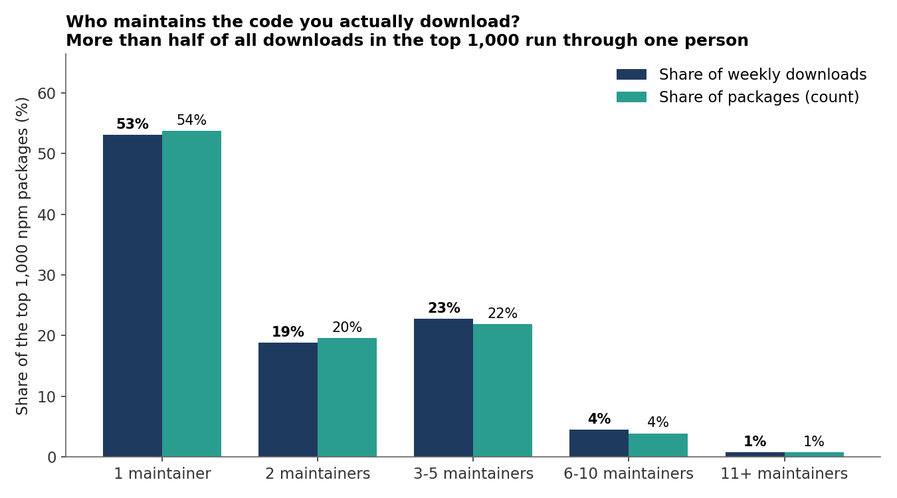
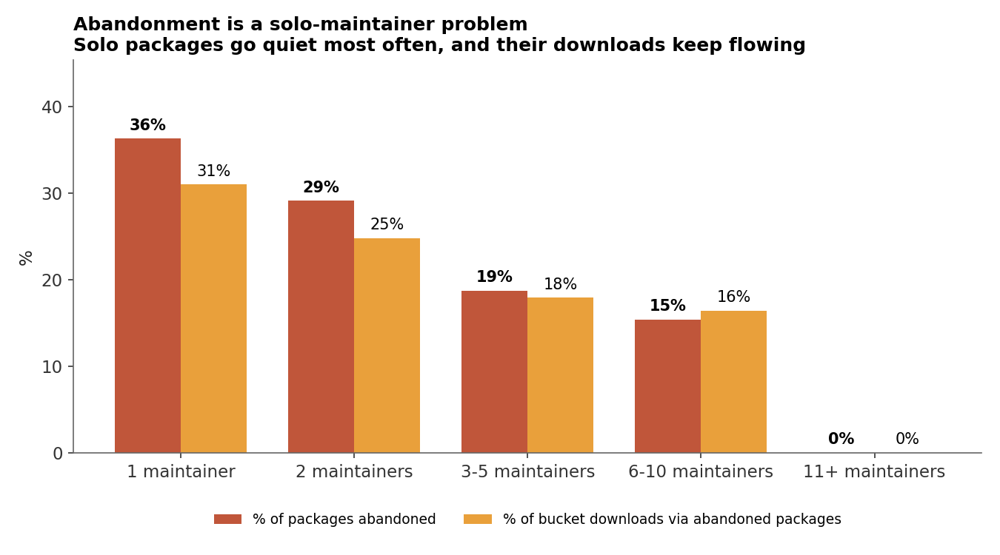
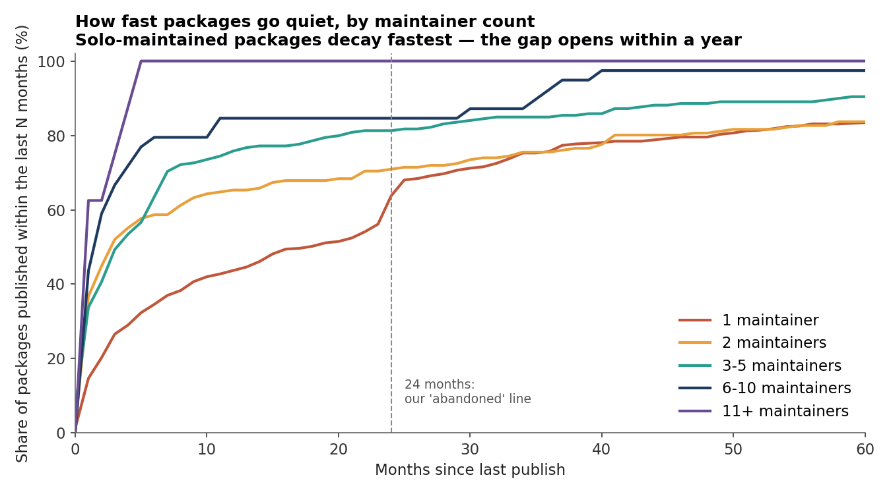
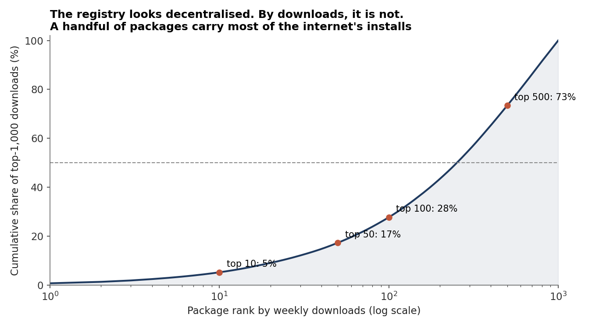
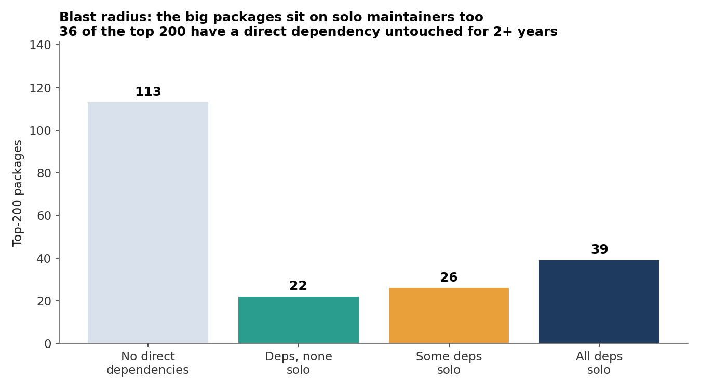

# The One-Person Internet

**Build #81 — 2026-11-28 — tech-industry — "Musing with Mike"**

A download-weighted census of who maintains npm, the package registry every JavaScript app on earth installs from.

## The headline

**53.1% of all downloads in npm's top 1,000 packages flow through packages maintained by a single person.**

538 of the top 1,000 packages have exactly one maintainer. The median solo-maintained package is downloaded 117 million times a week. The internet does not run on institutions. It runs on individuals, mostly unpaid, mostly alone.

Everyone in tech knows the left-pad story: one guy deleted 11 lines in 2016 and broke builds worldwide. That is an anecdote. This is the measurement. Weighted by what people actually download, more than half the JavaScript ecosystem sits in one person's hands.



## The zombie core

**25.9% of top-1,000 downloads flow through packages nobody has published in 24+ months.** 299 of the top 1,000 are abandoned by that line, including some of the most-installed code ever written:

| package | weekly downloads | last publish | maintainers |
|---|---|---|---|
| ms | 727M | Dec 2020 | 6 |
| json-schema-traverse | 464M | Dec 2020 | 1 |
| safe-buffer | 451M | May 2020 | 2 |
| path-key | 407M | Apr 2021 | 1 |
| has-flag | 398M | Jul 2021 | 1 |
| isarray | 347M | Jul 2019 | 1 |
| cross-spawn | 343M | Nov 2024 | 1 |

**16.5% of all top-1,000 downloads flow through packages that are both solo-maintained and untouched for 2+ years.**

One important caveat: many of these are finished, not broken. A 20-line utility can be done. The risk is not rot, it is that nobody is watching. A compromised publish to any of them ships silently into hundreds of millions of installs a week. That is the xz attack surface, measured.



## Abandonment is a solo-maintainer problem

The chance a package has gone quiet falls monotonically as maintainers are added:

| maintainers | % abandoned | % of bucket downloads abandoned |
|---|---|---|
| 1 | 36.3% | 31.0% |
| 2 | 29.1% | 24.8% |
| 3-5 | 18.7% | 17.9% |
| 6-10 | 15.4% | 16.4% |
| 11+ | 0.0% | 0.0% |

A logistic regression on the top 1,000 (McFadden R² 0.077) says each additional maintainer cuts the odds of abandonment by 21% (odds ratio 0.79, SE 0.06). Org-owned scoped packages are far safer (OR 0.23). At median downloads, a solo package has a 41% predicted chance of being abandoned, against 21% with five maintainers. Honest limit: the model is explanatory, not predictive. Its accuracy (70.1%) equals the majority-class baseline, so abandonment stays mostly idiosyncratic. Maintainer count moves the odds, it does not decide them.



## Concentration: the registry looks decentralised. By downloads, it is not.

Of top-1,000 downloads: top 10 packages 5.2%, top 50 17.3%, top 100 27.7%, **top 250 49.7%**, top 500 73.4%. The top 250 packages carry half of everything. That concentration is what makes the solo-maintainer finding matter: the risk is not spread across millions of packages, it is packed into a few hundred, and most of those have one author.



## Blast radius: even the biggest packages sit on solo maintainers

Of the top 200 packages' 264 direct dependency edges, **56.9% point at single-maintainer packages** and 25.2% point at abandoned ones. 65 of the top 200 (32.5%) have at least one solo-maintained direct dependency; 36 (18%) have at least one abandoned one. 39 of the top 200 depend entirely on solo maintainers, including side-channel (5/5 deps solo), browserslist (5/5), ajv (3/3) and resolve (4/4). And 113 of the top 200 have no direct dependencies at all, which is itself the point: the core is tiny utilities, and tiny utilities have one author.



## So what

npm is a two-sided marketplace whose supply side is almost entirely unpaid individuals, and its most-used inventory is the least watched. Three things this prices in:

1. **If you run a platform, your supply-chain risk is not your direct deps, it is the solo maintainers two levels down.** Audit by maintainer count, not just by CVE.
2. **The cheapest insurance in software is paying the maintainer of the 20-line package your whole stack stands on.** A $500/month sponsorship to the right 50 people buys more security than most tooling budgets.
3. **"Abandoned" is the wrong word for most of the zombie core.** They are finished. The fix is not more publishes, it is more eyes: shared maintenance, org adoption, or a bus-factor floor for the top 250.

## Method

Pool built 2026-11-28 from the npm registry search API: 131 broad queries, 27,315 unique packages, each with weekly downloads, dependent count, last publish date and maintainer list. The search API ranks by text relevance, not downloads, so we took full 250-result pages per query, deduped, and ranked by the weekly-downloads figure the payload itself carries. Validated against 100+ known giants; every missing one recovered by exact lookup, and every top-200 direct dependency resolved the same way. Top 1,000 ranked by weekly downloads (161.6B/week total). Dependency lists from abbreviated registry metadata for the top 200. Abandoned = no publish in 730 days. Maintainer count = users with publish rights on the package.

## Limitations

- **Coverage:** the query pool is broad but not exhaustive. Two cross-checks (the validation list and the top-200 dependency closure) caught 21 large packages the queries missed, including `@babel/parser` (379M/week) and `acorn` (328M/week); after adding them the headline shares moved by less than 0.5 points, so the results are stable to the residual coverage gap.
- **Weekly downloads are registry-reported** and include CI and mirror traffic, so absolute volumes are inflated; shares across packages are the meaningful quantity.
- **"Abandoned" is a publish-date proxy**, not a judgment that the code is broken. Many top packages are feature-complete.
- **Maintainer count is publish rights**, not active contributors. Some solo-maintainer packages have many contributors.
- Two dependency entries (`@jest/react-is-18`, `@jest/react-is-19`) 404 on the registry and could not be resolved; they are 2 of 264 edges.

## Reproduce

```bash
python3 src/01_fetch.py        # build the pool (takes ~4 min; proxy-safe retries in 01b_repair.py)
python3 src/01c_resolve_deps.py
python3 src/02_analysis.py    # -> output/findings.json
python3 src/03_charts.py      # -> charts/*.png
python3 src/04_checks.py      # independent verification, exit 0 = pass
```

## Files

- `src/01_fetch.py` — pool construction from the npm search API
- `src/01b_repair.py` — retry pass for proxy failures (fresh connection per call + backoff)
- `src/01c_resolve_deps.py` — resolves top-200 direct deps the pool missed
- `src/02_analysis.py` — all metrics + abandonment logistic regression
- `src/03_charts.py` — the five charts
- `src/04_checks.py` — independent verification of every headline number
- `data/packages.csv` — the 27,315-package pool (name, downloads, dependents, last publish, maintainers)
- `data/search_raw.jsonl.gz` — raw search payloads
- `data/deps_top200.json` — direct dependency lists for the top 200
- `data/fetch_log.txt` — fetch log including the proxy-failure repair pass
- `output/findings.json` / `output/findings.txt` — full results

## Sources

- npm registry search API (`registry.npmjs.org/-/v1/search`), abbreviated package metadata (`Accept: application/vnd.npm.install-v1+json`), npm downloads API (`api.npmjs.org`). All fetched 2026-11-28, no auth required.
